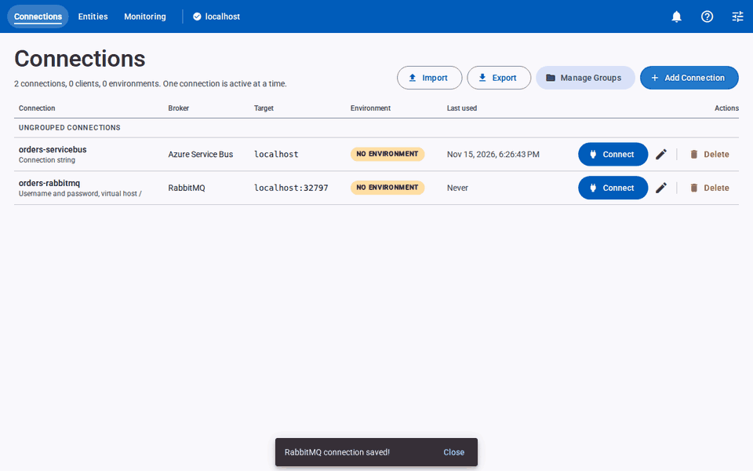

# Messaging Explorer

[](https://github.com/vitorafgomes/messaging-explorer/actions/workflows/ci.yml)
[](https://github.com/vitorafgomes/messaging-explorer/releases/latest)
[](LICENSE)

A free, open-source desktop app to explore and manage message brokers: **Azure Service Bus** and **RabbitMQ**. It runs on Windows, macOS and Linux.

Browse queues, topics, subscriptions and exchanges, read the messages in them, send new ones, and deal with the dead-letter queue: resubmit, move or delete what is stuck there. An AI assistant can do the same through the app, with you deciding what it sees and approving what it changes.



**Website:** https://vitorafgomes.github.io/messaging-explorer/

## Contents

- [Download](#download)
- [What it does](#what-it-does)
- [Use it from an AI assistant](#use-it-from-an-ai-assistant)
- [Connect to a broker](#connect-to-a-broker)
- [Before you point it at production](#before-you-point-it-at-production)
- [Develop](#develop)
- [Project layout](#project-layout)
- [Contributing](#contributing)

## Download

Get the latest version from the [releases page](https://github.com/vitorafgomes/messaging-explorer/releases/latest).

| System | File | Updates itself |
|---|---|---|
| Windows | `Messaging-Explorer-Setup-<version>-x64.exe` | Yes |
| Windows, no install | `Messaging-Explorer-Portable-<version>-x64.exe` | No |
| macOS, Apple silicon | `Messaging-Explorer-<version>-arm64.dmg` | No |
| macOS, Intel | `Messaging-Explorer-<version>-x64.dmg` | No |
| Linux | `Messaging-Explorer-x86_64.AppImage` | Yes |
| Linux, Debian and Ubuntu | `Messaging-Explorer-<version>-amd64.deb` | Yes, it asks for the administrator password |

Nothing else needs to be installed: each package carries the .NET runtime its local API uses.

**Coming from 2.5.1 or earlier on the deb?** Install 3.0.0 by hand once (`sudo apt install ./Messaging-Explorer-<version>-amd64.deb`). Those versions cannot install a deb by themselves; from 3.0.0 on the app does it.

The builds are not code signed, so the system asks before the first start:

- **Windows:** SmartScreen shows "Windows protected your PC". Choose **More info**, then **Run anyway**.
- **macOS:** open the app from Finder with a right click, then **Open**. Because the build is unsigned, macOS cannot install an update by itself: download the new version from the releases page.

The app looks for a new version a few seconds after it starts and every four hours. It only tells you: nothing downloads until you agree to the version shown in Settings. On Windows (the installer) and the Linux AppImage the version you agreed to installs the next time you quit, or at once with Restart to Update. The deb installs it only with Restart to Update, and asks for the administrator password of the computer. On macOS and the portable exe it links the release to download by hand.

## What it does

**Both brokers**

- Keep several connections, grouped by client and environment, and export or import them.
- List entities with their message counts.
- Peek messages without removing them, search them by text or regular expression, and compare two messages.
- Send a message with its properties, from scratch or from a saved template; import messages from a JSON or CSV file.
- Export messages to JSON, CSV or Excel.
- Light and dark themes.
- Stable and Beta update channels, and a list of versions to install from.
- A Logs screen, shown in Developer mode.

**Azure Service Bus**

- Queues, topics and subscriptions with their configuration, status and rules.
- Create, edit and delete queues, topics, subscriptions and rules.
- Dead-letter queues: resubmit, move to another queue or delete, one message or many, with progress and cancel.
- An automatic resubmit of a whole dead-letter queue, with pause, stop and a report.
- Schedule a message for later and set its time to live.
- Sessions on session-enabled subscriptions.
- Sign in with Microsoft, a connection string, a service principal or the Azure CLI session.

**RabbitMQ**

- Exchanges, queues and bindings, read through the management plugin.
- Peek, send, resubmit, move, delete and purge the messages of a queue.
- Recognises the common topologies (work queue, publish and subscribe, routing, topics, RPC, headers).

See the [releases](https://github.com/vitorafgomes/messaging-explorer/releases) for what each version added; the [changelog](CHANGELOG.md) covers versions up to 2.4.4.

## Use it from an AI assistant

The app carries an [MCP](https://modelcontextprotocol.io/) server, so an assistant such as Claude Code can list entities, read messages, send them and act on them through the app. It is off until you turn it on in **Settings**, under **MCP server**.

- **You choose what it sees.** Only the connections you offer exist for the assistant, each at its own level: read; read and send; or read, send and remove.
- **It asks before it changes anything.** A send, a move, a delete or a purge shows a question in the app, and a delete or a purge asks you to type the name. A production connection asks before every operation. Only a local test broker can be set not to ask before a send.
- **It answers on this computer only,** and only while the app is open, to a token you create in Settings and see once.
- **What it reads leaves your computer.** The names of entities, the counts and the bodies of the messages it reads go to the assistant and to the company that runs it. A connection string, a password or a key is never given to it.

Settings shows the configuration to paste into the assistant and a list of what it did.

## Connect to a broker

Open **Connections**, add a connection and choose **Connect**.

| Broker | What you need |
|---|---|
| Azure Service Bus | Either a connection string, or the namespace host (`<name>.servicebus.windows.net`) with one of: Microsoft sign-in, a service principal (tenant, client id, secret), or a logged-in Azure CLI. The identity needs a Service Bus data role on the namespace. |
| RabbitMQ | Host, AMQP port (5672), user, password, virtual host, and the management port (15672). The management plugin must be enabled. |

## Before you point it at production

This tool reads and changes real messages. Know these things first.

- **Moving messages is at-least-once.** Resubmit and move send the message to its destination first and remove it from the source after. If the removal fails, the message exists in both places; the app reports it as a possible duplicate and does not send it again. Consumers should tolerate a duplicate.
- **Resubmitting from a subscription publishes to its topic.** Every subscription whose rules match receives the message again, not only the one you resubmitted from.
- **On RabbitMQ a bulk delete, resubmit or move names a message by its position in the queue.** If another client removes a message between the moment you read the list and the moment you act, the operation acts on whichever message is at that position. The app refuses a queue that has a consumer; avoid these operations on a queue something else is reading.
- **Saved connections are stored on your disk in plain text,** secrets included, in the app's data folder (on Linux `~/.config/messaging-explorer/data`). Exporting connections masks the secrets unless you ask to include them.
- **Nothing leaves your machine except the calls to your broker, unless you turn the MCP server on.** The app starts a local API that listens on `127.0.0.1` only and accepts requests only with a key generated at each start. The update check contacts GitHub. With the MCP server on, what an assistant reads through it goes to that assistant; see [Use it from an AI assistant](#use-it-from-an-ai-assistant).

Found a security problem? Please report it privately through [GitHub security advisories](https://github.com/vitorafgomes/messaging-explorer/security/advisories/new) instead of a public issue.

## Develop

**You need:** the [.NET 10 SDK](https://dotnet.microsoft.com/download), [Node.js 22](https://nodejs.org/) or newer with npm, and Docker for the integration tests.

```bash
cd web-app
npm install
```

**Run it**

```bash
npm run start:all       # API on port 5917 and the web app on http://localhost:4297
npm run electron:dev    # the desktop app, in development mode
```

`npm run start:api` and `npm start` run the two halves separately.

**Test it**

```bash
# from the repository root
dotnet build ServiceBusExplorer.slnx
dotnet test src/ServiceBusExplorer.Core.Tests
dotnet test src/ServiceBusExplorer.Api.Tests
dotnet test src/ServiceBusExplorer.IntegrationTests   # starts RabbitMQ and the Service Bus emulator in Docker

# from web-app/
npm test -- --watch=false
npm run test:electron
npm run build
```

The same commands run in CI on every pull request.

**Brokers to try it against.** `dev/brokers/` starts a RabbitMQ and an Azure Service Bus emulator on your machine with sample queues and topics; its README has the connection values.

**Package the desktop app**

```bash
npm run electron:build:linux    # or :win, :mac
```

The packages are written to `web-app/release/`. Published releases are built by the release workflow: Run workflow on `main` computes the next version from the commits and creates the tag and the release; pushing a `v<version>` tag releases that tag.

## Project layout

```
src/
  ServiceBusExplorer.Core/              providers for each broker, connection storage, metrics
  ServiceBusExplorer.Api/               the local HTTP API the app talks to
  ServiceBusExplorer.Core.Tests/        unit tests
  ServiceBusExplorer.Api.Tests/         API tests
  ServiceBusExplorer.IntegrationTests/  tests against real brokers in containers
web-app/
  src/                                  the Angular app
  electron/                             the desktop shell: starts the API, updates, tray
dev/brokers/                            local brokers in Docker for manual testing
docs/                                   the project website
context/                                  the project's documentation
```

The documentation lives in [`context/`](context/index.md): how each part works, the rules the code must keep, the decisions taken and what is planned. The screens are drawn in the [UI prototype](context/prototypes/web-app/README.md).

To add another broker, start from [`docs/ADDING_PROVIDERS.md`](docs/ADDING_PROVIDERS.md) and the [provider boundaries](context/pages/invariants/provider-boundaries.md) page.

## Contributing

Issues and pull requests are welcome; see [CONTRIBUTING.md](.github/CONTRIBUTING.md) and the [Code of Conduct](.github/CODE_OF_CONDUCT.md). For anything beyond a small fix, please open an issue first so the approach can be agreed before you write it.

A change needs a test that fails without it, a clean build and the test suites green. The [pull request template](.github/PULL_REQUEST_TEMPLATE.md) lists what a reviewer will look for, including the three safety checks that matter for a tool pointed at production brokers.

## License

[MIT](LICENSE) © Vitor Gomes
