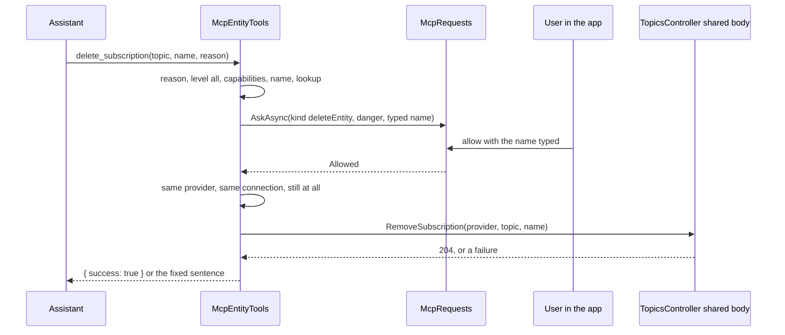

# Api: MCP server, administering entities

One topic of [[pages/services/api|Api]]; the map lists the others. The level `all`, the `danger` and `typed` fields and the typed word of an answer are on [[pages/services/api/mcp-moving-and-removing]]; the requests and the levels below on [[pages/services/api/mcp-asking-and-sending]].

The fourth phase of [[pages/decisions/0008-an-mcp-server-inside-the-local-api]]: an assistant creates, changes and deletes queues, topics, subscriptions and subscription rules, each only after the user's answer in the app.

## Contract

- **Twelve tools** on `/mcp`, no new route (`src/ServiceBusExplorer.Api/Mcp/McpEntityTools.cs#McpEntityTools`): `create_`, `update_` and `delete_` of `queue` and `topic` (`name`), of `subscription` (`topic`, `name`) and of `rule` (`topic`, `subscription`, `name`); the creates and updates take `options`, the rule tools `rule`. Each takes `reason`, optional in the schema and refused by the tool when missing or blank (`src/ServiceBusExplorer.Api/Mcp/McpToolCalls.cs#RequireReason`). None is read-only or idempotent; the four deletes are destructive.
- **The arguments are the routes' models**: `options` binds `QueueCreateBody`, `TopicCreateBody`, `SubscriptionCreateBody` (`src/ServiceBusExplorer.Api/Controllers/EntityAdministrationRequests.cs#QueueCreateBody`) or `QueueUpdateOptions`, `TopicUpdateOptions`, `SubscriptionUpdateOptions` (`src/ServiceBusExplorer.Core/Abstractions/IMessagingProvider.cs#QueueUpdateOptions`); `rule` binds `src/ServiceBusExplorer.Api/Controllers/EntityAdministrationRequests.cs#SubscriptionRuleRequest`. A duration is written `d.hh:mm:ss`, as the routes take it. The status is a field of the update models, so `update_*` enables and disables; there is no status route.
- **The level all.** Below it each tool answers `src/ServiceBusExplorer.Api/Mcp/McpEntityTools.cs#LevelRefused` without asking, recorded `Refused: not offered for changing entities`.
- **Three request kinds**: `createEntity` and `updateEntity`, not dangerous, no typed word; `deleteEntity`, dangerous, typed `{ label: "Type the <queue|topic|subscription|rule> name to allow it", word: <the name> }`.
- **`supports.entities`** is true in the state of `GET api/mcp` (`src/ServiceBusExplorer.Api/Controllers/McpController.cs#McpSupports`).
- **What each answers** is what its route answers: the queue, topic or subscription as read after an update, the rule as the provider answered it. A create of a queue, topic or subscription and every delete, whose route answers 201 or 204 with no body, answer `src/ServiceBusExplorer.Api/Mcp/McpEntityTools.cs#Success`, `{ "success": true }`. A refusal is the route's fixed sentence ([[pages/services/api/routes-entities-and-messages]]), never the broker's text.

## How it works

1. **Before anybody is asked** (`src/ServiceBusExplorer.Api/Mcp/McpEntityTools.cs#PrepareAsync`), in order: a reason; the connection active and offered at `all`; the capabilities, read from flags that exist and mapped to the routes' sentences: a topic, a subscription or a rule needs `SupportsTopics`, a subscription or a rule `SupportsSubscriptions`, a rule `SupportsSubscriptionRules` (`src/ServiceBusExplorer.Api/Controllers/EntityAdministrationResults.cs#RulesNotSupported`), an update of a queue, topic or subscription `SupportsEntityUpdate` (`src/ServiceBusExplorer.Api/Controllers/EntityAdministrationResults.cs#UpdateNotSupported`); a blank name, refused as the create routes refuse it (`src/ServiceBusExplorer.Api/Controllers/EntityAdministrationResults.cs#NameRequired`); a rule body that names another rule (`src/ServiceBusExplorer.Api/Controllers/TopicsController.cs#RuleRenamed`). Then one lookup, only where the request needs it: the topic of a subscription to create or change, the subscription of a rule, and the queue, topic or subscription to delete, whose counts the request shows. One that does not exist answers the route's not-found sentence; one that throws answers the fixed sentence of a failure. Nobody is asked and nothing is done.
2. **The user is always asked**, on a connection marked never asked too. The request names the entity, the connection, where it goes, each option set and the reason; a value longer than `src/ServiceBusExplorer.Api/Mcp/McpEntityTools.cs#MaxFactLength` is cut with "...". No option of these models holds a secret.
3. **After the allow** the call goes on only while the same provider and connection are active and still offered at `all` (`src/ServiceBusExplorer.Api/Mcp/McpToolCalls.cs#AskAsync`).
4. **The route's own body runs**, moved into one internal method that the route calls too, with unchanged answers: `src/ServiceBusExplorer.Api/Controllers/QueuesController.cs#Add`, `src/ServiceBusExplorer.Api/Controllers/QueuesController.cs#Change`, `src/ServiceBusExplorer.Api/Controllers/QueuesController.cs#Remove`; `src/ServiceBusExplorer.Api/Controllers/TopicsController.cs#Add`, `src/ServiceBusExplorer.Api/Controllers/TopicsController.cs#Change`, `src/ServiceBusExplorer.Api/Controllers/TopicsController.cs#Remove`; `src/ServiceBusExplorer.Api/Controllers/TopicsController.cs#AddSubscription`, `src/ServiceBusExplorer.Api/Controllers/TopicsController.cs#ChangeSubscription`, `src/ServiceBusExplorer.Api/Controllers/TopicsController.cs#RemoveSubscription`; `src/ServiceBusExplorer.Api/Controllers/TopicsController.cs#AddRule`, `src/ServiceBusExplorer.Api/Controllers/TopicsController.cs#ChangeRule`, `src/ServiceBusExplorer.Api/Controllers/TopicsController.cs#RemoveRule`. Nothing is retried.
5. **The record** says "Create the queue billing", "Change the topic events", "Delete the rule $Default"; where, the connection name for a queue or a topic, "events on <connection>" for a subscription, "events / audit on <connection>" for a rule; and how it ended: "Created, allowed by you", "Changed, allowed by you", "Deleted, allowed by you", "Failed, allowed by you", "Denied by you", "Denied: no answer in two minutes", or "Refused: ..." for each check. Names are cut at 100 characters.

### The words of a request

| | Title | Facts | Note | Allow |
|---|---|---|---|---|
| create | `<assistant> asks to create the <kind> <name>` | On; In; one per option set, as the model names it, or Options "The broker's defaults"; for a rule Filter and, when set, sqlAction; It said why | "A new `<kind>` is created on the broker." | Create the `<kind>` |
| update | `... asks to change the <kind> <name>` | On; In; "Sets `<field>`" per field given, for a rule "Sets filter"; It said why | "Only the settings listed are changed. A setting the broker does not allow to change is refused by the broker." | Change the `<kind>` |
| delete | `... asks to delete the <kind> <name>` | On; In; Holds, for a queue or a subscription "`<n>` active and `<m>` dead-letter messages counted now" or "This broker gives no count", for a topic "`<n>` subscriptions", none for a rule; It said why | one per kind, saying what is removed and that it cannot be brought back | Delete the `<kind>` |

"In" is "the topic `<topic>`" for a subscription and "`<topic>` / `<subscription>`" for a rule. The filter is the SQL expression, `True` or `False`, or `Correlation` followed by its fields as JSON.

## Sharp edges

- **A guard added to a shared body changes the route too.** A check meant for the tools belongs in `src/ServiceBusExplorer.Api/Mcp/McpEntityTools.cs#PrepareAsync`.
- **Only the names are validated before asking.** The limits of an option are the provider's (`EntityConfigurationValidator` is internal to the Azure provider and Azure only; RabbitMQ takes values Azure would refuse), so an option out of range is asked about and then refused with the route's 400 sentence, recorded "Failed, allowed by you".
- **A delete of a queue, topic or subscription has no catch in its route**: a failure reaches the error handler of the application, and in the tool `src/ServiceBusExplorer.Api/Mcp/McpToolCalls.cs#RunAsync`. Both answer `src/ServiceBusExplorer.Api/Controllers/EntityAdministrationResults.cs#Unhandled`, except an entity gone between the lookup and the delete, which the tool answers "The entity was not found." and the route the constant 500.
- **The count a topic delete shows** is the provider's `SubscriptionCount` of the topic read (`src/ServiceBusExplorer.Core/Abstractions/ITopicEntity.cs#SubscriptionCount`); RabbitMQ counts the bindings of the exchange.

## Tests

`src/ServiceBusExplorer.Api.Tests/McpEntityToolTests.cs`, through `/mcp` on a test server with the stub provider of `src/ServiceBusExplorer.Api.Tests/McpToolTests.cs#Broker`, which records every create, update and delete and can make them throw:

- `#Each_tool_waits_for_the_user_and_calls_its_route_path_once_only_after_the_allow`, `#The_options_and_the_rule_reach_the_provider_as_the_route_hands_them`, `#A_denial_a_cancellation_while_waiting_and_no_answer_in_time_each_do_nothing`.
- `#A_provider_call_that_fails_answers_the_route_fixed_sentence_records_it_and_retries_nothing` (a broker exception, a timeout, a refusal as not authorised, for each tool), `#A_lookup_before_asking_that_fails_answers_the_fixed_sentence_asks_nobody_and_does_nothing`.
- `#Below_the_level_all_each_tool_is_refused_without_asking`, `#Each_tool_asks_even_on_a_local_broker_the_user_marked_never_asked`, `#A_capability_the_provider_does_not_declare_is_refused_with_the_route_sentence_before_anybody_is_asked`, `#A_name_or_a_reason_the_route_or_the_tool_would_refuse_is_refused_before_anybody_is_asked`, `#An_entity_or_its_parent_that_does_not_exist_is_refused_before_anybody_is_asked`.
- `#An_allow_of_a_delete_needs_the_name_typed_exactly_and_a_wrong_word_keeps_the_request_waiting`, `#An_allow_after_the_connection_was_lowered_below_all_does_nothing`, `#The_request_says_what_where_and_why_in_fixed_words_with_no_secret`, `#A_long_value_is_cut_at_200_with_dots_a_name_at_100_in_the_record_and_a_broker_without_counts_says_so`, `#Each_tool_is_listed_as_not_read_only_and_not_idempotent_and_destructive_only_for_a_delete`.
- `src/ServiceBusExplorer.Api.Tests/McpSettingsRouteTests.cs#The_state_starts_off_with_no_token_nothing_offered_and_the_logs_not_allowed_and_sits_behind_the_api_key` reads `supports.entities`.

The routes keep their tests untouched: `src/ServiceBusExplorer.Api.Tests/EntityAdministrationTests.cs`, `src/ServiceBusExplorer.Api.Tests/EntityNameRoutingTests.cs`, `src/ServiceBusExplorer.Api.Tests/ErrorBodyTests.cs`, `src/ServiceBusExplorer.Api.Tests/EntityJsonContractTests.cs`.
