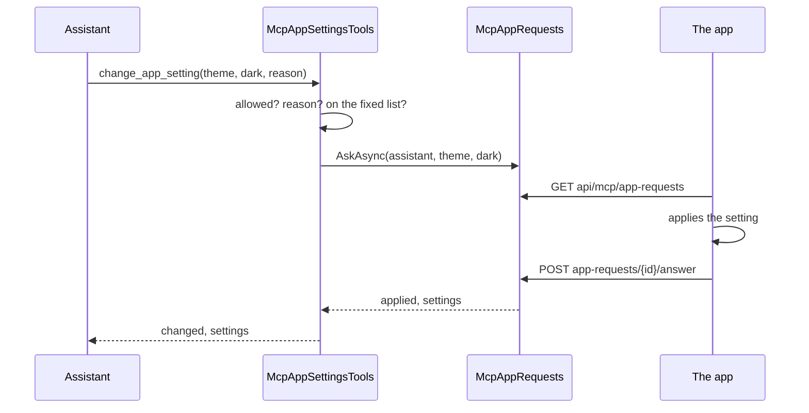

# Api: MCP server, the settings of the app

One topic of [[pages/services/api|Api]]; the map lists the others. The gate of `/mcp`, the token and the record are on [[pages/services/api/mcp-server]]; the requests that wait for the user on [[pages/services/api/mcp-asking-and-sending]].

The paragraph "The settings of the app" of [[pages/decisions/0008-an-mcp-server-inside-the-local-api]]: an assistant reads and changes the theme, Developer mode and the update channel, when the user allowed it in Settings. These settings live in the screen and the desktop shell, not in the API, so a tool hands each call to the app and waits for its answer. The user is not asked per change: the choice in Settings is the consent, and the record shows every call.

## Contract

- **The choice.** `McpState.appSettingsAllowed`, false by default, kept in `mcp-settings.json` as `AppSettingsAllowed` (`src/ServiceBusExplorer.Api/Mcp/McpSettingsStore.cs#SetAppSettingsAllowed`). `supports.appSettings` is true (`src/ServiceBusExplorer.Api/Controllers/McpController.cs#McpSupports`).
- **Three routes**, behind the `X-Api-Key` like every `api/` route; the MCP token opens none of them (`src/ServiceBusExplorer.Api/Controllers/McpController.cs#McpController`):
  - `PUT api/mcp/app-settings` `{ allowed }` answers the state; a body without `allowed` answers 400 `{ message }` (`src/ServiceBusExplorer.Api/Controllers/McpController.cs#SetAppSettingsAllowed`).
  - `GET api/mcp/app-requests` answers what waits for the app, oldest first: `{ id, time, assistant, setting, value }` (`src/ServiceBusExplorer.Api/Mcp/McpAppSettings.cs#McpAppRequest`). `setting` is `theme`, `developerMode` or `updateChannel`, or null when the app only reports its settings; `value` is null then.
  - `POST api/mcp/app-requests/{id}/answer` `{ applied, code, settings: { theme, developerMode, updateChannel } }` answers 204 (`src/ServiceBusExplorer.Api/Controllers/McpController.cs#AnswerAppRequest`). `applied` and `settings` are required; `code` is null, `desktopOnly` or `failed`; `theme` is `system`, `light` or `dark`; `developerMode` a boolean; `updateChannel` `latest`, `beta` or null, the web build that has no updates (`src/ServiceBusExplorer.Api/Mcp/McpAppSettings.cs#IsValid`). Anything else answers 400 `{ message: "The answer is not valid." }` and the request keeps waiting; a value of the wrong JSON type is refused by the model binding with its own 400 body. A request not waiting answers 404 `{ message: "This request is no longer waiting." }`.
- **Two tools** on `/mcp` (`src/ServiceBusExplorer.Api/Mcp/McpAppSettings.cs#McpAppSettingsTools`). Neither needs a connection, like `read_logs`; both are refused with `src/ServiceBusExplorer.Api/Mcp/McpAppSettings.cs#NotAllowed` while the choice is off, before anything is handed to the app.
  - `read_app_settings()`, read only, answers `{ settings: { theme, developerMode, updateChannel } }` as the app reported them.
  - `change_app_setting(setting, value, reason)`, not read only, not destructive, idempotent. `reason` is optional in the schema and refused by the tool when missing or blank (`src/ServiceBusExplorer.Api/Mcp/McpToolCalls.cs#RequireReason`); it is not handed to the app. Answers `{ changed: { setting, value }, settings }`.
- **The fixed list** (`src/ServiceBusExplorer.Api/Mcp/McpAppSettings.cs#Changeable`): `theme` `system|light|dark`, `developerMode` `on|off`, `updateChannel` `latest|beta`, matched exactly, letter case included. Another setting is refused with `src/ServiceBusExplorer.Api/Mcp/McpAppSettings.cs#NotASetting`, another value with "This value is not valid for <setting>. Valid: <values>.". So no request can name the MCP group, the token, a level, the logs choice or this choice, clearing the data or an update.
- **The answers of a failure**: no answer in the wait, `src/ServiceBusExplorer.Api/Mcp/McpAppSettings.cs#NoAnswer`; `applied` false with `desktopOnly`, `src/ServiceBusExplorer.Api/Mcp/McpAppSettings.cs#DesktopOnly`; `applied` false otherwise, `src/ServiceBusExplorer.Api/Mcp/McpAppSettings.cs#NotChanged`; 20 already waiting, `McpToolCalls.TooManySentence`.

## How it works

1. `McpToolCalls.RunAsync` records the call, whatever its end ([[pages/services/api/mcp-server]]).
2. The tool checks, in order: the choice, the reason, the setting, the value. A refusal hands nothing to the app.
3. `src/ServiceBusExplorer.Api/Mcp/McpAppSettings.cs#AskAsync` adds the request to an in-memory list of at most `src/ServiceBusExplorer.Api/Mcp/McpAppSettings.cs#Capacity`, 20, and waits for `src/ServiceBusExplorer.Api/Mcp/McpAppSettings.cs#DefaultWait`, ten seconds, or the caller's token. A timeout or a cancel removes the request. The list is its own, beside the requests to the user (`McpRequests`), so a request for the app never takes a place a request to the user needs, and the wait of the one never changes the other.
4. `src/ServiceBusExplorer.Api/Mcp/McpAppSettings.cs#Answer` takes the request out of the list and completes its wait; a second answer finds nothing and answers 404, and so does any answer while the choice is off.
   Turning the server off or creating a token ends at once every request waiting for the user and for the app (`src/ServiceBusExplorer.Api/Controllers/McpController.cs#EndAllWaiting`); withdrawing the choice ends those for the app (`src/ServiceBusExplorer.Api/Mcp/McpAppSettings.cs#EndAll`). The tool is refused with "The MCP server was turned off.", "The MCP token was replaced." or the not-allowed sentence (`src/ServiceBusExplorer.Api/Mcp/McpToolCalls.cs#RefuseIfEnded`, checked again after the wait, so an allow that lands late does nothing).
5. The tool answers what the app reported, or refuses with the sentence of the failure.

**The record.** Asked "Read the settings of the app" for a read; "Set <setting> to <value>" once both are on the fixed list, and "Change a setting of the app" before, so a refused call never writes what the assistant passed into the record. Where "This app". Outcomes: "Read", "Changed", "Refused: not allowed", "Refused: no reason", "Refused: not a setting", "Refused: not a value", "Refused: too many waiting", "Refused: server turned off", "Refused: token replaced", "Failed: the app did not answer", "Failed: desktop only", "Failed". The reason is not recorded.

## Sharp edges

- `src/ServiceBusExplorer.Api/Mcp/McpSettingsStore.cs#Copy` copies `AppSettingsAllowed`; every change of the store writes a copy, so a copy that dropped it would turn the choice off on the next switch of any other setting.
- `src/ServiceBusExplorer.Api/Mcp/McpAppSettings.cs#Changeable` is the whole reach of an assistant here. A setting added to it is a setting an assistant changes without the user being asked; one that widens what assistants may do (the MCP group, a level) never goes on it.
- `src/ServiceBusExplorer.Api/Program.cs#McpAppRequests` registers the list with `DefaultWait`; a test replaces the singleton with a shorter wait, so the ten seconds themselves are pinned only by an assertion on the constant.

## Tests

`src/ServiceBusExplorer.Api.Tests/McpAppSettingsTests.cs`, on the test server with the stub provider and no connection active; the wait is injected through `McpToolTests.Host`'s `appWait`.

- `src/ServiceBusExplorer.Api.Tests/McpAppSettingsTests.cs#The_choice_is_off_by_default_persisted_turned_on_and_off_by_its_route_behind_the_key_and_the_mcp_token_opens_no_app_route`
- `src/ServiceBusExplorer.Api.Tests/McpAppSettingsTests.cs#Both_tools_are_refused_with_the_fixed_sentence_while_not_allowed_and_nothing_waits_for_the_app`
- `src/ServiceBusExplorer.Api.Tests/McpAppSettingsTests.cs#Read_app_settings_hands_a_request_with_no_setting_and_answers_what_the_app_reported_with_no_connection_active`
- `src/ServiceBusExplorer.Api.Tests/McpAppSettingsTests.cs#Change_app_setting_hands_exactly_the_setting_and_value_and_answers_what_the_app_reported`
- `src/ServiceBusExplorer.Api.Tests/McpAppSettingsTests.cs#Only_the_three_settings_and_their_values_are_ever_handed_to_the_app`: `mcpEnabled`, `token`, `clearData`, `installUpdate`, `logsAllowed`, `appSettingsAllowed`, `level`, `Theme`, and wrong values.
- `src/ServiceBusExplorer.Api.Tests/McpAppSettingsTests.cs#Change_app_setting_without_a_reason_is_refused_and_nothing_is_handed_to_the_app`
- `src/ServiceBusExplorer.Api.Tests/McpAppSettingsTests.cs#A_request_the_app_does_not_answer_in_the_wait_stops_waiting_and_the_wait_of_the_app_is_ten_seconds`, `src/ServiceBusExplorer.Api.Tests/McpAppSettingsTests.cs#The_tool_fails_with_its_sentence_when_the_app_does_not_answer`
- `src/ServiceBusExplorer.Api.Tests/McpAppSettingsTests.cs#A_change_waiting_for_the_app_when_the_server_is_turned_off_or_the_choice_withdrawn_is_refused_at_once_and_nothing_is_changed`, `src/ServiceBusExplorer.Api.Tests/McpAppSettingsTests.cs#An_answer_of_the_app_while_the_choice_is_off_is_404_even_for_a_request_still_waiting` and, for the requests to the user, `src/ServiceBusExplorer.Api.Tests/McpRequestTests.cs#A_send_waiting_for_the_user_when_the_server_is_turned_off_or_its_token_replaced_is_refused_at_once_and_sends_nothing`; each guard shown red by a mutation.
- `src/ServiceBusExplorer.Api.Tests/McpAppSettingsTests.cs#An_answer_that_was_not_applied_fails_the_call_with_the_sentence_of_its_code`
- `src/ServiceBusExplorer.Api.Tests/McpAppSettingsTests.cs#An_answer_that_is_not_valid_is_refused_and_the_request_keeps_waiting_and_an_answer_to_a_request_not_waiting_is_404`
- `src/ServiceBusExplorer.Api.Tests/McpAppSettingsTests.cs#A_cancelled_call_removes_its_request`, `src/ServiceBusExplorer.Api.Tests/McpAppSettingsTests.cs#At_most_20_requests_wait_for_the_app_and_a_21st_is_refused_at_once`
- `src/ServiceBusExplorer.Api.Tests/McpAppSettingsTests.cs#No_record_line_holds_the_token_or_the_key_whatever_an_assistant_passes`
