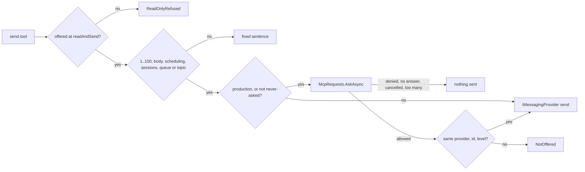

# Api: MCP server, asking the user and sending

One topic of [[pages/services/api|Api]]; the map lists the others. The endpoint, its gate, the token and the reading tools are on [[pages/services/api/mcp-server]].

The second phase of [[pages/decisions/0008-an-mcp-server-inside-the-local-api]] and connect_to: an assistant sends or switches the active connection after the user's answer in the app.

## Contract

- **Levels** (`src/ServiceBusExplorer.Api/Mcp/McpSettingsStore.cs#Levels`): `read` and `readAndSend`. `PUT api/mcp/connections/{id}` `{ level, neverAsk? }` answers the state; 404 for an unknown id; 400 `{ message }` for another level, and `src/ServiceBusExplorer.Api/Controllers/McpController.cs#NeverAskRefused` for `neverAsk` true on a connection that cannot be marked. A production connection is accepted. An omitted `neverAsk` keeps the mark the connection had.
- **State**: each offered connection answers `{ connectionId, level, production, canNeverAsk, neverAsk }` (`src/ServiceBusExplorer.Api/Controllers/McpController.cs#McpOfferedConnection`); `supports.confirmation` is true.
- **Requests**, behind the key: `GET api/mcp/requests` answers the waiting ones oldest first, each `{ id, time, assistant, kind, title, facts: [{ label, value }], note, allowLabel, expiresAt }` (`src/ServiceBusExplorer.Api/Mcp/McpRequests.cs#McpPendingRequest`); `POST api/mcp/requests/{id}/answer` `{ allow }` answers 204, or 404 when it no longer waits: answered, expired or cancelled; the first answer removes it, so a retried answer is 404 and never changes the outcome. `time` and `expiresAt` of a request and `time` of a record line are ISO 8601 in UTC with seven fraction digits and `Z` (`src/ServiceBusExplorer.Api/Mcp/McpRequests.cs#McpUtcTimeConverter`), so text order is time order.
- **Tools** (`src/ServiceBusExplorer.Api/Mcp/McpSendTools.cs#McpSendTools`): `send_message(entity, body, reason, contentType?, subject?, messageId?, correlationId?, sessionId?, applicationProperties?, scheduledEnqueueTimeUtc?)` answers `{ success, sequenceNumber }`; `send_messages(entity, messages[1..100], reason)` answers `{ success, count, failures: [{ index, error }] }`, as the batch route does ([[pages/services/api/routes-batch-send]]). Both `ReadOnly`, `Destructive` and `Idempotent` false.
- **The reason** is optional in the schema of every tool and required by the send tools and connect_to: missing or blank, the tool answers `src/ServiceBusExplorer.Api/Mcp/McpToolCalls.cs#ReasonRequired` before anything else, recorded `Refused: no reason` (`src/ServiceBusExplorer.Api/Mcp/McpToolCalls.cs#RequireReason`). Optional for the reading tools.
- **connect_to**`(connection, reason)` (`src/ServiceBusExplorer.Api/Mcp/McpConnectTools.cs#ConnectTo`): an offered connection by id or exact name, else `NotOffered` or `Ambiguous`, naming nothing. The one already active answers `{ connected, connection, alreadyActive }` without asking. Otherwise it always asks, kind `connect`, never-asked or not: From (the active one, `UnofferedActive` when not offered, or "No connection is active"), To, It said why. After the allow the offer is checked again, then `src/ServiceBusExplorer.Api/Controllers/ConnectionsController.cs#ConnectStoredAsync`, as the route, connects: `{ connected, connection, providerType }`, or the route's fixed sentence with the active connection unchanged. Recorded as `Connect to <name>` in `This app`.

## How it works

- **The order of a send** is `src/ServiceBusExplorer.Api/Mcp/McpSendTools.cs#PrepareAsync`: the active offered connection; the level, refused with `src/ServiceBusExplorer.Api/Mcp/McpSendTools.cs#ReadOnlyRefused` without asking; the count; the body as the routes check it (`src/ServiceBusExplorer.Api/Controllers/EntityAdministrationResults.cs#BodyNotAccepted`); scheduling and sessions against the capabilities; then `GetQueueAsync`, and `GetTopicAsync` only when `SupportsTopics`, which tell "a queue" from "a topic" and refuse a name that is neither; a queue whose `RequiresSession` is true and a message without a `sessionId` answer `src/ServiceBusExplorer.Api/Mcp/McpSendTools.cs#SessionRequired`, recorded `Refused: no session id` (RabbitMQ answers false). Only then the user is asked, and only then the provider sends. An undeclared capability is refused with its sentence before anything is asked or sent.
- **When a tool asks**: a production connection always, reads included; otherwise a send unless the connection is never asked; otherwise not. `list_connections` and `read_logs` never ask. The read ask is `src/ServiceBusExplorer.Api/Mcp/McpToolCalls.cs#AskToReadAsync`, after the tool's own checks.
- **The wait** (`src/ServiceBusExplorer.Api/Mcp/McpRequests.cs#AskAsync`): at most `Capacity` (20) wait, a 21st is answered at once with `TooManySentence`; the tool waits two minutes (`McpRequestOptions.Wait`), or until its token is cancelled, which removes the request. Denied answers `DeniedSentence`, no answer `NoAnswerSentence` (`src/ServiceBusExplorer.Api/Mcp/McpToolCalls.cs#McpToolCalls`). An answer that arrives as the wait ends is honoured only when it was taken first.
- **After an allow** `src/ServiceBusExplorer.Api/Mcp/McpToolCalls.cs#AskAsync` checks that the provider in the slot is the same instance, the connection the same id and still offered at a level that covers the call; otherwise `NotOffered`, and nothing is sent.
- **Never asked** (`src/ServiceBusExplorer.Api/Mcp/McpToolCalls.cs#ProtectionAsync`): a connection can be marked only when it is not production and `src/ServiceBusExplorer.Api/Mcp/McpToolCalls.cs#IsLoopbackHost` holds for `src/ServiceBusExplorer.Api/Mcp/McpToolCalls.cs#HostOf`: `localhost` in any letter case, 127.0.0.0/8 or `::1`, with or without brackets; never a name that only starts with localhost. The host is read from the masked connection; no secret is read. The mark is stored in `mcp-settings.json` (`src/ServiceBusExplorer.Api/Mcp/McpSettingsStore.cs#NeverAsk`), withdrawn with the connection, and counts only while the connection can be marked: answered false and asked again once it becomes production or leaves this computer.
- **What a request says**, authored by `src/ServiceBusExplorer.Api/Mcp/McpSendTools.cs#PrepareAsync` and `src/ServiceBusExplorer.Api/Mcp/McpToolCalls.cs#AskToReadAsync`: a title with the assistant's name, the facts To, On (the connection with its client and environment group names), Messages (count, content types, bytes of the bodies as UTF-8) and It said why, a note and the words of the button. The reason, the assistant's name and the entity lose their control characters and are cut (200, 100, 100 characters, `src/ServiceBusExplorer.Api/Mcp/McpToolCalls.cs#Clean`). No body and no secret.
- **The answer** of a send is the provider's: `SendMessageAsync` (which takes no token, as on the route) or `SendMessagesAsync` with the tool's token. A partial batch answers its result, not an error; a broker failure answers the sentences of the read tools plus the provider's own text of `InvalidEntityConfigurationException`; nothing is retried.
- **The record** adds to each line: `Send 3 messages`, `orders on <connection>`, then `3 sent`, `3 sent, allowed by you`, `2 sent, 1 not sent, allowed by you` (kind `error`), `Denied by you`, `Denied: no answer in two minutes`, `Refused: read only`, `Refused: too many waiting`, `Cancelled`, `Failed`. A read that was asked ends `, allowed by you`.

## Sharp edges

- The provider slot is process-wide: the user can switch the active connection while a request waits. The re-check after an allow is what keeps a send on the connection the user saw; removing it sends to whatever is active.
- `McpRequests` lives in memory: a restart of the API drops every waiting request and its tool call ends with the HTTP request.
- On RabbitMQ an exchange delivers to the queues its bindings match, maybe none: the provider then fails the message as not routed.
- The entity lookup before the question reaches the broker before the user answered; it reads only whether the name exists.

## Tests

- `src/ServiceBusExplorer.Api.Tests/McpSendToolTests.cs`: `#A_send_waits_for_the_user_and_is_sent_once_only_after_the_user_allows_it`, `#A_denied_send_sends_nothing`, `#A_send_with_no_answer_in_time_is_denied_and_sends_nothing`, `#A_send_cancelled_by_the_assistant_while_waiting_sends_nothing_and_its_request_disappears`, `#The_request_says_what_where_how_many_and_why_in_fixed_words_with_no_body_and_no_secret`, `#A_connection_offered_for_reading_refuses_a_send_without_asking`, `#A_local_test_broker_marked_never_asked_sends_without_asking_until_it_is_production_or_not_local`, `#Send_messages_reports_each_message_and_a_failure_midway_reports_what_was_and_was_not_sent`, `#A_capability_the_provider_does_not_declare_refuses_the_send_before_anything_is_attempted`, `#A_send_to_a_queue_that_requires_sessions_without_a_session_id_is_refused_before_anybody_is_asked`, `#A_send_the_broker_fails_answers_the_fixed_sentence_and_records_the_failure`, `#A_send_allowed_after_the_active_connection_changed_is_refused_and_sends_nothing`.
- `src/ServiceBusExplorer.Api.Tests/McpRequestTests.cs`: `#A_production_connection_asks_before_every_read_and_list_connections_and_read_logs_never_ask`, `#At_most_20_requests_wait_and_a_21st_is_refused_at_once`, `#A_second_answer_is_refused_at_once_and_never_changes_the_first`, `#The_mcp_token_cannot_answer_a_request_and_the_key_answers_it_once`.
- `src/ServiceBusExplorer.Api.Tests/McpSettingsRouteTests.cs`: `#A_connection_is_offered_at_read_or_readAndSend_a_production_one_included_and_withdrawn_idempotently`, `#Never_asked_is_accepted_only_for_a_broker_on_this_computer_that_is_not_production_and_stops_counting_when_that_changes`, `#A_host_is_this_computer_only_when_it_is_localhost_or_a_loopback_address`.
- connect_to: `src/ServiceBusExplorer.Api.Tests/McpConnectToolTests.cs#Connect_to_asks_even_a_never_asked_broker_and_an_allow_makes_it_active` and the rest of its file. The reason: `src/ServiceBusExplorer.Api.Tests/McpToolTests.cs#A_tool_called_without_a_reason_or_with_a_blank_one_is_refused_by_the_tool_before_anything_else`.
- They poll `GET api/mcp/requests` and answer through the key; the stub `src/ServiceBusExplorer.Api.Tests/McpToolTests.cs#Broker` counts sends, connects and disposals.
