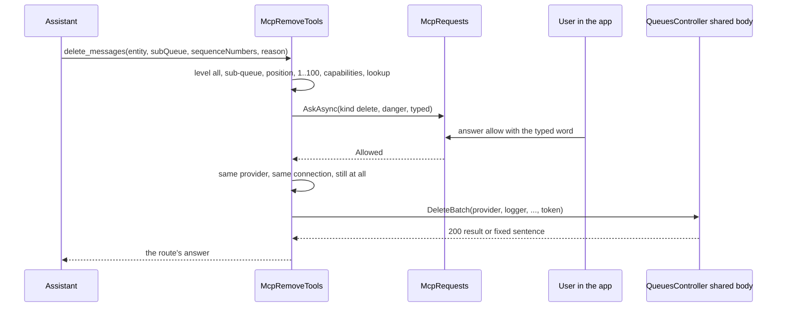

# Api: MCP server, moving and removing messages

One topic of [[pages/services/api|Api]]; the map lists the others. The requests, the levels below this one and the send tools are on [[pages/services/api/mcp-asking-and-sending]]; the endpoint and the reading tools on [[pages/services/api/mcp-server]].

The third phase of [[pages/decisions/0008-an-mcp-server-inside-the-local-api]]: an assistant dead-letters, resubmits, moves, deletes, purges and cancels scheduled messages, each only after the user's answer in the app.

## Contract

- **The level all.** `src/ServiceBusExplorer.Api/Mcp/McpSettingsStore.cs#AllLevel` is the third of `Levels`, `["read","readAndSend","all"]`, and covers the two before it (`src/ServiceBusExplorer.Api/Mcp/McpSettingsStore.cs#Covers`): a connection offered at all still reads and sends. Below all, every tool of this page answers `src/ServiceBusExplorer.Api/Mcp/McpRemoveTools.cs#LevelRefused` without asking.
- **Two fields on every request** of `GET api/mcp/requests` (`src/ServiceBusExplorer.Api/Mcp/McpRequests.cs#McpPendingRequest`): `danger`, true for a delete, a purge and a cancel of scheduled messages, and `typed`, null or `{ label, word }` (`src/ServiceBusExplorer.Api/Mcp/McpRequests.cs#McpTyped`), set for a delete and a purge with the queue name or the subscription name. New kinds: `deadLetter`, `resubmit`, `move`, `delete`, `purge`, `cancelScheduled`.
- **The answer takes the word.** `POST api/mcp/requests/{id}/answer` takes `{ allow, typed? }` (`src/ServiceBusExplorer.Api/Controllers/McpController.cs#AnswerRequest`). An allow of a request with a word is taken only when `typed` is that word, ordinal and case-sensitive (`src/ServiceBusExplorer.Api/Mcp/McpRequests.cs#Answer`); otherwise 400 `src/ServiceBusExplorer.Api/Controllers/McpController.cs#WrongWord` and the request keeps waiting. A deny needs no word. No route was added; the MCP token still cannot answer.
- **Six tools**, each needing a `reason`, not read-only, not idempotent: `dead_letter_messages`, `resubmit_messages`, `move_messages`, `delete_messages`, `purge_messages`, `cancel_scheduled_messages` (`src/ServiceBusExplorer.Api/Mcp/McpRemoveTools.cs#McpRemoveTools`). Delete, purge, cancel and dead-letter are marked destructive. Sequence numbers are 1 to 100 per call (`src/ServiceBusExplorer.Api/Mcp/McpRemoveTools.cs#MaxSequenceNumbers`), as JSON numbers or numeric strings. The `reason` is optional in the schema so the SDK does not reject a call without it: missing or blank, the tool answers `src/ServiceBusExplorer.Api/Mcp/McpToolCalls.cs#ReasonRequired` before anything else, recorded `Refused: no reason`.
- **What each answers** is what its route answers: the `BatchOperationResult` with its failures per sequence number, their possible-duplicate flag, the new message ids and the unselected-delivery fields; the purge `{ success }`. A refusal of a check or of the broker is the route's fixed sentence.

## How it works

1. **Before anybody is asked** (`src/ServiceBusExplorer.Api/Mcp/McpRemoveTools.cs#PrepareAsync`): the connection active and offered at all; the sub-queue among those the tool takes; for the five tools that take sequence numbers, a provider that names a message by a broker identity (`SupportsSequenceNumbers`; RabbitMQ names it by position and is refused with `src/ServiceBusExplorer.Api/Mcp/McpRemoveTools.cs#PositionRefused`), then 1 to 100 numbers; then subscriptions, the dead-letter queue, the transfer dead-letter queue and, for delete, resubmit and move, `SupportsBulkMessageOperations`. Dead-letter needs `SupportsManualDeadLetter`, cancel `SupportsScheduledMessages`. The queue or the subscription is read once, and refused as not found when it does not exist (`src/ServiceBusExplorer.Api/Mcp/McpRemoveTools.cs#LookupAsync`); its count is the purge's "counted now". A move then looks its target up as a send does, a queue, else a topic when `SupportsTopics`, and refuses one that is neither with `src/ServiceBusExplorer.Api/Mcp/McpRemoveTools.cs#TargetNotFound`, recorded `Refused: target not found`; a lookup that throws answers the fixed sentence of a failure. Nobody is asked and nothing moves.
2. **The user is always asked**, on a connection marked never asked and on one that is not production too: the mark covers sends only. The request names the entity and the sub-queue, the connection, the sequence numbers or the count, and the reason; never a body or a secret.
3. **After the allow** the call goes on only while the same provider and connection are active and still offered at all (`src/ServiceBusExplorer.Api/Mcp/McpToolCalls.cs#AskAsync`).
4. **The route's own body runs**, with the tool's `CancellationToken`: `src/ServiceBusExplorer.Api/Controllers/QueuesController.cs#DeleteBatch`, `src/ServiceBusExplorer.Api/Controllers/QueuesController.cs#Purge`, `src/ServiceBusExplorer.Api/Controllers/QueuesController.cs#ResubmitBatch`, `src/ServiceBusExplorer.Api/Controllers/QueuesController.cs#MoveBatch`, `src/ServiceBusExplorer.Api/Controllers/QueuesController.cs#DeadLetterBatch` and `src/ServiceBusExplorer.Api/Controllers/QueuesController.cs#CancelScheduled`. Each takes the provider and the token as arguments; the queue and the subscription routes call the same one, so a body is no longer kept twice. Their answers and status codes are unchanged. Send first, complete after, and the report per sequence number stay where they were, in the providers ([[pages/invariants/bulk-operations-are-at-least-once]]).
5. **The record** says what was asked ("Delete 2 messages"), where ("orders (dead-letter queue) on <connection>") and how it ended: "2 deleted, allowed by you", "1 deleted, 1 not deleted, allowed by you" as an error, "Purged, 5 counted before, allowed by you", "Denied by you", "Denied: no answer in two minutes", "Failed, allowed by you", or "Refused: ..." for each check.

## Sharp edges

- **A name is taken only as the user reads it.** A name with a space at an edge, a control character or more than 260 characters is refused before anybody is asked, here and in the tools that administer entities, so the word the user types is the entity the broker is given: `src/ServiceBusExplorer.Api/Mcp/McpToolCalls.cs#RequireExactNames`, pinned by `src/ServiceBusExplorer.Api.Tests/McpRemoveToolTests.cs#A_name_that_is_not_exactly_what_the_user_would_read_is_refused_before_anybody_is_asked` and its namesake in `src/ServiceBusExplorer.Api.Tests/McpEntityToolTests.cs`.
- **A guard added to a shared body changes the route too.** The bodies of item 4 are the routes'; a check meant for the tools belongs in `src/ServiceBusExplorer.Api/Mcp/McpRemoveTools.cs#PrepareAsync`.
- **A cancellation during the provider call** is answered by the route's catch-all as the constant 500, as it was before; the tool returns that sentence, the record says "Failed, allowed by you".
- **The transfer dead-letter queue** is taken by delete, resubmit and move only; no route purges it. A move from it is checked by `src/ServiceBusExplorer.Api/Controllers/EntityAdministrationResults.cs#SubQueueNotSupported` in the shared body, which no route reaches.
- **A purge has no capability of its own** and returns no count: the record carries the count read before the question, when the broker gives counts.

## Tests

`src/ServiceBusExplorer.Api.Tests/McpRemoveToolTests.cs`, through `/mcp` on a test server with the stub provider of `src/ServiceBusExplorer.Api.Tests/McpToolTests.cs#Broker`, which counts every batch call:

- `#Each_tool_waits_for_the_user_and_calls_its_route_path_once_only_after_the_allow`, `#A_denial_a_cancellation_while_waiting_and_no_answer_in_time_each_do_nothing`.
- `#A_batch_that_fails_midway_answers_the_route_report_per_sequence_number_and_nothing_is_retried`, `#A_provider_call_that_fails_answers_the_route_fixed_sentence_records_it_and_retries_nothing` (a broker exception, a timeout, a refusal as not authorised, for each tool).
- `#A_move_to_a_target_that_does_not_exist_is_refused_before_anybody_is_asked_and_moves_nothing`, `#A_move_whose_lookup_of_the_target_fails_answers_the_fixed_sentence_asks_nobody_and_moves_nothing` (a broker exception and a timeout, of the queue and of the topic lookup).
- `#Below_the_level_all_each_tool_is_refused_without_asking`, `#Each_tool_asks_even_on_a_local_broker_the_user_marked_never_asked`, `#A_provider_that_names_a_message_by_its_position_is_refused_for_the_numbered_tools_and_purge_still_asks`, `#A_capability_the_provider_does_not_declare_is_refused_with_its_sentence_before_anybody_is_asked`, `#Sequence_numbers_are_taken_1_to_100_as_numbers_or_numeric_strings`.
- `#An_allow_of_a_delete_needs_the_name_typed_exactly_and_a_wrong_word_keeps_the_request_waiting`, `#An_allow_after_the_connection_was_lowered_below_all_does_nothing`, `#The_request_says_what_where_how_many_and_why_in_fixed_words_with_no_secret`.
- `src/ServiceBusExplorer.Api.Tests/McpRequestTests.cs#An_allow_of_a_request_with_a_typed_word_is_taken_only_with_the_word_typed_exactly_and_a_deny_needs_none`, `src/ServiceBusExplorer.Api.Tests/McpRequestTests.cs#Every_request_carries_danger_and_typed_and_a_send_is_not_dangerous_and_asks_for_no_word`.

The routes the tools share keep their tests untouched: `src/ServiceBusExplorer.Api.Tests/MessageRouteTests.cs` and `src/ServiceBusExplorer.Api.Tests/EntityNameRoutingTests.cs`.
