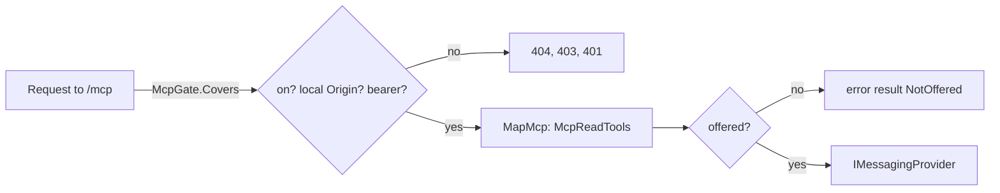

# Api: MCP server

One topic of [[pages/services/api|Api]]; the map lists the others.

The reading phase of [[pages/decisions/0008-an-mcp-server-inside-the-local-api]]. The levels, the requests that wait for the user, the never-asked mark and the sending tools are on [[pages/services/api/mcp-asking-and-sending]].

## Contract

- **`/mcp`**, Streamable HTTP, stateless, served by the API process (`src/ServiceBusExplorer.Api/Program.cs#MapMcp`, package `ModelContextProtocol.AspNetCore` 2.4.0). It is the second exemption from the `X-Api-Key` middleware after `/health` ([[pages/invariants/local-authenticated-api]]); its gate is `src/ServiceBusExplorer.Api/Mcp/McpGate.cs#AdmitAsync`.
- **Routes of Settings**, behind the key, camelCase (`src/ServiceBusExplorer.Api/Controllers/McpController.cs#McpController`):
  - `GET api/mcp` answers `McpState`: `enabled`, `url` (`http://127.0.0.1:<apiPort>/mcp`), `hasToken`, `tokenCreatedAt`, `levels`, `supports` (`logs` and `confirmation` true, `appSettings` false), `logsAllowed`, `connections` ([[pages/services/api/mcp-asking-and-sending]]).
  - `PUT api/mcp/enabled` `{ enabled }`, `PUT api/mcp/logs` `{ allowed }`, `DELETE api/mcp/connections/{id}` (idempotent) answer the state.
  - `POST api/mcp/token` answers `{ token, state }`; the plain token is answered this once.
  - `PUT api/mcp/connections/{id}` and `api/mcp/requests`: [[pages/services/api/mcp-asking-and-sending]].
  - `GET api/mcp/activity` answers the record newest first; `DELETE api/mcp/activity` answers 204.
- **Defaults:** off, no token, nothing offered, logs not allowed.
- **Tools** (`src/ServiceBusExplorer.Api/Mcp/McpReadTools.cs#McpReadTools`): `list_connections`, `list_queues`, `list_topics`, `list_subscriptions`, `list_rules`, `peek_messages`, `read_logs`. Each answers JSON text, or an error result (`isError`) with the fixed sentence. The three lists of entities answer `countsAvailable` on each, and counts only when it is true. `peek_messages` answers `{ messages }`, and `{ note, messages }` on RabbitMQ.
- **Annotations:** every tool is `ReadOnly = true` but `peek_messages`, `ReadOnly = false` with no destructive hint: on RabbitMQ a peek marks what it reads as redelivered, and a dying channel returns them as a delivery a quorum queue counts.

## How it works

- **The gate** runs first in the key middleware, before the `OPTIONS` and `/health` exemptions, for `/mcp` in any letter case (`src/ServiceBusExplorer.Api/Mcp/McpGate.cs#Covers`), so the API key opens nothing there. Off answers 404. An `Origin` other than `http://localhost`, `http://127.0.0.1` or `http://[::1]`, any port, answers 403; the SDK does not check it. A missing, malformed or wrong bearer, or no token yet, answers 401 with one body. The bearer is checked nowhere else, so it opens no `api/` route.
- **The token** is 32 bytes of `RandomNumberGenerator`, base64url. `src/ServiceBusExplorer.Api/Mcp/McpSettingsStore.cs#CreateToken` keeps only its SHA-256 as hex; `src/ServiceBusExplorer.Api/Mcp/McpSettingsStore.cs#TokenMatches` compares the hash of what was presented with `CryptographicOperations.FixedTimeEquals`. A new token replaces the old one.
- **The settings** are `mcp-settings.json` in the data folder of `workspace.json` (`SERVICEBUS_DATA_PATH`). A change is written to `mcp-settings.json.tmp`, moved over the file, and only then held in memory (`src/ServiceBusExplorer.Api/Mcp/McpSettingsStore.cs#Change`); a failed write throws and answers the constant 500. An unreadable file is logged with its exception type and the server starts off with nothing offered (`src/ServiceBusExplorer.Api/Mcp/McpSettingsStore.cs#Load`).
- **The active connection**: tools read the provider and the stored connection id together from `src/ServiceBusExplorer.Api/Controllers/ConnectionsController.cs#GetCurrent` (`src/ServiceBusExplorer.Api/Mcp/McpToolCalls.cs#ActiveAsync`). Nothing active, an id not offered or a deleted connection answer one sentence, `src/ServiceBusExplorer.Api/Mcp/McpReadTools.cs#NotOffered`, which names no connection. A production connection is read only after the user allows it.
- **Deleting a connection** withdraws it first, and `clear-all` withdraws every one (`src/ServiceBusExplorer.Api/Controllers/ConnectionsController.cs#DeleteConnection`, `src/ServiceBusExplorer.Api/Controllers/ConnectionsController.cs#ClearAllData`), so one that comes back with the same id through an import is not offered again.
- **Capabilities decide** what a tool refuses before the provider is called: topics, subscriptions, rules, the dead-letter and transfer dead-letter queues, a peek from a position. The sentences are those of `src/ServiceBusExplorer.Api/Controllers/EntityAdministrationResults.cs#EntityAdministrationResults` where it has one. `SupportsMessageCounts` false leaves the counts out, never zeros.
- **peek_messages** calls `IMessagingProvider.PeekMessagesAsync` with the tool's `CancellationToken`, a count clamped to 1..50, and cuts each body at 8000 characters with `bodyTruncated`. On Azure a peek does not lock or remove. On RabbitMQ it is a get without acknowledgement and a requeue (`src/ServiceBusExplorer.Core/Providers/RabbitMQ/RabbitMQProvider.cs#PeekMessagesAsync`), whose cost the description and, when `ProviderType` is RabbitMQ, the answer state: `src/ServiceBusExplorer.Api/Mcp/McpReadTools.cs#RabbitMQPeekNote`.
- **A refusal is not an error of the app.** `src/ServiceBusExplorer.Api/Mcp/McpToolCalls.cs#RunAsync` returns refusals and broker failures (`src/ServiceBusExplorer.Api/Mcp/McpToolCalls.cs#FailureSentence`, never the broker's text) as a `CallToolResult` with `IsError`, never throws: the SDK logs a completed call at Information, which the Logs screen does not keep, and adds no prefix; a thrown `McpException` was logged at Error. A failure keeps its own Warning line.
- **read_logs** answers the lines of `src/ServiceBusExplorer.Api/Logs/RecentLogStore.cs#RecentLogStore` newest first, at or above a level and containing a text, at most 200; refused with `src/ServiceBusExplorer.Api/Mcp/McpReadTools.cs#LogsRefused` until the user allows it. It needs no active connection.
- **The record** (`src/ServiceBusExplorer.Api/Mcp/McpActivityLog.cs#McpActivityLog`) keeps the last 500 calls in memory, one line each, answered or refused: the client's name from `McpServer.ClientInfo` or `Assistant`, what was asked, where (entity and sub-queue on the offered connection's name, or `This app`; the name and the entity each cut at 100 characters), the outcome, and `ok`, `plain` (no broker read) or `error`. Never a body, a secret or the name of a connection not offered.

## Sharp edges

- `src/ServiceBusExplorer.Api/Mcp/McpGate.cs#Covers` must stay case-insensitive: routing matches `/MCP` too, and a case-sensitive one would send it to the key branch.
- The client's name: on a stateless server it comes from the request's `_meta` under the 2026-07-28 revision; an older client that names itself only in `initialize` is recorded as `Assistant`.
- A CORS preflight to `/mcp` is answered 204 by `UseCors`, which runs before the gate, even while the server is off; it carries no MCP answer and allows only the front end's origins ([[pages/roadmap/followups]]).
- A call the SDK rejects before the tool runs, such as an argument of the wrong type, still throws inside the SDK: it is logged at Error and not recorded ([[pages/roadmap/followups]]).
- Not verified: a connection from Claude Code itself; whether a peek's own requeue counts as a delivery too.

## Tests

- `src/ServiceBusExplorer.Api.Tests/McpGateTests.cs#The_mcp_endpoint_answers_404_while_the_user_has_not_turned_it_on_even_with_a_token_and_the_api_key`, `src/ServiceBusExplorer.Api.Tests/McpGateTests.cs#A_request_without_the_right_bearer_is_refused_401_with_one_body_whatever_was_wrong`, `src/ServiceBusExplorer.Api.Tests/McpGateTests.cs#A_request_is_refused_401_while_no_token_was_ever_created`, `src/ServiceBusExplorer.Api.Tests/McpGateTests.cs#The_api_key_alone_does_not_open_the_mcp_endpoint_in_any_letter_case`, `src/ServiceBusExplorer.Api.Tests/McpGateTests.cs#A_foreign_origin_is_refused_403_even_with_the_right_bearer`, `src/ServiceBusExplorer.Api.Tests/McpGateTests.cs#The_mcp_token_alone_opens_no_api_route`.
- `src/ServiceBusExplorer.Api.Tests/McpSettingsRouteTests.cs#The_token_is_answered_once_and_stored_only_as_its_hash`, `src/ServiceBusExplorer.Api.Tests/McpSettingsRouteTests.cs#A_connection_is_offered_at_read_or_readAndSend_a_production_one_included_and_withdrawn_idempotently`, `src/ServiceBusExplorer.Api.Tests/McpSettingsRouteTests.cs#A_settings_file_that_cannot_be_read_starts_off_with_nothing_offered_and_the_api_still_answers`, `src/ServiceBusExplorer.Api.Tests/McpSettingsRouteTests.cs#A_settings_file_that_cannot_be_written_answers_500_with_the_fixed_sentence_and_changes_nothing`.
- `src/ServiceBusExplorer.Api.Tests/McpToolTests.cs#List_connections_answers_only_the_offered_connections_with_no_secret`, `src/ServiceBusExplorer.Api.Tests/McpToolTests.cs#A_tool_on_an_active_connection_that_is_not_offered_is_refused_and_names_nothing`, `src/ServiceBusExplorer.Api.Tests/McpToolTests.cs#Reading_tools_answer_what_the_provider_lists_and_peeks_with_bodies_cut_at_8000_characters`, `src/ServiceBusExplorer.Api.Tests/McpToolTests.cs#A_peek_the_broker_fails_answers_the_fixed_sentence_and_records_the_failure`, `src/ServiceBusExplorer.Api.Tests/McpToolTests.cs#Read_logs_answers_the_lines_of_the_store_newest_first_only_when_the_user_allowed_it`, `src/ServiceBusExplorer.Api.Tests/McpToolTests.cs#Every_tool_call_is_recorded_newest_first_without_a_body_or_a_secret`, `src/ServiceBusExplorer.Api.Tests/McpToolTests.cs#A_deleted_connection_is_no_longer_offered`.
- `src/ServiceBusExplorer.Api.Tests/McpToolTests.cs#A_capability_the_provider_does_not_declare_is_refused_with_its_sentence_recorded_and_the_provider_never_called`, `src/ServiceBusExplorer.Api.Tests/McpToolTests.cs#Counts_are_answered_only_when_the_broker_gives_them`, `src/ServiceBusExplorer.Api.Tests/McpToolTests.cs#A_peek_on_RabbitMQ_says_what_it_costs_in_the_description_and_in_the_answer`, `src/ServiceBusExplorer.Api.Tests/McpToolTests.cs#A_refusal_is_answered_as_an_error_result_and_leaves_no_Error_line_in_the_app_log`, `src/ServiceBusExplorer.Api.Tests/McpToolTests.cs#The_entity_an_assistant_names_is_recorded_cut_at_100_characters`.
- They call `/mcp` on the test server with JSON-RPC, a fake `IProviderFactory` and `POST api/connections/{id}/connect`, as `src/ServiceBusExplorer.Api.Tests/ConnectionLastUsedTests.cs#ConnectionLastUsedTests` does; no broker is reached.
