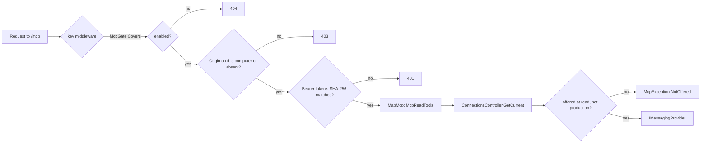

# Api: MCP server

One topic of [[pages/services/api|Api]]; the map lists the others.

The first phase of [[pages/decisions/0008-an-mcp-server-inside-the-local-api]]: reading only. No tool sends, moves, removes or changes anything, and there is no confirmation window yet, so a connection is offered at the level `read` only and never one of a production environment.

## Contract

- **`/mcp`**, Streamable HTTP, stateless, served by the API process (`src/ServiceBusExplorer.Api/Program.cs#MapMcp`, package `ModelContextProtocol.AspNetCore` 2.4.0). It is the second exemption from the `X-Api-Key` middleware after `/health` ([[pages/invariants/local-authenticated-api]]); its gate is `src/ServiceBusExplorer.Api/Mcp/McpGate.cs#AdmitAsync`.
- **Routes of Settings**, behind the key, camelCase (`src/ServiceBusExplorer.Api/Controllers/McpController.cs#McpController`):
  - `GET api/mcp` answers `McpState`: `enabled`, `url` (`http://127.0.0.1:<apiPort>/mcp`), `hasToken`, `tokenCreatedAt`, `levels` (`["read"]`), `supports` (`logs` true, `appSettings` and `confirmation` false), `logsAllowed`, `connections` as `{ connectionId, level }`.
  - `PUT api/mcp/enabled` `{ enabled }`, `PUT api/mcp/logs` `{ allowed }`, `DELETE api/mcp/connections/{id}` (idempotent) answer the state.
  - `POST api/mcp/token` answers `{ token, state }`; the plain token is answered this once.
  - `PUT api/mcp/connections/{id}` `{ level }` answers the state, 404 for an id no stored connection has, 400 for a level other than `read`, 409 with `src/ServiceBusExplorer.Api/Controllers/McpController.cs#ProductionRefused` when the connection's environment is marked production.
  - `GET api/mcp/activity` answers the record newest first; `DELETE api/mcp/activity` answers 204.
- **Defaults:** off, no token, nothing offered, logs not allowed.
- **Tools**, all `ReadOnly = true` (`src/ServiceBusExplorer.Api/Mcp/McpReadTools.cs#McpReadTools`): `list_connections`, `list_queues`, `list_topics`, `list_subscriptions`, `list_rules`, `peek_messages`, `read_logs`. Each answers JSON text.

## How it works

- **The gate** runs first in the key middleware, before the `OPTIONS` and `/health` exemptions, for `/mcp` in any letter case (`src/ServiceBusExplorer.Api/Mcp/McpGate.cs#Covers`), so the API key never reaches it and opens nothing there. Off answers 404. An `Origin` that is not `http://localhost`, `http://127.0.0.1` or `http://[::1]`, with any port, answers 403; the SDK does not check it. A missing, malformed or wrong bearer, or no token yet, answers 401 with one body. The bearer is not checked anywhere else, so it opens no `api/` route.
- **The token** is 32 bytes of `RandomNumberGenerator`, base64url. `src/ServiceBusExplorer.Api/Mcp/McpSettingsStore.cs#CreateToken` keeps only its SHA-256 as hex; `src/ServiceBusExplorer.Api/Mcp/McpSettingsStore.cs#TokenMatches` hashes what was presented and compares the two hashes with `CryptographicOperations.FixedTimeEquals`. A new token replaces the old one.
- **The settings** are `mcp-settings.json` in the data folder of `workspace.json` (`SERVICEBUS_DATA_PATH`). A change is written to `mcp-settings.json.tmp`, moved over the file, and only then takes effect in memory (`src/ServiceBusExplorer.Api/Mcp/McpSettingsStore.cs#Change`); a write that fails throws, and the exception handler answers the constant 500. A file that cannot be read is logged with its exception type and the server starts off with nothing offered (`src/ServiceBusExplorer.Api/Mcp/McpSettingsStore.cs#Load`).
- **The active connection**: tools read the provider and the stored connection id together from `src/ServiceBusExplorer.Api/Controllers/ConnectionsController.cs#GetCurrent`. Nothing active, an id not offered at `read`, a deleted connection, or one whose environment is now production all answer the same sentence, `src/ServiceBusExplorer.Api/Mcp/McpReadTools.cs#NotOffered`, which names no connection.
- **Deleting a connection** withdraws it from the offered list before it is deleted, and `clear-all` withdraws every one (`src/ServiceBusExplorer.Api/Controllers/ConnectionsController.cs#DeleteConnection`, `src/ServiceBusExplorer.Api/Controllers/ConnectionsController.cs#ClearAllData`), so a connection that comes back with the same id through an import is not offered again.
- **Capabilities decide** what a tool refuses before the provider is called: topics, subscriptions, rules, the dead-letter and transfer dead-letter queues, a peek from a position. The sentences are those of `src/ServiceBusExplorer.Api/Controllers/EntityAdministrationResults.cs#EntityAdministrationResults` where it has one.
- **peek_messages** calls `IMessagingProvider.PeekMessagesAsync` with the tool's `CancellationToken`, a count clamped to 1..50, and cuts each body at 8000 characters with `bodyTruncated`. A peek does not lock or remove.
- **A broker failure** is logged with its exception type and answered as the routes answer it (`src/ServiceBusExplorer.Api/Mcp/McpReadTools.cs#FailureSentence`): never the broker's text. The SDK puts `An error occurred invoking '<tool>': ` before the sentence.
- **read_logs** answers the lines of `src/ServiceBusExplorer.Api/Logs/RecentLogStore.cs#RecentLogStore` newest first, at or above a level and containing a text, at most 200; refused with `src/ServiceBusExplorer.Api/Mcp/McpReadTools.cs#LogsRefused` until the user allows it. It needs no active connection.
- **The record** (`src/ServiceBusExplorer.Api/Mcp/McpActivityLog.cs#McpActivityLog`) keeps the last 500 calls in memory. Every call, answered or refused, adds one line: the client's name from `McpServer.ClientInfo` or `Assistant`, what was asked, where (entity and sub-queue on the offered connection's name, or `This app`), the outcome, and `ok`, `plain` (no broker read) or `error`. Never a body, a secret or the name of a connection that is not offered.

## Sharp edges

- `src/ServiceBusExplorer.Api/Mcp/McpGate.cs#Covers` must stay case-insensitive: routing matches `/MCP` too, and a case-sensitive check would send it to the key branch.
- The client's name: on a stateless server it comes from the request's `_meta` under the 2026-07-28 revision; an older client that names itself only in `initialize` is recorded as `Assistant`.
- A CORS preflight (`OPTIONS` with `Origin` and `Access-Control-Request-Method`) to `/mcp` is answered 204 by `UseCors`, which runs before the gate, as on every path, even while the server is off; it carries no MCP answer, and the allow headers name only the front end's origins. Any other request while off answers 404.
- Not verified: a connection from Claude Code itself; the endpoint was called with curl and the test client.

## Tests

- `src/ServiceBusExplorer.Api.Tests/McpGateTests.cs#The_mcp_endpoint_answers_404_while_the_user_has_not_turned_it_on_even_with_a_token_and_the_api_key`, `src/ServiceBusExplorer.Api.Tests/McpGateTests.cs#A_request_without_the_right_bearer_is_refused_401_with_one_body_whatever_was_wrong`, `src/ServiceBusExplorer.Api.Tests/McpGateTests.cs#A_request_is_refused_401_while_no_token_was_ever_created`, `src/ServiceBusExplorer.Api.Tests/McpGateTests.cs#The_api_key_alone_does_not_open_the_mcp_endpoint_in_any_letter_case`, `src/ServiceBusExplorer.Api.Tests/McpGateTests.cs#A_foreign_origin_is_refused_403_even_with_the_right_bearer`, `src/ServiceBusExplorer.Api.Tests/McpGateTests.cs#The_mcp_token_alone_opens_no_api_route`.
- `src/ServiceBusExplorer.Api.Tests/McpSettingsRouteTests.cs#The_token_is_answered_once_and_stored_only_as_its_hash`, `src/ServiceBusExplorer.Api.Tests/McpSettingsRouteTests.cs#A_connection_is_offered_at_the_level_read_only_never_from_a_production_environment_and_withdrawn_idempotently`, `src/ServiceBusExplorer.Api.Tests/McpSettingsRouteTests.cs#A_settings_file_that_cannot_be_read_starts_off_with_nothing_offered_and_the_api_still_answers`, `src/ServiceBusExplorer.Api.Tests/McpSettingsRouteTests.cs#A_settings_file_that_cannot_be_written_answers_500_with_the_fixed_sentence_and_changes_nothing`.
- `src/ServiceBusExplorer.Api.Tests/McpToolTests.cs#List_connections_answers_only_the_offered_connections_with_no_secret`, `src/ServiceBusExplorer.Api.Tests/McpToolTests.cs#A_tool_on_an_active_connection_that_is_not_offered_is_refused_and_names_nothing`, `src/ServiceBusExplorer.Api.Tests/McpToolTests.cs#Reading_tools_answer_what_the_provider_lists_and_peeks_with_bodies_cut_at_8000_characters`, `src/ServiceBusExplorer.Api.Tests/McpToolTests.cs#A_peek_the_broker_fails_answers_the_fixed_sentence_and_records_the_failure`, `src/ServiceBusExplorer.Api.Tests/McpToolTests.cs#Read_logs_answers_the_lines_of_the_store_newest_first_only_when_the_user_allowed_it`, `src/ServiceBusExplorer.Api.Tests/McpToolTests.cs#Every_tool_call_is_recorded_newest_first_without_a_body_or_a_secret`, `src/ServiceBusExplorer.Api.Tests/McpToolTests.cs#A_deleted_connection_is_no_longer_offered`.
- They drive `/mcp` through the test server with JSON-RPC `tools/call`, a fake `IProviderFactory` and a connect through `POST api/connections/{id}/connect`, as `src/ServiceBusExplorer.Api.Tests/ConnectionLastUsedTests.cs#ConnectionLastUsedTests` does; no broker is reached.
