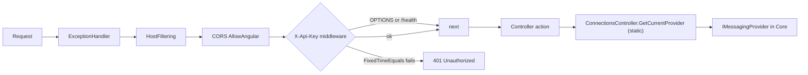

# Api: Public contract and startup

One topic of [[pages/services/api|Api]]; the map lists the others.

## Public contract

- **HTTP routes:** `api/{controller}` for `connections`, `connectiongroups`, `queues`, `topics`, `metrics`, `monitoring`, and `api/namespace` for the entity definitions (`src/ServiceBusExplorer.Api/Controllers/NamespaceController.cs#NamespaceController`, `src/ServiceBusExplorer.Api/Controllers/NamespaceController.cs#Export`) (`[Route("api/[controller]")]`, for example `src/ServiceBusExplorer.Api/Controllers/QueuesController.cs#[Route("api/[controller]")]`); the session routes sit under `api/queues/{name}/sessions` and `api/topics/{topic}/subscriptions/{subscription}/sessions` with absolute templates (`src/ServiceBusExplorer.Api/Controllers/SessionsController.cs#QueueBase`), plus unauthenticated `GET /health` (`src/ServiceBusExplorer.Api/Program.cs#FileWorkspaceManager`) and, in Development only, the OpenAPI document (`src/ServiceBusExplorer.Api/Program.cs#FileWorkspaceManager`).
- **HTTP routes:** `api/{controller}` for `connections`, `connectiongroups`, `queues`, `topics`, `metrics`, `monitoring` (`snapshot`, `history`, `counts`) (`[Route("api/[controller]")]`, for example `src/ServiceBusExplorer.Api/Controllers/QueuesController.cs#[Route("api/[controller]")]`); the session routes sit under `api/queues/{name}/sessions` and `api/topics/{topic}/subscriptions/{subscription}/sessions` with absolute templates (`src/ServiceBusExplorer.Api/Controllers/SessionsController.cs#QueueBase`), plus unauthenticated `GET /health` (`src/ServiceBusExplorer.Api/Program.cs#FileWorkspaceManager`) and, in Development only, the OpenAPI document (`src/ServiceBusExplorer.Api/Program.cs#FileWorkspaceManager`).
- **Auth:** every request except `OPTIONS` and `/health*` needs header `X-Api-Key` equal to `API_SECRET` ([[pages/invariants/local-authenticated-api]]).
- **JSON:** camelCase, enums as strings in both directions (`src/ServiceBusExplorer.Api/Program.cs#options.JsonSerializerOptions.PropertyNamingPolicy = JsonNamingPolicy.CamelCase;`, `:59`). The import/export files on disk stay PascalCase (`src/ServiceBusExplorer.Api/Controllers/ConnectionsController.cs#ExportFullConfiguration`).
- **Events:** none published or consumed. **Direct callers:** the Angular app in Electron (`X-Api-Key` set at `web-app/electron/main.js#headers: { 'X-Api-Key': API_SECRET }`).

## Startup and composition

Everything is in `src/ServiceBusExplorer.Api/Program.cs`, top-level statements, in this order:

- **Ports** (`:228`): `EXPLORER_CONFIG_PATH` if the file exists and parses (`:231`), else walk up from `AppContext.BaseDirectory` for the first parsable `config.json` (`:239-246`), else defaults 5917 (API) and 4297 (frontend) with a warning (`:25-26`, `:249`). Only `apiPort` and `frontendPort` are read (`:263-266`); a parse failure logs the path and exception type, not the message (`:272`).
- **Secret** (`:36-42`): `API_SECRET` must be at least 32 characters or the process logs Critical and calls `Environment.Exit(1)` before the host is built. Bytes cached once (`:45`). Pinned by `src/ServiceBusExplorer.Api.Tests/BoundaryGuardTests.cs#The_API_does_not_start_without_a_32_character_API_SECRET`, which starts the built API as a child process with the variable unset and with 31 characters and expects exit code 1 in both cases.
- **JSON** (`:50-60`), **OpenAPI** services (`:61-62`).
- **CORS** policy `AllowAngular` (`:66-77`): origins `http://localhost:{frontendPort}`, `http://127.0.0.1:{frontendPort}` and the literal `null` (the origin a `file://` Electron page sends), any header, any method.
- **Host filtering** (`:80-83`): `AllowedHosts = ["localhost", "127.0.0.1"]` set in code.
- **Kestrel** (`:86-89`): `ListenLocalhost(apiPort)` only when `ASPNETCORE_URLS` is empty. When it is set the code binds nothing itself and the URLs win. Electron always sets it to `http://localhost:{apiPort}` (`web-app/electron/main.js`, `:848`), so under Electron the in-code loopback binding is not the one in effect; the bind address is whatever the shell passes.
- **Data path** (`:92-101`): `SERVICEBUS_DATA_PATH`, else `%APPDATA%/ServiceBusExplorer` equivalent; created if missing.
- **DI** (all singletons): `IConnectionManager` = `FileWorkspaceManager` (`:103`), `IConnectionGroupManager` = the same instance cast (`:107`), `IProviderFactory` (`:110`), `IServiceBusService` (`:117`, a legacy Azure-only service, see Known gaps), `MonitoringStore` (`:123`), hosted `MonitoringBackgroundService` (`:124`), `IMemoryCache` (`:139`).
- **Metrics** (`:133-164`): `AzureMonitorOptions.IsConfigured` needs `SubscriptionId`, `ResourceGroup` and `Namespace` all non-blank (`src/ServiceBusExplorer.Core/Services/AzureMonitorOptions.cs#IsConfigured`). If true, `AzureMonitorMetricsService` with `credential: null` (`:146-157`); otherwise `UnconfiguredMetricsService` (`:163`), which throws an `InvalidOperationException` whose text contains "not properly configured" (`src/ServiceBusExplorer.Core/Services/UnconfiguredMetricsService.cs#UnconfiguredMetricsService`) and the controller turns into 503.
- **Pipeline** (`:175-221`): the exception handler (`:175`), host filtering, CORS, `MapGet("/health")`, the key middleware, authorization, `MapControllers`. No HTTPS redirection (`:218-219`).

The key middleware (`:189-216`) skips `OPTIONS` (`:192`) and any path under `/health` (`:198`), then compares UTF-8 bytes of the header against the cached secret: length check first, then `CryptographicOperations.FixedTimeEquals` (`:207-208`). The length check is not constant time, which only reveals the secret's length. A missing header is treated as empty bytes (`:205`). Failure answers 401 `{message:"Unauthorized"}`; a 401 is a response, not an exception, so the exception handler does not touch it.

**Host filtering vs `"AllowedHosts": "*"`:** `src/ServiceBusExplorer.Api/appsettings.json#"AllowedHosts": "*",` sets `"*"` while the code sets an explicit list (`src/ServiceBusExplorer.Api/Program.cs#o.AllowedHosts = new[] { "localhost", "127.0.0.1" };`). The list in code is the one in effect: a request with `Host: evil.example` and a valid key answers 400, one with `Host: 127.0.0.1` answers 200 (`src/ServiceBusExplorer.Api.Tests/BoundaryGuardTests.cs#A_foreign_Host_is_refused`), and widening the list in code to `"*"` makes the foreign host answer 200. The `"*"` in `appsettings.json` has no effect on this filter.
