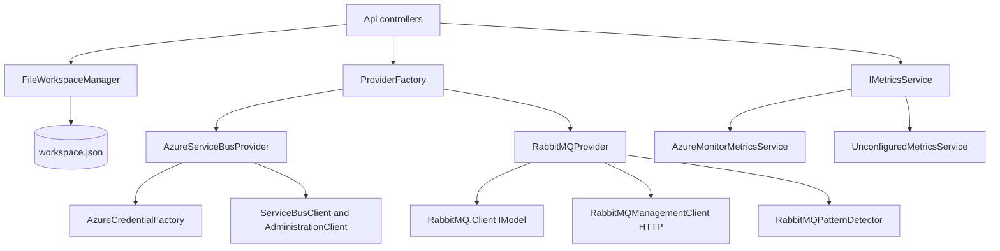

# Core: Public contract and flow

One topic of [[pages/services/core|Core]]; the map lists the others.

## Public contract

Everything is a .NET type consumed in-process by `src/ServiceBusExplorer.Api`. Project `ServiceBusExplorer.Core` targets net10.0 and exposes internals to `ServiceBusExplorer.Core.Tests` (`src/ServiceBusExplorer.Core/ServiceBusExplorer.Core.csproj#<InternalsVisibleTo Include="ServiceBusExplorer.Core.Tests" />`).

- **Provider seam:** `IMessagingProvider` (`src/ServiceBusExplorer.Core/Abstractions/IMessagingProvider.cs#IMessagingProvider`): connect/disconnect, queues, topics (RabbitMQ exchanges), subscriptions, peek/send/receive/search, `PurgeMessagesAsync` (`src/ServiceBusExplorer.Core/Abstractions/IMessagingProvider.cs#Task PurgeMessagesAsync(string entityName, MessageSubQueue subQueue = MessageSub`), and the three bulk calls `DeleteMessagesAsync` (`src/ServiceBusExplorer.Core/Abstractions/IMessagingProvider.cs#Task<BatchOperationResult> DeleteMessagesAsync(string entityName, long[] sequenc`), `ResubmitDeadLetterMessagesAsync` (`src/ServiceBusExplorer.Core/Abstractions/IMessagingProvider.cs#Task<BatchOperationResult> ResubmitDeadLetterMessagesAsync(string entityName, lo`), `MoveMessagesAsync` (`src/ServiceBusExplorer.Core/Abstractions/IMessagingProvider.cs#Task<BatchOperationResult> MoveMessagesAsync(string sourceEntityName, string tar`), each taking a `CancellationToken` and returning `BatchOperationResult`. Since 2026-11-12 every message operation takes a `MessageSubQueue` (`src/ServiceBusExplorer.Core/Abstractions/IMessagingProvider.cs#MessageSubQueue`: active, dead-letter, transfer dead-letter) where it took `bool isDeadLetter`, peek and search take a `CancellationToken` too (`src/ServiceBusExplorer.Core/Abstractions/IMessagingProvider.cs#Task<IEnumerable<IMessage>> PeekMessagesAsync(string entityName, int count = 10,`), and `CancelScheduledMessagesAsync` is a fourth bulk call (`src/ServiceBusExplorer.Core/Abstractions/IMessagingProvider.cs#Task<BatchOperationResult> CancelScheduledMessagesAsync(string queueName, long[]`); sessions at `src/ServiceBusExplorer.Core/Abstractions/IMessagingProvider.cs#Task<SessionList> GetSessionsAsync(string entityName, string? subscriptionName,` (a passive list, the detail of one session with up to `messageCount` of its messages, its messages alone, a state write that compares the state first; `src/ServiceBusExplorer.Core/Abstractions/IMessagingProvider.cs#Task<SessionDetail> GetSessionAsync(string entityName, string? subscriptionName,`).
- **Capabilities:** `IProviderCapabilities` (`src/ServiceBusExplorer.Core/Abstractions/IProviderCapabilities.cs#IProviderCapabilities`), a flag per feature (`SupportsSessions`, `SupportsSequenceNumbers`, ...). Azure sets almost all true (`src/ServiceBusExplorer.Core/Providers/Azure/AzureProviderCapabilities.cs#SupportsScheduledMessages`), deferral being false since 2026-11-12 because nothing defers (`src/ServiceBusExplorer.Core/Providers/Azure/AzureProviderCapabilities.cs#SupportsDeferral`); Since 2026-11-13 `SupportsPeekFromSequenceNumber` says whether a peek can start at a given sequence number (`src/ServiceBusExplorer.Core/Abstractions/IProviderCapabilities.cs#bool SupportsPeekFromSequenceNumber { get; }`): true for Azure, false for RabbitMQ (`src/ServiceBusExplorer.Core/Providers/Azure/AzureProviderCapabilities.cs#SupportsPeekFromSequenceNumber`, `src/ServiceBusExplorer.Core/Providers/RabbitMQ/RabbitMQProviderCapabilities.cs#SupportsPeekFromSequenceNumber`). RabbitMQ sets sessions, sequence numbers, scheduling, deferral and duplicate detection false (`src/ServiceBusExplorer.Core/Providers/RabbitMQ/RabbitMQProviderCapabilities.cs#SupportsScheduledMessages`, `src/ServiceBusExplorer.Core/Providers/RabbitMQ/RabbitMQProviderCapabilities.cs#SupportsSessions`, `src/ServiceBusExplorer.Core/Providers/RabbitMQ/RabbitMQProviderCapabilities.cs#SupportsSequenceNumbers`, `src/ServiceBusExplorer.Core/Providers/RabbitMQ/RabbitMQProviderCapabilities.cs#SupportsDeferral`, `src/ServiceBusExplorer.Core/Providers/RabbitMQ/RabbitMQProviderCapabilities.cs#SupportsDuplicateDetection`).
- **Capabilities:** `IProviderCapabilities` (`src/ServiceBusExplorer.Core/Abstractions/IProviderCapabilities.cs#IProviderCapabilities`), a flag per feature (`SupportsSessions`, `SupportsSequenceNumbers`, ...). Azure sets almost all true (`src/ServiceBusExplorer.Core/Providers/Azure/AzureProviderCapabilities.cs#SupportsScheduledMessages`), deferral being false since 2026-11-12 because nothing defers (`src/ServiceBusExplorer.Core/Providers/Azure/AzureProviderCapabilities.cs#SupportsDeferral`); RabbitMQ sets sessions, sequence numbers, scheduling, deferral and duplicate detection false (`src/ServiceBusExplorer.Core/Providers/RabbitMQ/RabbitMQProviderCapabilities.cs#SupportsScheduledMessages`, `src/ServiceBusExplorer.Core/Providers/RabbitMQ/RabbitMQProviderCapabilities.cs#SupportsSessions`, `src/ServiceBusExplorer.Core/Providers/RabbitMQ/RabbitMQProviderCapabilities.cs#SupportsSequenceNumbers`, `src/ServiceBusExplorer.Core/Providers/RabbitMQ/RabbitMQProviderCapabilities.cs#SupportsDeferral`, `src/ServiceBusExplorer.Core/Providers/RabbitMQ/RabbitMQProviderCapabilities.cs#SupportsDuplicateDetection`).
- **Config and entities:** `IConnectionConfig` (`src/ServiceBusExplorer.Core/Abstractions/IConnectionConfig.cs#IConnectionConfig`, `IsValid` and `GetDisplayTarget`), `IMessagingEntity` / `IQueueEntity` / `ITopicEntity` / `IMessage` (`src/ServiceBusExplorer.Core/Abstractions/IQueueEntity.cs#IQueueEntity`, `src/ServiceBusExplorer.Core/Abstractions/ITopicEntity.cs#ITopicEntity`, `src/ServiceBusExplorer.Core/Abstractions/IMessage.cs#IMessage`). The concrete shapes are the DTOs in `src/ServiceBusExplorer.Core/Models/` (`QueueInfo`, `TopicInfo`, `MessageInfo`).
- **Factory:** `IProviderFactory` / `ProviderFactory` (`src/ServiceBusExplorer.Core/Providers/ProviderFactory.cs#IProviderFactory`, `src/ServiceBusExplorer.Core/Providers/ProviderFactory.cs#ProviderFactory`). `ProviderType` has two values, `AzureServiceBus = 0` and `RabbitMQ = 1` (`src/ServiceBusExplorer.Core/Providers/ProviderType.cs#ProviderType`). Every switch on the enum (`CreateProvider` `src/ServiceBusExplorer.Core/Providers/ProviderFactory.cs#CreateProvider`, `CreateConnectionConfig` `src/ServiceBusExplorer.Core/Providers/ProviderFactory.cs#CreateConnectionConfig` and `src/ServiceBusExplorer.Core/Providers/ProviderFactory.cs#CreateConnectionConfig`, `GetProviderCapabilities` `src/ServiceBusExplorer.Core/Providers/ProviderFactory.cs#GetProviderCapabilities`) throws `ArgumentOutOfRangeException` for any other value, so a new provider touches all four ([[pages/invariants/provider-boundaries]]). `GetSupportedProviderTypes` is `Enum.GetValues` (`src/ServiceBusExplorer.Core/Providers/ProviderFactory.cs#GetSupportedProviderTypes`). `TestConnectionAsync` swallows exceptions and returns false (`src/ServiceBusExplorer.Core/Providers/ProviderFactory.cs#TestConnectionAsync`). `docs/ADDING_PROVIDERS.md` is the long-form guide.
- **Workspace:** `IConnectionManager` and `IConnectionGroupManager` (`src/ServiceBusExplorer.Core/Services/IConnectionManager.cs#IConnectionManager`, `src/ServiceBusExplorer.Core/Services/IConnectionGroupManager.cs#IConnectionGroupManager`), both implemented by `FileWorkspaceManager`.
- **Metrics:** `IMetricsService` (`src/ServiceBusExplorer.Core/Services/IMetricsService.cs#IMetricsService`) with queue, topic and subscription reads.

## How it works

The API resolves a saved connection with the secret (`GetConnectionWithSecretAsync`), asks `ProviderFactory.CreateConnectedProviderAsync` for a connected provider (`src/ServiceBusExplorer.Core/Providers/ProviderFactory.cs#CreateConnectedProviderAsync`; it disposes the provider if `ConnectAsync` throws, `src/ServiceBusExplorer.Core/Providers/ProviderFactory.cs#CreateConnectedProviderAsync`) and calls the interface. Providers are not thread-safe singletons: each holds one client and one config, and `DisconnectAsync` nulls them (`src/ServiceBusExplorer.Core/Providers/Azure/AzureServiceBusProvider.cs#DisconnectAsync`).
