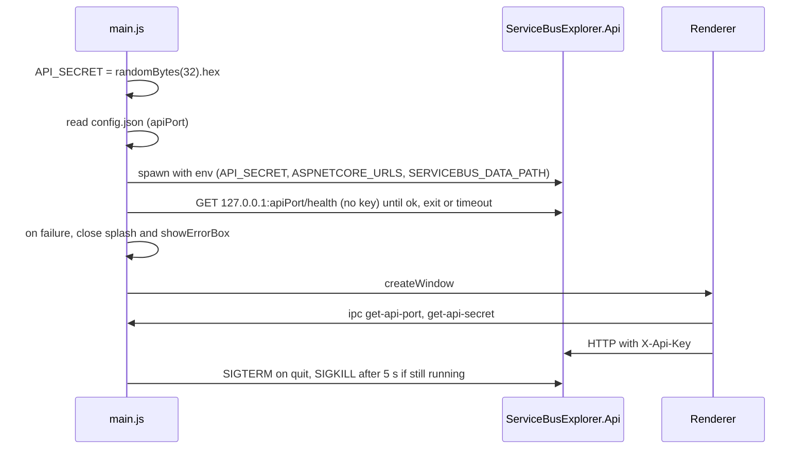

# Electron Shell

> The desktop wrapper: it launches the published .NET API with a random per-launch secret, shows the Angular UI in a sandboxed window, and owns tray, menu, updates and packaging.

## To change here, read

- [[pages/invariants/local-authenticated-api]] - the secret, loopback binding and `X-Api-Key` contract this process creates and enforces the start of.
- [[pages/invariants/secrets-masked-at-the-api-boundary]] - why the tray can show connection data safely.
- [[pages/services/web-app]] - the only consumer of `window.electronAPI`.
- [[pages/services/api]] - the child process; `API_SECRET` and `SERVICEBUS_DATA_PATH` are read there.
- [[pages/architecture/project-map]] and [[pages/conventions/tooling]] - repo layout and the release toolchain.

## Responsibility

Owns: process lifecycle of the API, window and splash, native menu, tray and its connection menu, single-instance lock, auto-update, `electron-builder` packaging and the release pipeline. Does not own any UI logic ([[pages/services/web-app]]) or any broker or storage code ([[pages/services/api]], [[pages/services/core]]).

## Startup and the API process

- Secret: `crypto.randomBytes(32).toString('hex')` at module load, so one new 64-hex-character secret per launch (`web-app/electron/main.js:10`). The API refuses to start with a secret shorter than 32 characters (`src/ServiceBusExplorer.Api/Program.cs:36`).
- Port: read from a `config.json`, trying `../../config.json`, `resourcesPath/config.json`, `../config.json` in that order (`web-app/electron/main.js:29`); default 5917 for the API and 4297 for the frontend when none is valid (`web-app/electron/main.js:47`). The repo's `config.json` holds those same two values. There is no free-port probing: the port is fixed per install, and a port already in use is not detected. The preload comment calling the port "dynamically-allocated" is wrong (`web-app/electron/preload.js:11`).
- Mode: `isDev = !app.isPackaged && NODE_ENV === 'development'` (`web-app/electron/main.js:56`).
- Dev: spawns `dotnet run --no-launch-profile` in `src/ServiceBusExplorer.Api` with `ASPNETCORE_URLS`, `ASPNETCORE_ENVIRONMENT=Development`, `SERVICEBUS_DATA_PATH`, `DOTNET_SYSTEM_GLOBALIZATION_INVARIANT=1` and `API_SECRET`, on top of `process.env` (`web-app/electron/main.js:630`). The renderer loads `http://localhost:{frontendPort}` (`web-app/electron/main.js:522`).
- Packaged: looks for `ServiceBusExplorer.Api(.exe)` under `resources/api`, `app.asar.unpacked/api`, `../resources/api`, then the repo publish folder (`web-app/electron/main.js:592`), tries `chmod 755` if not executable (`web-app/electron/main.js:685`), and spawns it with the same variables minus `ASPNETCORE_ENVIRONMENT` (`web-app/electron/main.js:698`). stdio is `['ignore','pipe','pipe']`.
- Data path: `userData/data`, created if missing, passed as `SERVICEBUS_DATA_PATH` (`web-app/electron/main.js:620`).
- Order: `whenReady` sets the application menu (`web-app/electron/main.js:793`), creates the splash, calls `startApi()`, creates the tray, then hands the start result to `openWindowWhenApiReady` (`web-app/electron/main.js:792`, `web-app/electron/main.js:799`). That function polls `http://127.0.0.1:{apiPort}/health` every 250 ms through `waitForHealth` (`web-app/electron/main.js:761`, `web-app/electron/shell-helpers.js:36`) until it answers ok, the child exits, or 30 s pass (120 s in dev, where `dotnet run` compiles first; `web-app/electron/main.js:764`). The probe sends no `X-Api-Key`: `/health` is public (`src/ServiceBusExplorer.Api/Program.cs:186`). Each fetch is aborted after 2 s and a fetch that never settles cannot hold the wait past its deadline. The splash stays up meanwhile and closes 1500 ms (500 ms in dev) after the window's `ready-to-show` (`web-app/electron/main.js:536`).
- Failure: `startApi()` returns a reason when it cannot spawn: executable not found, `chmod` failed, or spawn threw (`web-app/electron/main.js:660`, `web-app/electron/main.js:675`, `web-app/electron/main.js:689`, `web-app/electron/main.js:738`). The child's `error` and `exit` events record that it is gone, in dev and packaged (`web-app/electron/main.js:645`, `web-app/electron/main.js:722`, `web-app/electron/main.js:728`, `web-app/electron/main.js:744`). When the start failed, the child exited, or `/health` timed out, the main window is still created (hidden until `ready-to-show`) so the tray and menus work, and only then is the splash closed, so closing it cannot fire `window-all-closed` and quit the app on Linux or Windows; then `dialog.showErrorBox` says "The local API did not start" with the reason: not found, exited with code N, could not be launched, or did not answer within N seconds (`web-app/electron/main.js:755`, `web-app/electron/main.js:781`, `web-app/electron/main.js:785`, `web-app/electron/main.js:788`). A non-zero exit after a healthy start shows one error box unless the app is quitting (`web-app/electron/main.js:748`). There is no retry and no restart, and nothing is sent to the renderer. The dialog wiring has no automated test; only the `waitForHealth` outcomes are tested.
- Stop: on `before-quit` set `app.isQuitting` and, if the child is still running, call `stopProcess` (`web-app/electron/main.js:811`, `web-app/electron/main.js:815`): SIGTERM, then SIGKILL after 5 s if and only if `exitCode` and `signalCode` are both still null (`web-app/electron/shell-helpers.js:65`). It does not read `ChildProcess.killed`, which is true as soon as any signal was sent. The timer is unref'd. Whether Electron is still alive 5 s after `before-quit` for that timer to run is not verified (see Known gaps). On non-macOS `window-all-closed` calls `app.quit()` (`web-app/electron/main.js:819`).
- Single instance: `requestSingleInstanceLock`; a second launch shows a dialog and quits, the first instance is focused (`web-app/electron/main.js:59`, `web-app/electron/main.js:75`).

## Windows and security settings

- Main window: its options come from `mainWindowOptions` (`web-app/electron/shell-helpers.js:108`, called at `web-app/electron/main.js:486`): `nodeIntegration: false`, `contextIsolation: true`, `sandbox: true`, preload `preload.js` (`web-app/electron/shell-helpers.js:118`), pinned by `web-app/electron/shell-helpers.test.js:79`. Splash window uses the same three flags with no preload (`web-app/electron/main.js:466`).
- Production loads `dist/web-app/browser/index.html` from `file://` (`web-app/electron/main.js:524`).
- CSP is set through `onHeadersReceived` for every non-`file://` response: `default-src 'self'; script-src 'self'; ... connect-src 'self' http://localhost:*` (`web-app/electron/main.js:505`, `web-app/electron/main.js:515`). `file://` responses are skipped (`web-app/electron/main.js:507`), so the packaged window runs without this header; only the dev server is covered.
- `window.open` and link targets are always denied in-app; the URL goes to `shell.openExternal` only when `isSafeExternalUrl` accepts it, a parseable `http:` or `https:` URL (`web-app/electron/main.js:540`, `web-app/electron/main.js:541`, `web-app/electron/shell-helpers.js:4`). That is the only `openExternal` call in main.js.
- Close hides the window (Linux: minimize) instead of quitting; quitting is via Quit in the macOS application menu or tray Quit (`web-app/electron/main.js:548`).

## Window frame and menu

Since 2026-11-13, the owner's decision of 2026-11-12: a standard window and no menu bar of its own.

- **Frame.** The native frame and title bar on every platform: the options carry no `titleBarStyle`, `trafficLightPosition` or `vibrancy` (`web-app/electron/shell-helpers.js:108`). Until then macOS asked for `hiddenInset` with the window buttons at 15, 15, drawn over the toolbar, and no drag region. The page declares none now; the native title bar drags the window.
- **Background.** The Material surface colour of the system theme, `#111318` dark or `#f9f9ff` light, chosen by `nativeTheme.shouldUseDarkColors` (`web-app/electron/main.js:489`, `web-app/electron/shell-helpers.js:123`), instead of `#4A90E2`. The theme the user chose inside the app lives in the renderer's `localStorage` and is not read here, so someone who picked the opposite of the system theme sees the system colour until the first paint.
- **Menu.** `applicationMenuTemplate` (`web-app/electron/shell-helpers.js:76`) returns, on macOS, exactly three menus: the `appMenu` and `editMenu` roles and a `window` menu written out as minimize, zoom, close, a separator and front, because macOS delivers Cmd+C, Cmd+V, Cmd+X and Cmd+A through Edit and Cmd+M and Cmd+W through Window (the `windowMenu` role has no Close on macOS); elsewhere `null`, and `Menu.setApplicationMenu(null)` removes the menu bar (`web-app/electron/main.js:794`). Set once in `whenReady`, before the splash. Pinned by `web-app/electron/shell-helpers.test.js:14` and `web-app/electron/shell-helpers.test.js:19`.
- **Shortcuts without a menu.** `shellShortcut` (`web-app/electron/shell-helpers.js:93`) reads every key of the main window through `before-input-event` (`web-app/electron/main.js:492`) and takes it from the page only when it names an action: F11 toggles full screen on Windows and Linux, in every build; on macOS F11 is left alone, full screen being the zoom button and the system shortcut. F12 and Ctrl+Shift+I, Cmd+Alt+I on macOS, toggle the developer tools in a development build only; a packaged build never opens them. Key up and auto-repeat are ignored. Pinned by `web-app/electron/shell-helpers.test.js:40`, `web-app/electron/shell-helpers.test.js:48`, `web-app/electron/shell-helpers.test.js:54`, `web-app/electron/shell-helpers.test.js:62` and `web-app/electron/shell-helpers.test.js:70`.
- **What the old menu held.** File (Connection, Clear All Data (Testing), Exit), View (developer tools in development builds, developer mode, full screen) and Help (About) are gone. Connections is the first link of the app toolbar ([[pages/services/web-app]]); developer mode is the page's Ctrl+Shift+D or Cmd+Shift+D. Full screen and the developer tools are the shell's shortcuts above. About was **not** moved: the Settings screen that will hold it does not exist yet, so About survives only as the item of the macOS application menu; the toolbar's version badge shows the version.
- **Alt+F4 on Windows** was the accelerator of Exit and quit the app. It is now the system's close, which hides the window to the tray as the close button always did; this is intended, and quitting on Windows and Linux is tray Quit.

## IPC surface

| Channel | Direction | Returns / payload | Preload API | Caller in `web-app/src` |
|---|---|---|---|---|
| `get-app-version` | invoke | `app.getVersion()` (`web-app/electron/main.js:828`) | `getAppVersion` | `app.ts` `loadVersion` (`web-app/src/app/app.ts:179`) |
| `get-api-secret` | invoke | the per-launch secret (`web-app/electron/main.js:832`) | `getApiSecret` | `ApiService` (`web-app/src/app/core/services/api.service.ts:58`) |
| `get-api-port` | invoke | `apiPort` number (`web-app/electron/main.js:834`) | `getApiPort` | `ApiService` (`web-app/src/app/core/services/api.service.ts:45`) |
| `check-for-updates` | invoke | `{status:'dev-mode'}`, `{status:'ok',version}` or `{status:'error',message}` (`web-app/electron/main.js:878`) | `checkForUpdates` | `app.ts` (`web-app/src/app/app.ts:163`) |
| `download-update` | invoke | `{status:'ok'}` or error (`web-app/electron/main.js:889`) | `downloadUpdate` | `app.ts` (`web-app/src/app/app.ts:169`) |
| `install-update` | invoke | none; `quitAndInstall(false, true)` (`web-app/electron/main.js:899`) | `installUpdate` | `app.ts` (`web-app/src/app/app.ts:175`) |
| `set-update-channel` | invoke | for `latest` or `beta` only: stores and applies it, returns `{status:'ok',channel}`; anything else changes nothing and returns `{status:'error',message:'Unknown update channel'}` (`web-app/electron/main.js:904`) | `setUpdateChannel` | `app.ts` `switchChannel` |
| `get-update-channel` | invoke | stored channel, `latest` when the stored value is not a known channel (`web-app/electron/main.js:916`) | `getUpdateChannel` | `app.ts` `loadUpdateChannel` |
| `update-status` | main to renderer | `{status, version?, percent?, message?, releaseNotes?}` (`web-app/electron/main.js:841`) | `onUpdateStatus` | `app.ts` (`web-app/src/app/app.ts:210`) |
| `navigate` | main to renderer | route string, from the tray (`web-app/electron/main.js:331`, `web-app/electron/main.js:417`) | `onNavigate` | `app.ts` |
| `change-connection` | main to renderer | connection id from tray (`web-app/electron/main.js:327`) | `onChangeConnection` | `app.ts` |
| `set-active-connection` | `ipcMain.on` | sets tray checkmark (`web-app/electron/main.js:940`) | none | none |
| `connections-updated` | `ipcMain.on` | refreshes tray menu (`web-app/electron/main.js:947`) | none | none |

Removed on 2026-11-13 with the native menu, their only sender: `toggle-dev-mode` and `clear-all-data`, with the preload's `onToggleDevMode` and `onClearAllData`, the listener in `app.ts` and the one on the connections page; and `menu-new-connection` with `onNewConnection`, which had no sender at all. No channel was added.

The preload bridge also exposes `platform`, `isElectron` (`web-app/electron/preload.js:37`). Since 2026-11-13 `window.electronAPI` is the only global it exposes: the generic `window.electron.on`, whose one caller in `web-app/src` went with the clear-all-data listener, was removed. `web-app/electron/preload.test.js:30` loads the preload against a fake `electron` module and asserts that one global and the channels its listeners subscribe to, `change-connection`, `navigate` and `update-status` (`web-app/electron/preload.test.js:35`). Preload contains no `ipcRenderer.send`, so the two `ipcMain.on` handlers cannot be reached from the sandboxed renderer. Any script running in the window can call `getApiSecret`; the secret is therefore only as protected as the page content, see [[pages/invariants/local-authenticated-api]].

## Tray

The tray calls the API itself with Node `http` and the secret header (`web-app/electron/main.js:235`), for `connections` and `connectiongroups`, 5 s timeout, returning `[]` on any error (`web-app/electron/main.js:259`). It is first built at tray creation, before the API is likely to be up, and refreshed only by the two unreachable `ipcMain.on` handlers and by a connection click (`web-app/electron/main.js:335`). The tray list is therefore usually empty until a connection item is used. Menu labels use `connection.name`, falling back to the first 40 characters of `connection.connectionString` as returned by the API (`web-app/electron/main.js:320`); that value is the masked form per [[pages/invariants/secrets-masked-at-the-api-boundary]].

## Store and auto-update

- `electron-store` holds one key, `updateChannel`, default `'latest'` (`web-app/electron/main.js:13`).
- `electron-updater`: `autoDownload = false`, `autoInstallOnAppQuit = true`, `channel` from the store, run through `normalizeUpdateChannel` with `latest` as the fallback (`web-app/electron/main.js:837`, `web-app/electron/main.js:839`, `web-app/electron/shell-helpers.js:14`). The channel is applied at start-up and on every change by `applyUpdateChannel` (`web-app/electron/shell-helpers.js:19`), which sets `allowPrerelease` to true on `beta` only and `allowDowngrade` to false after the channel, because the library's channel setter turns downgrades on. With `allowPrerelease` off the GitHub provider asked the latest stable release for `beta.yml` and failed every check; with it on it takes the newest release, beta or stable, and falls back to `latest*.yml`. A beta build whose stored channel is still the default `latest` receives no prerelease until the user chooses Beta. `set-update-channel` accepts exactly `latest` and `beta` (`web-app/electron/main.js:904`), the two the UI offers (`web-app/src/app/app.ts:195`).
- Checks: 5 s after launch, then every 4 hours, skipped in dev (`web-app/electron/main.js:923`, `web-app/electron/main.js:926`). Failures are logged as "offline?" (`web-app/electron/main.js:930`).
- Feed: GitHub provider, owner `vitorafgomes`, repo `messaging-explorer`, `releaseType: release` (`web-app/package.json:159`). The release job uploads the updater metadata of both channels, `latest*.yml` and `beta*.yml` (`.github/workflows/release.yml:92`, `.github/workflows/release.yml:134`, `.github/workflows/release.yml:178`), and the `.blockmap` files of the Windows installer and the macOS packages for differential downloads (`.github/workflows/release.yml:133`, `.github/workflows/release.yml:177`); the AppImage carries its block map inside the file. electron-builder writes only the file of the version's own channel for the GitHub provider, so a `-beta` version yields `beta*.yml`. No beta release has been published yet, so the path is covered by tests and by reading the library, not by a real update.

## Logging

Everything goes to `console.*` of the main process; there is no log file. Findings:

- The secret is never logged by main.js: it appears only in the child env (`web-app/electron/main.js:638`, `web-app/electron/main.js:705`) and the tray header (`web-app/electron/main.js:236`). The API does not print it either; it only compares it (`src/ServiceBusExplorer.Api/Program.cs:204`).
- Child stdout and stderr are echoed verbatim as `[API]` and `[API ERROR]` (`web-app/electron/main.js:643`, `web-app/electron/main.js:712`, `web-app/electron/main.js:717`), so anything the API logs, including connection data if the API ever logs it, would reach the console. That is an API-side question, see [[pages/services/api]].
- Connection ids are logged on tray selection (`web-app/electron/main.js:941`). No connection string is passed to any `console` call in main.js or preload.js.
- The health probe logs nothing and sends no secret. Log strings in main.js carry no emoji markers since 2026-11-12.

## Packaging (`web-app/package.json` `build`)

- App id `com.messagingexplorer.app`, product `Messaging Explorer`, output `release/` (`web-app/package.json:91`). Files: `dist/web-app/**`, `electron/**` except `electron/**/*.test.js`, `src/assets/**`; assets are `asarUnpack`ed (`web-app/package.json:95`, `web-app/package.json:103`).
- `extraResources` copies `../src/ServiceBusExplorer.Api/bin/Release/net10.0/publish` to `resources/api` (`web-app/package.json:106`). That folder comes from `dotnet publish -c Release` with no runtime identifier (`web-app/package.json:22`) and the csproj sets no `SelfContained` or `RuntimeIdentifier`, so the API is framework-dependent and the user needs the .NET 10 runtime (inferred from the missing settings, not run). One publish output is shared by the arm64 and x64 mac builds.
- Windows: `nsis` and `portable`, `asInvoker` (`web-app/package.json:115`). macOS: `dmg` and `zip` for arm64 and x64 (`web-app/package.json:130`). Linux: `AppImage` and `deb` (`web-app/package.json:150`).
- Scripts use `electron-builder --publish never` (`web-app/package.json:28`); publishing is done by the workflow, not by the builder.

## Tests

- `web-app/electron/shell-helpers.js` holds the testable decisions of main.js in plain CommonJS with no `electron` import: `isSafeExternalUrl`, `normalizeUpdateChannel`, `applyUpdateChannel`, `waitForHealth`, `stopProcess`, and since 2026-11-13 `applicationMenuTemplate`, `mainWindowOptions` and `shellShortcut`.
- `web-app/electron/shell-helpers.test.js` covers them with `node:test` and `node:assert/strict`, no dependency: no application menu on win32 and linux and exactly the three menus on darwin (`web-app/electron/shell-helpers.test.js:14`, `web-app/electron/shell-helpers.test.js:19`), the shell's shortcuts for each platform and build (`web-app/electron/shell-helpers.test.js:40` to `web-app/electron/shell-helpers.test.js:70`), window options with no hidden title bar, traffic-light position or vibrancy and with the sandboxed web preferences (`web-app/electron/shell-helpers.test.js:79`), the background for each system theme (`web-app/electron/shell-helpers.test.js:93`), the accepted and refused URL schemes (`web-app/electron/shell-helpers.test.js:98`, `web-app/electron/shell-helpers.test.js:103`), the two channels and the rejected values (`web-app/electron/shell-helpers.test.js:113`, `web-app/electron/shell-helpers.test.js:118`), what a channel applies to the updater, with a fake whose channel setter turns downgrades on as the library's does (`web-app/electron/shell-helpers.test.js:142`, `web-app/electron/shell-helpers.test.js:149`, `web-app/electron/shell-helpers.test.js:156`), the health outcomes healthy, exited and timeout, including a fetch that never settles (`web-app/electron/shell-helpers.test.js:164`, `web-app/electron/shell-helpers.test.js:189`, `web-app/electron/shell-helpers.test.js:215`, `web-app/electron/shell-helpers.test.js:233`); since 2026-11-13 the two timeout cases run on the `node:test` fake clock (`setTimeout` and `Date`), so a five-minute deadline resolves in milliseconds and a stalled scheduler cannot change the count of attempts, and both `stopProcess` cases with a fake child whose `killed` turns true on the first signal (`web-app/electron/shell-helpers.test.js:270`, `web-app/electron/shell-helpers.test.js:282`).
- `web-app/electron/release-workflow.test.js` reads `.github/workflows/release.yml` as text and matches the upload globs of each OS against the files a stable and a beta build leave behind: the exact uploaded set, `beta*.yml` on a beta, the block maps, and never the builder's debug files (`web-app/electron/release-workflow.test.js:67`, `web-app/electron/release-workflow.test.js:74`, `web-app/electron/release-workflow.test.js:81`, `web-app/electron/release-workflow.test.js:91`).
- Run with `npm run test:electron` in `web-app/` (`web-app/package.json:26`); CI runs it in the `web` job after the Angular tests (`.github/workflows/ci.yml:117`).
- `web-app/electron/preload.test.js` loads the preload with a fake `electron` module (no Electron) and pins what it exposes; see the IPC surface.
- No test starts Electron. The wiring in main.js (the dialogs, the window opening after the wait, `before-quit`, the IPC handlers) is untested.

## Release workflow (`.github/workflows/release.yml`)

- Trigger: push of a tag matching `v*` only (`.github/workflows/release.yml:10`). One release per tag at a time (`.github/workflows/release.yml:16`). `contents: write` (`.github/workflows/release.yml:20`).
- Jobs: `build-linux` on ubuntu-latest (`.github/workflows/release.yml:56`), `build-windows` on windows-latest (`.github/workflows/release.yml:98`), `build-mac` on macos-latest (`.github/workflows/release.yml:141`); each sets up .NET 10 and Node 22, runs `npm ci` and `npm run electron:build:{linux,win,mac}`, and uploads artifacts with `if-no-files-found: error`. `release` needs all three, downloads them and calls `softprops/action-gh-release@v2` with generated notes; `prerelease` is true when the tag contains `-beta` (`.github/workflows/release.yml:184`, `.github/workflows/release.yml:212`, `.github/workflows/release.yml:215`).
- Signing: none. No certificate, `CSC_*` or notarization settings exist in the workflow or in `package.json`; the workflow header says macOS is unsigned (`.github/workflows/release.yml:5`). Windows output is unsigned as well (nothing configures it). Since 2026-11-12 the `verify-version` job fails the run when the tag is not `v` plus the `package.json` version (`.github/workflows/release.yml:43`).
- Tests: since 2026-11-12 every build job needs `verify`, which calls the CI workflow on the tagged commit (`.github/workflows/release.yml:29`, `.github/workflows/release.yml:58`), so a tag on a commit with a failing test packages nothing. CI does not build the Electron app (`.github/workflows/ci.yml:95`), and nothing starts a packaged app.

## Known gaps

- Port is fixed from `config.json`; no free-port probing despite the preload comment: `web-app/electron/preload.js:11`.
- The SIGKILL fallback may not fire on a real quit: Electron does not wait for Node timers after `before-quit`, so the process may be gone before the 5 s timer runs and the API is left with only SIGTERM. Unverified, needs a run of the packaged app: `web-app/electron/main.js:815`.
- The start-failure and crash dialogs, and the window opening only after `/health`, have no automated test; they need Electron. Only `waitForHealth` is tested: `web-app/electron/main.js:761`.
- A tray click during the health wait opens the main window before the API answers, because the tray exists first and calls `createWindow()` when there is no window: `web-app/electron/main.js:225`.
- No restart after the API crashes; the user gets one error box: `web-app/electron/main.js:748`. An API killed by a signal after a healthy start (exit code null) shows no box at all: `web-app/electron/main.js:750`.
- CSP not applied to the packaged `file://` window: `web-app/electron/main.js:507`.
- Tray refresh channels have no sender in preload, so the tray list goes stale: `web-app/electron/main.js:940`.
- The macOS window and menu are tested only as the options and the template the helpers return. Nobody has run the result on a Mac: whether the native title bar draws and drags as expected, whether Cmd+C and Cmd+V work in a text field through the Edit role and Cmd+W closes the window, and whether Cmd+Shift+D reaches the page as `D` or `d` (the page accepts both): `web-app/electron/shell-helpers.js:76`.
- No code signing for any OS: `.github/workflows/release.yml:5`.
- Framework-dependent API in the installer, .NET 10 runtime required on the host (inferred): `web-app/package.json:22`.

## Related

[[pages/services/web-app]], [[pages/services/api]], [[pages/architecture/project-map]]
