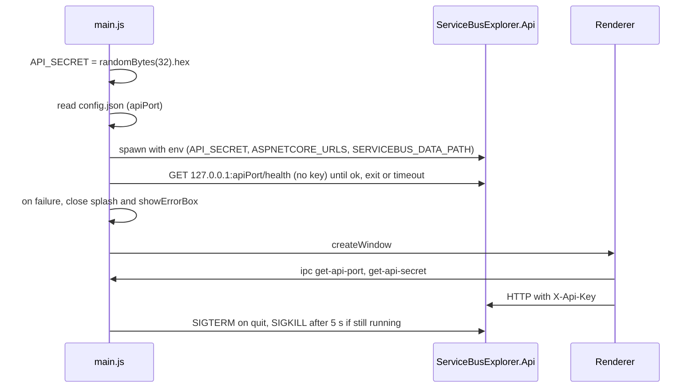

# Electron Shell: Startup and the API process

One topic of [[pages/services/electron-shell|Electron Shell]]; the map lists the others.

## Startup and the API process

- Secret: `crypto.randomBytes(32).toString('hex')` at module load, so one new 64-hex-character secret per launch (`web-app/electron/main.js#const API_SECRET = crypto.randomBytes(32).toString('hex');`). The API refuses to start with a secret shorter than 32 characters (`src/ServiceBusExplorer.Api/Program.cs`).
- Port: read from a `config.json`, trying `../../config.json`, `resourcesPath/config.json`, `../config.json` in that order (`web-app/electron/main.js#const candidates = [`); default 5917 for the API and 4297 for the frontend when none is valid (`web-app/electron/main.js#console.warn('[loadPortConfig] config.json not found, using defaults 5917/4297')`). The repo's `config.json` holds those same two values. There is no free-port probing: the port is fixed per install, and a port already in use is not detected. The preload comment calling the port "dynamically-allocated" is wrong (`web-app/electron/preload.js#// Get the dynamically-allocated API port from the Electron main process`).
- Mode: `isDev = !app.isPackaged && NODE_ENV === 'development'` (`web-app/electron/main.js#const isDev = !app.isPackaged && process.env.NODE_ENV === 'development';`).
- Dev: spawns `dotnet run --no-launch-profile` in `src/ServiceBusExplorer.Api` with `ASPNETCORE_URLS`, `ASPNETCORE_ENVIRONMENT=Development`, `SERVICEBUS_DATA_PATH`, `DOTNET_SYSTEM_GLOBALIZATION_INVARIANT=1` and `API_SECRET`, on top of `process.env` (`web-app/electron/main.js#apiProcess = spawn('dotnet', ['run', '--no-launch-profile'], {`). The renderer loads `http://localhost:{frontendPort}` (`web-app/electron/main.js`).
- Packaged: looks for `ServiceBusExplorer.Api(.exe)` under `resources/api`, `app.asar.unpacked/api`, `../resources/api`, then the repo publish folder (`web-app/electron/main.js#const possiblePaths = [`), tries `chmod 755` if not executable (`web-app/electron/main.js#fs.chmodSync(executable, 0o755);`), and spawns it with the same variables minus `ASPNETCORE_ENVIRONMENT` (`web-app/electron/main.js#apiProcess = spawn(executable, [], {`). stdio is `['ignore','pipe','pipe']`.
- Data path: `userData/data`, created if missing, passed as `SERVICEBUS_DATA_PATH` (`web-app/electron/main.js#const userDataPath = app.getPath('userData');`).
- Order: `whenReady` sets the application menu (`web-app/electron/main.js#const menuTemplate = applicationMenuTemplate(process.platform);`), creates the splash, calls `startApi()`, creates the tray, then hands the start result to `openWindowWhenApiReady` (`web-app/electron/main.js#app.whenReady().then(() => {`, `web-app/electron/main.js#openWindowWhenApiReady(startFailure);`). That function polls `http://127.0.0.1:{apiPort}/health` every 250 ms through `waitForHealth` (`web-app/electron/main.js#async function openWindowWhenApiReady(startFailure) {`, `web-app/electron/shell-helpers.js#async function waitForHealth({ url, timeoutMs, intervalMs, fetchFn, hasExited })`) until it answers ok, the child exits, or 30 s pass (120 s in dev, where `dotnet run` compiles first; `web-app/electron/main.js#const timeoutMs = isDev ? 120_000 : 30_000;`). The probe sends no `X-Api-Key`: `/health` is public (`src/ServiceBusExplorer.Api/Program.cs#FileWorkspaceManager`). Each fetch is aborted after 2 s and a fetch that never settles cannot hold the wait past its deadline. The splash stays up meanwhile and closes 1500 ms (500 ms in dev) after the window's `ready-to-show` (`web-app/electron/main.js#}, isDev ? 500 : 1500);`).
- Failure: `startApi()` returns a reason when it cannot spawn: executable not found, `chmod` failed, or spawn threw (`web-app/electron/main.js#if (!apiPath) {`, `web-app/electron/main.js#return 'the API executable was not found';`, `web-app/electron/main.js#return 'the API executable could not be made executable';`, `web-app/electron/main.js`). The child's `error` and `exit` events record that it is gone, in dev and packaged (`web-app/electron/main.js#apiProcess.on('error', recordApiError);`, `web-app/electron/main.js#apiProcess.on('error', (err) => {`, `web-app/electron/main.js#apiProcess.on('exit', (code, signal) => {`, `web-app/electron/main.js#function recordApiError(err) {`). When the start failed, the child exited, or `/health` timed out, the main window is still created (hidden until `ready-to-show`) so the tray and menus work, and only then is the splash closed, so closing it cannot fire `window-all-closed` and quit the app on Linux or Windows; then `dialog.showErrorBox` says "The local API did not start" with the reason: not found, exited with code N, could not be launched, or did not answer within N seconds (`web-app/electron/main.js#function describeApiExit(exit) {`, `web-app/electron/main.js#createWindow();`, `web-app/electron/main.js#splashWindow.close();`, `web-app/electron/main.js`). A non-zero exit after a healthy start shows one error box unless the app is quitting (`web-app/electron/main.js#function recordApiExit(code, signal) {`). There is no retry and no restart, and nothing is sent to the renderer. The dialog wiring has no automated test; only the `waitForHealth` outcomes are tested.
- Stop: on `before-quit` set `app.isQuitting` and, if the child is still running, call `stopProcess` (`web-app/electron/main.js#app.on('before-quit', () => {`, `web-app/electron/main.js#stopProcess(apiProcess, { graceMs: 5000 }).unref();`): SIGTERM, then SIGKILL after 5 s if and only if `exitCode` and `signalCode` are both still null (`web-app/electron/shell-helpers.js#if (child.exitCode === null && child.signalCode === null) {`). It does not read `ChildProcess.killed`, which is true as soon as any signal was sent. The timer is unref'd. Whether Electron is still alive 5 s after `before-quit` for that timer to run is not verified (see [[pages/services/electron-shell/known-gaps|Known gaps]]). On non-macOS `window-all-closed` calls `app.quit()` (`web-app/electron/main.js#app.on('window-all-closed', () => {`).
- Single instance: `requestSingleInstanceLock`; a second launch shows a dialog and quits, the first instance is focused (`web-app/electron/main.js#const gotTheLock = app.requestSingleInstanceLock();`, `web-app/electron/main.js#app.on('second-instance', (event, commandLine, workingDirectory) => {`).
