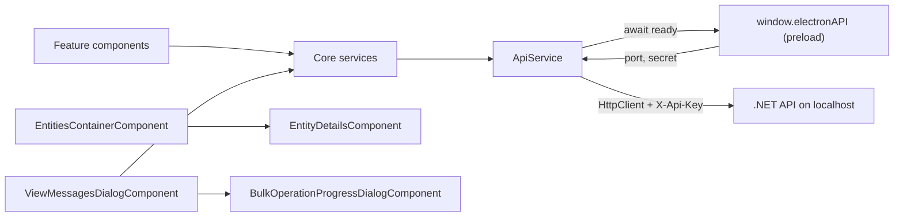

# Web App

> The Angular 21 UI under `web-app/src/`: it renders connections, entities, messages and monitoring, and sends every HTTP call to the local .NET API through `ApiService`.

## To change here, read

- [[pages/invariants/local-authenticated-api]] - the `X-Api-Key` contract `ApiService` must keep honouring.
- [[pages/invariants/secrets-masked-at-the-api-boundary]] - the UI only ever receives masked connection strings and passwords.
- [[pages/invariants/provider-boundaries]] - what may be provider-specific and where.
- [[pages/invariants/bulk-operations-are-at-least-once]] - what cancel and retry mean for the bulk dialogs.
- [[pages/services/electron-shell]] - owns `window.electronAPI`, the only source of the API port and secret.
- [[pages/services/api]] and [[pages/services/core]] - the contract this app mirrors.
- [[pages/conventions/testing]] and [[pages/conventions/tooling]] - how tests and builds are run.

## Responsibility

Owns all presentation and client-side state: connection management, the entity tree, message browsing, send, import, export, diff, bulk dialogs, monitoring charts, templates, theme, filters. Does not own persistence of connections or any broker access; that is the API ([[pages/services/api]]) and the Core library ([[pages/services/core]]). Does not own process management, tray, menu or updates; that is [[pages/services/electron-shell]].

## Stack

| Item | Value | Source |
|---|---|---|
| Angular | `^21.2.8` (core, router, forms, common) | `web-app/package.json:52` |
| Angular Material and CDK | `^21.0.5` | `web-app/package.json:55` |
| ng-bootstrap, bootstrap | `^20.0.0`, `^5.3.7`, with Font Awesome and Material Icons | `web-app/package.json:61` |
| Charts | `apexcharts`, `ng-apexcharts` | `web-app/package.json:64` |
| Export | `exceljs`, loaded with a dynamic `import()` only when XLSX export runs | `web-app/src/app/core/services/message-export.service.ts:139` |
| Electron-only deps | `electron-store`, `electron-updater` (used by the main process, not by `src/`) | `web-app/package.json:67` |
| TypeScript, vitest, jsdom | `~5.9.2`, `^4.0.8`, `^27.1.0` | `web-app/package.json:87` |
| Build | `@angular/build:application`, default configuration `production` | `web-app/angular.json:22` |
| Dev server | `@angular/build:dev-server`, port 4297 | `web-app/angular.json:78` |
| Budgets (production) | initial warn 1.5MB / error 2MB; per component style warn 20kB / error 32kB | `web-app/angular.json:47` |

All components are standalone; there are no NgModules.

## Bootstrap and routing

- `web-app/src/main.ts:5` calls `bootstrapApplication(App, appConfig)`.
- `web-app/src/app/app.config.ts:9` detects Electron by the presence of `window.electronAPI`. Under Electron it uses hash routing so `file://` works (`web-app/src/app/app.config.ts:15`); in a browser it uses path routing. `provideHttpClient()` is registered with no interceptors (`web-app/src/app/app.config.ts:16`).
- Routes are all lazy `loadComponent` (`web-app/src/app/app.routes.ts:3`): `''` redirects to `connections`, then `connections`, `entities`, `queues`, `topics`, `monitoring`.
- `web-app/src/app/app.ts:90` registers the Electron listeners (navigate and change-connection from the tray, update status) only when `isElectron`. It keeps the last five window errors for the bug-report dialog (`web-app/src/app/app.ts:112`).
- **Navigation is the toolbar** (2026-11-13). The toolbar starts with a `nav` named "Main" holding one Material text button per route, Connections, Entities, Queues, Topics and Monitoring (`web-app/src/app/app.html:2`, `web-app/src/app/app.ts:77`), the same in Electron and in the browser; the active one carries `aria-current="page"` and the secondary-container colour (`web-app/src/app/app.html:4`). Until then the links sat in a side navigation rendered only outside Electron, so Queues, Topics and Monitoring had no way in from the desktop app. The side navigation, its toggle button and the "Messaging Explorer" text of the toolbar were removed, as the prototype draws it; the window title carries the name. A long namespace in the connection badge shortens with an ellipsis (`web-app/src/app/app.html:31`). Pinned by `web-app/src/app/app.spec.ts:79`, `web-app/src/app/app.spec.ts:90` and `web-app/src/app/app.spec.ts:103`, which read the links against `app.routes.ts`, so a route added without a link fails. The prototype's toolbar draws three links (Connections, Entities, Monitoring); the app has five because Queues and Topics are routes of their own.
- **Developer mode shortcut.** Ctrl+Shift+D, or Cmd+Shift+D on a Mac, toggles developer mode, through a window `HostListener` that goes with the component (`web-app/src/app/app.ts:99`); the letter is matched in either case. Pinned by `web-app/src/app/app.spec.ts:111`.

## How it works

### ApiService (the single HTTP gate)

- A grep of `web-app/src/app` for `HttpClient` finds only `api.service.ts` (plus the provider in `app.config.ts`); every service calls `ApiService.get/post/put/delete` (`web-app/src/app/core/services/api.service.ts:76`). No `fetch`, `XMLHttpRequest` or `EventSource` is used.
- Constructor: only if `window.electronAPI` exists, it builds a `ready` promise that awaits `getApiPort()` and `getApiSecret()` in parallel (`web-app/src/app/core/services/api.service.ts:23`, `web-app/src/app/core/services/api.service.ts:35`).
- Port: a positive number from Electron replaces the base URL with `http://localhost:{port}/api` (`web-app/src/app/core/services/api.service.ts:45`). Otherwise `environment.apiUrl` is used, `http://localhost:5917/api` in both environment files (`web-app/src/environments/environment.ts:3`, `web-app/src/environments/environment.prod.ts:8`).
- Secret: stored in memory, attached as `X-Api-Key` on every verb via `getHeaders()` (`web-app/src/app/core/services/api.service.ts:65`). If the secret call throws it is logged and requests go out without the header (`web-app/src/app/core/services/api.service.ts:59`), so the API answers 401.
- Plain browser (no Electron): `ready` stays null, requests are sent immediately with no `X-Api-Key` (`web-app/src/app/core/services/api.service.ts:72`). The API requires the key on everything except `/health` and answers 401 otherwise (`src/ServiceBusExplorer.Api/Program.cs:198`, `src/ServiceBusExplorer.Api/Program.cs:204`), and refuses to start without `API_SECRET` (`src/ServiceBusExplorer.Api/Program.cs:36`). So a browser tab pointed at a running API cannot call it; see [[pages/invariants/local-authenticated-api]].
- GET requests append a `_t=Date.now()` cache buster (`web-app/src/app/core/services/api.service.ts:78`).
- **Names in a path are encoded once, by one helper.** Every endpoint that carries a value is written as an `apiPath` tagged template (`web-app/src/app/core/services/api-path.ts:7`): each interpolated value, an entity, topic, subscription or session name, a connection or group id, a sequence number or a query value, goes through `encodeURIComponent`, and the literal parts stay as written. A queue named `a/messages` is deleted with `DELETE queues/a%2Fmessages`, never the purge route of `a`; a purge of `orders#1` is `DELETE queues/orders%231/messages`, never a request for `orders`. No other code encodes, so nothing is encoded twice (`50%off` becomes `50%25off`). An `undefined` or `null` value throws instead of writing the text into the URL (`web-app/src/app/core/services/api-path.ts:11`). Endpoints with no value stay plain strings. The API decodes each segment once on its side ([[pages/services/api]]). Pinned by `web-app/src/app/core/services/api-path.spec.ts:4` and the "names in the URL" specs of the queue, topic, session and metrics services (`web-app/src/app/core/services/queue.service.spec.ts:115`, `web-app/src/app/core/services/topic.service.spec.ts:98`, `web-app/src/app/core/services/session.service.spec.ts:63`, `web-app/src/app/core/services/metrics.service.spec.ts:294`).

### Bulk operations

- `BulkOperationsService` is selection state only: one `BehaviorSubject` holding one selection per tab, three since 2026-11-12 (active, deadletter, transferdeadletter), each keyed by sequence number (`web-app/src/app/core/services/bulk-operations.service.ts:67`). It does no batching, no progress and no HTTP. "All selected" is not stored: `isAllSelected` takes the list the tab shows now and checks every row of it (`web-app/src/app/core/services/bulk-operations.service.ts:230`), so a selection made over a search never counts as the whole page.
- The operations live in `ViewMessagesDialogComponent`: resubmit (`web-app/src/app/features/messages/view-messages-dialog.component.ts:1607`), delete (`web-app/src/app/features/messages/view-messages-dialog.component.ts:2202`), move (`web-app/src/app/features/messages/view-messages-dialog.component.ts:2405`). Each sends one request carrying all selected sequence numbers (`web-app/src/app/core/services/queue.service.ts:147`, `web-app/src/app/core/services/queue.service.ts:160`, `web-app/src/app/core/services/queue.service.ts:173`). The client does not chunk; batching is the server's job.
- **"All" means the entity, not the page.** Delete sends `all: true` with an empty list, and the server drains, only when the number of selected messages equals the entity's count for that tab and no search or filter is active (`web-app/src/app/features/messages/view-messages-dialog.component.ts:2299`, `web-app/src/app/features/messages/view-messages-dialog.component.ts:2198`), and never on the transfer dead-letter tab, which has no purge; the confirmation then asks for an acknowledgement. Selecting the 20 loaded messages of a queue of 50,000 sends those 20 sequence numbers. Every change of the quick search or of a filter clears the tab's selection (`web-app/src/app/features/messages/view-messages-dialog.component.ts:1249`, `web-app/src/app/features/messages/view-messages-dialog.component.ts:1320`). The count compared is the one the dialog received when it opened, updated after each operation, not a fresh read. The selection bar says what a selection covers, as on prototype artboard 4: "3 selected of 20 loaded, 37 in the dead-letter queue" (`web-app/src/app/features/messages/view-messages-dialog.component.ts:1998`). Pinned by the "never deletes the whole entity" specs (`web-app/src/app/features/messages/view-messages-dialog.component.spec.ts:115`).
- **A possible duplicate is never retried.** A failure whose text says the message "may be duplicated" (the two texts the Azure provider writes when a send succeeded and the complete failed) is a possible duplicate (`web-app/src/app/core/services/bulk-operations.service.ts:10`). The API has no field for it yet, so the match is on text, marked as a ceiling in the code. The retry list for resubmit and for move is built from the result without those entries (`web-app/src/app/features/messages/view-messages-dialog.component.ts:1656`, `web-app/src/app/features/messages/view-messages-dialog.component.ts:2453`), Retry is offered only when one remains, and the results dialog labels each entry "Possible duplicate - do not retry" or "Failed" (`web-app/src/app/shared/components/bulk-operation-results-dialog/bulk-operation-results-dialog.component.ts:106`).
- **Automatic resubmit of a dead-letter queue (2026-11-13).** Two behaviours, chosen when the dialog opens by the API's own answer: only `supportsPeekFromSequenceNumber === true` gives the run (`web-app/src/app/features/messages/continuous-resubmit-dialog.component.ts:311`); `ProviderService` keeps the flag false while the capabilities load, after a failed call and for anything but an explicit true (`web-app/src/app/core/services/provider.service.ts:82`, `web-app/src/app/core/services/provider.service.ts:195`). The dead-letter and transfer dead-letter peeks of the queue and topic services take an optional `fromSequenceNumber`, written into the URL only when given, 0 included (`web-app/src/app/core/services/queue.service.ts:89`, `web-app/src/app/core/services/topic.service.ts:198`).
  - **The run** belongs to the app, not to the dialog: `ResubmitRunService`, a root service, keeps at most one run per entity and sub-queue (`web-app/src/app/core/services/resubmit-run.service.ts:553`), so closing or destroying the dialog leaves it running and the dialog opened again shows it. At the start it reads the dead-letter count N, the entity's lock duration and the start time (`web-app/src/app/core/services/resubmit-run.service.ts:237`); each cycle peeks at most `min(batchSize, N - read)` (`web-app/src/app/core/services/resubmit-run.service.ts:259`) from a cursor that only moves forward, past the highest sequence number of each batch whatever happened to it (`web-app/src/app/core/services/resubmit-run.service.ts:276`), so a message left behind is never read again. Every message counts against N, so the run reads at most N whatever the queue does and whatever the client clock says. It skips a sequence number below the cursor (`web-app/src/app/core/services/resubmit-run.service.ts:280`) and leaves alone every message enqueued at or after its start, and one whose enqueued time it cannot read (`web-app/src/app/core/services/resubmit-run.service.ts:283`): a message it resubmitted that the consumer dead-letters again is not resubmitted a second time. It ends when a peek returns nothing, N messages were read, a batch holds only messages newer than the start (which also ends it against an API that ignores the position), or a message stays "Not found within scan window" after one wait. An error the run does not expect ends it failed, never leaves it running (`web-app/src/app/core/services/resubmit-run.service.ts:170`). It keeps counters, the per-reason totals (at most 50 reasons apart, the rest as "(other reasons)", because the reason is free text a consumer writes) and the failed and possible-duplicate entries (sequence number, dead-letter reason, the API's error); never a message.
  - **Batch size and bodies.** A run starts at 250 per batch, what the server receives per scan, and the dialog says a smaller batch costs the broker more scans (`web-app/src/app/features/messages/continuous-resubmit-dialog.component.ts:345`); the head-of-queue loop keeps 10. Without a text filter the run peeks with `includeBody=false` (`web-app/src/app/core/services/resubmit-run.service.ts:262`), which the queue and topic services add to the URL only when asked (`web-app/src/app/core/services/queue.service.ts:91`); the API then answers the messages without their body. With a text filter, the text is matched by a case-insensitive regular expression built once from the escaped text (`web-app/src/app/core/services/resubmit-run.service.ts:167`).
  - **Filter and failures.** An optional reason (equals) and text (in the subject or body, ignoring case) are applied to each batch as it is read (`web-app/src/app/core/services/resubmit-run.service.ts:437`); the screen shows "Matched so far", never a count of the queue, and with a filter set it warns that a filter leaves the messages it skips at the head of the queue, which the server can reach only a few hundred messages past, so a filtered run may stop early (`web-app/src/app/features/messages/continuous-resubmit-dialog.component.ts:196`). The default "Skip it, continue, and report it at the end" records a message the broker refused and goes on; "Stop at the first failure" ends the run on the batch that reports one (`web-app/src/app/core/services/resubmit-run.service.ts:379`). A possible duplicate is recorded apart and never sent again, nor offered for retry. A resubmit answer whose failure entries cannot be read is an unknown outcome (`web-app/src/app/core/services/resubmit-run.service.ts:344`).
  - **A message the server did not find is never left behind by moving on.** The server finds each target by receiving from the head of the dead-letter queue and abandoning what it does not want, about 250 to 500 messages deep (measured by the API lane on the emulator), and the messages a previous call received stay locked until their lock expires, so the next batch's targets can come back "Not found within scan window" for a while. Moving the cursor past such a message would leave it at the head, where every later scan abandons it again. So the run sends the rest of the batch, waits the entity's lock duration, at most 5 minutes, one second at a time with "Waiting for the broker to release the messages of the last batch" and the time left (`web-app/src/app/core/services/resubmit-run.service.ts:410`), and sends the ones not found once more; Pause holds that second try and Stop ends the wait at once. Still not found, they are listed as failed and the run ends failed, saying the head holds messages the server cannot scan past (`web-app/src/app/core/services/resubmit-run.service.ts:392`). Nothing was received or sent for a message not found, so trying it again is safe. The configure screen says that continuing applies to a refused message and a possible duplicate only.
  - **Pause, Resume, Stop.** Pause starts nothing new once the request in flight has answered (`web-app/src/app/core/services/resubmit-run.service.ts:459`); Stop unsubscribes the request in flight, which aborts the HTTP call (`web-app/src/app/core/services/resubmit-run.service.ts:455`). A resubmit that was in flight when Stop came, that failed as a call, or whose answer cannot be read has an unknown outcome: its messages are reported as possible duplicates and kept out of the retry (`web-app/src/app/core/services/resubmit-run.service.ts:430`). Resume acts on a paused run only; a stopped, failed or finished run is never resumed.
  - **A change of connection.** The API swaps its broker inside the connect request (`src/ServiceBusExplorer.Api/Controllers/ConnectionsController.cs:227`), and a connect whose save fails afterwards answers 500 with the new broker already in place. So `ConnectionService` runs a hook the run service registers before it posts a connect, a disconnect or a clear of all data (`web-app/src/app/core/services/connection.service.ts:154`): every active run is stopped, its request in flight aborted, and the post waits until each run has ended, a run that failed included (`web-app/src/app/core/services/resubmit-run.service.ts:542`). From then until the API's status arrives no run starts and none is retried (`web-app/src/app/core/services/resubmit-run.service.ts:554`); the dialog says "The connection is changing, so no run was started." When the request fails, the status is read again from the API (`web-app/src/app/core/services/connection.service.ts:158`), so a connect that failed after the switch still updates the selection, the capabilities and the runs. The tray's change of connection goes through the same `connect`. A status that arrives later stops runs too (`web-app/src/app/core/services/resubmit-run.service.ts:534`). Either way a run from before cannot be retried: "Retry the N failed" is offered only under the connection the run ran on (`web-app/src/app/core/services/resubmit-run.service.ts:565`), and the screen names the connection of the run.
  - **Progress and report.** Read of N, matched so far, resubmitted, failed, possible duplicates, elapsed, the rate over the last minute and the time left from N, computed when a batch is read or answered, with no timer (`web-app/src/app/core/services/resubmit-run.service.ts:482`). The report (`web-app/src/app/core/services/resubmit-run.service.ts:211`) gives the totals, the counts per dead-letter reason and every failed and possible-duplicate sequence number; the screen shows the first 100, its rows kept by sequence number while the run goes on (`web-app/src/app/features/messages/continuous-resubmit-dialog.component.ts:323`), and "Save report, JSON" downloads all of them through `MessageExportService.downloadFile` (`web-app/src/app/features/messages/continuous-resubmit-dialog.component.ts:432`). "Retry the N failed" starts a run on exactly the failed sequence numbers, without peeking and without the possible duplicates (`web-app/src/app/core/services/resubmit-run.service.ts:573`, `web-app/src/app/core/services/resubmit-run.service.ts:305`). Every state of the dialog says "This operation is at-least-once: a message sent but not removed from the dead-letter queue may be delivered twice." (`web-app/src/app/features/messages/continuous-resubmit-dialog.component.ts:43`).
  - **Where it shows.** A toolbar button, shown only while a run is running or paused, lists the active runs and opens the dialog of the one chosen (`web-app/src/app/app.html:70`, `web-app/src/app/features/messages/resubmit-run-indicator.component.ts:50`); the Auto Resubmit entry of the queue and subscription panels reads "Resubmit running: read of N" while its entity has an active run (`web-app/src/app/features/entities/entity-details.component.ts:2057`). The dialog moved to Angular Material and theme tokens.
  - Pinned by `web-app/src/app/core/services/resubmit-run.service.spec.ts:96` to `web-app/src/app/core/services/resubmit-run.service.spec.ts:806`, `web-app/src/app/features/messages/continuous-resubmit-dialog.component.spec.ts:131` to `web-app/src/app/features/messages/continuous-resubmit-dialog.component.spec.ts:360`, `web-app/src/app/core/services/connection.service.spec.ts:22`, `web-app/src/app/features/messages/resubmit-run-indicator.component.spec.ts:16` and `web-app/src/app/features/entities/entity-details.component.spec.ts:226`.
- **Where the API cannot read from a position, continuous resubmit stops on the first failure,** as before. Each cycle peeks the head of the dead-letter queue, where a failed or possibly duplicated message stays, so the loop stops on the first batch that reports any failure and says which sequence numbers failed and which may be duplicated (`web-app/src/app/features/messages/continuous-resubmit-dialog.component.ts:516`, `web-app/src/app/features/messages/continuous-resubmit-dialog.component.ts:530`). The dialog has no restart, so nothing that failed in a run is sent again by it, and it ends with the dialog. An error the loop does not expect ends the run as a failure, never as "Completed - Dead letter queue is empty" (`web-app/src/app/features/messages/continuous-resubmit-dialog.component.ts:406`), locked by `web-app/src/app/features/messages/continuous-resubmit-dialog.component.spec.ts:116`.
- **A failed load is not an empty list** (2026-11-13). The entity tree fails when the queue or topic list fails (`web-app/src/app/core/services/tree-data-builder.service.ts:31`) and says "Could not load entities" (`web-app/src/app/features/entities/entities-tree.component.ts:70`); the topics page loads the subscriptions of a topic when it is opened, once, shows "Loading subscriptions..." until they arrive, and on a failure says so and closes the topic so that opening it again retries (`web-app/src/app/features/topics/topics.component.ts:227`, `web-app/src/app/features/topics/topics.component.ts:251`). The tree still asks for the subscriptions of every topic, because its dead-letter alerts need them. One load runs at a time on both screens: a new load cancels the one in flight (`web-app/src/app/features/entities/entities-tree.component.ts:770`, `web-app/src/app/features/topics/topics.component.ts:208`), so an earlier failure cannot put the error panel over a later good tree. The topics page marks loaded subscriptions per topic object, not per name (`web-app/src/app/features/topics/topics.component.ts:184`), so an answer that lands after a reload cannot mark the new topic of that name as loaded (`web-app/src/app/features/topics/topics.component.spec.ts:84`).
- **Send and export** (2026-11-13). Each send takes the properties and the schedule from the form as it is, so a retry after a failure never carries a value the user cleared (`web-app/src/app/features/messages/send-message-dialog.component.ts:435`). A CSV cell that starts with `=`, `+`, `-`, `@`, a tab or a carriage return is prefixed with an apostrophe so a spreadsheet reads it as text (`web-app/src/app/core/services/message-export.service.ts:317`), and the CSV import removes it again (`web-app/src/app/core/services/message-import.service.ts:296`), so export then import keeps the bodies, apart from surrounding white space, which the import has always trimmed. A connected status clears the dead-letter alerts before the tree loads (`web-app/src/app/features/entities/entities-tree.component.ts:742`), so a switch whose load fails shows none of the previous connection's alerts.
- **Continuous resubmit stops on the first failure.** Each cycle peeks the head of the dead-letter queue, where a failed or possibly duplicated message stays, so the loop stops on the first batch that reports any failure and says which sequence numbers failed and which may be duplicated (`web-app/src/app/features/messages/continuous-resubmit-dialog.component.ts:516`, `web-app/src/app/features/messages/continuous-resubmit-dialog.component.ts:530`). The dialog has no restart, so nothing that failed in a run is sent again by it. Since 2026-11-13 an error the loop does not expect also ends the run as a failure, never as "Completed - Dead letter queue is empty" (`web-app/src/app/features/messages/continuous-resubmit-dialog.component.ts:406`), locked by `web-app/src/app/features/messages/continuous-resubmit-dialog.component.spec.ts:116`.
- **Guards against a stacked delete.** A keyboard shortcut does nothing while another dialog is open over the messages dialog (`web-app/src/app/features/messages/view-messages-dialog.component.ts:2676`), and a delete does not start while one is in flight (`web-app/src/app/features/messages/view-messages-dialog.component.ts:2181`).
- Progress is not incremental: `updateProgress` is called once, with the final result (`web-app/src/app/features/messages/view-messages-dialog.component.ts:1642`).
- Cancel: the progress dialog emits `cancelRequested$` (`web-app/src/app/shared/components/bulk-operation-progress-dialog/bulk-operation-progress-dialog.component.ts:381`); the parent pipes the in-flight observable through `takeUntil`, which aborts the XHR (`web-app/src/app/features/messages/view-messages-dialog.component.ts:1626`, `web-app/src/app/features/messages/view-messages-dialog.component.ts:1634`). The API passes `HttpContext.RequestAborted` to the provider (`src/ServiceBusExplorer.Api/Controllers/QueuesController.cs:310`).
- After an abort: the success handler is skipped, no results dialog opens, the entity message list and counters are not reloaded, and the progress dialog stays open in a "cancelled" state with a Close button (`web-app/src/app/features/messages/view-messages-dialog.component.ts:1638`, `web-app/src/app/shared/components/bulk-operation-progress-dialog/bulk-operation-progress-dialog.component.ts:125`). The dialog itself warns that messages already processed server-side may have been affected; delivery is at-least-once, see [[pages/invariants/bulk-operations-are-at-least-once]].

### Entity selection and the purge confirmation

- `EntitySelectionService` clears the selection on every connection status after the one it starts with: a connect, a disconnect or the startup status (`web-app/src/app/core/services/entity-selection.service.ts:40`). Only those three emit, so an entity selected under one connection is never shown, with its Purge, Send and View, under another; the tree no longer clears it on its own. A new selection or a clear cancels the load still in flight (`web-app/src/app/core/services/entity-selection.service.ts:47`, `web-app/src/app/core/services/entity-selection.service.ts:82`), so a late response neither overwrites a newer selection nor brings back one from the previous connection. Pinned by `web-app/src/app/core/services/entity-selection.service.spec.ts:46`.
- The purge confirmation names what it destroys, as on prototype artboard 3: the kind and name, the topic of a subscription, the connection target (namespace or host) and the count, the live one when the panel has it and otherwise the one read when the entity was loaded, said as such; it reuses the confirm dialog with its acknowledgement checkbox (`web-app/src/app/features/entities/entity-details.component.ts:2100`). Only a subscription has a live count today; a queue shows the count from selection.

### Highlight pipe

`HighlightPipe` escapes every text segment through a detached `div.textContent` then reads `innerHTML` (`web-app/src/app/shared/pipes/highlight.pipe.ts:83`), wraps matches in `<mark>` after escaping (`web-app/src/app/shared/pipes/highlight.pipe.ts:63`) and returns a plain string, not `SafeHtml`, so Angular's own `[innerHTML]` sanitizer still runs (`web-app/src/app/shared/pipes/highlight.pipe.ts:74`). It never calls `bypassSecurityTrustHtml`. Used in three `[innerHTML]` bindings of the messages dialog (`web-app/src/app/features/messages/view-messages-dialog.component.ts:210`, `web-app/src/app/features/messages/view-messages-dialog.component.ts:333`, `web-app/src/app/features/messages/view-messages-dialog.component.ts:509`).

## core/

- `models/`: DTO interfaces mirroring the API (connection, connection-group, message, queue, topic, metrics, monitoring, session, filter, provider, tree-node) and the provider component contract (`web-app/src/app/core/models/provider-component.interface.ts:55`).
- `services/`: `api` and `api-path` (above); `connection`, `connection-group`, `queue`, `topic`, `session`, `monitoring`, `metrics`, `provider` (all thin `ApiService` wrappers); `bulk-operations` (selection); `message-search`, `advanced-message-filter` (client-side filtering, filter presets in localStorage under prefix `advanced-filter-`, `web-app/src/app/core/services/advanced-message-filter.service.ts:19`); `message-export` (CSV/JSON/XLSX), `message-import`; `message-template` (localStorage key `explorer-messages-templates`, `web-app/src/app/core/services/message-template.service.ts:6`); `theme` (key `app-theme`, `web-app/src/app/core/services/theme.service.ts:8`); `dev-settings` (key `dev-mode`); `dead-letter-notification`, `entity-selection`, `tree-data-builder`, `logger` (silent in production builds, `web-app/src/app/core/services/logger.service.ts:12`).

## features/

**Entity administration (2026-11-12),** under `features/entities/`: `entity-form-dialog` (create and edit of a queue, topic or subscription), `entity-review-dialog` (the changed fields with current and new value, before saving), `entity-status-dialog` (a status other than Active needs the entity's name typed) and `entity-admin-actions` (the status chip and the Edit and Status actions of the panel header). Angular Material, each with a spec. They appear only when the API's own answer says `supportsEntityUpdate` is true; unlike the other capabilities, a default never turns this one on, nor the rules editor, nor the transfer dead-letter queue (`web-app/src/app/core/services/provider.service.ts:83`). `ApiService` gained `patch` (`web-app/src/app/core/services/api.service.ts:99`); durations go to the wire through one formatter (`web-app/src/app/features/entities/duration.ts:103`) and the contract's limits are mirrored in `entity-validation.ts` for inline errors, the server being the authority.

**Sub-queues, scheduled messages and a disabled entity (2026-11-12),** under `features/messages/`. The messages dialog no longer carries a dead-letter boolean: one `subQueue` value is derived from the tab shown (`web-app/src/app/features/messages/view-messages-dialog.component.ts:1111`) and every list, selection and action reads it. A third tab, Transfer dead-letter, appears only when the API's own answer says `supportsTransferDeadLetter` is true (`web-app/src/app/features/messages/view-messages-dialog.component.ts:83`); it peeks, searches, deletes a selection and resubmits (`web-app/src/app/core/services/queue.service.ts:180`, `web-app/src/app/core/services/topic.service.ts:259`), with no purge and no move. The queue and subscription panels show a Transfer Dead Letter card when the count is above zero, and it opens that tab only under the same flag (`web-app/src/app/features/entities/entity-details.component.ts:110`, `web-app/src/app/features/entities/entity-details.component.ts:353`, `web-app/src/app/features/entities/entity-details.component.ts:1888`). Each message shows a state chip when it is Scheduled or Deferred (`web-app/src/app/features/messages/view-messages-dialog.component.ts:206`); a "Scheduled" filter on a queue's Active tab narrows the loaded messages, client side (`web-app/src/app/features/messages/view-messages-dialog.component.ts:1291`). Cancel scheduled is offered on a queue's Active tab only (`web-app/src/app/features/messages/view-messages-dialog.component.ts:2046`) and enabled only when every selected message is scheduled and at most 500 are selected (`web-app/src/app/features/messages/view-messages-dialog.component.ts:2051`, `web-app/src/app/features/messages/view-messages-dialog.component.ts:42`); `cancel-scheduled-dialog` confirms it and needs the queue name typed for more than one message (`web-app/src/app/features/messages/cancel-scheduled-dialog.component.ts:77`); the result opens in the bulk results dialog. A 409 from any message call is shown in the API's own words, "The entity is disabled for this operation." (`web-app/src/app/features/messages/message-call-failure.ts:8`). `supportsDeferral` defaults to false. Open points are on [[pages/roadmap/followups]].

**Sessions (2026-11-13),** under `features/entities/`: `entity-sessions` serves the queue panel and the subscription panel alike. The queue panel gained Material tabs, Properties and Sessions (`web-app/src/app/features/entities/entity-details.component.ts:142`); the subscription keeps its tab strip and mounts the same component (`web-app/src/app/features/entities/entity-details.component.ts:554`). Either appears only when the entity requires sessions and the capability is not explicitly false. The component is created the first time its tab opens, so selecting an entity reads nothing, and is then kept while that entity stays selected: the queue's tab group preserves its content and the subscription hides the component instead of destroying it, so going back to the tab shows the same list without a second scan. Another entity, or a reload of the selection (after a purge, say), drops it until the tab opens again (`web-app/src/app/features/entities/entity-details.component.ts:1872`). `SessionService` calls the three routes under `api/queues/{name}/sessions` and `api/topics/{topic}/subscriptions/{subscription}/sessions` through one path helper (`web-app/src/app/core/services/session.service.ts:17`); the old `api/sessions` routes and their callers are gone.
- **The list locks nothing.** It is read once when the tab opens (a peek of up to 1000 messages on the server, at most 100 sessions back) and shows each session id with the messages seen in the scan. A truncated scan says "Listed from the first N messages." before the sentence on sessions further back or holding only a state; a complete scan says only that sessions holding only a state are not shown. A state-only session is opened by typing its id, 1 to 128 characters and not only spaces (`web-app/src/app/features/entities/entity-sessions.component.ts:213`). A Refresh button beside that notice, named "Refresh the sessions", scans again (`web-app/src/app/features/entities/entity-sessions.component.ts:74`). Above both, the screen says that opening a session locks it for a moment (`web-app/src/app/features/entities/entity-sessions.component.ts:42`).
- **Opening one session is one request:** `GET .../sessions/{sessionId}?messageCount=100` answers the detail with up to 100 messages read under a single lock (`web-app/src/app/features/entities/entity-sessions.component.ts:259`): the state as text, a binary state as its byte count and base64 with no editor, the time the read held the lock until, and a read-only table of up to 100 messages (sequence number, message id, enqueued time, state, a 100-character body preview). A 400, 404 or 409 is shown in the API's words with Retry; anything else says the API did not answer. A new entity resets the component and unsubscribes what was in flight (`web-app/src/app/features/entities/entity-sessions.component.ts:224`).
- **The state editor never overwrites a state someone else changed.** `session-state-dialog` edits or clears the state (an empty text clears it), refuses more than 262144 bytes as UTF-8, enables Save only when the text differs from the state as read (an empty field and no state are the same: a zero-byte state arrives as null), then confirms with the current state beside the new and the sentence "The application that consumes this session reads this state next." The write carries `expectedState` exactly as read, null included (`web-app/src/app/features/entities/session-state-dialog.component.ts:152`). The two 409 answers are told apart by their `code`, never by the text: on `SessionStateChanged` the dialog disables the write and offers Reload, also after Back and Save, which reopens the session and puts the focus back on Edit state; it never sends again (`web-app/src/app/features/entities/session-state-dialog.component.ts:162`). On success the panel shows the state the server returned. No Format button: the app has no shared JSON formatter.

**Entity definitions (2026-11-13),** under `features/entities/`. The tree header has Export definitions and Import definitions, two named icon buttons shown only when the API's own answer says `supportsDefinitions` is true; a default never turns them on (`web-app/src/app/features/entities/entities-tree.component.ts:720`, `web-app/src/app/core/services/provider.service.ts:196`). `DefinitionsService` posts to `namespace/export` and to `namespace/import` with `dryRun=true` or `false`, through `ApiService` (`web-app/src/app/core/services/definitions.service.ts:13`).
- **Export** (`export-definitions-dialog`) names the connection and its environment, says messages and secrets are not in the file, and on Export to a file saves the API's document as `<namespace>.definitions.json` through the existing download helper, then says how many queues, topics, subscriptions and rules it holds, or that the namespace has none (`web-app/src/app/features/entities/export-definitions-dialog.component.ts:13`, `web-app/src/app/features/entities/export-definitions-dialog.component.ts:107`). Cancel while it runs abandons the request; a failure says nothing was saved and offers Retry.
- **Import** (`import-definitions-dialog`) reads a chosen file, refuses one that is not JSON before any call, and sends it to the dry run as read (`web-app/src/app/features/entities/import-definitions-dialog.component.ts:237`). It shows three groups, Would be created, Already exist and Exist and differ with the differing fields, and the sentence "Import only creates." with the counts. The confirmation names the connection, the environment and how many entities would be created; Create stays disabled until the namespace is typed exactly, case included (`web-app/src/app/features/entities/import-definitions-dialog.component.ts:192`), and sends the same document with `dryRun=false` (`web-app/src/app/features/entities/import-definitions-dialog.component.ts:256`). The result lists every entity: created, left as it is (exists or differs) or failed with the API's reason; the tree is reloaded. A 400 or 413 is shown in the API's words, naming the field; an import the API does not confirm says some entities may exist now and offers the dry run again. With nothing to create there is no Create button. While the import runs the dialog cannot be closed, by Cancel, Escape or the backdrop, so its result is never abandoned half way.

- `connections/` - connection list, add/edit dialog, client and environment groups, export of connections (`web-app/src/app/features/connections/connections.component.ts:236`). Since 2026-11-13 the screen and its three dialogs are Material and theme tokens, drawn from the Connections artboard: one table with a row group per client and environment, "Ungrouped Connections" last, columns Connection, Broker, Target and Actions; groups no longer collapse. The artboard's Last used column is not built: the API sets `LastUsedAt` on connect, but the save keeps only the editable fields, so every connection would read "Never". A row offers Connect, or Open entities on the active connection, an edit icon button named "Edit {name}", and Delete apart in the error colour, named "Delete {name}". Loading, empty and a failed load are three states; a failed load says the connections could not be loaded and offers Retry, where it used to end on "No connections configured" (`web-app/src/app/features/connections/connections.component.ts:123`). The empty state has its own Add Connection and Import, and the header actions are hidden there. Styles are in `connections.component.scss`. The developer-mode debug panel is left as it was, Bootstrap and Font Awesome included. Pinned by `web-app/src/app/features/connections/connections.component.spec.ts`; the masking of the dialogs is unchanged and still pinned by the two dialog specs.
- `entities/` - the main workspace: tree plus details (`web-app/src/app/features/entities/entities-container.component.ts:14`), transfer monitor. The metrics dashboard that drew mock data was removed on 2026-11-12.
- `messages/` - view, send, import, export, move, diff and continuous-resubmit dialogs.
- `queues/`, `topics/` - list pages with per-row purge and actions.
- `monitoring/` - snapshot and history charts (`web-app/src/app/features/monitoring/monitoring.component.ts:623`) and, since 2026-11-13, the counts of every entity (below).

**Monitoring (2026-11-13).** The screen reads `GET monitoring/snapshot`, now `{ snapshot, pollIntervalSeconds, lastPollFailedAt }`, with the recent history when it opens or the connection changes, and the snapshot again every 30 seconds from the local API (`web-app/src/app/features/monitoring/monitoring.component.ts:735`). Its states are distinct: loading until the API answers; "Waiting for the API's first poll of the broker" while `snapshot` is null and no poll failed; "Could not read the counts from the broker", with the time and Retry, while `snapshot` is null and a poll failed; "Could not load the monitoring data" when the request itself fails; "Nothing to monitor in this namespace" only for a snapshot with no entity; and over data from before a failed poll, a line saying the last poll failed and when the counts are from. The header says how often the API reads the broker. Two Material tabs follow: Overview, the summary cards, chart and two tables as before, and All entities, `monitoring-counts` (`web-app/src/app/features/monitoring/monitoring-counts.component.ts:60`), drawn from the `counts` state of the monitoring artboard:
- one `mat-table` of every queue and subscription with Name (a subscription says its topic), Kind, Active, Dead-letter, Scheduled and Transfer dead-letter; a count the API sends as null reads "Not counted", which is every subscription's scheduled count;
- `matSort` on every column, dead-letter descending at first, a text column ascending on its first click and a count descending, a null count sorting below zero (`web-app/src/app/features/monitoring/monitoring-counts.component.ts:110`);
- a name filter that matches part of the name or of the topic, ignoring case, with a line saying how many entities match and how many are over the threshold (`web-app/src/app/features/monitoring/monitoring-counts.component.ts:109`);
- a dead-letter threshold, a whole number, 100 at first, kept in `localStorage` under `monitoring-dead-letter-threshold` (`web-app/src/app/features/monitoring/monitoring-counts.component.ts:129`); a row whose dead-letter count is strictly above it is marked "over threshold" in the error container colour, which the theme has, as no warning colour is defined yet;
- the name, a button named "Open {name} in Entities", selects that queue, or that subscription of its topic, in `EntitySelectionService` and navigates to `/entities` (`web-app/src/app/features/monitoring/monitoring-counts.component.ts:143`);
- a refresh icon button per row, named "Refresh the counts of {name}", reads that entity through `GET monitoring/counts` and shows its counts until the next snapshot; a failure says why and keeps the counts of the last poll (`web-app/src/app/features/monitoring/monitoring-counts.component.ts:152`).
Each 30-second read of the snapshot costs little: the table keeps a row element per entity (`trackBy` on the row key), `monitoring-counts` is `OnPush` and its state is all signals, and the All entities tab is created only when it is opened (`matTabContent`); the Overview deltas look the previous snapshot up in one map instead of a search per entity. The artboard's "Refresh every" select is not built: the period is the API's setting, not the app's, and the screen shows it read-only. Its "Auto resubmit" link waits for that feature. Pinned by `web-app/src/app/features/monitoring/monitoring-counts.component.spec.ts` and `web-app/src/app/features/monitoring/monitoring.component.spec.ts`; the query values are encoded once by `apiPath` (`web-app/src/app/core/services/monitoring.service.spec.ts:17`).

## providers/ and the registry

- `ProviderRegistryService` maps `ProviderType` to an entity-details component class, filled by lazy `import()` of the `azure-service-bus` and `rabbitmq` barrels (`web-app/src/app/providers/provider-registry.service.ts:57`, `web-app/src/app/providers/provider-registry.service.ts:67`).
- `ProviderShellComponent` resolves the class and calls `createComponent` (`web-app/src/app/features/entities/provider-shell.component.ts:173`, `web-app/src/app/features/entities/provider-shell.component.ts:183`).
- But the shell is not used: the `entities` route renders `<app-entity-details>` directly (`web-app/src/app/features/entities/entities-container.component.ts:20`), and a grep of `src/app` finds no `app-provider-shell` outside doc comments. The registry, shell and both provider components are therefore unreachable at runtime; the 2178-line `EntityDetailsComponent` handles both brokers, and since 2026-11-12 it hides what the connected broker's capabilities say it cannot do: sessions, scheduled messages and the dead-letter side, each only when the flag is explicitly false (`web-app/src/app/features/entities/entity-details.component.ts:1883`). See [[pages/invariants/provider-boundaries]].
- `kafka/` holds three empty folders (`.gitkeep`) and a barrel containing only a TODO comment (`web-app/src/app/providers/kafka/index.ts:4`). No Kafka component, no `ProviderType.Kafka` in the frontend enum (`web-app/src/app/core/models/provider.model.ts:5`), and none in the backend enum (`src/ServiceBusExplorer.Core/Providers/ProviderType.cs:6`): there is no backend provider.
- `ProviderService` follows the active connection: on connect it holds that provider's built-in default capabilities, then the API's answer merged over them; a failed call keeps the defaults of the connected provider without an error; on disconnect the state resets and a late answer for the previous connection is dropped (`web-app/src/app/core/services/provider.service.ts:123`). The API sends the provider type by name and the service normalises it (`web-app/src/app/core/services/provider.service.ts:96`). It lists only Azure and RabbitMQ.

### docs/ADDING_PROVIDERS.md versus the code

- Step 1 (add enum value): matches the current enum shape (`web-app/src/app/core/models/provider.model.ts:5`) but the backend enum must also change and the guide omits it.
- Step 8 (register in `registerProviders`): matches the registry (`web-app/src/app/providers/provider-registry.service.ts:55`).
- Architecture flow ("ProviderShellComponent receives change ... renders provider UI", `docs/ADDING_PROVIDERS.md:21`): does not match; the shell is never instantiated, so completing steps 1 to 9 would not make a new provider appear.
- Step 9 (`EntityInfo` union): matches (`web-app/src/app/core/models/provider-component.interface.ts:13`).

## shared/

Components: `advanced-filter-panel`, `bulk-actions-toolbar`, `bulk-operation-progress-dialog`, `bulk-operation-results-dialog`, `message-body-editor` (Prism-based, `web-app/src/app/shared/components/message-body-editor/message-body-editor.component.ts:426`). Top level: `confirm-dialog`, `bug-report-dialog`. Pipes: `highlight` only.

## Tests

- 50 `*.spec.ts` files exist under `web-app/src` (2026-11-13).
- 50 `*.spec.ts` files exist under `web-app/src` (2026-11-13): 892 tests pass and 8 are skipped.
- `web-app/scripts/generate-icons.js` sets a non-zero exit code when generation fails (`web-app/scripts/generate-icons.js:43`), tested with a stubbed `sharp` by `web-app/scripts/generate-icons.test.js:26`. No npm script and no CI job runs that test: `test:electron` globs `electron/**` only (`web-app/package.json:26`); run it with `node --test scripts/generate-icons.test.js` in `web-app/`.
- `npm test` is `ng test` (`web-app/package.json:25`). `angular.json` sets the `@angular/build:unit-test` builder with no `runner` option (`web-app/angular.json:90`); the builder schema defaults `runner` to `vitest`, `runnerConfig` to `false` and `include` to `**/*.spec.ts` (`web-app/node_modules/@angular/build/src/builders/unit-test/schema.json:19`, `web-app/node_modules/@angular/build/src/builders/unit-test/schema.json:25`, `web-app/node_modules/@angular/build/src/builders/unit-test/schema.json:45`). Run on 2026-11-12, after the sub-queue and cancel-scheduled changes, `npm test -- --watch=false` executes all 45 files: 827 tests pass and 8 are skipped (three `describe.skip` blocks for the refresh variants in `web-app/src/app/core/services/metrics.service.spec.ts:314`).
- Plain `npx vitest` is not a way to run these tests: without the Angular builder there is no compiler, so components with signal inputs or `templateUrl` fail. A `vitest.config.ts` that listed 11 files for that mode was removed on 2026-11-12; the builder never read it.
- **End-to-end tests** (2026-11-13), in `web-app/e2e/`, run with `npx playwright test -c e2e` in `web-app/`. They drive the production build in Chromium against the real API and RabbitMQ and the Service Bus emulator in containers the run starts. They save every screen they reach in light and dark under `web-app/dist/e2e/screenshots/`.
  - They run the Electron renderer path in a browser. The page gets the two preload members `ApiService` reads, `getApiPort` and `getApiSecret` (`web-app/e2e/fixtures.ts:13`), so the key is attached by `ApiService` as in the desktop app, and routing is by hash.
  - Browser mode without a key stays unreachable by design ([[pages/invariants/local-authenticated-api]]). Neither `ApiService` nor the API changed for the tests.
  - How they run, the flows, the defects they pin as expected failures, and what they do not cover are on [[pages/conventions/testing]].
- CI: the web job runs `npm ci`, the tests and `npm run build` (`.github/workflows/ci.yml:109`, `.github/workflows/ci.yml:115`, `.github/workflows/ci.yml:121`). No lint step; `web-app/package.json` has no `lint` script. See [[pages/conventions/testing]].

## Hot spots

- `web-app/src/app/features/entities/entity-details.component.ts:1837` - 2178 lines, template inline; handles both brokers, purge, send. The topic panel is read-only text since 2026-11-12: it used to be a form with no save.
- `web-app/src/app/features/messages/view-messages-dialog.component.ts:984` - 2719 lines; three near-identical bulk flows (resubmit, delete, move) and the cancel of scheduled messages.
- `web-app/src/app/shared/components/message-body-editor/message-body-editor.component.ts:426` - 1239 lines.
- `web-app/src/app/features/connections/connections.component.ts:236` - 737 lines, of which the debug panel and its methods are a large part.
- `web-app/src/app/features/connections/add-connection-dialog.component.ts:323` - 672 lines.
- `web-app/src/app/shared/components/advanced-filter-panel/advanced-filter-panel.component.ts:545` - 799 lines.
- `web-app/src/app/features/entities/entities-tree.component.ts:706` - 790 lines.
- `web-app/src/app/features/monitoring/monitoring.component.ts:623` - 785 lines.
- `web-app/src/app/features/monitoring/monitoring.component.ts:623` - 846 lines; the Overview tab is still Bootstrap and Font Awesome.

## Known gaps

- Provider registry, shell and provider components are not wired into any route: `web-app/src/app/features/entities/entities-container.component.ts:20`.
- `docs/ADDING_PROVIDERS.md:21` describes a flow the code does not run.
- A 3537-line `web-app/src/app/features/entities/entity-details.component.ts.backup` is committed next to the live file.
- No lint or format script exists for the web app, and CI runs none.
- The counts table renders every row, with no virtual scroll or paging, marked as a ceiling in the code; a namespace of several hundred entities draws them all: `web-app/src/app/features/monitoring/monitoring-counts.component.ts:81`.
- `LastUsedAt` never reaches the list: the connect sets it (`src/ServiceBusExplorer.Api/Controllers/ConnectionsController.cs:246`) and the save copies only the editable fields onto the stored connection (`src/ServiceBusExplorer.Core/Services/FileWorkspaceManager.cs:342`), the same root as `IsConnected`. Seen in the end-to-end screenshots of 2026-11-13: every connection read "Never" right after a connect, so the Connections screen has no Last used column.
- The developer-mode debug panel of the Connections screen is still Bootstrap with Font Awesome icons and two literal colours, left as it was so the removal of its Clear All Data button merges cleanly: `web-app/src/app/features/connections/connections.component.ts:77`. The connected chip keeps the class `badge`, which a pinned end-to-end expected failure looks for.
- The Overview tab of the monitoring screen (summary cards, chart, two tables) is still Bootstrap with Font Awesome icons and literal colours; the header, the states and the All entities tab are Material: `web-app/src/app/features/monitoring/monitoring.component.ts:107`.
- Eight tests are skipped: the refresh variants in `web-app/src/app/core/services/metrics.service.spec.ts:314`, with a TODO about timers under zoneless Angular.
- Bulk progress is a single final update, not per batch: `web-app/src/app/features/messages/view-messages-dialog.component.ts:1642`.
- After a cancel the message list and counters are not refreshed: `web-app/src/app/features/messages/view-messages-dialog.component.ts:1638`.
- A possible duplicate is recognised by the provider's English text, not a field: a change of that text in the Azure provider would make Retry Failed resend duplicates again, and RabbitMQ writes no such text. Ceiling until `BatchOperationFailure` carries a flag: `web-app/src/app/core/services/bulk-operations.service.ts:10`.
- The drain-all decision compares the selection with the count the messages dialog received when it opened, not a fresh read; if the entity grew past what was loaded, a selection equal to that stale count still drains everything present at execution, behind the acknowledgement: `web-app/src/app/features/messages/view-messages-dialog.component.ts:2299`.
- A disabled-entity failure of a resubmit or a move is listed as retryable: only a possible duplicate is kept out of the retry list (`web-app/src/app/features/messages/view-messages-dialog.component.ts:1656`, `web-app/src/app/features/messages/view-messages-dialog.component.ts:2453`), so Retry Failed resends by hand to an entity that is still disabled.
- The export dialog still takes a dead-letter boolean and says "(Dead Letter)" for an export from the transfer dead-letter tab: `web-app/src/app/features/messages/export-messages-dialog.component.ts:46`.
- The "Scheduled" view filters the loaded messages; it is not a listing from the broker: `web-app/src/app/features/messages/view-messages-dialog.component.ts:1291`.
- `cancelScheduledBlockedReason` and `scheduledLoadedCount` are methods bound in the template and recompute on every change detection pass (`web-app/src/app/features/messages/view-messages-dialog.component.ts:2051`, `web-app/src/app/features/messages/view-messages-dialog.component.ts:1299`); not noticeable up to 1,000 loaded messages.
- If `getApiSecret()` fails the app silently sends unauthenticated requests: `web-app/src/app/core/services/api.service.ts:59`.
- `ProviderShellComponent` silently renders nothing when no component is registered (TODO in code): `web-app/src/app/features/entities/provider-shell.component.ts:176`.
- A name that is exactly `.` or `..` cannot be sent as a path segment: `encodeURIComponent` leaves dots alone and the browser's URL parser resolves `.`, `..` and their `%2E` forms as dot segments. Azure names cannot take that form; RabbitMQ names can, and deleting a subscription named `..` under topic `t` would become `DELETE /api/topics/t/` and delete the topic (read from the URL standard and the route table, not executed). `apiPath` does not refuse such a value today: `web-app/src/app/core/services/api-path.ts:7`.
- An automatic resubmit run lives in the renderer's memory: a reload or quitting the app ends it without asking, and its report is lost unless saved; the prototype draws a question on quit (`web-app/src/app/core/services/resubmit-run.service.ts:513`). After a connect that failed, no run starts until the status read again from the API arrives; if that read fails too, none starts until a later status does.
- The server's resubmit reaches only a few hundred messages past the head of the dead-letter queue. A filtered run, or one that leaves refused messages behind, fills the head with messages it does not send, and the run ends as failed once a message stays not found after one wait, short of N. A message "Not found within scan window" is recognised by the provider's English text, like a possible duplicate (`web-app/src/app/core/services/bulk-operations.service.ts:19`): a change of that text would make the run continue past such messages again. The wait and the second try are unit-tested with a fake clock only, not against a broker: `web-app/src/app/core/services/resubmit-run.service.ts:410`.
- The toolbar at the minimum window width was seen once in a headless browser at 1000 px, disconnected, light and dark; with a long namespace connected, with an update button, and in Electron on each system it was not: `web-app/src/app/app.html:2`.

## Related

[[pages/services/electron-shell]], [[pages/services/api]], [[pages/architecture/project-map]]
