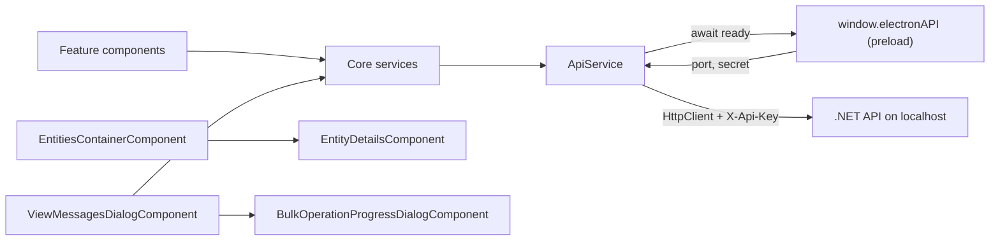

# Web App: Stack, bootstrap and core

One topic of [[pages/services/web-app|Web App]]; the map lists the others.

## Stack

| Item | Value | Source |
|---|---|---|
| Angular | `^21.2.8` (core, router, forms, common) | `web-app/package.json` |
| Angular Material and CDK | `^21.0.5` | `web-app/package.json` |
| ng-bootstrap, bootstrap | `^20.0.0`, `^5.3.7`, with Font Awesome and Material Icons | `web-app/package.json` |
| Charts | `apexcharts`, `ng-apexcharts` | `web-app/package.json` |
| Export | `exceljs`, loaded with a dynamic `import()` only when XLSX export runs | `web-app/src/app/core/services/message-export.service.ts#ExcelJS` |
| Electron-only deps | `electron-store`, `electron-updater` (used by the main process, not by `src/`) | `web-app/package.json` |
| TypeScript, vitest, jsdom | `~5.9.2`, `^4.0.8`, `^27.1.0` | `web-app/package.json` |
| Build | `@angular/build:application`, default configuration `production` | `web-app/angular.json` |
| Dev server | `@angular/build:dev-server`, port 4297 | `web-app/angular.json` |
| Budgets (production) | initial warn 1.5MB / error 2MB; per component style warn 20kB / error 32kB | `web-app/angular.json` |

All components are standalone; there are no NgModules.

## Bootstrap and routing

- `web-app/src/main.ts#bootstrapApplication(App, appConfig)` calls `bootstrapApplication(App, appConfig)`.
- `web-app/src/app/app.config.ts#isElectron` detects Electron by the presence of `window.electronAPI`. Under Electron it uses hash routing so `file://` works (`web-app/src/app/app.config.ts#provideBrowserGlobalErrorListeners`); in a browser it uses path routing. `provideHttpClient()` is registered with no interceptors (`web-app/src/app/app.config.ts#provideHttpClient`).
- Routes are all lazy `loadComponent` (`web-app/src/app/app.routes.ts#routes`): `''` redirects to `connections`, then `connections`, `entities`, `queues`, `topics`, `monitoring` and, since 2026-11-13, `settings`.
- `web-app/src/app/app.ts#ngOnInit` registers the Electron listeners (navigate and change-connection from the tray, update status) only when `isElectron`. Since 2026-11-13 it starts `BugReportService`, which keeps the last five window errors for the bug-report dialog (`web-app/src/app/shared/bug-report.service.ts#remember`), and `AppUpdateService` (`web-app/src/app/app.ts#ngOnInit`).
- **Navigation is the toolbar** (2026-11-13). The toolbar starts with a `nav` named "Main" holding one Material text button per route, Connections, Entities, Queues, Topics and Monitoring (`web-app/src/app/app.html`, `web-app/src/app/app.ts#App`), the same in Electron and in the browser; the active one carries `aria-current="page"` and the secondary-container colour (`web-app/src/app/app.html`). Until then the links sat in a side navigation rendered only outside Electron, so Queues, Topics and Monitoring had no way in from the desktop app. The side navigation, its toggle button and the "Messaging Explorer" text of the toolbar were removed, as the prototype draws it; the window title carries the name. A long namespace in the connection badge shortens with an ellipsis (`web-app/src/app/app.html`). Pinned by `web-app/src/app/app.spec.ts#every screen reachable without the menu: the main links and the Settings link cover every route`, `web-app/src/app/app.spec.ts#the toolbar marks the active route` and `web-app/src/app/app.spec.ts#in the browser the toolbar links to the same routes, Settings included`, which read the links against `app.routes.ts`, so a route added without a link fails. The prototype's toolbar draws three links (Connections, Entities, Monitoring); the app has five because Queues and Topics are routes of their own. At the right end an icon link named "Settings" opens the Settings screen and carries `aria-current` there (`web-app/src/app/app.html`); the main links and that link together must cover the route table (`web-app/src/app/app.spec.ts#every screen reachable without the menu: the main links and the Settings link cover every route`).
- **Developer mode shortcut.** Ctrl+Shift+D, or Cmd+Shift+D on a Mac, toggles developer mode, through a window `HostListener` that goes with the component (`web-app/src/app/app.ts#ngOnInit`); the letter is matched in either case. Pinned by `web-app/src/app/app.spec.ts#developer mode shortcut on a Mac: Cmd+Shift+D toggles developer mode`.

## How it works

## core/

- `models/`: DTO interfaces mirroring the API (connection, connection-group, message, queue, topic, metrics, monitoring, session, filter, provider, tree-node) and the provider component contract (`web-app/src/app/core/models/provider-component.interface.ts#export interface IProviderEntityDetailsComponent {`).
- `services/`: `api` and `api-path` ([[pages/services/web-app/how-the-rules-are-kept]]); `connection`, `connection-group`, `queue`, `topic`, `session`, `monitoring`, `metrics`, `provider` (all thin `ApiService` wrappers); `bulk-operations` (selection); `message-search`, `advanced-message-filter` (client-side filtering, filter presets in localStorage under prefix `advanced-filter-`, `web-app/src/app/core/services/advanced-message-filter.service.ts#AdvancedMessageFilterService`); `message-export` (CSV/JSON/XLSX), `message-import`; `message-template` (localStorage key `explorer-messages-templates`, `web-app/src/app/core/services/message-template.service.ts#MessageTemplateService`); `theme` (key `app-theme`, `web-app/src/app/core/services/theme.service.ts#ThemeService`); `dev-settings` (key `dev-mode`); `dead-letter-notification`, `entity-selection`, `tree-data-builder`, `logger` (silent in production builds, `web-app/src/app/core/services/logger.service.ts#log`).
