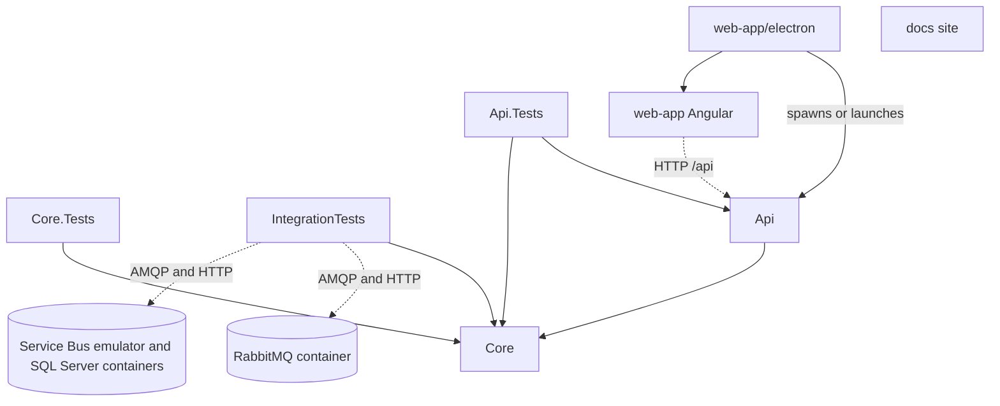

# Project map

> Five .NET projects in `ServiceBusExplorer.slnx` with a two-level graph (Api and the three test projects point at Core, Api.Tests also at Api), plus three non-.NET parts that are not in the solution: the Angular app, the Electron shell and the GitHub Pages site.

The solution file lists exactly five projects (lines 3 to 7 of `ServiceBusExplorer.slnx`), all `net10.0`. Derived from the `ProjectReference` and `PackageReference` items in each csproj and from `web-app/package.json` on the working tree of 2026-11-12. No `Directory.Build.props`, `global.json` or central package management file exists; versions live in each csproj.

## .NET projects

| Project | Kind | ProjectReference | Test project |
|---|---|---|---|
| [[pages/services/core]] | class library | none | `ServiceBusExplorer.Core.Tests` (direct) and, through the API, `ServiceBusExplorer.Api.Tests` |
| [[pages/services/api]] | ASP.NET Core web app (`Microsoft.NET.Sdk.Web`) | Core (`src/ServiceBusExplorer.Api/ServiceBusExplorer.Api.csproj:15`) | `ServiceBusExplorer.Api.Tests` |
| `ServiceBusExplorer.Core.Tests` | xUnit test project | Core (`src/ServiceBusExplorer.Core.Tests/ServiceBusExplorer.Core.Tests.csproj:26`) | is the tests |
| `ServiceBusExplorer.IntegrationTests` | xUnit test project, brokers in Docker | Core (`src/ServiceBusExplorer.IntegrationTests/ServiceBusExplorer.IntegrationTests.csproj:27`) | is the tests |
| `ServiceBusExplorer.Api.Tests` | xUnit test project, in-process host | Api, Core (`src/ServiceBusExplorer.Api.Tests/ServiceBusExplorer.Api.Tests.csproj:26`, `src/ServiceBusExplorer.Api.Tests/ServiceBusExplorer.Api.Tests.csproj:27`) | is the tests |

Core grants its internals to `ServiceBusExplorer.Core.Tests` only (`src/ServiceBusExplorer.Core/ServiceBusExplorer.Core.csproj:10`), which is how the tests call `DeleteMessagesCoreAsync`, `ResubmitCoreAsync` and `MoveCoreAsync` directly. Api.Tests does not get Api internals; it uses `WebApplicationFactory` (`src/ServiceBusExplorer.Api.Tests/ApiFactory.cs`).

Dotted and plain arrows from `web-app` and `electron`, and the dotted arrows to the containers, are run-time relationships, not build references; nothing in the .NET solution depends on them.

## NuGet packages

| Project | Package | Version |
|---|---|---|
| Core | `Azure.Identity` | 1.13.1 (`src/ServiceBusExplorer.Core/ServiceBusExplorer.Core.csproj:14`) |
| Core | `Azure.Messaging.ServiceBus` | 7.20.1 (`src/ServiceBusExplorer.Core/ServiceBusExplorer.Core.csproj:15`) |
| Core | `Azure.Monitor.Query` | 1.5.0 (`src/ServiceBusExplorer.Core/ServiceBusExplorer.Core.csproj:16`) |
| Core | `Microsoft.Extensions.Caching.Memory` | 9.0.0 (`src/ServiceBusExplorer.Core/ServiceBusExplorer.Core.csproj:17`) |
| Core | `Microsoft.Extensions.Logging.Abstractions` | 9.0.0 (`src/ServiceBusExplorer.Core/ServiceBusExplorer.Core.csproj:18`) |
| Core | `RabbitMQ.Client` | 6.8.1 (`src/ServiceBusExplorer.Core/ServiceBusExplorer.Core.csproj:19`) |
| Api | `Microsoft.AspNetCore.OpenApi` | 10.0.0 (`src/ServiceBusExplorer.Api/ServiceBusExplorer.Api.csproj:10`) |
| Api | `Microsoft.OpenApi` | 2.7.5 (`src/ServiceBusExplorer.Api/ServiceBusExplorer.Api.csproj:11`) |
| Core.Tests | `Moq` | 4.20.70 (`src/ServiceBusExplorer.Core.Tests/ServiceBusExplorer.Core.Tests.csproj:17`) |
| Core.Tests | `xunit` / `xunit.runner.visualstudio` / `Microsoft.NET.Test.Sdk` / `coverlet.collector` | 2.6.2 / 2.5.4 / 17.8.0 / 6.0.0 (`src/ServiceBusExplorer.Core.Tests/ServiceBusExplorer.Core.Tests.csproj:18`, `src/ServiceBusExplorer.Core.Tests/ServiceBusExplorer.Core.Tests.csproj:19`, `src/ServiceBusExplorer.Core.Tests/ServiceBusExplorer.Core.Tests.csproj:16`, `src/ServiceBusExplorer.Core.Tests/ServiceBusExplorer.Core.Tests.csproj:12`) |
| IntegrationTests | `Testcontainers.RabbitMq` | 4.16.0 (`src/ServiceBusExplorer.IntegrationTests/ServiceBusExplorer.IntegrationTests.csproj:17`) |
| IntegrationTests | `Testcontainers.ServiceBus` | 4.16.0 (`src/ServiceBusExplorer.IntegrationTests/ServiceBusExplorer.IntegrationTests.csproj:18`); it brings `Testcontainers.MsSql` for the emulator's SQL Server. The project names `Azure.Messaging.ServiceBus` types, which reach it through Core, only to arrange and observe broker state |
| IntegrationTests | `xunit` / `xunit.runner.visualstudio` / `Microsoft.NET.Test.Sdk` / `coverlet.collector` | 2.6.2 / 2.5.4 / 17.8.0 / 6.0.0, the versions of Core.Tests (`src/ServiceBusExplorer.IntegrationTests/ServiceBusExplorer.IntegrationTests.csproj:19`, `src/ServiceBusExplorer.IntegrationTests/ServiceBusExplorer.IntegrationTests.csproj:20`, `src/ServiceBusExplorer.IntegrationTests/ServiceBusExplorer.IntegrationTests.csproj:16`, `src/ServiceBusExplorer.IntegrationTests/ServiceBusExplorer.IntegrationTests.csproj:12`) |
| Api.Tests | `Microsoft.AspNetCore.Mvc.Testing` | 10.0.0 (`src/ServiceBusExplorer.Api.Tests/ServiceBusExplorer.Api.Tests.csproj:12`) |
| Api.Tests | `xunit` / `xunit.runner.visualstudio` / `Microsoft.NET.Test.Sdk` / `coverlet.collector` | 2.6.2 / 2.5.4 / 17.8.0 / 6.0.0 (`src/ServiceBusExplorer.Api.Tests/ServiceBusExplorer.Api.Tests.csproj:14`, `src/ServiceBusExplorer.Api.Tests/ServiceBusExplorer.Api.Tests.csproj:15`, `src/ServiceBusExplorer.Api.Tests/ServiceBusExplorer.Api.Tests.csproj:13`, `src/ServiceBusExplorer.Api.Tests/ServiceBusExplorer.Api.Tests.csproj:19`) |

The vendor SDKs (`Azure.*`, `RabbitMQ.Client`) are referenced by Core only; Api reaches them transitively. `ProviderVersion` in the two capability classes repeats the Azure and RabbitMQ package versions as strings (see Known gaps in [[pages/services/core]]).

## What each test project covers

- **Core.Tests** (`src/ServiceBusExplorer.Core.Tests/`): the Azure bulk cores against mocked receivers and senders, `AzureCredentialFactory`, `AzureServiceBusProvider` connect paths, `AzureMonitorMetricsService`, the RabbitMQ session stubs, `SessionInfo`, and since 2026-11-12 `FileWorkspaceManager` (`src/ServiceBusExplorer.Core.Tests/Services/FileWorkspaceManagerTests.cs:65`: the merge on save and import, the masked save return, an unreadable file, the atomic write). Not covered directly: `ProviderFactory`, `RabbitMQProvider` (beyond sessions), `RabbitMQManagementClient`, `RabbitMQPatternDetector`, `ServiceBusService`.
- **Api.Tests** (`src/ServiceBusExplorer.Api.Tests/`): masking of connections on read, export and the save response (`ConnectionMaskingTests.cs`), API key middleware (`AuthMiddlewareTests.cs`), CORS (`CorsTests.cs`), the metrics controller with 503 when unconfigured (`MetricsControllerTests.cs`). `FileWorkspaceManager` also runs here, through `IConnectionManager` (`src/ServiceBusExplorer.Api.Tests/ApiFactory.cs:42`). The queue, topic, session, group and monitoring controllers have no test file.
- **IntegrationTests** (`src/ServiceBusExplorer.IntegrationTests/`): the RabbitMQ provider through its public surface against `rabbitmq:4.3.7-management`, and the Azure Service Bus provider through `IMessagingProvider` against `servicebus-emulator:2.0.1` with its SQL Server, each started by Testcontainers once per run; baseline tests of what works and `Defect_` tests pinning reproduced audit entries. Purge and delete-all on Azure are not reached (the emulator serves the two endpoints they need on two ports). Needs Docker; fails, never skips, without it. No `InternalsVisibleTo`. See [[pages/conventions/testing]] and [[pages/decisions/0002-integration-tests-against-brokers-in-docker]].
- **web-app**: 22 `*.spec.ts` files under `web-app/src`, run by the Angular `unit-test` builder (`web-app/angular.json:90`, `web-app/angular.json:91`) with Vitest (`web-app/package.json`, `vitest` ^4.0.8, script `test`). See [[pages/services/web-app]].

## Non-.NET parts

| Part | Path | Kind | Notes |
|---|---|---|---|
| Angular app | `web-app/` | Angular 21 SPA (`@angular/core` ^21.2.8), Material, ng-bootstrap, ApexCharts, ExcelJS, Prism; npm `packageManager` npm@11.6.2 | Feature folders `connections`, `entities`, `messages`, `monitoring`, `queues`, `topics` under `web-app/src/app/features`; per-provider UI under `web-app/src/app/providers/{azure-service-bus,rabbitmq,kafka}` through `provider-registry.service.ts`. A `kafka` folder exists in the UI, but Core has no Kafka provider (`src/ServiceBusExplorer.Core/Providers/ProviderType.cs:11`, `src/ServiceBusExplorer.Core/Providers/ProviderType.cs:16`) and the registry example for it is commented out (`web-app/src/app/providers/provider-registry.service.ts:77`). See [[pages/services/web-app]]. |
| Electron shell | `web-app/electron/` (`main.js` 1094 lines, `shell-helpers.js` with its `node:test` file, `preload.js` 72, `splash.html`) | Electron ^41.2.0 main process; electron-builder ^26.7.0 | `package.json` `main` is `electron/main.js`. In development it runs `dotnet run` in `src/ServiceBusExplorer.Api` (`web-app/electron/main.js:774`, `web-app/electron/main.js:776`); packaged, it finds the published API under `resources/api` (`web-app/electron/main.js:739` to `web-app/electron/main.js:741`). Defaults: API port 5917, frontend port 4297 (`web-app/electron/main.js:48`). Packaging copies `src/ServiceBusExplorer.Api/bin/Release/net10.0/publish` into `api` (`web-app/package.json`, `build.extraResources`). See [[pages/services/electron-shell]]. |
| Docs site | `docs/` | static GitHub Pages site: `index.html` (148), `styles.css` (414), `app.js` (180), `icon.svg`, `_config.yml` (`theme: null`, `plugins: []`, `docs/_config.yml:1`, `docs/_config.yml:2`) | No build step and no reference to or from any code project. `docs/ADDING_PROVIDERS.md` (695 lines) is the guide to adding a provider and is the one document here that tracks Core's provider seam. |

`web-app/package.json` `homepage` points at the Pages site.

## CI

`.github/workflows/ci.yml` runs on pushes and pull requests to `main`. Job `dotnet` restores and builds the whole solution in Release (`.github/workflows/ci.yml:59`, `.github/workflows/ci.yml:62`), so all five projects always build together, and tests Core.Tests and Api.Tests by path (`.github/workflows/ci.yml:66`, `.github/workflows/ci.yml:67`), so it starts no container. Job `integration` builds and runs the integration project on its own runner (`.github/workflows/ci.yml:72`, `.github/workflows/ci.yml:89`); the release workflow calls this workflow, so a tag waits for it too. Job `web` runs `npm ci` and `npm run build` in `web-app` (`.github/workflows/ci.yml:111`, `.github/workflows/ci.yml:123`) and, since 2026-11-12, `npm test -- --watch=false` between them (`.github/workflows/ci.yml:115`), so the 21 spec files are part of CI. `.github/workflows/release.yml` triggers on `v*` tags (`.github/workflows/release.yml:13`) and builds Electron installers for Linux, Windows and macOS (`.github/workflows/release.yml:83`, `.github/workflows/release.yml:125`, `.github/workflows/release.yml:166`).

## Who references whom: what to run when X changes

| Changed | Builds break in | Run these tests | Why |
|---|---|---|---|
| Core, `Abstractions/` or `Models/` | Api, Core.Tests, Api.Tests, IntegrationTests | `dotnet test ServiceBusExplorer.slnx` (it includes the integration project, so it needs Docker), and `web-app` specs if a DTO shape or JSON name changed | Every other .NET project references Core; the SPA consumes the serialised models |
| Core, `Providers/Azure/` | Core.Tests (internals), Api, IntegrationTests | Core.Tests (`Providers/Azure/*`) first; `dotnet test src/ServiceBusExplorer.IntegrationTests` (Docker); Api.Tests for connection and metrics paths; a fix to a pinned defect rewrites its `Defect_` test | The bulk cores are covered by Core.Tests against mocks and by the integration project against the emulator |
| Core, `Providers/RabbitMQ/` | Api, IntegrationTests | `dotnet test src/ServiceBusExplorer.IntegrationTests` (Docker), Core.Tests for sessions, then the full solution; a fix to a pinned defect rewrites its `Defect_` test | Only the integration project reaches the provider's broker paths |
| Core, `Services/FileWorkspaceManager.cs` | Api | Core.Tests `FileWorkspaceManagerTests` and Api.Tests `ConnectionMaskingTests` | Run both projects |
| Core, `Services/*Metrics*` | Api | Core.Tests `Services/AzureMonitorMetricsServiceTests.cs` and Api.Tests `MetricsControllerTests.cs` | Both sides pin behaviour |
| Core, `Providers/ProviderFactory.cs` or `ProviderType.cs` | Api | Full solution; also `web-app` provider registry if a value is added | No direct test; `ConnectionMaskingTests` touches `ProviderType` |
| Api (controllers, `Program.cs`, middleware) | Api.Tests | Api.Tests; the SPA calls these routes, so check `web-app/src/app/core/services/api.service.ts` | Route and JSON changes cross the HTTP boundary with no generated client |
| Core.Tests, Api.Tests or IntegrationTests only | that project | that project | Nothing references a test project |
| `web-app/src` | nothing in .NET | `npm test` and `npm run build` in `web-app` | CI runs only the build |
| `web-app/electron`, `web-app/package.json` `build` | nothing in .NET | `npm run electron:dev` by hand; no automated test | Process spawn and port logic is untested |
| `docs/` | nothing | none | Static files |

## To change here, read

- [[pages/invariants/provider-boundaries]]
- [[pages/conventions/testing]]
- [[pages/conventions/tooling]]
- [[pages/services/core]]
- [[pages/services/api]]

## Related

[[pages/services/web-app]], [[pages/services/electron-shell]]
