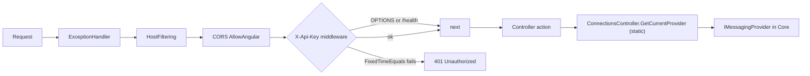

# Api

> The local HTTP door of Messaging Explorer: one authenticated loopback REST surface that holds a single active broker connection and forwards every call to the Core provider.

## To change here, read

- [[pages/invariants/local-authenticated-api]]
- [[pages/invariants/secrets-masked-at-the-api-boundary]]
- [[pages/invariants/provider-boundaries]]
- [[pages/invariants/bulk-operations-are-at-least-once]]
- [[pages/invariants/a-guard-must-be-able-to-fire]]
- [[pages/services/core]] (the provider contract every controller calls)
- [[pages/services/web-app]] and [[pages/services/electron-shell]] (the only callers; Electron mints the secret)
- [[pages/conventions/testing]]

## Responsibility

Owns the HTTP surface: startup configuration, the auth/CORS/host-filter pipeline, route shape, request clamping, error-to-status mapping, and the one slot that holds the active provider. Does not own broker behaviour, bulk-operation semantics or connection persistence; those live in [[pages/services/core]]. Does not serve the UI ([[pages/services/web-app]]) and does not start itself ([[pages/services/electron-shell]]). See [[pages/architecture/project-map]].

## Public contract

- **HTTP routes:** `api/{controller}` for `connections`, `connectiongroups`, `queues`, `topics`, `sessions`, `metrics`, `monitoring` (`[Route("api/[controller]")]`, for example `src/ServiceBusExplorer.Api/Controllers/QueuesController.cs:8`), plus unauthenticated `GET /health` (`src/ServiceBusExplorer.Api/Program.cs:186`) and, in Development only, the OpenAPI document (`src/ServiceBusExplorer.Api/Program.cs:168`).
- **Auth:** every request except `OPTIONS` and `/health*` needs header `X-Api-Key` equal to `API_SECRET` ([[pages/invariants/local-authenticated-api]]).
- **JSON:** camelCase, enums as strings in both directions (`src/ServiceBusExplorer.Api/Program.cs:55`, `:59`). The import/export files on disk stay PascalCase (`src/ServiceBusExplorer.Api/Controllers/ConnectionsController.cs:495`).
- **Events:** none published or consumed. **Direct callers:** the Angular app in Electron (`X-Api-Key` set at `web-app/electron/main.js:346`).

## Startup and composition

Everything is in `src/ServiceBusExplorer.Api/Program.cs`, top-level statements, in this order:

- **Ports** (`:228`): `EXPLORER_CONFIG_PATH` if the file exists and parses (`:231`), else walk up from `AppContext.BaseDirectory` for the first parsable `config.json` (`:239-246`), else defaults 5917 (API) and 4297 (frontend) with a warning (`:25-26`, `:249`). Only `apiPort` and `frontendPort` are read (`:263-266`); a parse failure logs the path and exception type, not the message (`:272`).
- **Secret** (`:36-42`): `API_SECRET` must be at least 32 characters or the process logs Critical and calls `Environment.Exit(1)` before the host is built. Bytes cached once (`:45`). Pinned by `src/ServiceBusExplorer.Api.Tests/BoundaryGuardTests.cs:29`, which starts the built API as a child process with the variable unset and with 31 characters and expects exit code 1 in both cases.
- **JSON** (`:50-60`), **OpenAPI** services (`:61-62`).
- **CORS** policy `AllowAngular` (`:66-77`): origins `http://localhost:{frontendPort}`, `http://127.0.0.1:{frontendPort}` and the literal `null` (the origin a `file://` Electron page sends), any header, any method.
- **Host filtering** (`:80-83`): `AllowedHosts = ["localhost", "127.0.0.1"]` set in code.
- **Kestrel** (`:86-89`): `ListenLocalhost(apiPort)` only when `ASPNETCORE_URLS` is empty. When it is set the code binds nothing itself and the URLs win. Electron always sets it to `http://localhost:{apiPort}` (`web-app/electron/main.js:780`, `:848`), so under Electron the in-code loopback binding is not the one in effect; the bind address is whatever the shell passes.
- **Data path** (`:92-101`): `SERVICEBUS_DATA_PATH`, else `%APPDATA%/ServiceBusExplorer` equivalent; created if missing.
- **DI** (all singletons): `IConnectionManager` = `FileWorkspaceManager` (`:103`), `IConnectionGroupManager` = the same instance cast (`:107`), `IProviderFactory` (`:110`), `IServiceBusService` (`:117`, a legacy Azure-only service, see Known gaps), `MonitoringStore` (`:123`), hosted `MonitoringBackgroundService` (`:124`), `IMemoryCache` (`:139`).
- **Metrics** (`:133-164`): `AzureMonitorOptions.IsConfigured` needs `SubscriptionId`, `ResourceGroup` and `Namespace` all non-blank (`src/ServiceBusExplorer.Core/Services/AzureMonitorOptions.cs:29`). If true, `AzureMonitorMetricsService` with `credential: null` (`:146-157`); otherwise `UnconfiguredMetricsService` (`:163`), which throws an `InvalidOperationException` whose text contains "not properly configured" (`src/ServiceBusExplorer.Core/Services/UnconfiguredMetricsService.cs:14`) and the controller turns into 503.
- **Pipeline** (`:175-221`): the exception handler (`:175`), host filtering, CORS, `MapGet("/health")`, the key middleware, authorization, `MapControllers`. No HTTPS redirection (`:218-219`).

The key middleware (`:189-216`) skips `OPTIONS` (`:192`) and any path under `/health` (`:198`), then compares UTF-8 bytes of the header against the cached secret: length check first, then `CryptographicOperations.FixedTimeEquals` (`:207-208`). The length check is not constant time, which only reveals the secret's length. A missing header is treated as empty bytes (`:205`). Failure answers 401 `{message:"Unauthorized"}`; a 401 is a response, not an exception, so the exception handler does not touch it.

**Host filtering vs `"AllowedHosts": "*"`:** `src/ServiceBusExplorer.Api/appsettings.json:8` sets `"*"` while the code sets an explicit list (`src/ServiceBusExplorer.Api/Program.cs:82`). The list in code is the one in effect: a request with `Host: evil.example` and a valid key answers 400, one with `Host: 127.0.0.1` answers 200 (`src/ServiceBusExplorer.Api.Tests/BoundaryGuardTests.cs:15`), and widening the list in code to `"*"` makes the foreign host answer 200. The `"*"` in `appsettings.json` has no effect on this filter.

## Controllers

**Entity administration (2026-11-12).** `POST` on queues, topics and subscriptions takes `{ name, options }` with typed fields and no dictionary (`src/ServiceBusExplorer.Api/Controllers/QueuesController.cs:57`, `src/ServiceBusExplorer.Api/Controllers/TopicsController.cs:57`, `src/ServiceBusExplorer.Api/Controllers/TopicsController.cs:162`); `PATCH` on each edits only the fields sent and returns the entity read again (`src/ServiceBusExplorer.Api/Controllers/QueuesController.cs:84`, `src/ServiceBusExplorer.Api/Controllers/TopicsController.cs:84`, `src/ServiceBusExplorer.Api/Controllers/TopicsController.cs:189`). The controllers know no limit: the provider validates. They map the provider's neutral exceptions to 409 already exists, 404 not found and 400 invalid configuration, a provider that cannot update to 400, anything else to the constant 500 body (`src/ServiceBusExplorer.Api/Controllers/EntityAdministrationResults.cs:44`). A response never carries the broker's text and a log line never carries the request body.

**Sub-queues, scheduled messages and a disabled entity (2026-11-12).** The active, dead-letter and transfer dead-letter routes of an operation are one-line actions over one private action that takes a `MessageSubQueue` (for example `src/ServiceBusExplorer.Api/Controllers/QueuesController.cs:130`, `src/ServiceBusExplorer.Api/Controllers/QueuesController.cs:163`). Eight routes read the transfer dead-letter queue, four for a queue and four for a subscription, mirroring the dead-letter peek, search, delete-batch and resubmit-batch (`src/ServiceBusExplorer.Api/Controllers/QueuesController.cs:159`, `src/ServiceBusExplorer.Api/Controllers/QueuesController.cs:126`, `src/ServiceBusExplorer.Api/Controllers/QueuesController.cs:360`, `src/ServiceBusExplorer.Api/Controllers/QueuesController.cs:297`, `src/ServiceBusExplorer.Api/Controllers/TopicsController.cs:356`, `src/ServiceBusExplorer.Api/Controllers/TopicsController.cs:322`, `src/ServiceBusExplorer.Api/Controllers/TopicsController.cs:494`, `src/ServiceBusExplorer.Api/Controllers/TopicsController.cs:429`); a provider without `SupportsTransferDeadLetter` answers 400 and is never called (`src/ServiceBusExplorer.Api/Controllers/EntityAdministrationResults.cs:29`), there is no purge and no move for it, and its delete-batch refuses `all: true` with 400 (`src/ServiceBusExplorer.Api/Controllers/QueuesController.cs:370`, `src/ServiceBusExplorer.Api/Controllers/EntityAdministrationResults.cs:21`). `POST api/queues/{name}/messages/cancel-scheduled` takes `{ sequenceNumbers }` (`src/ServiceBusExplorer.Api/Controllers/QueuesController.cs:241`), answers the result in the delete-batch shape, 400 with the provider's own text when it refuses the numbers (`src/ServiceBusExplorer.Api/Controllers/QueuesController.cs:255`) and 400 for a provider without scheduled messages (`src/ServiceBusExplorer.Api/Controllers/EntityAdministrationResults.cs:23`); queues only. A disabled entity answers 409 `{ "message": "The entity is disabled for this operation." }` on every message route (`src/ServiceBusExplorer.Api/Controllers/EntityAdministrationResults.cs:19`), where it answered the constant 500. Peek and search hand the provider the request token (`src/ServiceBusExplorer.Api/Controllers/QueuesController.cs:175`, `src/ServiceBusExplorer.Api/Controllers/QueuesController.cs:137`), and the capabilities answer carries `supportsTransferDeadLetter` (`src/ServiceBusExplorer.Api/Controllers/ConnectionsController.cs:398`). Pinned by `src/ServiceBusExplorer.Api.Tests/MessageRouteTests.cs`: each transfer route against its dead-letter sibling (`:51`), `all: true` refused (`:82`), the token (`:98`, `:107`), the unsupported provider (`:123`, `:165`), the cancel result and its 400 (`:133`, `:154`), the 409 on every message route (`:207`) and the API key on the new routes (`:243`).

All controllers are `[ApiController]`, transient, with `[Route("api/[controller]")]`.

| Controller | Route groups | Provider source |
|---|---|---|
| `ConnectionsController` (`.../ConnectionsController.cs:11`) | saved-connection CRUD (`GET`, `GET {id}`, `POST`, `DELETE {id}`), `test`, lifecycle (`{id}/connect`, `disconnect`, `status`), `providers`, `providers/{type}/capabilities`, `export`, `import`, `export-full`, `import-full`, `DELETE clear-all` | Owns the slot |
| `ConnectionGroupsController` (`.../ConnectionGroupsController.cs:9`) | group CRUD (client / environment tree) | none (uses `IConnectionGroupManager`) |
| `QueuesController` (`.../QueuesController.cs:9`) | entity CRUD, peek (`messages`, `deadletter`, `transferdeadletter`), search (`messages/search`, `deadletter/search`, `transferdeadletter/search`), send (single and `messages/batch`), receive (`messages/receive`), `messages/cancel-scheduled`, DLQ resubmit (single and `resubmit-batch`, the batch also for `transferdeadletter`), purge (`DELETE messages`, `DELETE deadletter`), `delete-batch` (main, dead-letter and transfer dead-letter), `move-batch` (main and dead-letter) | `ConnectionsController.GetCurrentProvider()` |
| `TopicsController` (`.../TopicsController.cs:9`) | topic CRUD, send to topic, subscription CRUD, then the same peek/search/receive/resubmit/purge/delete-batch/move-batch groups under `{topic}/subscriptions/{sub}/...`, without cancel-scheduled | same |
| `SessionsController` (`.../SessionsController.cs:9`) | list sessions for a queue (`{entityName}`) or subscription, set session state (`PUT`) | same |
| `MetricsController` (`.../MetricsController.cs:12`) | Azure Monitor series for `queues/{q}`, `topics/{t}`, `topics/{t}/subscriptions/{s}` | none (uses `IMetricsService`) |
| `MonitoringController` (`.../MonitoringController.cs:8`) | `snapshot`, `history` | none (uses `MonitoringStore`) |

Paths in the table abbreviate `src/ServiceBusExplorer.Api/Controllers/`.

### How the active provider is obtained

`QueuesController`, `TopicsController` and `SessionsController` take only a logger. Each declares a private static `GetProvider()` that returns `ConnectionsController.GetCurrentProvider()` (`src/ServiceBusExplorer.Api/Controllers/QueuesController.cs:22`, `src/ServiceBusExplorer.Api/Controllers/TopicsController.cs:22`, `src/ServiceBusExplorer.Api/Controllers/SessionsController.cs:22`). That is a public static read of `ConnectionsController._currentProvider`, a static field guarded by a lock for reads and swaps (`src/ServiceBusExplorer.Api/Controllers/ConnectionsController.cs:24-25`, `:50-53`, `:410`). `MonitoringBackgroundService` reads the same slot (`src/ServiceBusExplorer.Api/Monitoring/MonitoringBackgroundService.cs:39`).

Consequences:

- One active connection per process, shared by every client of the API. Connecting replaces it for everyone ([[pages/invariants/provider-boundaries]]).
- With no connection, every provider-backed action returns 400 `{message:"No messaging provider connected..."}` (`src/ServiceBusExplorer.Api/Controllers/QueuesController.cs:27-30`), the same text duplicated in each of the three controllers.
- The lock covers only the field. `SetCurrentProviderAsync` swaps under the lock, then disconnects and disposes the old provider outside it (`.../ConnectionsController.cs:59-80`). An action that already read the old reference at its start (for example `src/ServiceBusExplorer.Api/Controllers/QueuesController.cs:35`) keeps using it with no lease, so a concurrent `connect`, `disconnect` or `clear-all` can dispose the provider under a running call. No test covers it.
- `Connect` creates and connects the new provider before the swap (`.../ConnectionsController.cs:240-243`); if creation throws, the previous provider stays active and the caller gets 500.
- `GetStatus` falls back to the legacy `IServiceBusService` when no provider is set (`.../ConnectionsController.cs:326-332`).

### Entity names in the path

An entity, topic, subscription or session name is one path segment, sent percent-encoded by the web app ([[pages/services/web-app]]). Kestrel decodes every escape in the path except `%2F`, so by default the route value of `/api/queues/a%2Fmessages` is the literal `a%2Fmessages`, while `%25`, `%23`, `%3F` and `%20` are decoded: a raw `a%252Fb` and a raw `a%2Fb` both reach the action as `a%2Fb`. Decoding the route value again would turn the first into `a/b`, so the route value alone cannot be fixed.

`RawTargetRouteValuesAttribute` (`src/ServiceBusExplorer.Api/Controllers/RawTargetRouteValuesAttribute.cs:16`), a resource filter on `QueuesController`, `TopicsController`, `SessionsController` and `MetricsController` (`src/ServiceBusExplorer.Api/Controllers/QueuesController.cs:7`), runs before model binding and replaces each whole-segment route value with the matching segment of the raw request target, decoded once (`src/ServiceBusExplorer.Api/Controllers/RawTargetRouteValuesAttribute.cs:59`): `a%2Fmessages` reaches the provider as `a/messages`, `a%252Fb` as `a%2Fb`, `50%25off` as `50%off`. It replaces a value only when the raw target is an origin-form path with as many segments as the route pattern (`:47`) and the raw segment decodes, `%2F` kept, to the value routing produced (`:57`); otherwise, for example a raw target with dot segments that Kestrel normalised, the routed value is left as it was. Routes are unchanged. `ConnectionsController` and `ConnectionGroupsController` carry ids, not names, and do not use it.

Pinned through Kestrel (`WebApplicationFactory.UseKestrel`) by `src/ServiceBusExplorer.Api.Tests/EntityNameRoutingTests.cs`: deleting the queue `a/messages` calls `DeleteQueueAsync("a/messages")` and nothing else (`:98`); purging `orders#1` calls `PurgeMessagesAsync("orders#1")` and nothing else (`:106`); eight queue names on six queue operations (`:122`), a topic and subscription with `/` (`:144`), a session id with `/` and a space (`:162`) and the three metrics routes (`:176`) reach the provider or the metrics service unchanged; the fallback branches are driven directly (`:197`, `:210`).

### Cancellation

The bulk and destructive actions pass `HttpContext.RequestAborted` to the provider: purge (`src/ServiceBusExplorer.Api/Controllers/QueuesController.cs:338`), delete-batch (`src/ServiceBusExplorer.Api/Controllers/QueuesController.cs:375`), move-batch (`src/ServiceBusExplorer.Api/Controllers/QueuesController.cs:405`), resubmit-batch (`src/ServiceBusExplorer.Api/Controllers/QueuesController.cs:310`) and cancel-scheduled (`src/ServiceBusExplorer.Api/Controllers/QueuesController.cs:252`), and the same four under a subscription (`src/ServiceBusExplorer.Api/Controllers/TopicsController.cs:472`, `src/ServiceBusExplorer.Api/Controllers/TopicsController.cs:509`, `src/ServiceBusExplorer.Api/Controllers/TopicsController.cs:539`, `src/ServiceBusExplorer.Api/Controllers/TopicsController.cs:442`). A client abort therefore cancels the Core loop between batches ([[pages/invariants/bulk-operations-are-at-least-once]]: messages already moved or completed before the abort stay done). Since 2026-11-12 peek and search pass it too (`src/ServiceBusExplorer.Api/Controllers/QueuesController.cs:175`, `src/ServiceBusExplorer.Api/Controllers/QueuesController.cs:137`, `src/ServiceBusExplorer.Api/Controllers/TopicsController.cs:372`, `src/ServiceBusExplorer.Api/Controllers/TopicsController.cs:334`). Not cancellable from the request: receive (`src/ServiceBusExplorer.Api/Controllers/QueuesController.cs:232`), send, single resubmit (`src/ServiceBusExplorer.Api/Controllers/QueuesController.cs:279`) and entity create/delete. `MetricsController` is the only one that model-binds a `CancellationToken` parameter (`src/ServiceBusExplorer.Api/Controllers/MetricsController.cs:34`).

### Error mapping

Two layers, one body. Most actions catch `Exception`, log it and return a constant 500; an exception no action catches reaches the exception handler, the outermost middleware (`src/ServiceBusExplorer.Api/Program.cs:175`), which answers the same 500 `{message:"An internal error occurred."}` as JSON in every environment, Development included. The framework's `ExceptionHandlerMiddleware` logs that exception once at Error; the handler logs nothing itself, and no exception text reaches the client.

- Every 500 body is `{message:"An internal error occurred."}`: Queues/Topics/Sessions (`src/ServiceBusExplorer.Api/Controllers/QueuesController.cs:147`), Connections/Groups (`src/ServiceBusExplorer.Api/Controllers/ConnectionsController.cs:96`) and the handler. Pinned by `src/ServiceBusExplorer.Api.Tests/ErrorBodyTests.cs:94` for one caught failure in each of Queues, Topics and Sessions, and by `src/ServiceBusExplorer.Api.Tests/ErrorBodyTests.cs:51` for the handler under Development and Production.
- Metrics: 503 `{message, configurationRequired:true}` when the exception text contains "not properly configured" (`src/ServiceBusExplorer.Api/Controllers/MetricsController.cs:47-54`), else 500 `{message:"Failed to fetch queue metrics."}` (`:58`).
- Sessions map `NotSupportedException` to 400 (`src/ServiceBusExplorer.Api/Controllers/SessionsController.cs:81`); `SessionsController` and `Capabilities` clamp or reject inputs (`src/ServiceBusExplorer.Api/Controllers/SessionsController.cs:43-44`, `src/ServiceBusExplorer.Api/Controllers/ConnectionsController.cs:370-373`).
- A disabled entity is not a 500: every message route catches `EntityDisabledException` and answers 409 with the fixed text (`src/ServiceBusExplorer.Api/Controllers/EntityAdministrationResults.cs:19`, for example `src/ServiceBusExplorer.Api/Controllers/QueuesController.cs:140`).
- Counts are clamped to 1..1000 on peek (`src/ServiceBusExplorer.Api/Controllers/QueuesController.cs:165`, `src/ServiceBusExplorer.Api/Controllers/QueuesController.cs:166`) and receive (`src/ServiceBusExplorer.Api/Controllers/QueuesController.cs:223`) and monitoring history to 1..120 (`src/ServiceBusExplorer.Api/Controllers/MonitoringController.cs:34-35`).
- No controller returns an exception message. `ImportConfiguration` answers an `ArgumentException` with 400 and the constant `{message:"Invalid or empty configuration data"}` (`src/ServiceBusExplorer.Api/Controllers/ConnectionsController.cs:455-459`): the two `ArgumentException`s Core throws there carry literal text, but the catch also takes any framework `ArgumentException`, which the action cannot tell apart, so it never echoes `ex.Message`. Pinned by `src/ServiceBusExplorer.Api.Tests/ErrorBodyTests.cs:69`. `TestConnection` returns 200 with `success:false` and an `error` text it builds itself rather than an error status (`:223`); that 200 body is not a 500 and keeps its `error` key, which the add-connection dialog reads.
- Actions that catch no general failure reach the exception handler and answer the constant 500: the reads (`src/ServiceBusExplorer.Api/Controllers/QueuesController.cs:33-41`, all `GetX`), entity delete, and peek, send, batch send and receive, which catch only the disabled entity (`src/ServiceBusExplorer.Api/Controllers/QueuesController.cs:173`, `src/ServiceBusExplorer.Api/Controllers/QueuesController.cs:191`, `src/ServiceBusExplorer.Api/Controllers/QueuesController.cs:209`, `src/ServiceBusExplorer.Api/Controllers/QueuesController.cs:230`, topic send `src/ServiceBusExplorer.Api/Controllers/TopicsController.cs:118`).

## Connections and secrets

- **Masking:** list and get return masked copies (`***` for `ConnectionString`, `Password`, `ClientSecret`) from `FileWorkspaceManager` (`src/ServiceBusExplorer.Core/Services/FileWorkspaceManager.cs:271-295`, `:321`); raw secrets come only from `GetConnectionWithSecretAsync` (`:325`), which `Connect` and `SaveConnection` call (`src/ServiceBusExplorer.Api/Controllers/ConnectionsController.cs:121`, `:233`) ([[pages/invariants/secrets-masked-at-the-api-boundary]]).
- **Save with placeholder:** if the body carries an `Id` that exists, `***` in `ConnectionString` or `Password` is replaced by the stored value (`.../ConnectionsController.cs:125-133`) before the equality check that decides a "metadata only" update. A metadata-only update skips the connection test (`:146`, `:155`). The manager keeps the stored value for any of the three secrets that still arrives as `***` (`src/ServiceBusExplorer.Core/Services/FileWorkspaceManager.cs:343`, `:348`, `:357`) and returns the masked clone of what it stored, which the action returns as the POST body (`src/ServiceBusExplorer.Core/Services/FileWorkspaceManager.cs:382`, `src/ServiceBusExplorer.Api/Controllers/ConnectionsController.cs:176`).
- **Unreadable `workspace.json`:** every manager read throws `InvalidOperationException` ([[pages/services/core]]). Actions with a `try/catch` answer 500 `{message:"An internal error occurred."}`: list, save, connect, import (the exception is neither `ArgumentException` nor `JsonException`, so it is not a 400), `export-full` and `import-full` (`src/ServiceBusExplorer.Api/Controllers/ConnectionsController.cs:93`, `:178`, `:260`, `:463`, `:504`, `:563`). `clear-all` is the in-app recovery: it answers 200 with zero counts and leaves an empty workspace (pinned by `src/ServiceBusExplorer.Api.Tests/ClearAllTests.cs:13`). GET by id, `DELETE {id}` and `export` have no `try/catch` (`:100`, `:412`, `:419`); the exception handler answers them with the constant 500 in every environment (`src/ServiceBusExplorer.Api.Tests/ErrorBodyTests.cs:51`).
- **`export`:** `POST`, masked by default; `?includeSecrets=true` returns raw and sets `Content-Disposition: attachment` and logs the remote IP (`.../ConnectionsController.cs:419-430`). **`export-full`:** same flag, adds groups, indented PascalCase JSON (`:470-502`). **`import`:** string payload to the manager (`:432-468`). **`import-full`:** groups saved first, then connections, with no rollback if the second step fails (`:540-559`).
- **`clear-all`** (`DELETE`, no confirmation parameter): disconnects the provider and the legacy service (`src/ServiceBusExplorer.Api/Controllers/ConnectionsController.cs:581-591`), then calls `IConnectionManager.ClearAllAsync` (`src/ServiceBusExplorer.Api/Controllers/ConnectionsController.cs:595`), which counts what is stored and writes an empty workspace under the manager's lock through the temp-file-and-move save ([[pages/services/core]]). The body is `{message, connectionsDeleted, groupsDeleted}`; an unreadable file reports zero for both and is still reset. A failed write answers the constant 500.
- **`ConnectionMaskingTests.cs` pins** (`src/ServiceBusExplorer.Api.Tests/ConnectionMaskingTests.cs:23`): GET by id masks `connectionString` and `clientSecret` (`:81`); default export masks both and does not leak the sentinel (`:41`, `:103`); `includeSecrets=true` returns raw values and a content-disposition (`:61`, `:127`); GET by id and the default export mask `password` (`:150`, `:170`); a metadata-only `POST` answers with `***` for all three secrets (`:196`). It does not pin the list endpoint, `export-full`, any import through the API or `clear-all`; the import merge is pinned in Core (`src/ServiceBusExplorer.Core.Tests/Services/FileWorkspaceManagerTests.cs:78`, `:155`).

## Monitoring

`MonitoringBackgroundService` loops forever: collect, then `Task.Delay(30s)` (`src/ServiceBusExplorer.Api/Monitoring/MonitoringBackgroundService.cs:22-34`). A collection reads the current provider, clears the store when the provider reference changed (`:42-47`), returns if none or disconnected (`:49`), then calls `GetQueuesAsync`, `GetTopicsAsync` and `GetSubscriptionsAsync` per topic (`:52-70`) and adds one snapshot of counts (active, dead-letter, transfer, scheduled for queues). Exceptions are logged and the loop continues (`:28-31`). `MonitoringStore` is a `ConcurrentQueue` capped at 120 snapshots, about one hour at 30 s (`src/ServiceBusExplorer.Api/Monitoring/MonitoringStore.cs:7`, `:16-22`); `snapshot` returns the latest or an empty snapshot stamped now (`src/ServiceBusExplorer.Api/Controllers/MonitoringController.cs:17-29`).

## Invariants

- [[pages/invariants/local-authenticated-api]]: loopback only plus `X-Api-Key` on everything but `/health` and preflight (`src/ServiceBusExplorer.Api/Program.cs:189-216`; pinned by `src/ServiceBusExplorer.Api.Tests/AuthMiddlewareTests.cs:12`, `:20`, `:29`, `:38`).
- [[pages/invariants/secrets-masked-at-the-api-boundary]]: only `includeSecrets` exports and internal `WithSecret` calls see raw secrets.
- [[pages/invariants/provider-boundaries]]: controllers talk to `IMessagingProvider`, never to a broker SDK; the slot is process-wide.
- [[pages/invariants/bulk-operations-are-at-least-once]]: the controllers only forward the request token; delivery semantics are in [[pages/services/core]].
- [[pages/invariants/a-guard-must-be-able-to-fire]]: the Host filter and the `API_SECRET` fail-fast are made to fire by `src/ServiceBusExplorer.Api.Tests/BoundaryGuardTests.cs:15` and `:29`; the Kestrel loopback binding has no test that makes it fire (see Testing and Known gaps).

## Hot spots

- `src/ServiceBusExplorer.Api/Program.cs:189` - the auth middleware; hand-rolled, ordering relative to `MapGet("/health")` and CORS matters.
- `src/ServiceBusExplorer.Api/Controllers/ConnectionsController.cs:24` - the static provider slot and `SetCurrentProviderAsync` (`:59`).
- `src/ServiceBusExplorer.Api/Controllers/ConnectionsController.cs:111` - `SaveConnection` merge logic and the metadata-only shortcut.
- `src/ServiceBusExplorer.Api/Controllers/ConnectionsController.cs:573` - `clear-all`.
- `src/ServiceBusExplorer.Api/Controllers/QueuesController.cs:293` and `src/ServiceBusExplorer.Api/Controllers/TopicsController.cs:425` - batch DLQ resubmit entry points; queue and topic copies are hand-duplicated, so a change must be made twice.

## Cache footprint

`IMemoryCache` is registered here (`src/ServiceBusExplorer.Api/Program.cs:139`) and handed only to `AzureMonitorMetricsService` (`:154`); its keys belong to [[pages/services/core]]. The only other in-process state is the provider slot and the 120-entry `MonitoringStore`; both vanish on restart.

## Cross-service dependencies

- **Reads from:** [[pages/services/core]] (provider factory, providers, `FileWorkspaceManager`, metrics service).
- **Written to by:** [[pages/services/web-app]] over HTTP; [[pages/services/electron-shell]] spawns the process and sets `API_SECRET`, `ASPNETCORE_URLS`.

## Testing footprint

`src/ServiceBusExplorer.Api.Tests/` has thirteen files; 211 tests pass on 2026-11-12.

- `ApiFactory.cs` boots `WebApplicationFactory<Program>` with a fixed 32-character secret, a temp `SERVICEBUS_DATA_PATH` and `ASPNETCORE_URLS=http://127.0.0.1:0` in Development (`src/ServiceBusExplorer.Api.Tests/ApiFactory.cs:20-39`). Because `ASPNETCORE_URLS` is always set, the `ListenLocalhost` branch at `Program.cs:86` is never exercised.
- `AuthMiddlewareTests.cs`: no key 401, wrong key 401, right key 200, `/health` public (`:12`, `:20`, `:29`, `:38`).
- `CorsTests.cs`: preflight from a foreign origin gets no allow-origin header (`:12`), from `http://localhost:4297` it does (`:26`). The `null` origin and `127.0.0.1` are not tested.
- `ConnectionMaskingTests.cs`: see Connections and secrets.
- `ClearAllTests.cs`: with a corrupt `workspace.json` the list answers 500, `clear-all` answers 200 with zero counts and the list then answers an empty array (`src/ServiceBusExplorer.Api.Tests/ClearAllTests.cs:13`). Its fixture has its own data path, and the test leaves a valid empty workspace there.
- `MetricsControllerTests.cs`: unconfigured section gives 503 with `configurationRequired` and no `error` field (`:83`); a throwing service gives 500 without leaking the exception text (`:109`).
- `Usings.cs` sets `DisableTestParallelization` because tests share process-wide environment variables, which `ApiFactory` writes (`src/ServiceBusExplorer.Api.Tests/Usings.cs:3-4`, `src/ServiceBusExplorer.Api.Tests/ApiFactory.cs:27-30`).
- `ErrorBodyTests.cs`: a corrupt `workspace.json` under GET by id answers 500 with exactly `{"message":"An internal error occurred."}` as JSON and no exception text, under Development and Production (`src/ServiceBusExplorer.Api.Tests/ErrorBodyTests.cs:51`); an `ArgumentException` on import never reaches the client (`:69`); a provider failure caught in Queues, Topics and Sessions answers the same body (`:94`), through a fake `IProviderFactory`, `POST {id}/connect` and `POST disconnect` to reset the static slot.
- `BoundaryGuardTests.cs`: a foreign `Host` answers 400 and `127.0.0.1` answers 200 (`src/ServiceBusExplorer.Api.Tests/BoundaryGuardTests.cs:15`); the built API started as a child process exits with code 1 when `API_SECRET` is unset or 31 characters long (`:29`).
- `EntityNameRoutingTests.cs`: which provider or metrics method each route calls, and with which name, for names with `/`, `#`, `?`, `%` and a space; see Entity names in the path.
- `MessageRouteTests.cs`: the transfer dead-letter routes, the cancel of scheduled messages, the request token on peek, search and a transfer batch, and the 409 of a disabled entity on every message route, against a fake provider (`src/ServiceBusExplorer.Api.Tests/MessageRouteTests.cs:51`, `src/ServiceBusExplorer.Api.Tests/MessageRouteTests.cs:133`, `src/ServiceBusExplorer.Api.Tests/MessageRouteTests.cs:98`, `src/ServiceBusExplorer.Api.Tests/MessageRouteTests.cs:207`).
- **No test beyond the error body, the names, the entity administration and the message routes above:** the rest of `QueuesController` and `TopicsController`, and `SessionsController`. **No test at all:** `ConnectionGroupsController`, `MonitoringController`, `MonitoringBackgroundService`/`MonitoringStore`, port resolution, the loopback binding. The bulk algorithms themselves are exercised only at Core level (`src/ServiceBusExplorer.Core.Tests/Providers/Azure/AzureServiceBusProviderBatchTests.cs`). See [[pages/conventions/testing]].

## History

This page states how the module works now; dated changes will live in `pages/history/api` when the history pages exist.

## Known gaps

- Static process-wide provider slot with no lease on in-flight calls: `src/ServiceBusExplorer.Api/Controllers/ConnectionsController.cs:24`, `:73-74`.
- 503 detection by substring of an exception message: `src/ServiceBusExplorer.Api/Controllers/MetricsController.cs:47`, `src/ServiceBusExplorer.Core/Services/UnconfiguredMetricsService.cs:14`.
- CORS allows origin `null`, which any `file://` or sandboxed page also sends; the API key is the real control: `src/ServiceBusExplorer.Api/Program.cs:73`.
- Metadata-only detection ignores `AuthType`, tenant, namespace and client secret, so changing only those skips the connection test: `src/ServiceBusExplorer.Api/Controllers/ConnectionsController.cs:136-144`.
- `import-full` is not atomic (groups then connections): `src/ServiceBusExplorer.Api/Controllers/ConnectionsController.cs:544-560`.
- Receive (destructive) and single resubmit ignore the request token: `src/ServiceBusExplorer.Api/Controllers/QueuesController.cs:232`, `src/ServiceBusExplorer.Api/Controllers/QueuesController.cs:279`.
- Monitoring polls every 30 s with one `GetSubscriptionsAsync` per topic whether or not anyone is looking, ignores the stopping token for broker calls, and keeps a reference to the last (possibly disposed) provider: `src/ServiceBusExplorer.Api/Monitoring/MonitoringBackgroundService.cs:10`, `:33`, `:52-70`.
- Legacy `IServiceBusService` is still registered and consulted by `status`, `disconnect` and `clear-all`: `src/ServiceBusExplorer.Api/Program.cs:117`, `src/ServiceBusExplorer.Api/Controllers/ConnectionsController.cs:294`, `:326`.
- Untested controllers listed under Testing footprint; the largest surface (queues, topics) has its 500 body, the name each route hands the provider, the entity administration routes and, since 2026-11-12, the message routes pinned; the entity reads and deletes are not.

## Related

[[pages/services/core]], [[pages/services/web-app]], [[pages/services/electron-shell]], [[pages/architecture/project-map]], [[pages/conventions/testing]], [[pages/conventions/tooling]].
