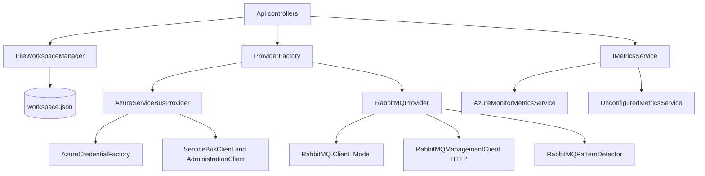

# Core

> One `IMessagingProvider` seam over Azure Service Bus and RabbitMQ, plus the file-backed workspace of saved connections and the metrics service; it has no HTTP surface of its own.

## To change here, read

- [[pages/invariants/provider-boundaries]] - what may live outside `Providers/<Provider>/`
- [[pages/invariants/secrets-masked-at-the-api-boundary]] - masking, the `***` sentinel, who may call `GetConnectionWithSecretAsync`
- [[pages/invariants/bulk-operations-are-at-least-once]] - send before complete, possible duplicates are reported, never resent
- [[pages/invariants/a-guard-must-be-able-to-fire]] - the safety timeout and no-progress guards in the scan loops
- [[pages/services/api]] - the only caller of this library
- [[pages/architecture/project-map]] - which tests to run when this project changes
- [[pages/conventions/testing]]

## Responsibility

Owns the provider contract and both implementations, the bulk delete / resubmit / move algorithms, `workspace.json` persistence and masking of stored connections, and the Azure Monitor metrics reader. Does not own HTTP routes, auth middleware, CORS or the monitoring poller ([[pages/services/api]]), nor any UI ([[pages/services/web-app]], [[pages/services/electron-shell]]).

## Public contract

Everything is a .NET type consumed in-process by `src/ServiceBusExplorer.Api`. Project `ServiceBusExplorer.Core` targets net10.0 and exposes internals to `ServiceBusExplorer.Core.Tests` (`src/ServiceBusExplorer.Core/ServiceBusExplorer.Core.csproj:10`).

- **Provider seam:** `IMessagingProvider` (`src/ServiceBusExplorer.Core/Abstractions/IMessagingProvider.cs:11`): connect/disconnect, queues, topics (RabbitMQ exchanges), subscriptions, peek/send/receive/search, `PurgeMessagesAsync` (`src/ServiceBusExplorer.Core/Abstractions/IMessagingProvider.cs:251`), and the three bulk calls `DeleteMessagesAsync` (`src/ServiceBusExplorer.Core/Abstractions/IMessagingProvider.cs:266`), `ResubmitDeadLetterMessagesAsync` (`src/ServiceBusExplorer.Core/Abstractions/IMessagingProvider.cs:276`), `MoveMessagesAsync` (`src/ServiceBusExplorer.Core/Abstractions/IMessagingProvider.cs:288`), each taking a `CancellationToken` and returning `BatchOperationResult`; sessions at `src/ServiceBusExplorer.Core/Abstractions/IMessagingProvider.cs:297`.
- **Capabilities:** `IProviderCapabilities` (`src/ServiceBusExplorer.Core/Abstractions/IProviderCapabilities.cs:8`), a flag per feature (`SupportsSessions`, `SupportsSequenceNumbers`, ...). Azure sets almost all true (`src/ServiceBusExplorer.Core/Providers/Azure/AzureProviderCapabilities.cs:33`); RabbitMQ sets sessions, sequence numbers, scheduling, deferral and duplicate detection false (`src/ServiceBusExplorer.Core/Providers/RabbitMQ/RabbitMQProviderCapabilities.cs:34`, `src/ServiceBusExplorer.Core/Providers/RabbitMQ/RabbitMQProviderCapabilities.cs:40`, `src/ServiceBusExplorer.Core/Providers/RabbitMQ/RabbitMQProviderCapabilities.cs:52`, `src/ServiceBusExplorer.Core/Providers/RabbitMQ/RabbitMQProviderCapabilities.cs:76`, `src/ServiceBusExplorer.Core/Providers/RabbitMQ/RabbitMQProviderCapabilities.cs:82`).
- **Config and entities:** `IConnectionConfig` (`src/ServiceBusExplorer.Core/Abstractions/IConnectionConfig.cs:9`, `IsValid` and `GetDisplayTarget`), `IMessagingEntity` / `IQueueEntity` / `ITopicEntity` / `IMessage` (`src/ServiceBusExplorer.Core/Abstractions/IQueueEntity.cs:7`, `src/ServiceBusExplorer.Core/Abstractions/ITopicEntity.cs:8`, `src/ServiceBusExplorer.Core/Abstractions/IMessage.cs:7`). The concrete shapes are the DTOs in `src/ServiceBusExplorer.Core/Models/` (`QueueInfo`, `TopicInfo`, `MessageInfo`).
- **Factory:** `IProviderFactory` / `ProviderFactory` (`src/ServiceBusExplorer.Core/Providers/ProviderFactory.cs:228`, `src/ServiceBusExplorer.Core/Providers/ProviderFactory.cs:14`). `ProviderType` has two values, `AzureServiceBus = 0` and `RabbitMQ = 1` (`src/ServiceBusExplorer.Core/Providers/ProviderType.cs:11`, `src/ServiceBusExplorer.Core/Providers/ProviderType.cs:16`). Every switch on the enum (`CreateProvider` `src/ServiceBusExplorer.Core/Providers/ProviderFactory.cs:37`, `CreateConnectionConfig` `src/ServiceBusExplorer.Core/Providers/ProviderFactory.cs:80` and `src/ServiceBusExplorer.Core/Providers/ProviderFactory.cs:101`, `GetProviderCapabilities` `src/ServiceBusExplorer.Core/Providers/ProviderFactory.cs:190`) throws `ArgumentOutOfRangeException` for any other value, so a new provider touches all four ([[pages/invariants/provider-boundaries]]). `GetSupportedProviderTypes` is `Enum.GetValues` (`src/ServiceBusExplorer.Core/Providers/ProviderFactory.cs:204`). `TestConnectionAsync` swallows exceptions and returns false (`src/ServiceBusExplorer.Core/Providers/ProviderFactory.cs:175`). `docs/ADDING_PROVIDERS.md` is the long-form guide.
- **Workspace:** `IConnectionManager` and `IConnectionGroupManager` (`src/ServiceBusExplorer.Core/Services/IConnectionManager.cs:5`, `src/ServiceBusExplorer.Core/Services/IConnectionGroupManager.cs:5`), both implemented by `FileWorkspaceManager`.
- **Metrics:** `IMetricsService` (`src/ServiceBusExplorer.Core/Services/IMetricsService.cs:8`) with queue, topic and subscription reads.

## How it works

The API resolves a saved connection with the secret (`GetConnectionWithSecretAsync`), asks `ProviderFactory.CreateConnectedProviderAsync` for a connected provider (`src/ServiceBusExplorer.Core/Providers/ProviderFactory.cs:113`; it disposes the provider if `ConnectAsync` throws, `src/ServiceBusExplorer.Core/Providers/ProviderFactory.cs:145`) and calls the interface. Providers are not thread-safe singletons: each holds one client and one config, and `DisconnectAsync` nulls them (`src/ServiceBusExplorer.Core/Providers/Azure/AzureServiceBusProvider.cs:122`).

## Azure provider

`AzureServiceBusProvider` (`src/ServiceBusExplorer.Core/Providers/Azure/AzureServiceBusProvider.cs:14`, 1844 lines) holds a `ServiceBusClient` for messages and a `ServiceBusAdministrationClient` for entities (`src/ServiceBusExplorer.Core/Providers/Azure/AzureServiceBusProvider.cs:17`, `src/ServiceBusExplorer.Core/Providers/Azure/AzureServiceBusProvider.cs:18`). Both are built from the connection string when `AuthType` is `ConnectionString`, otherwise from the fully qualified namespace plus a `TokenCredential` (`src/ServiceBusExplorer.Core/Providers/Azure/AzureServiceBusProvider.cs:103` to `src/ServiceBusExplorer.Core/Providers/Azure/AzureServiceBusProvider.cs:113`). Logging is careful not to put the connection string in a template (`src/ServiceBusExplorer.Core/Providers/Azure/AzureServiceBusProvider.cs:65`, `src/ServiceBusExplorer.Core/Providers/Azure/AzureServiceBusProvider.cs:80`).

- **Auth types** (`src/ServiceBusExplorer.Core/Providers/Azure/AzureAuthType.cs:6`): `ConnectionString` (default, `src/ServiceBusExplorer.Core/Providers/Azure/AzureAuthType.cs:11`), `InteractiveBrowser` (`src/ServiceBusExplorer.Core/Providers/Azure/AzureAuthType.cs:16`), `ServicePrincipal` (`src/ServiceBusExplorer.Core/Providers/Azure/AzureAuthType.cs:21`), `AzureCli` (`src/ServiceBusExplorer.Core/Providers/Azure/AzureAuthType.cs:26`), `DefaultCredential` (`src/ServiceBusExplorer.Core/Providers/Azure/AzureAuthType.cs:31`).
- **`AzureCredentialFactory.Create`** (`src/ServiceBusExplorer.Core/Providers/Azure/AzureCredentialFactory.cs:25`): service principal uses `ClientSecretCredential` (`src/ServiceBusExplorer.Core/Providers/Azure/AzureCredentialFactory.cs:31`); `DefaultCredential` is `DefaultAzureCredential` with managed identity excluded (`src/ServiceBusExplorer.Core/Providers/Azure/AzureCredentialFactory.cs:40`, `src/ServiceBusExplorer.Core/Providers/Azure/AzureCredentialFactory.cs:43`); interactive browser redirects to `http://localhost:8400` (`src/ServiceBusExplorer.Core/Providers/Azure/AzureCredentialFactory.cs:16`, `src/ServiceBusExplorer.Core/Providers/Azure/AzureCredentialFactory.cs:50`); `ConnectionString` throws because it uses no credential (`src/ServiceBusExplorer.Core/Providers/Azure/AzureCredentialFactory.cs:59`).
- **Search:** `SearchMessagesAsync` peeks 100 at a time and gives up after 10,000 peeked messages (`src/ServiceBusExplorer.Core/Providers/Azure/AzureServiceBusProvider.cs:580`, `src/ServiceBusExplorer.Core/Providers/Azure/AzureServiceBusProvider.cs:599`, `src/ServiceBusExplorer.Core/Providers/Azure/AzureServiceBusProvider.cs:627`, `src/ServiceBusExplorer.Core/Providers/Azure/AzureServiceBusProvider.cs:635`); `HasMore` is also true at that cap.
- **Purge / delete all:** `PurgeEntityAsync` (`src/ServiceBusExplorer.Core/Providers/Azure/AzureServiceBusProvider.cs:885`) checks `RequiresSession` through the admin client, uses a session-aware drain for active session entities (`src/ServiceBusExplorer.Core/Providers/Azure/AzureServiceBusProvider.cs:911`, `src/ServiceBusExplorer.Core/Providers/Azure/AzureServiceBusProvider.cs:933`) and always the non-session path for dead-letter queues (`src/ServiceBusExplorer.Core/Providers/Azure/AzureServiceBusProvider.cs:909`). The drain prefers server-side purge, called by reflection because the SDK method is still internal (`src/ServiceBusExplorer.Core/Providers/Azure/AzureServiceBusProvider.cs:1031`, `src/ServiceBusExplorer.Core/Providers/Azure/AzureServiceBusProvider.cs:1033`, `src/ServiceBusExplorer.Core/Providers/Azure/AzureServiceBusProvider.cs:1054`), and falls back to a `ReceiveAndDelete` receive loop (`src/ServiceBusExplorer.Core/Providers/Azure/AzureServiceBusProvider.cs:1064`).
- **Bulk delete selected** (`DeleteMessagesAsync` `src/ServiceBusExplorer.Core/Providers/Azure/AzureServiceBusProvider.cs:988`, core `src/ServiceBusExplorer.Core/Providers/Azure/AzureServiceBusProvider.cs:1099`): a PeekLock receiver scans in batches of 250 (`src/ServiceBusExplorer.Core/Providers/Azure/AzureServiceBusProvider.cs:976`, `src/ServiceBusExplorer.Core/Providers/Azure/AzureServiceBusProvider.cs:977`), completes targets in chunks of 20 (`src/ServiceBusExplorer.Core/Providers/Azure/AzureServiceBusProvider.cs:978`, `src/ServiceBusExplorer.Core/Providers/Azure/AzureServiceBusProvider.cs:1201`) and abandons non-targets. The scan stops when every target is located, the read position passes the largest target (`src/ServiceBusExplorer.Core/Providers/Azure/AzureServiceBusProvider.cs:1156`), no new sequence numbers arrive (`src/ServiceBusExplorer.Core/Providers/Azure/AzureServiceBusProvider.cs:1161`), or a 2 minute safety timeout fires (`src/ServiceBusExplorer.Core/Providers/Azure/AzureServiceBusProvider.cs:983`, `src/ServiceBusExplorer.Core/Providers/Azure/AzureServiceBusProvider.cs:1106` to `src/ServiceBusExplorer.Core/Providers/Azure/AzureServiceBusProvider.cs:1108`).
- **Bulk resubmit and move** (`ResubmitCoreAsync` `src/ServiceBusExplorer.Core/Providers/Azure/AzureServiceBusProvider.cs:1282`, `MoveCoreAsync` `src/ServiceBusExplorer.Core/Providers/Azure/AzureServiceBusProvider.cs:1512`) run the same scan, but each cycle sends its targets to the destination first and completes them straight after, so a PeekLock never ages out across a large selection (`src/ServiceBusExplorer.Core/Providers/Azure/AzureServiceBusProvider.cs:1274` to `src/ServiceBusExplorer.Core/Providers/Azure/AzureServiceBusProvider.cs:1281`, `src/ServiceBusExplorer.Core/Providers/Azure/AzureServiceBusProvider.cs:1336`, `src/ServiceBusExplorer.Core/Providers/Azure/AzureServiceBusProvider.cs:1566`). Resubmit sends to the queue or the parent topic, never to the subscription, so subscription filters apply (`src/ServiceBusExplorer.Core/Providers/Azure/AzureServiceBusProvider.cs:1260`). Sending uses size-aware `ServiceBusMessageBatch` splitting (`src/ServiceBusExplorer.Core/Providers/Azure/AzureServiceBusProvider.cs:1386`). Move targets a queue (`src/ServiceBusExplorer.Core/Providers/Azure/AzureServiceBusProvider.cs:1499`).
- **Cancellation:** the linked token carries both the caller token and the safety timeout (`src/ServiceBusExplorer.Core/Providers/Azure/AzureServiceBusProvider.cs:1293` to `src/ServiceBusExplorer.Core/Providers/Azure/AzureServiceBusProvider.cs:1295`). Only the safety timeout is absorbed into a partial result (`src/ServiceBusExplorer.Core/Providers/Azure/AzureServiceBusProvider.cs:1358`); a caller cancellation propagates as `OperationCanceledException` (`src/ServiceBusExplorer.Core.Tests/Providers/Azure/AzureServiceBusProviderBatchTests.cs:467`). A `ServiceBusException` mid-scan also ends the loop with a partial result (`src/ServiceBusExplorer.Core/Providers/Azure/AzureServiceBusProvider.cs:1362`). Targets never located are reported as "Not found within scan window" (`src/ServiceBusExplorer.Core/Providers/Azure/AzureServiceBusProvider.cs:984`, `src/ServiceBusExplorer.Core/Providers/Azure/AzureServiceBusProvider.cs:1369`).
- **Possible duplicates:** if `CompleteMessageAsync` fails after the send succeeded, the message is never resent and is reported as a failure whose text says it "may be duplicated" (`src/ServiceBusExplorer.Core/Providers/Azure/AzureServiceBusProvider.cs:1466` for resubmit, `src/ServiceBusExplorer.Core/Providers/Azure/AzureServiceBusProvider.cs:985` and `src/ServiceBusExplorer.Core/Providers/Azure/AzureServiceBusProvider.cs:1653` for move). There is no separate field: `BatchOperationResult` has `SuccessCount`, `FailureCount` and `Failures` (a list of `SequenceNumber` plus `Error` string) (`src/ServiceBusExplorer.Core/Models/BatchOperationResult.cs:11`, `src/ServiceBusExplorer.Core/Models/BatchOperationResult.cs:16`, `src/ServiceBusExplorer.Core/Models/BatchOperationResult.cs:21`, `src/ServiceBusExplorer.Core/Models/BatchOperationResult.cs:42`), so a duplicate warning is a failure counted in `FailureCount`, identified only by its message text. See [[pages/invariants/bulk-operations-are-at-least-once]].

## RabbitMQ provider

`RabbitMQProvider` (`src/ServiceBusExplorer.Core/Providers/RabbitMQ/RabbitMQProvider.cs:14`, 1096 lines) uses two channels to the broker (`src/ServiceBusExplorer.Core/Providers/RabbitMQ/RabbitMQProvider.cs:16` to `src/ServiceBusExplorer.Core/Providers/RabbitMQ/RabbitMQProvider.cs:18`, connect at `src/ServiceBusExplorer.Core/Providers/RabbitMQ/RabbitMQProvider.cs:73`, management client at `src/ServiceBusExplorer.Core/Providers/RabbitMQ/RabbitMQProvider.cs:102`):

- **AMQP** through `RabbitMQ.Client` (`IConnection`, `IModel`): publish, `BasicGet` for receive and peek, `QueuePurge`. Peek is a `BasicGet` followed by `BasicNack` with requeue (`src/ServiceBusExplorer.Core/Providers/RabbitMQ/RabbitMQProvider.cs:510`, `src/ServiceBusExplorer.Core/Providers/RabbitMQ/RabbitMQProvider.cs:517`); receive acks (`src/ServiceBusExplorer.Core/Providers/RabbitMQ/RabbitMQProvider.cs:589`).
- **HTTP management API** through `RabbitMQManagementClient` (`src/ServiceBusExplorer.Core/Providers/RabbitMQ/RabbitMQManagementClient.cs:15`, 1193 lines, own `HttpClient` with Basic auth `src/ServiceBusExplorer.Core/Providers/RabbitMQ/RabbitMQManagementClient.cs:17`, `src/ServiceBusExplorer.Core/Providers/RabbitMQ/RabbitMQManagementClient.cs:73`): queue, exchange and binding CRUD, overview, `GetMessagesAsync` (`src/ServiceBusExplorer.Core/Providers/RabbitMQ/RabbitMQManagementClient.cs:229`) and publish (`src/ServiceBusExplorer.Core/Providers/RabbitMQ/RabbitMQManagementClient.cs:348`, `src/ServiceBusExplorer.Core/Providers/RabbitMQ/RabbitMQManagementClient.cs:377`). It has an internal constructor taking an `HttpClient` for tests (`src/ServiceBusExplorer.Core/Providers/RabbitMQ/RabbitMQManagementClient.cs:54`).
- **Mapping:** exchanges are "topics", bound queues are "subscriptions", and the dead-letter queue is the convention `<queue>.dlq` (`src/ServiceBusExplorer.Core/Providers/RabbitMQ/RabbitMQProvider.cs:612`, `src/ServiceBusExplorer.Core/Providers/RabbitMQ/RabbitMQProvider.cs:647`, `src/ServiceBusExplorer.Core/Providers/RabbitMQ/RabbitMQProvider.cs:836`). RabbitMQ has no sequence numbers, so the bulk calls treat `sequenceNumbers` as 1-based positions in a destructive read (`src/ServiceBusExplorer.Core/Providers/RabbitMQ/RabbitMQProvider.cs:673`).
- **`RabbitMQPatternDetector`** (`src/ServiceBusExplorer.Core/Providers/RabbitMQ/Services/RabbitMQPatternDetector.cs:10`, `DetectExchangePattern` `src/ServiceBusExplorer.Core/Providers/RabbitMQ/Services/RabbitMQPatternDetector.cs:22`, `DetectQueuePattern` `src/ServiceBusExplorer.Core/Providers/RabbitMQ/Services/RabbitMQPatternDetector.cs:85`) classifies exchanges into `MessagingPattern` values (`src/ServiceBusExplorer.Core/Providers/RabbitMQ/Models/MessagingPattern.cs:7`) with a confidence. The provider calls it while listing and fetching exchanges (`src/ServiceBusExplorer.Core/Providers/RabbitMQ/RabbitMQProvider.cs:240`, `src/ServiceBusExplorer.Core/Providers/RabbitMQ/RabbitMQProvider.cs:282`).
- **Bulk operations are not the Azure algorithm.** `DeleteMessagesAsync`, `ResubmitDeadLetterMessagesAsync` and `MoveMessagesAsync` consume up to the largest position through the management API with `ack_requeue_false` (`src/ServiceBusExplorer.Core/Providers/RabbitMQ/RabbitMQProvider.cs:669`, `src/ServiceBusExplorer.Core/Providers/RabbitMQ/RabbitMQProvider.cs:725`, `src/ServiceBusExplorer.Core/Providers/RabbitMQ/RabbitMQProvider.cs:788`), then republish: targets to their destination, non-targets back to the source (`src/ServiceBusExplorer.Core/Providers/RabbitMQ/RabbitMQProvider.cs:689`, `src/ServiceBusExplorer.Core/Providers/RabbitMQ/RabbitMQProvider.cs:748`, `src/ServiceBusExplorer.Core/Providers/RabbitMQ/RabbitMQProvider.cs:755`, `src/ServiceBusExplorer.Core/Providers/RabbitMQ/RabbitMQProvider.cs:803`, `src/ServiceBusExplorer.Core/Providers/RabbitMQ/RabbitMQProvider.cs:809`). The messages are already gone from the broker before the republish, so a failed republish loses the message and is recorded as a failure; the order is consume-then-publish, the opposite of Azure's send-then-complete. Non-targets return at the tail of the queue. `all` maps to `QueuePurge` (`src/ServiceBusExplorer.Core/Providers/RabbitMQ/RabbitMQProvider.cs:655`). The `CancellationToken` parameters are accepted and never read (`src/ServiceBusExplorer.Core/Providers/RabbitMQ/RabbitMQProvider.cs:640`, `src/ServiceBusExplorer.Core/Providers/RabbitMQ/RabbitMQProvider.cs:707`, `src/ServiceBusExplorer.Core/Providers/RabbitMQ/RabbitMQProvider.cs:773`, `src/ServiceBusExplorer.Core/Providers/RabbitMQ/RabbitMQProvider.cs:827`).

## Legacy `ServiceBusService`

`Services/ServiceBusService.cs` (780 lines, `src/ServiceBusExplorer.Core/Services/ServiceBusService.cs:10`) is the pre-provider Azure-only service behind `IServiceBusService` (`src/ServiceBusExplorer.Core/Services/IServiceBusService.cs:5`). It is still registered as a singleton (`src/ServiceBusExplorer.Api/Program.cs:117`) and injected into `ConnectionsController` (`src/ServiceBusExplorer.Api/Controllers/ConnectionsController.cs:14`), but the controller only reads `IsConnected` and `CurrentNamespace` and calls `DisconnectAsync` (`src/ServiceBusExplorer.Api/Controllers/ConnectionsController.cs:294`, `src/ServiceBusExplorer.Api/Controllers/ConnectionsController.cs:329`, `src/ServiceBusExplorer.Api/Controllers/ConnectionsController.cs:331`, `src/ServiceBusExplorer.Api/Controllers/ConnectionsController.cs:589`). Nothing in `src/ServiceBusExplorer.Api` calls `ConnectAsync` or any entity method on it, so `IsConnected` is always false at run time and the status endpoint reports it. No other project references the class. Its operations are served by `AzureServiceBusProvider`.

## FileWorkspaceManager

`FileWorkspaceManager` (`src/ServiceBusExplorer.Core/Services/FileWorkspaceManager.cs:13`) implements both manager interfaces over one file, `<dataPath>/workspace.json`, holding `{ Connections, Groups }` (`src/ServiceBusExplorer.Core/Services/FileWorkspaceManager.cs:54`, `src/ServiceBusExplorer.Core/Services/FileWorkspaceManager.cs:542`). The API passes `SERVICEBUS_DATA_PATH` or `%APPDATA%/ServiceBusExplorer` (`src/ServiceBusExplorer.Api/Program.cs:92`, `src/ServiceBusExplorer.Api/Program.cs:103`); with no path it falls back to `./.servicebus` (`src/ServiceBusExplorer.Core/Services/FileWorkspaceManager.cs:34`).

- **Migration** runs in the constructor. `MigrateLegacyData` copies old AppData `connections.json` / `connection-groups.json` when the base path was defaulted and no `workspace.json` exists (`src/ServiceBusExplorer.Core/Services/FileWorkspaceManager.cs:59` to `src/ServiceBusExplorer.Core/Services/FileWorkspaceManager.cs:63`); `MigrateFromSeparateFiles` merges the two files into `workspace.json` and deletes them (`src/ServiceBusExplorer.Core/Services/FileWorkspaceManager.cs:129`, `src/ServiceBusExplorer.Core/Services/FileWorkspaceManager.cs:200`, `src/ServiceBusExplorer.Core/Services/FileWorkspaceManager.cs:208`, `src/ServiceBusExplorer.Core/Services/FileWorkspaceManager.cs:214`). It is a no-op once `workspace.json` exists (`src/ServiceBusExplorer.Core/Services/FileWorkspaceManager.cs:132`).
- **Locking:** one in-process `lock (_lock)` (`src/ServiceBusExplorer.Core/Services/FileWorkspaceManager.cs:21`) guards every read and every write: the connection reads (`src/ServiceBusExplorer.Core/Services/FileWorkspaceManager.cs:302`, `src/ServiceBusExplorer.Core/Services/FileWorkspaceManager.cs:317`, `src/ServiceBusExplorer.Core/Services/FileWorkspaceManager.cs:327`), save, delete, export and import (`src/ServiceBusExplorer.Core/Services/FileWorkspaceManager.cs:362`, `src/ServiceBusExplorer.Core/Services/FileWorkspaceManager.cs:388`, `src/ServiceBusExplorer.Core/Services/FileWorkspaceManager.cs:399`, `src/ServiceBusExplorer.Core/Services/FileWorkspaceManager.cs:420`) the four group methods (`src/ServiceBusExplorer.Core/Services/FileWorkspaceManager.cs:460`, `src/ServiceBusExplorer.Core/Services/FileWorkspaceManager.cs:469`, `src/ServiceBusExplorer.Core/Services/FileWorkspaceManager.cs:479`, `src/ServiceBusExplorer.Core/Services/FileWorkspaceManager.cs:507`) and `ClearAllAsync` (`src/ServiceBusExplorer.Core/Services/FileWorkspaceManager.cs:518`). There is no cross-process lock.
- **Atomic write:** `SaveWorkspace` writes `workspace.json.tmp` in the same directory and moves it over `workspace.json` with `File.Move(..., overwrite: true)` (`src/ServiceBusExplorer.Core/Services/FileWorkspaceManager.cs:254`, `src/ServiceBusExplorer.Core/Services/FileWorkspaceManager.cs:258`, `src/ServiceBusExplorer.Core/Services/FileWorkspaceManager.cs:259`), so a failed write leaves the previous file whole. `ClearAllAsync` writes its empty workspace through the same method (`src/ServiceBusExplorer.Core/Services/FileWorkspaceManager.cs:533`). The consolidation migration still writes `workspace.json` directly (`src/ServiceBusExplorer.Core/Services/FileWorkspaceManager.cs:200`).
- **Unreadable workspace:** `LoadWorkspace` returns an empty workspace only when the file is missing (`src/ServiceBusExplorer.Core/Services/FileWorkspaceManager.cs:236`); a file that exists and cannot be read or parsed throws `InvalidOperationException` with a generic message and the cause as inner exception (`src/ServiceBusExplorer.Core/Services/FileWorkspaceManager.cs:246`), so no read answers empty and no save overwrites the file. The constructor and both migrations never call `LoadWorkspace`, and the consolidation returns early once the file exists (`src/ServiceBusExplorer.Core/Services/FileWorkspaceManager.cs:132`), so startup is unchanged; the first request that reads the workspace fails instead. The one way out in the app is `ClearAllAsync` (`src/ServiceBusExplorer.Core/Services/FileWorkspaceManager.cs:516`, contract at `src/ServiceBusExplorer.Core/Services/IConnectionManager.cs:35`), behind `DELETE /api/connections/clear-all`: it catches that exception, logs only the inner exception's type name (`src/ServiceBusExplorer.Core/Services/FileWorkspaceManager.cs:526`), reports zero connections and zero groups, and writes an empty workspace; on a readable or missing file it reports what was stored.
- **Masking:** `MaskConnection` clones a connection and replaces `ConnectionString`, `Password` and `ClientSecret` with the literal `***` when non-empty (`src/ServiceBusExplorer.Core/Services/FileWorkspaceManager.cs:271`, `src/ServiceBusExplorer.Core/Services/FileWorkspaceManager.cs:278`, `src/ServiceBusExplorer.Core/Services/FileWorkspaceManager.cs:283`, `src/ServiceBusExplorer.Core/Services/FileWorkspaceManager.cs:295`). `GetConnectionsAsync` and `GetConnectionAsync` return masked copies (`src/ServiceBusExplorer.Core/Services/FileWorkspaceManager.cs:299`, `src/ServiceBusExplorer.Core/Services/FileWorkspaceManager.cs:315`); only `GetConnectionWithSecretAsync` returns the stored object (`src/ServiceBusExplorer.Core/Services/FileWorkspaceManager.cs:325`, contract at `src/ServiceBusExplorer.Core/Services/IConnectionManager.cs:18`). `SaveConnectionAsync` returns the masked clone of what it stored, on update and on create (`src/ServiceBusExplorer.Core/Services/FileWorkspaceManager.cs:382`).
- **Update and import merge:** for an id already stored, save and import both call `CopyEditableFields` (`src/ServiceBusExplorer.Core/Services/FileWorkspaceManager.cs:339`, called at `src/ServiceBusExplorer.Core/Services/FileWorkspaceManager.cs:369` and `src/ServiceBusExplorer.Core/Services/FileWorkspaceManager.cs:430`), which copies name, provider type, the Azure fields and the RabbitMQ host, port, user, password, virtual host and management port; a `ConnectionString`, `Password` or `ClientSecret` that arrives as `***` keeps the stored value (`src/ServiceBusExplorer.Core/Services/FileWorkspaceManager.cs:343`, `src/ServiceBusExplorer.Core/Services/FileWorkspaceManager.cs:348`, `src/ServiceBusExplorer.Core/Services/FileWorkspaceManager.cs:357`). `Id`, `CreatedAt`, `LastUsedAt` and `IsConnected` are not copied. An imported entry whose id is not stored keeps its other fields but has every secret equal to `***` cleared (`src/ServiceBusExplorer.Core/Services/FileWorkspaceManager.cs:438` to `src/ServiceBusExplorer.Core/Services/FileWorkspaceManager.cs:443`). `ExportConfigurationAsync(includeSecrets)` serialises the raw objects when true and masked copies when false (`src/ServiceBusExplorer.Core/Services/FileWorkspaceManager.cs:397` to `src/ServiceBusExplorer.Core/Services/FileWorkspaceManager.cs:404`).
- **Secrets are stored in plain text on disk.** `workspace.json` is written with `JsonSerializer` and `File.WriteAllText` (`src/ServiceBusExplorer.Core/Services/FileWorkspaceManager.cs:256`, `src/ServiceBusExplorer.Core/Services/FileWorkspaceManager.cs:258`); the connection string, RabbitMQ password and service principal secret are the raw values. There is no encryption, DPAPI or Data Protection call anywhere in `src/ServiceBusExplorer.Core` or `src/ServiceBusExplorer.Api` (searched for `Encrypt`, `DataProtect`, `ProtectedData`). Protection is the operating system's file permissions only. See [[pages/invariants/secrets-masked-at-the-api-boundary]].

## Metrics services

`IMetricsService` has two implementations chosen in `src/ServiceBusExplorer.Api/Program.cs:128` to `src/ServiceBusExplorer.Api/Program.cs:163`: when `AzureMonitorOptions.IsConfigured` (subscription id, resource group and namespace all set, `src/ServiceBusExplorer.Core/Services/AzureMonitorOptions.cs:29`; section name `AzureMonitor`, `src/ServiceBusExplorer.Core/Services/AzureMonitorOptions.cs:9`) the API registers `AzureMonitorMetricsService`; otherwise `UnconfiguredMetricsService`, whose three methods throw `InvalidOperationException` (`src/ServiceBusExplorer.Core/Services/UnconfiguredMetricsService.cs:21`). `AzureMonitorMetricsService` (`src/ServiceBusExplorer.Core/Services/AzureMonitorMetricsService.cs:18`) uses `MetricsQueryClient` with `DefaultAzureCredential` when no credential is passed (`src/ServiceBusExplorer.Core/Services/AzureMonitorMetricsService.cs:22`, `src/ServiceBusExplorer.Core/Services/AzureMonitorMetricsService.cs:72`), caches each result for 30 seconds in `IMemoryCache` (`src/ServiceBusExplorer.Core/Services/AzureMonitorMetricsService.cs:29`, `src/ServiceBusExplorer.Core/Services/AzureMonitorMetricsService.cs:115`) and throws if used while unconfigured (`src/ServiceBusExplorer.Core/Services/AzureMonitorMetricsService.cs:357`). It reads a fixed namespace from options, not from the connected connection.

## Invariants

- [[pages/invariants/provider-boundaries]] - vendor SDK types stay under `Providers/<Provider>/`
- [[pages/invariants/secrets-masked-at-the-api-boundary]] - masked reads, sentinel on write, raw only via `GetConnectionWithSecretAsync`
- [[pages/invariants/bulk-operations-are-at-least-once]] - `ResubmitCoreAsync` and `MoveCoreAsync` send before they complete
- [[pages/invariants/a-guard-must-be-able-to-fire]] - the no-progress and safety-timeout exits in `DeleteMessagesCoreAsync`

## Hot spots

- `src/ServiceBusExplorer.Core/Providers/Azure/AzureServiceBusProvider.cs:1099` - 1844 lines; `DeleteMessagesCoreAsync`, `ResubmitCoreAsync` (`src/ServiceBusExplorer.Core/Providers/Azure/AzureServiceBusProvider.cs:1282`) and `MoveCoreAsync` (`src/ServiceBusExplorer.Core/Providers/Azure/AzureServiceBusProvider.cs:1512`) repeat one scan loop three times with small differences; a fix to one belongs in all three.
- `src/ServiceBusExplorer.Core/Providers/RabbitMQ/RabbitMQManagementClient.cs:229` - 1193 lines of HTTP plumbing and response DTOs; `GetMessagesAsync` with `ack_requeue_false` is the destructive read every RabbitMQ bulk call relies on.
- `src/ServiceBusExplorer.Core/Providers/RabbitMQ/RabbitMQProvider.cs:640` - 1096 lines; the three bulk methods (`src/ServiceBusExplorer.Core/Providers/RabbitMQ/RabbitMQProvider.cs:640`, `src/ServiceBusExplorer.Core/Providers/RabbitMQ/RabbitMQProvider.cs:707`, `src/ServiceBusExplorer.Core/Providers/RabbitMQ/RabbitMQProvider.cs:773`) are the least safe code in the library.
- `src/ServiceBusExplorer.Core/Services/ServiceBusService.cs:10` - 780 lines of legacy code that is effectively unused.
- `src/ServiceBusExplorer.Core/Services/FileWorkspaceManager.cs:360` - the one write path that stores a connection a caller sent (`ClearAllAsync` only empties the file) and the place masking rules meet persistence.
- `src/ServiceBusExplorer.Core/Providers/Azure/AzureServiceBusProvider.cs:1031` - reflection call to an internal SDK method; breaks silently to the slow drain when the SDK changes.

## Cache footprint

`AzureMonitorMetricsService` keeps an `IMemoryCache` entry per metrics query for 30 seconds (`src/ServiceBusExplorer.Core/Services/AzureMonitorMetricsService.cs:29`, `src/ServiceBusExplorer.Core/Services/AzureMonitorMetricsService.cs:115`, `src/ServiceBusExplorer.Core/Services/AzureMonitorMetricsService.cs:139`, `src/ServiceBusExplorer.Core/Services/AzureMonitorMetricsService.cs:164`). Nothing else in Core caches.

## Cross-service dependencies

- **Reads from:** Azure Service Bus (AMQP + management), RabbitMQ (AMQP + HTTP management), Azure Monitor (`MetricsQueryClient`), the local `workspace.json`.
- **Written to by:** [[pages/services/api]] only (`src/ServiceBusExplorer.Api/Program.cs:103` to `src/ServiceBusExplorer.Api/Program.cs:114`).

## Testing footprint

`src/ServiceBusExplorer.Core.Tests/` (xUnit + Moq, 1677 test lines). See [[pages/conventions/testing]] and [[pages/architecture/project-map]].

- `src/ServiceBusExplorer.Core.Tests/Providers/Azure/AzureServiceBusProviderBatchTests.cs` (489 lines) - the bulk cores against mocked `ServiceBusReceiver`/`ServiceBusSender`: multi-batch location, real complete error, not-found termination, partial result on transient failure, send-before-complete, duplicate warning without resend, empty input, pre-cancelled token (`src/ServiceBusExplorer.Core.Tests/Providers/Azure/AzureServiceBusProviderBatchTests.cs:63`, `src/ServiceBusExplorer.Core.Tests/Providers/Azure/AzureServiceBusProviderBatchTests.cs:162`, `src/ServiceBusExplorer.Core.Tests/Providers/Azure/AzureServiceBusProviderBatchTests.cs:196`, `src/ServiceBusExplorer.Core.Tests/Providers/Azure/AzureServiceBusProviderBatchTests.cs:313`, `src/ServiceBusExplorer.Core.Tests/Providers/Azure/AzureServiceBusProviderBatchTests.cs:347`, `src/ServiceBusExplorer.Core.Tests/Providers/Azure/AzureServiceBusProviderBatchTests.cs:467`).
- `Providers/Azure/AzureCredentialFactoryTests.cs` (125) and `AzureServiceBusProviderTests.cs` (90) - credential types, `IsValid`, connect per auth type.
- `Services/AzureMonitorMetricsServiceTests.cs` (556) - metrics mapping and caching.
- `Providers/RabbitMQSessionTests.cs` (49) and `Models/SessionInfoTests.cs` (53).
- `Services/FileWorkspaceManagerTests.cs` (314) - each test on its own temp directory: update and import of an existing id persist the RabbitMQ fields (`src/ServiceBusExplorer.Core.Tests/Services/FileWorkspaceManagerTests.cs:65`, `src/ServiceBusExplorer.Core.Tests/Services/FileWorkspaceManagerTests.cs:78`), a masked password keeps the stored one (`src/ServiceBusExplorer.Core.Tests/Services/FileWorkspaceManagerTests.cs:91`), the save return value is masked on update and create (`src/ServiceBusExplorer.Core.Tests/Services/FileWorkspaceManagerTests.cs:108`, `src/ServiceBusExplorer.Core.Tests/Services/FileWorkspaceManagerTests.cs:134`), a masked import for an unknown id stores no `***` (`src/ServiceBusExplorer.Core.Tests/Services/FileWorkspaceManagerTests.cs:155`), a corrupt file throws and a failed save leaves it unchanged (`src/ServiceBusExplorer.Core.Tests/Services/FileWorkspaceManagerTests.cs:177`, `src/ServiceBusExplorer.Core.Tests/Services/FileWorkspaceManagerTests.cs:190`), a missing file reads as empty (`src/ServiceBusExplorer.Core.Tests/Services/FileWorkspaceManagerTests.cs:203`), a save leaves no temp file (`src/ServiceBusExplorer.Core.Tests/Services/FileWorkspaceManagerTests.cs:214`) and a save whose temp write fails keeps the original file (`src/ServiceBusExplorer.Core.Tests/Services/FileWorkspaceManagerTests.cs:228`). `ClearAllAsync`: a corrupt file reports `(0, 0)` and reads back empty (`src/ServiceBusExplorer.Core.Tests/Services/FileWorkspaceManagerTests.cs:249`), two connections and one group report `(2, 1)` and read back empty (`src/ServiceBusExplorer.Core.Tests/Services/FileWorkspaceManagerTests.cs:263`), no temp file is left and the file parses as an empty workspace (`src/ServiceBusExplorer.Core.Tests/Services/FileWorkspaceManagerTests.cs:279`), a missing file ends as an empty workspace file (`src/ServiceBusExplorer.Core.Tests/Services/FileWorkspaceManagerTests.cs:291`), and a clear whose temp write fails throws and keeps the original file (`src/ServiceBusExplorer.Core.Tests/Services/FileWorkspaceManagerTests.cs:303`). The lock on the read paths has no test.
- No test references `ProviderFactory`, `RabbitMQManagementClient`, `RabbitMQPatternDetector` or the RabbitMQ bulk methods in this project. The API masking tests also seed `FileWorkspaceManager` (`src/ServiceBusExplorer.Api.Tests/ApiFactory.cs:42`) and assert the `***` mask (`src/ServiceBusExplorer.Api.Tests/ConnectionMaskingTests.cs:37`).
- The single-message `ResubmitDeadLetterMessageAsync`, the purge paths and `SearchMessagesAsync` have no test.

## History

Not tracked on this page yet. Newest first when a history page exists.

## Known gaps

Each item was read in the working tree on 2026-11-12 (branch `fix/dlq-bulk-operations`, uncommitted changes included).

- **Comment disagrees with code.** The single resubmit comment says "Use ReceiveAndDelete mode" (`src/ServiceBusExplorer.Core/Providers/Azure/AzureServiceBusProvider.cs:832`); the receiver is PeekLock (`src/ServiceBusExplorer.Core/Providers/Azure/AzureServiceBusProvider.cs:836`). The same method sends first (`src/ServiceBusExplorer.Core/Providers/Azure/AzureServiceBusProvider.cs:829`) and, if it cannot find the original within five receive attempts, returns without error (`src/ServiceBusExplorer.Core/Providers/Azure/AzureServiceBusProvider.cs:840`, `src/ServiceBusExplorer.Core/Providers/Azure/AzureServiceBusProvider.cs:870`), so a duplicate there is silent, unlike the batch path.
- **Partial send is misreported as not found.** In `ResubmitCoreAsync` and `MoveCoreAsync`, `SendResubmitBatchAsync` can send several sub-batches before a `ServiceBusException` ends the loop (`src/ServiceBusExplorer.Core/Providers/Azure/AzureServiceBusProvider.cs:1337`, `src/ServiceBusExplorer.Core/Providers/Azure/AzureServiceBusProvider.cs:1362`, `src/ServiceBusExplorer.Core/Providers/Azure/AzureServiceBusProvider.cs:1408` to `src/ServiceBusExplorer.Core/Providers/Azure/AzureServiceBusProvider.cs:1417`); those messages are not in `located`, so they are reported as "Not found within scan window" (`src/ServiceBusExplorer.Core/Providers/Azure/AzureServiceBusProvider.cs:1369`) although they were already sent, and a retry duplicates them.
- **RabbitMQ bulk calls can lose messages and ignore cancellation** (consume with `ack_requeue_false`, then republish; token never read): `src/ServiceBusExplorer.Core/Providers/RabbitMQ/RabbitMQProvider.cs:669`, `src/ServiceBusExplorer.Core/Providers/RabbitMQ/RabbitMQProvider.cs:803`, `src/ServiceBusExplorer.Core/Providers/RabbitMQ/RabbitMQProvider.cs:640`. `MoveMessagesAsync` also ignores `subscriptionName` (`src/ServiceBusExplorer.Core/Providers/RabbitMQ/RabbitMQProvider.cs:773`).
- **RabbitMQ gaps behind the shared interface.** `DeadLetterMessageAsync` throws `NotSupportedException` (`src/ServiceBusExplorer.Core/Providers/RabbitMQ/RabbitMQProvider.cs:601`) and `SetSessionStateAsync` throws (`src/ServiceBusExplorer.Core/Providers/RabbitMQ/RabbitMQProvider.cs:1051`); `GetSessionsAsync` returns an empty list (`src/ServiceBusExplorer.Core/Providers/RabbitMQ/RabbitMQProvider.cs:1046`); `SearchMessagesAsync` returns an empty result instead of searching or throwing (`src/ServiceBusExplorer.Core/Providers/RabbitMQ/RabbitMQProvider.cs:1034`). The capability flags say false for sessions (`src/ServiceBusExplorer.Core/Providers/RabbitMQ/RabbitMQProviderCapabilities.cs:40`) but nothing forces callers to check them.
- **RabbitMQ logs to the console.** `RabbitMQProvider` has no `ILogger`; it writes `Console.WriteLine` (`src/ServiceBusExplorer.Core/Providers/RabbitMQ/RabbitMQProvider.cs:53`, `src/ServiceBusExplorer.Core/Providers/RabbitMQ/RabbitMQProvider.cs:59`, `src/ServiceBusExplorer.Core/Providers/RabbitMQ/RabbitMQProvider.cs:67`, `src/ServiceBusExplorer.Core/Providers/RabbitMQ/RabbitMQProvider.cs:246`, `src/ServiceBusExplorer.Core/Providers/RabbitMQ/RabbitMQProvider.cs:288`) and `ProviderFactory` builds it without a logger (`src/ServiceBusExplorer.Core/Providers/ProviderFactory.cs:41`), while Azure gets one (`src/ServiceBusExplorer.Core/Providers/ProviderFactory.cs:39`). The host name and exception text can reach stdout.
- **Vendor SDK types outside `Providers/<Provider>/`.** `Services/ServiceBusService.cs` imports `Azure.Messaging.ServiceBus` and its `Administration` namespace (`src/ServiceBusExplorer.Core/Services/ServiceBusService.cs:2`, `src/ServiceBusExplorer.Core/Services/ServiceBusService.cs:3`); `Services/AzureMonitorMetricsService.cs` imports `Azure.Core`, `Azure.Identity` and `Azure.Monitor.Query` and its public constructor takes a `TokenCredential` (`src/ServiceBusExplorer.Core/Services/AzureMonitorMetricsService.cs:2`, `src/ServiceBusExplorer.Core/Services/AzureMonitorMetricsService.cs:3`, `src/ServiceBusExplorer.Core/Services/AzureMonitorMetricsService.cs:4`, `src/ServiceBusExplorer.Core/Services/AzureMonitorMetricsService.cs:52`); `Models/ServiceBusConnection.cs` imports `ServiceBusExplorer.Core.Providers.Azure` for `AzureAuthType` (`src/ServiceBusExplorer.Core/Models/ServiceBusConnection.cs:2`, `src/ServiceBusExplorer.Core/Models/ServiceBusConnection.cs:111`) and mixes Azure and RabbitMQ fields in one DTO (`src/ServiceBusExplorer.Core/Models/ServiceBusConnection.cs:44`, `src/ServiceBusExplorer.Core/Models/ServiceBusConnection.cs:62`, `src/ServiceBusExplorer.Core/Models/ServiceBusConnection.cs:74`, `src/ServiceBusExplorer.Core/Models/ServiceBusConnection.cs:133`). `Abstractions/` is clean: it has no `Azure` or `RabbitMQ` import.
- **Hard-coded vendor versions.** `ProviderVersion` returns the string `"7.20.1"` and `"6.8.1"` (`src/ServiceBusExplorer.Core/Providers/Azure/AzureProviderCapabilities.cs:119`, `src/ServiceBusExplorer.Core/Providers/RabbitMQ/RabbitMQProviderCapabilities.cs:128`); they match the package versions in the csproj today but nothing ties them together.
- **Dead legacy service.** `ServiceBusService` is registered and injected but never connected (see Legacy section), 780 lines kept alive by three read-only calls in `ConnectionsController`.

## Ownership

- **Primary:** repo owner.
- **Escalation:** see [[pages/architecture/project-map]].

## Related

[[pages/services/api]], [[pages/services/web-app]], [[pages/services/electron-shell]], [[pages/conventions/tooling]]
