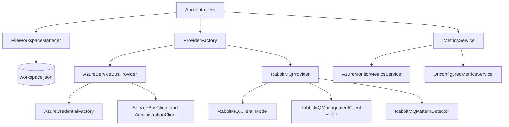

# Core

> One `IMessagingProvider` seam over Azure Service Bus and RabbitMQ, plus the file-backed workspace of saved connections and the metrics service; it has no HTTP surface of its own.

## To change here, read

- [[pages/invariants/provider-boundaries]] - what may live outside `Providers/<Provider>/`
- [[pages/invariants/secrets-masked-at-the-api-boundary]] - masking, the `***` sentinel, who may call `GetConnectionWithSecretAsync`
- [[pages/invariants/bulk-operations-are-at-least-once]] - send before complete, possible duplicates are reported, never resent
- [[pages/invariants/a-guard-must-be-able-to-fire]] - the safety timeout and no-progress guards in the scan loops
- [[pages/services/api]] - the only caller of this library
- [[pages/architecture/project-map]] - which tests to run when this project changes
- [[pages/conventions/testing]]

## Responsibility

Owns the provider contract and both implementations, the bulk delete / resubmit / move algorithms, `workspace.json` persistence and masking of stored connections, and the Azure Monitor metrics reader. Does not own HTTP routes, auth middleware, CORS or the monitoring poller ([[pages/services/api]]), nor any UI ([[pages/services/web-app]], [[pages/services/electron-shell]]).

## Public contract

Everything is a .NET type consumed in-process by `src/ServiceBusExplorer.Api`. Project `ServiceBusExplorer.Core` targets net10.0 and exposes internals to `ServiceBusExplorer.Core.Tests` (`src/ServiceBusExplorer.Core/ServiceBusExplorer.Core.csproj:10`).

- **Provider seam:** `IMessagingProvider` (`src/ServiceBusExplorer.Core/Abstractions/IMessagingProvider.cs:11`): connect/disconnect, queues, topics (RabbitMQ exchanges), subscriptions, peek/send/receive/search, `PurgeMessagesAsync` (`src/ServiceBusExplorer.Core/Abstractions/IMessagingProvider.cs:316`), and the three bulk calls `DeleteMessagesAsync` (`src/ServiceBusExplorer.Core/Abstractions/IMessagingProvider.cs:331`), `ResubmitDeadLetterMessagesAsync` (`src/ServiceBusExplorer.Core/Abstractions/IMessagingProvider.cs:342`), `MoveMessagesAsync` (`src/ServiceBusExplorer.Core/Abstractions/IMessagingProvider.cs:354`), each taking a `CancellationToken` and returning `BatchOperationResult`. Since 2026-11-12 every message operation takes a `MessageSubQueue` (`src/ServiceBusExplorer.Core/Abstractions/IMessagingProvider.cs:390`: active, dead-letter, transfer dead-letter) where it took `bool isDeadLetter`, peek and search take a `CancellationToken` too (`src/ServiceBusExplorer.Core/Abstractions/IMessagingProvider.cs:268`), and `CancelScheduledMessagesAsync` is a fourth bulk call (`src/ServiceBusExplorer.Core/Abstractions/IMessagingProvider.cs:367`); sessions at `src/ServiceBusExplorer.Core/Abstractions/IMessagingProvider.cs:376`.
- **Capabilities:** `IProviderCapabilities` (`src/ServiceBusExplorer.Core/Abstractions/IProviderCapabilities.cs:8`), a flag per feature (`SupportsSessions`, `SupportsSequenceNumbers`, ...). Azure sets almost all true (`src/ServiceBusExplorer.Core/Providers/Azure/AzureProviderCapabilities.cs:33`), deferral being false since 2026-11-12 because nothing defers (`src/ServiceBusExplorer.Core/Providers/Azure/AzureProviderCapabilities.cs:76`); RabbitMQ sets sessions, sequence numbers, scheduling, deferral and duplicate detection false (`src/ServiceBusExplorer.Core/Providers/RabbitMQ/RabbitMQProviderCapabilities.cs:34`, `src/ServiceBusExplorer.Core/Providers/RabbitMQ/RabbitMQProviderCapabilities.cs:40`, `src/ServiceBusExplorer.Core/Providers/RabbitMQ/RabbitMQProviderCapabilities.cs:52`, `src/ServiceBusExplorer.Core/Providers/RabbitMQ/RabbitMQProviderCapabilities.cs:76`, `src/ServiceBusExplorer.Core/Providers/RabbitMQ/RabbitMQProviderCapabilities.cs:82`).
- **Config and entities:** `IConnectionConfig` (`src/ServiceBusExplorer.Core/Abstractions/IConnectionConfig.cs:9`, `IsValid` and `GetDisplayTarget`), `IMessagingEntity` / `IQueueEntity` / `ITopicEntity` / `IMessage` (`src/ServiceBusExplorer.Core/Abstractions/IQueueEntity.cs:7`, `src/ServiceBusExplorer.Core/Abstractions/ITopicEntity.cs:8`, `src/ServiceBusExplorer.Core/Abstractions/IMessage.cs:7`). The concrete shapes are the DTOs in `src/ServiceBusExplorer.Core/Models/` (`QueueInfo`, `TopicInfo`, `MessageInfo`).
- **Factory:** `IProviderFactory` / `ProviderFactory` (`src/ServiceBusExplorer.Core/Providers/ProviderFactory.cs:228`, `src/ServiceBusExplorer.Core/Providers/ProviderFactory.cs:14`). `ProviderType` has two values, `AzureServiceBus = 0` and `RabbitMQ = 1` (`src/ServiceBusExplorer.Core/Providers/ProviderType.cs:11`, `src/ServiceBusExplorer.Core/Providers/ProviderType.cs:16`). Every switch on the enum (`CreateProvider` `src/ServiceBusExplorer.Core/Providers/ProviderFactory.cs:37`, `CreateConnectionConfig` `src/ServiceBusExplorer.Core/Providers/ProviderFactory.cs:80` and `src/ServiceBusExplorer.Core/Providers/ProviderFactory.cs:101`, `GetProviderCapabilities` `src/ServiceBusExplorer.Core/Providers/ProviderFactory.cs:190`) throws `ArgumentOutOfRangeException` for any other value, so a new provider touches all four ([[pages/invariants/provider-boundaries]]). `GetSupportedProviderTypes` is `Enum.GetValues` (`src/ServiceBusExplorer.Core/Providers/ProviderFactory.cs:204`). `TestConnectionAsync` swallows exceptions and returns false (`src/ServiceBusExplorer.Core/Providers/ProviderFactory.cs:175`). `docs/ADDING_PROVIDERS.md` is the long-form guide.
- **Workspace:** `IConnectionManager` and `IConnectionGroupManager` (`src/ServiceBusExplorer.Core/Services/IConnectionManager.cs:5`, `src/ServiceBusExplorer.Core/Services/IConnectionGroupManager.cs:5`), both implemented by `FileWorkspaceManager`.
- **Metrics:** `IMetricsService` (`src/ServiceBusExplorer.Core/Services/IMetricsService.cs:8`) with queue, topic and subscription reads.

## How it works

The API resolves a saved connection with the secret (`GetConnectionWithSecretAsync`), asks `ProviderFactory.CreateConnectedProviderAsync` for a connected provider (`src/ServiceBusExplorer.Core/Providers/ProviderFactory.cs:113`; it disposes the provider if `ConnectAsync` throws, `src/ServiceBusExplorer.Core/Providers/ProviderFactory.cs:145`) and calls the interface. Providers are not thread-safe singletons: each holds one client and one config, and `DisconnectAsync` nulls them (`src/ServiceBusExplorer.Core/Providers/Azure/AzureServiceBusProvider.cs:129`).

## Azure provider

**Entity administration (2026-11-12).** `IMessagingProvider` has `UpdateQueueAsync`, `UpdateTopicAsync` and `UpdateSubscriptionAsync` (`src/ServiceBusExplorer.Core/Abstractions/IMessagingProvider.cs:109`), declared by the capability `SupportsEntityUpdate`: true here, false for RabbitMQ, whose three members throw `NotSupportedException`. Create and update run through static seams that take the administration client (`src/ServiceBusExplorer.Core/Providers/Azure/AzureServiceBusProvider.cs:207`, `src/ServiceBusExplorer.Core/Providers/Azure/AzureServiceBusProvider.cs:257`): the Azure limits are checked first by `EntityConfigurationValidator` in this folder and nothing reaches the broker when one fails; an update reads once, changes only the fields present and writes once, last write wins; SDK failures become the neutral `EntityAlreadyExistsException`, `EntityNotFoundException` and `InvalidEntityConfigurationException` (`src/ServiceBusExplorer.Core/Abstractions/EntityAdministrationExceptions.cs:33`), whose message is always text written by this code. Forward targets, which the broker returns as addresses, are read back as entity names (`src/ServiceBusExplorer.Core/Providers/Azure/AzureServiceBusProvider.cs:320`).

**Sub-queues, scheduled messages and a disabled entity (2026-11-12).** One helper, `CreateReceiver`, builds the receiver of every message operation for a `MessageSubQueue` through the SDK's own sub-queue option (`src/ServiceBusExplorer.Core/Providers/Azure/AzureServiceBusProvider.cs:1002`); no operation writes a path suffix by hand any more. The transfer dead-letter queue is declared by `SupportsTransferDeadLetter` (`src/ServiceBusExplorer.Core/Abstractions/IProviderCapabilities.cs:114`): true here, false for RabbitMQ, which refuses it on every operation (`src/ServiceBusExplorer.Core/Providers/RabbitMQ/RabbitMQProvider.cs:1092`). **Peek** no longer stops at the first short batch: it asks in batches of at most 250 from the last sequence number until a batch is empty or `count` is reached, at most `count` plus one broker calls (`src/ServiceBusExplorer.Core/Providers/Azure/AzureServiceBusProvider.cs:1174`, `src/ServiceBusExplorer.Core/Providers/Azure/AzureServiceBusProvider.cs:1182`), so a scheduled message behind an active one is listed. Peek and search check the caller's token before every broker call and hand it to the SDK (`src/ServiceBusExplorer.Core/Providers/Azure/AzureServiceBusProvider.cs:1181`, `src/ServiceBusExplorer.Core/Providers/Azure/AzureServiceBusProvider.cs:1079`). **Cancel of scheduled messages,** queues only (`src/ServiceBusExplorer.Core/Providers/Azure/AzureServiceBusProvider.cs:2101`): 1 to 500 positive distinct sequence numbers, validated before any broker call (`src/ServiceBusExplorer.Core/Providers/Azure/EntityConfigurationValidator.cs:73`); one broker call when all are scheduled, one call per number only after the broker reports one not found (`src/ServiceBusExplorer.Core/Providers/Azure/AzureServiceBusProvider.cs:2139`, `src/ServiceBusExplorer.Core/Providers/Azure/AzureServiceBusProvider.cs:2163`), at most 501 calls; a failed number carries one of three fixed sentences (`src/ServiceBusExplorer.Core/Providers/Azure/AzureServiceBusProvider.cs:1023` to `src/ServiceBusExplorer.Core/Providers/Azure/AzureServiceBusProvider.cs:1025`) and the causes are logged in one warning per request (`src/ServiceBusExplorer.Core/Providers/Azure/AzureServiceBusProvider.cs:2126`). RabbitMQ refuses it (`src/ServiceBusExplorer.Core/Providers/RabbitMQ/RabbitMQProvider.cs:1083`). **A disabled entity** becomes the neutral `EntityDisabledException` (`src/ServiceBusExplorer.Core/Abstractions/EntityAdministrationExceptions.cs:24`) on every message path (`src/ServiceBusExplorer.Core/Providers/Azure/AzureServiceBusProvider.cs:1034`); in a bulk operation that already started, the remaining sequence numbers are failures with the text "The entity is disabled for this operation." and nothing is retried (`src/ServiceBusExplorer.Core/Providers/Azure/AzureServiceBusProvider.cs:1611`, `src/ServiceBusExplorer.Core/Providers/Azure/AzureServiceBusProvider.cs:1802`, `src/ServiceBusExplorer.Core/Providers/Azure/AzureServiceBusProvider.cs:2030`, `src/ServiceBusExplorer.Core/Providers/Azure/AzureServiceBusProvider.cs:2172`). The exception guarantees only that no message was removed from its source; the limit is on [[pages/invariants/bulk-operations-are-at-least-once]]. `SupportsDeferral` is now false: nothing defers, and a deferred message already in a queue is still listed with its state.

`AzureServiceBusProvider` (`src/ServiceBusExplorer.Core/Providers/Azure/AzureServiceBusProvider.cs:15`, 2382 lines) holds a `ServiceBusClient` for messages and a `ServiceBusAdministrationClient` for entities (`src/ServiceBusExplorer.Core/Providers/Azure/AzureServiceBusProvider.cs:18`, `src/ServiceBusExplorer.Core/Providers/Azure/AzureServiceBusProvider.cs:19`). Both are built from the connection string when `AuthType` is `ConnectionString`, otherwise from the fully qualified namespace plus a `TokenCredential` (`src/ServiceBusExplorer.Core/Providers/Azure/AzureServiceBusProvider.cs:110` to `src/ServiceBusExplorer.Core/Providers/Azure/AzureServiceBusProvider.cs:120`). Logging is careful not to put the connection string in a template (`src/ServiceBusExplorer.Core/Providers/Azure/AzureServiceBusProvider.cs:72`, `src/ServiceBusExplorer.Core/Providers/Azure/AzureServiceBusProvider.cs:87`).

- **Auth types** (`src/ServiceBusExplorer.Core/Providers/Azure/AzureAuthType.cs:6`): `ConnectionString` (default, `src/ServiceBusExplorer.Core/Providers/Azure/AzureAuthType.cs:11`), `InteractiveBrowser` (`src/ServiceBusExplorer.Core/Providers/Azure/AzureAuthType.cs:16`), `ServicePrincipal` (`src/ServiceBusExplorer.Core/Providers/Azure/AzureAuthType.cs:21`), `AzureCli` (`src/ServiceBusExplorer.Core/Providers/Azure/AzureAuthType.cs:26`), `DefaultCredential` (`src/ServiceBusExplorer.Core/Providers/Azure/AzureAuthType.cs:31`).
- **`AzureCredentialFactory.Create`** (`src/ServiceBusExplorer.Core/Providers/Azure/AzureCredentialFactory.cs:25`): service principal uses `ClientSecretCredential` (`src/ServiceBusExplorer.Core/Providers/Azure/AzureCredentialFactory.cs:31`); `DefaultCredential` is `DefaultAzureCredential` with managed identity excluded (`src/ServiceBusExplorer.Core/Providers/Azure/AzureCredentialFactory.cs:40`, `src/ServiceBusExplorer.Core/Providers/Azure/AzureCredentialFactory.cs:43`); interactive browser redirects to `http://localhost:8400` (`src/ServiceBusExplorer.Core/Providers/Azure/AzureCredentialFactory.cs:16`, `src/ServiceBusExplorer.Core/Providers/Azure/AzureCredentialFactory.cs:50`); `ConnectionString` throws because it uses no credential (`src/ServiceBusExplorer.Core/Providers/Azure/AzureCredentialFactory.cs:59`).
- **Search:** `SearchMessagesAsync` peeks 100 at a time and gives up after 10,000 peeked messages (`src/ServiceBusExplorer.Core/Providers/Azure/AzureServiceBusProvider.cs:1054`, `src/ServiceBusExplorer.Core/Providers/Azure/AzureServiceBusProvider.cs:1075`, `src/ServiceBusExplorer.Core/Providers/Azure/AzureServiceBusProvider.cs:1101`, `src/ServiceBusExplorer.Core/Providers/Azure/AzureServiceBusProvider.cs:1109`); `HasMore` is also true at that cap.
- **Purge / delete all:** `PurgeEntityAsync` (`src/ServiceBusExplorer.Core/Providers/Azure/AzureServiceBusProvider.cs:1333`) checks `RequiresSession` through the admin client, uses a session-aware drain for active session entities (`src/ServiceBusExplorer.Core/Providers/Azure/AzureServiceBusProvider.cs:1350`, `src/ServiceBusExplorer.Core/Providers/Azure/AzureServiceBusProvider.cs:1372`) and always the non-session path for dead-letter queues (`src/ServiceBusExplorer.Core/Providers/Azure/AzureServiceBusProvider.cs:1348`). The drain prefers server-side purge, called by reflection because the SDK method is still internal (`src/ServiceBusExplorer.Core/Providers/Azure/AzureServiceBusProvider.cs:1461`, `src/ServiceBusExplorer.Core/Providers/Azure/AzureServiceBusProvider.cs:1463`, `src/ServiceBusExplorer.Core/Providers/Azure/AzureServiceBusProvider.cs:1484`), and falls back to a `ReceiveAndDelete` receive loop (`src/ServiceBusExplorer.Core/Providers/Azure/AzureServiceBusProvider.cs:1494`).
- **Bulk delete selected** (`DeleteMessagesAsync` `src/ServiceBusExplorer.Core/Providers/Azure/AzureServiceBusProvider.cs:1427`, core `src/ServiceBusExplorer.Core/Providers/Azure/AzureServiceBusProvider.cs:1529`): a PeekLock receiver scans in batches of 250 (`src/ServiceBusExplorer.Core/Providers/Azure/AzureServiceBusProvider.cs:1415`, `src/ServiceBusExplorer.Core/Providers/Azure/AzureServiceBusProvider.cs:1416`), completes targets in chunks of 20 (`src/ServiceBusExplorer.Core/Providers/Azure/AzureServiceBusProvider.cs:1417`, `src/ServiceBusExplorer.Core/Providers/Azure/AzureServiceBusProvider.cs:1638`) and abandons non-targets. The scan stops when every target is located, the read position passes the largest target (`src/ServiceBusExplorer.Core/Providers/Azure/AzureServiceBusProvider.cs:1587`), no new sequence numbers arrive (`src/ServiceBusExplorer.Core/Providers/Azure/AzureServiceBusProvider.cs:1592`), or a 2 minute safety timeout fires (`src/ServiceBusExplorer.Core/Providers/Azure/AzureServiceBusProvider.cs:1422`, `src/ServiceBusExplorer.Core/Providers/Azure/AzureServiceBusProvider.cs:1536` to `src/ServiceBusExplorer.Core/Providers/Azure/AzureServiceBusProvider.cs:1538`).
- **Bulk resubmit and move** (`ResubmitCoreAsync` `src/ServiceBusExplorer.Core/Providers/Azure/AzureServiceBusProvider.cs:1717`, `MoveCoreAsync` `src/ServiceBusExplorer.Core/Providers/Azure/AzureServiceBusProvider.cs:1945`) run the same scan, but each cycle sends its targets to the destination first and completes them straight after, so a PeekLock never ages out across a large selection (`src/ServiceBusExplorer.Core/Providers/Azure/AzureServiceBusProvider.cs:1709` to `src/ServiceBusExplorer.Core/Providers/Azure/AzureServiceBusProvider.cs:1716`, `src/ServiceBusExplorer.Core/Providers/Azure/AzureServiceBusProvider.cs:1772`, `src/ServiceBusExplorer.Core/Providers/Azure/AzureServiceBusProvider.cs:2000`). Resubmit sends to the queue or the parent topic, never to the subscription, so subscription filters apply (`src/ServiceBusExplorer.Core/Providers/Azure/AzureServiceBusProvider.cs:1695`). Sending uses size-aware `ServiceBusMessageBatch` splitting (`src/ServiceBusExplorer.Core/Providers/Azure/AzureServiceBusProvider.cs:1828`). Move targets a queue (`src/ServiceBusExplorer.Core/Providers/Azure/AzureServiceBusProvider.cs:1932`).
- **Cancellation:** the linked token carries both the caller token and the safety timeout (`src/ServiceBusExplorer.Core/Providers/Azure/AzureServiceBusProvider.cs:1728` to `src/ServiceBusExplorer.Core/Providers/Azure/AzureServiceBusProvider.cs:1730`). Only the safety timeout is absorbed into a partial result (`src/ServiceBusExplorer.Core/Providers/Azure/AzureServiceBusProvider.cs:1794`); a caller cancellation propagates as `OperationCanceledException` (`src/ServiceBusExplorer.Core.Tests/Providers/Azure/AzureServiceBusProviderBatchTests.cs:467`). A `ServiceBusException` mid-scan also ends the loop with a partial result (`src/ServiceBusExplorer.Core/Providers/Azure/AzureServiceBusProvider.cs:1804`), except a disabled entity, which is reported with its own text or thrown when nothing was done yet (`src/ServiceBusExplorer.Core/Providers/Azure/AzureServiceBusProvider.cs:1798`). Targets never located are reported as "Not found within scan window" (`src/ServiceBusExplorer.Core/Providers/Azure/AzureServiceBusProvider.cs:1423`, `src/ServiceBusExplorer.Core/Providers/Azure/AzureServiceBusProvider.cs:1811`).
- **Possible duplicates:** if `CompleteMessageAsync` fails after the send succeeded, the message is never resent and is reported as a failure whose text says it "may be duplicated" (`src/ServiceBusExplorer.Core/Providers/Azure/AzureServiceBusProvider.cs:1908` for resubmit, `src/ServiceBusExplorer.Core/Providers/Azure/AzureServiceBusProvider.cs:1424` and `src/ServiceBusExplorer.Core/Providers/Azure/AzureServiceBusProvider.cs:2093` for move). There is no separate field: `BatchOperationResult` has `SuccessCount`, `FailureCount` and `Failures` (a list of `SequenceNumber` plus `Error` string) (`src/ServiceBusExplorer.Core/Models/BatchOperationResult.cs:11`, `src/ServiceBusExplorer.Core/Models/BatchOperationResult.cs:16`, `src/ServiceBusExplorer.Core/Models/BatchOperationResult.cs:21`, `src/ServiceBusExplorer.Core/Models/BatchOperationResult.cs:42`), so a duplicate warning is a failure counted in `FailureCount`, identified only by its message text. See [[pages/invariants/bulk-operations-are-at-least-once]].

## RabbitMQ provider

`RabbitMQProvider` (`src/ServiceBusExplorer.Core/Providers/RabbitMQ/RabbitMQProvider.cs:14`, 1150 lines) uses two channels to the broker (`src/ServiceBusExplorer.Core/Providers/RabbitMQ/RabbitMQProvider.cs:16` to `src/ServiceBusExplorer.Core/Providers/RabbitMQ/RabbitMQProvider.cs:18`, connect at `src/ServiceBusExplorer.Core/Providers/RabbitMQ/RabbitMQProvider.cs:73`, management client at `src/ServiceBusExplorer.Core/Providers/RabbitMQ/RabbitMQProvider.cs:102`):

- **AMQP** through `RabbitMQ.Client` (`IConnection`, `IModel`): publish, `BasicGet` for receive and peek, `QueuePurge`. Peek is a `BasicGet` followed by `BasicNack` with requeue (`src/ServiceBusExplorer.Core/Providers/RabbitMQ/RabbitMQProvider.cs:544`, `src/ServiceBusExplorer.Core/Providers/RabbitMQ/RabbitMQProvider.cs:551`); receive acks (`src/ServiceBusExplorer.Core/Providers/RabbitMQ/RabbitMQProvider.cs:623`).
- **HTTP management API** through `RabbitMQManagementClient` (`src/ServiceBusExplorer.Core/Providers/RabbitMQ/RabbitMQManagementClient.cs:15`, 1193 lines, own `HttpClient` with Basic auth `src/ServiceBusExplorer.Core/Providers/RabbitMQ/RabbitMQManagementClient.cs:17`, `src/ServiceBusExplorer.Core/Providers/RabbitMQ/RabbitMQManagementClient.cs:73`): queue, exchange and binding CRUD, overview, `GetMessagesAsync` (`src/ServiceBusExplorer.Core/Providers/RabbitMQ/RabbitMQManagementClient.cs:229`) and publish (`src/ServiceBusExplorer.Core/Providers/RabbitMQ/RabbitMQManagementClient.cs:348`, `src/ServiceBusExplorer.Core/Providers/RabbitMQ/RabbitMQManagementClient.cs:377`). It has an internal constructor taking an `HttpClient` for tests (`src/ServiceBusExplorer.Core/Providers/RabbitMQ/RabbitMQManagementClient.cs:54`).
- **Mapping:** exchanges are "topics", bound queues are "subscriptions", and the dead-letter queue is the convention `<queue>.dlq` (`src/ServiceBusExplorer.Core/Providers/RabbitMQ/RabbitMQProvider.cs:646`, and for the message operations one helper, `src/ServiceBusExplorer.Core/Providers/RabbitMQ/RabbitMQProvider.cs:1089`). RabbitMQ has no sequence numbers, so the bulk calls treat `sequenceNumbers` as 1-based positions in a destructive read (`src/ServiceBusExplorer.Core/Providers/RabbitMQ/RabbitMQProvider.cs:706`).
- **`RabbitMQPatternDetector`** (`src/ServiceBusExplorer.Core/Providers/RabbitMQ/Services/RabbitMQPatternDetector.cs:10`, `DetectExchangePattern` `src/ServiceBusExplorer.Core/Providers/RabbitMQ/Services/RabbitMQPatternDetector.cs:22`, `DetectQueuePattern` `src/ServiceBusExplorer.Core/Providers/RabbitMQ/Services/RabbitMQPatternDetector.cs:85`) classifies exchanges into `MessagingPattern` values (`src/ServiceBusExplorer.Core/Providers/RabbitMQ/Models/MessagingPattern.cs:7`) with a confidence. The provider calls it while listing and fetching exchanges (`src/ServiceBusExplorer.Core/Providers/RabbitMQ/RabbitMQProvider.cs:244`, `src/ServiceBusExplorer.Core/Providers/RabbitMQ/RabbitMQProvider.cs:286`).
- **Bulk operations are not the Azure algorithm.** `DeleteMessagesAsync`, `ResubmitDeadLetterMessagesAsync` and `MoveMessagesAsync` consume up to the largest position through the management API with `ack_requeue_false` (`src/ServiceBusExplorer.Core/Providers/RabbitMQ/RabbitMQProvider.cs:702`, `src/ServiceBusExplorer.Core/Providers/RabbitMQ/RabbitMQProvider.cs:763`, `src/ServiceBusExplorer.Core/Providers/RabbitMQ/RabbitMQProvider.cs:825`), then republish: targets to their destination, non-targets back to the source (`src/ServiceBusExplorer.Core/Providers/RabbitMQ/RabbitMQProvider.cs:722`, `src/ServiceBusExplorer.Core/Providers/RabbitMQ/RabbitMQProvider.cs:786`, `src/ServiceBusExplorer.Core/Providers/RabbitMQ/RabbitMQProvider.cs:793`, `src/ServiceBusExplorer.Core/Providers/RabbitMQ/RabbitMQProvider.cs:840`, `src/ServiceBusExplorer.Core/Providers/RabbitMQ/RabbitMQProvider.cs:846`). The messages are already gone from the broker before the republish, so a failed republish loses the message and is recorded as a failure; the order is consume-then-publish, the opposite of Azure's send-then-complete. Non-targets return at the tail of the queue. `all` maps to `QueuePurge` (`src/ServiceBusExplorer.Core/Providers/RabbitMQ/RabbitMQProvider.cs:688`). The `CancellationToken` parameters of these four are accepted and never read; only the peek reads its token, between two messages (`src/ServiceBusExplorer.Core/Providers/RabbitMQ/RabbitMQProvider.cs:541`) (`src/ServiceBusExplorer.Core/Providers/RabbitMQ/RabbitMQProvider.cs:674`, `src/ServiceBusExplorer.Core/Providers/RabbitMQ/RabbitMQProvider.cs:740`, `src/ServiceBusExplorer.Core/Providers/RabbitMQ/RabbitMQProvider.cs:811`, `src/ServiceBusExplorer.Core/Providers/RabbitMQ/RabbitMQProvider.cs:864`).

## Legacy `ServiceBusService`

`Services/ServiceBusService.cs` (780 lines, `src/ServiceBusExplorer.Core/Services/ServiceBusService.cs:11`) is the pre-provider Azure-only service behind `IServiceBusService` (`src/ServiceBusExplorer.Core/Services/IServiceBusService.cs:5`). It is still registered as a singleton (`src/ServiceBusExplorer.Api/Program.cs:117`) and injected into `ConnectionsController` (`src/ServiceBusExplorer.Api/Controllers/ConnectionsController.cs:14`), but the controller only reads `IsConnected` and `CurrentNamespace` and calls `DisconnectAsync` (`src/ServiceBusExplorer.Api/Controllers/ConnectionsController.cs:294`, `src/ServiceBusExplorer.Api/Controllers/ConnectionsController.cs:329`, `src/ServiceBusExplorer.Api/Controllers/ConnectionsController.cs:331`, `src/ServiceBusExplorer.Api/Controllers/ConnectionsController.cs:592`). Nothing in `src/ServiceBusExplorer.Api` calls `ConnectAsync` or any entity method on it, so `IsConnected` is always false at run time and the status endpoint reports it. No other project references the class. Its operations are served by `AzureServiceBusProvider`.

## FileWorkspaceManager

`FileWorkspaceManager` (`src/ServiceBusExplorer.Core/Services/FileWorkspaceManager.cs:13`) implements both manager interfaces over one file, `<dataPath>/workspace.json`, holding `{ Connections, Groups }` (`src/ServiceBusExplorer.Core/Services/FileWorkspaceManager.cs:54`, `src/ServiceBusExplorer.Core/Services/FileWorkspaceManager.cs:545`). The API passes `SERVICEBUS_DATA_PATH` or `%APPDATA%/ServiceBusExplorer` (`src/ServiceBusExplorer.Api/Program.cs:92`, `src/ServiceBusExplorer.Api/Program.cs:103`); with no path it falls back to `./.servicebus` (`src/ServiceBusExplorer.Core/Services/FileWorkspaceManager.cs:34`).

- **Migration** runs in the constructor. `MigrateLegacyData` copies old AppData `connections.json` / `connection-groups.json` when the base path was defaulted and no `workspace.json` exists (`src/ServiceBusExplorer.Core/Services/FileWorkspaceManager.cs:59` to `src/ServiceBusExplorer.Core/Services/FileWorkspaceManager.cs:63`); `MigrateFromSeparateFiles` merges the two files into `workspace.json` and deletes them (`src/ServiceBusExplorer.Core/Services/FileWorkspaceManager.cs:130`, `src/ServiceBusExplorer.Core/Services/FileWorkspaceManager.cs:203`, `src/ServiceBusExplorer.Core/Services/FileWorkspaceManager.cs:211`, `src/ServiceBusExplorer.Core/Services/FileWorkspaceManager.cs:217`). It is a no-op once `workspace.json` exists (`src/ServiceBusExplorer.Core/Services/FileWorkspaceManager.cs:133`). Since 2026-11-13 a legacy file that cannot be read or parsed stops it before anything is written or deleted (`src/ServiceBusExplorer.Core/Services/FileWorkspaceManager.cs:170`, `src/ServiceBusExplorer.Core/Services/FileWorkspaceManager.cs:189`): both files stay on disk, an error is logged with the exception type, and the app starts with an empty workspace. Locked by `A_legacy_file_that_cannot_be_parsed_is_kept_and_nothing_is_consolidated` for either file (`src/ServiceBusExplorer.Core.Tests/Services/FileWorkspaceManagerTests.cs:318`) and `Readable_legacy_files_are_consolidated_into_the_workspace_and_removed` (`src/ServiceBusExplorer.Core.Tests/Services/FileWorkspaceManagerTests.cs:338`). The first save then creates `workspace.json`, after which the consolidation no longer runs, so the kept files are recovered by hand.
- **Locking:** one in-process `lock (_lock)` (`src/ServiceBusExplorer.Core/Services/FileWorkspaceManager.cs:21`) guards every read and every write: the connection reads (`src/ServiceBusExplorer.Core/Services/FileWorkspaceManager.cs:305`, `src/ServiceBusExplorer.Core/Services/FileWorkspaceManager.cs:320`, `src/ServiceBusExplorer.Core/Services/FileWorkspaceManager.cs:330`), save, delete, export and import (`src/ServiceBusExplorer.Core/Services/FileWorkspaceManager.cs:365`, `src/ServiceBusExplorer.Core/Services/FileWorkspaceManager.cs:391`, `src/ServiceBusExplorer.Core/Services/FileWorkspaceManager.cs:402`, `src/ServiceBusExplorer.Core/Services/FileWorkspaceManager.cs:423`) the four group methods (`src/ServiceBusExplorer.Core/Services/FileWorkspaceManager.cs:463`, `src/ServiceBusExplorer.Core/Services/FileWorkspaceManager.cs:472`, `src/ServiceBusExplorer.Core/Services/FileWorkspaceManager.cs:482`, `src/ServiceBusExplorer.Core/Services/FileWorkspaceManager.cs:510`) and `ClearAllAsync` (`src/ServiceBusExplorer.Core/Services/FileWorkspaceManager.cs:521`). There is no cross-process lock.
- **Atomic write:** `SaveWorkspace` writes `workspace.json.tmp` in the same directory and moves it over `workspace.json` with `File.Move(..., overwrite: true)` (`src/ServiceBusExplorer.Core/Services/FileWorkspaceManager.cs:257`, `src/ServiceBusExplorer.Core/Services/FileWorkspaceManager.cs:261`, `src/ServiceBusExplorer.Core/Services/FileWorkspaceManager.cs:262`), so a failed write leaves the previous file whole. `ClearAllAsync` writes its empty workspace through the same method (`src/ServiceBusExplorer.Core/Services/FileWorkspaceManager.cs:536`). The consolidation migration still writes `workspace.json` directly (`src/ServiceBusExplorer.Core/Services/FileWorkspaceManager.cs:203`).
- **Unreadable workspace:** `LoadWorkspace` returns an empty workspace only when the file is missing (`src/ServiceBusExplorer.Core/Services/FileWorkspaceManager.cs:239`); a file that exists and cannot be read or parsed throws `InvalidOperationException` with a generic message and the cause as inner exception (`src/ServiceBusExplorer.Core/Services/FileWorkspaceManager.cs:249`), so no read answers empty and no save overwrites the file. The constructor and both migrations never call `LoadWorkspace`, and the consolidation returns early once the file exists (`src/ServiceBusExplorer.Core/Services/FileWorkspaceManager.cs:133`), so startup is unchanged; the first request that reads the workspace fails instead. The one way out in the app is `ClearAllAsync` (`src/ServiceBusExplorer.Core/Services/FileWorkspaceManager.cs:519`, contract at `src/ServiceBusExplorer.Core/Services/IConnectionManager.cs:35`), behind `DELETE /api/connections/clear-all`: it catches that exception, logs only the inner exception's type name (`src/ServiceBusExplorer.Core/Services/FileWorkspaceManager.cs:529`), reports zero connections and zero groups, and writes an empty workspace; on a readable or missing file it reports what was stored.
- **Masking:** `MaskConnection` clones a connection and replaces `ConnectionString`, `Password` and `ClientSecret` with the literal `***` when non-empty (`src/ServiceBusExplorer.Core/Services/FileWorkspaceManager.cs:274`, `src/ServiceBusExplorer.Core/Services/FileWorkspaceManager.cs:281`, `src/ServiceBusExplorer.Core/Services/FileWorkspaceManager.cs:286`, `src/ServiceBusExplorer.Core/Services/FileWorkspaceManager.cs:298`). `GetConnectionsAsync` and `GetConnectionAsync` return masked copies (`src/ServiceBusExplorer.Core/Services/FileWorkspaceManager.cs:302`, `src/ServiceBusExplorer.Core/Services/FileWorkspaceManager.cs:318`); only `GetConnectionWithSecretAsync` returns the stored object (`src/ServiceBusExplorer.Core/Services/FileWorkspaceManager.cs:328`, contract at `src/ServiceBusExplorer.Core/Services/IConnectionManager.cs:18`). `SaveConnectionAsync` returns the masked clone of what it stored, on update and on create (`src/ServiceBusExplorer.Core/Services/FileWorkspaceManager.cs:385`).
- **Update and import merge:** for an id already stored, save and import both call `CopyEditableFields` (`src/ServiceBusExplorer.Core/Services/FileWorkspaceManager.cs:342`, called at `src/ServiceBusExplorer.Core/Services/FileWorkspaceManager.cs:372` and `src/ServiceBusExplorer.Core/Services/FileWorkspaceManager.cs:433`), which copies name, provider type, the Azure fields and the RabbitMQ host, port, user, password, virtual host and management port; a `ConnectionString`, `Password` or `ClientSecret` that arrives as `***` keeps the stored value (`src/ServiceBusExplorer.Core/Services/FileWorkspaceManager.cs:346`, `src/ServiceBusExplorer.Core/Services/FileWorkspaceManager.cs:351`, `src/ServiceBusExplorer.Core/Services/FileWorkspaceManager.cs:360`). `Id`, `CreatedAt`, `LastUsedAt` and `IsConnected` are not copied. An imported entry whose id is not stored keeps its other fields but has every secret equal to `***` cleared (`src/ServiceBusExplorer.Core/Services/FileWorkspaceManager.cs:441` to `src/ServiceBusExplorer.Core/Services/FileWorkspaceManager.cs:446`). `ExportConfigurationAsync(includeSecrets)` serialises the raw objects when true and masked copies when false (`src/ServiceBusExplorer.Core/Services/FileWorkspaceManager.cs:400` to `src/ServiceBusExplorer.Core/Services/FileWorkspaceManager.cs:407`).
- **Secrets are stored in plain text on disk.** `workspace.json` is written with `JsonSerializer` and `File.WriteAllText` (`src/ServiceBusExplorer.Core/Services/FileWorkspaceManager.cs:259`, `src/ServiceBusExplorer.Core/Services/FileWorkspaceManager.cs:261`); the connection string, RabbitMQ password and service principal secret are the raw values. There is no encryption, DPAPI or Data Protection call anywhere in `src/ServiceBusExplorer.Core` or `src/ServiceBusExplorer.Api` (searched for `Encrypt`, `DataProtect`, `ProtectedData`). Protection is the operating system's file permissions only. See [[pages/invariants/secrets-masked-at-the-api-boundary]].

## Metrics services

`IMetricsService` has two implementations chosen in `src/ServiceBusExplorer.Api/Program.cs:128` to `src/ServiceBusExplorer.Api/Program.cs:163`: when `AzureMonitorOptions.IsConfigured` (subscription id, resource group and namespace all set, `src/ServiceBusExplorer.Core/Services/AzureMonitorOptions.cs:29`; section name `AzureMonitor`, `src/ServiceBusExplorer.Core/Services/AzureMonitorOptions.cs:9`) the API registers `AzureMonitorMetricsService`; otherwise `UnconfiguredMetricsService`, whose three methods throw `InvalidOperationException` (`src/ServiceBusExplorer.Core/Services/UnconfiguredMetricsService.cs:21`). `AzureMonitorMetricsService` (`src/ServiceBusExplorer.Core/Services/AzureMonitorMetricsService.cs:18`) uses `MetricsQueryClient` with `DefaultAzureCredential` when no credential is passed (`src/ServiceBusExplorer.Core/Services/AzureMonitorMetricsService.cs:22`, `src/ServiceBusExplorer.Core/Services/AzureMonitorMetricsService.cs:72`), caches each result for 30 seconds in `IMemoryCache` (`src/ServiceBusExplorer.Core/Services/AzureMonitorMetricsService.cs:29`, `src/ServiceBusExplorer.Core/Services/AzureMonitorMetricsService.cs:115`) and throws if used while unconfigured (`src/ServiceBusExplorer.Core/Services/AzureMonitorMetricsService.cs:357`). It reads a fixed namespace from options, not from the connected connection.

## Invariants

- [[pages/invariants/provider-boundaries]] - vendor SDK types stay under `Providers/<Provider>/`
- [[pages/invariants/secrets-masked-at-the-api-boundary]] - masked reads, sentinel on write, raw only via `GetConnectionWithSecretAsync`
- [[pages/invariants/bulk-operations-are-at-least-once]] - `ResubmitCoreAsync` and `MoveCoreAsync` send before they complete
- [[pages/invariants/a-guard-must-be-able-to-fire]] - the no-progress and safety-timeout exits in `DeleteMessagesCoreAsync`

## Hot spots

- `src/ServiceBusExplorer.Core/Providers/Azure/AzureServiceBusProvider.cs:1529` - 2382 lines; `DeleteMessagesCoreAsync`, `ResubmitCoreAsync` (`src/ServiceBusExplorer.Core/Providers/Azure/AzureServiceBusProvider.cs:1717`) and `MoveCoreAsync` (`src/ServiceBusExplorer.Core/Providers/Azure/AzureServiceBusProvider.cs:1945`) repeat one scan loop three times with small differences; a fix to one belongs in all three.
- `src/ServiceBusExplorer.Core/Providers/RabbitMQ/RabbitMQManagementClient.cs:229` - 1193 lines of HTTP plumbing and response DTOs; `GetMessagesAsync` with `ack_requeue_false` is the destructive read every RabbitMQ bulk call relies on.
- `src/ServiceBusExplorer.Core/Providers/RabbitMQ/RabbitMQProvider.cs:674` - 1150 lines; the three bulk methods (`src/ServiceBusExplorer.Core/Providers/RabbitMQ/RabbitMQProvider.cs:674`, `src/ServiceBusExplorer.Core/Providers/RabbitMQ/RabbitMQProvider.cs:740`, `src/ServiceBusExplorer.Core/Providers/RabbitMQ/RabbitMQProvider.cs:811`) are the least safe code in the library.
- `src/ServiceBusExplorer.Core/Services/ServiceBusService.cs:11` - 780 lines of legacy code that is effectively unused.
- `src/ServiceBusExplorer.Core/Services/FileWorkspaceManager.cs:363` - the one write path that stores a connection a caller sent (`ClearAllAsync` only empties the file) and the place masking rules meet persistence.
- `src/ServiceBusExplorer.Core/Providers/Azure/AzureServiceBusProvider.cs:1461` - reflection call to an internal SDK method; breaks silently to the slow drain when the SDK changes.

## Cache footprint

`AzureMonitorMetricsService` keeps an `IMemoryCache` entry per metrics query for 30 seconds (`src/ServiceBusExplorer.Core/Services/AzureMonitorMetricsService.cs:29`, `src/ServiceBusExplorer.Core/Services/AzureMonitorMetricsService.cs:115`, `src/ServiceBusExplorer.Core/Services/AzureMonitorMetricsService.cs:139`, `src/ServiceBusExplorer.Core/Services/AzureMonitorMetricsService.cs:164`). Nothing else in Core caches.

## Cross-service dependencies

- **Reads from:** Azure Service Bus (AMQP + management), RabbitMQ (AMQP + HTTP management), Azure Monitor (`MetricsQueryClient`), the local `workspace.json`.
- **Written to by:** [[pages/services/api]] only (`src/ServiceBusExplorer.Api/Program.cs:103` to `src/ServiceBusExplorer.Api/Program.cs:114`).

## Testing footprint

`src/ServiceBusExplorer.Core.Tests/` (xUnit + Moq, 3923 test lines, 302 tests on 2026-11-12). See [[pages/conventions/testing]] and [[pages/architecture/project-map]].

- `src/ServiceBusExplorer.Core.Tests/Providers/Azure/AzureServiceBusProviderBatchTests.cs` (554 lines) - the bulk cores against mocked `ServiceBusReceiver`/`ServiceBusSender`: multi-batch location, real complete error, not-found termination, partial result on transient failure, send-before-complete, duplicate warning without resend, empty input, pre-cancelled token (`src/ServiceBusExplorer.Core.Tests/Providers/Azure/AzureServiceBusProviderBatchTests.cs:63`, `src/ServiceBusExplorer.Core.Tests/Providers/Azure/AzureServiceBusProviderBatchTests.cs:162`, `src/ServiceBusExplorer.Core.Tests/Providers/Azure/AzureServiceBusProviderBatchTests.cs:196`, `src/ServiceBusExplorer.Core.Tests/Providers/Azure/AzureServiceBusProviderBatchTests.cs:313`, `src/ServiceBusExplorer.Core.Tests/Providers/Azure/AzureServiceBusProviderBatchTests.cs:347`, `src/ServiceBusExplorer.Core.Tests/Providers/Azure/AzureServiceBusProviderBatchTests.cs:467`).
- `src/ServiceBusExplorer.Core.Tests/Providers/Azure/AzureServiceBusProviderSubQueueTests.cs` (573 lines) and `Providers/RabbitMQSubQueueTests.cs` (47) - each sub-queue reaching the SDK as the receiver of that queue (`src/ServiceBusExplorer.Core.Tests/Providers/Azure/AzureServiceBusProviderSubQueueTests.cs:72`), the peek across a short batch, its batches of 250, its call bound and its token (`src/ServiceBusExplorer.Core.Tests/Providers/Azure/AzureServiceBusProviderSubQueueTests.cs:141`, `src/ServiceBusExplorer.Core.Tests/Providers/Azure/AzureServiceBusProviderSubQueueTests.cs:175`, `src/ServiceBusExplorer.Core.Tests/Providers/Azure/AzureServiceBusProviderSubQueueTests.cs:226`, `src/ServiceBusExplorer.Core.Tests/Providers/Azure/AzureServiceBusProviderSubQueueTests.cs:191`), the search token (`src/ServiceBusExplorer.Core.Tests/Providers/Azure/AzureServiceBusProviderSubQueueTests.cs:241`), a failing continuation call reaching the caller (`src/ServiceBusExplorer.Core.Tests/Providers/Azure/AzureServiceBusProviderSubQueueTests.cs:261`), the disabled entity on every single-message path and midway through each bulk call (`src/ServiceBusExplorer.Core.Tests/Providers/Azure/AzureServiceBusProviderSubQueueTests.cs:292`, `src/ServiceBusExplorer.Core.Tests/Providers/Azure/AzureServiceBusProviderSubQueueTests.cs:340`, `src/ServiceBusExplorer.Core.Tests/Providers/Azure/AzureServiceBusProviderSubQueueTests.cs:364`), the cancel of scheduled messages with its validation, its fallback, its fixed sentences, its one log line and its token (`src/ServiceBusExplorer.Core.Tests/Providers/Azure/AzureServiceBusProviderSubQueueTests.cs:423`, `src/ServiceBusExplorer.Core.Tests/Providers/Azure/AzureServiceBusProviderSubQueueTests.cs:435`, `src/ServiceBusExplorer.Core.Tests/Providers/Azure/AzureServiceBusProviderSubQueueTests.cs:502`, `src/ServiceBusExplorer.Core.Tests/Providers/Azure/AzureServiceBusProviderSubQueueTests.cs:524`, `src/ServiceBusExplorer.Core.Tests/Providers/Azure/AzureServiceBusProviderSubQueueTests.cs:551`), and RabbitMQ refusing the transfer dead-letter queue and the cancel.
- `Providers/Azure/AzureCredentialFactoryTests.cs` (125) and `AzureServiceBusProviderTests.cs` (90) - credential types, `IsValid`, connect per auth type.
- `Providers/Azure/AzureServiceBusProviderReadTests.cs` - the single-queue read against a mocked administration client: every configured and runtime value mapped, a failing configuration call reaching the caller, a queue either call reports missing answered as null, and the state and byte size of a mapped message.
- `Services/AzureMonitorMetricsServiceTests.cs` (556) - metrics mapping and caching.
- `Providers/RabbitMQSessionTests.cs` (49) and `Models/SessionInfoTests.cs` (53).
- `Services/FileWorkspaceManagerTests.cs` (352) - each test on its own temp directory: update and import of an existing id persist the RabbitMQ fields (`src/ServiceBusExplorer.Core.Tests/Services/FileWorkspaceManagerTests.cs:65`, `src/ServiceBusExplorer.Core.Tests/Services/FileWorkspaceManagerTests.cs:78`), a masked password keeps the stored one (`src/ServiceBusExplorer.Core.Tests/Services/FileWorkspaceManagerTests.cs:91`), the save return value is masked on update and create (`src/ServiceBusExplorer.Core.Tests/Services/FileWorkspaceManagerTests.cs:108`, `src/ServiceBusExplorer.Core.Tests/Services/FileWorkspaceManagerTests.cs:134`), a masked import for an unknown id stores no `***` (`src/ServiceBusExplorer.Core.Tests/Services/FileWorkspaceManagerTests.cs:155`), a corrupt file throws and a failed save leaves it unchanged (`src/ServiceBusExplorer.Core.Tests/Services/FileWorkspaceManagerTests.cs:177`, `src/ServiceBusExplorer.Core.Tests/Services/FileWorkspaceManagerTests.cs:190`), a missing file reads as empty (`src/ServiceBusExplorer.Core.Tests/Services/FileWorkspaceManagerTests.cs:203`), a save leaves no temp file (`src/ServiceBusExplorer.Core.Tests/Services/FileWorkspaceManagerTests.cs:214`) and a save whose temp write fails keeps the original file (`src/ServiceBusExplorer.Core.Tests/Services/FileWorkspaceManagerTests.cs:228`). `ClearAllAsync`: a corrupt file reports `(0, 0)` and reads back empty (`src/ServiceBusExplorer.Core.Tests/Services/FileWorkspaceManagerTests.cs:249`), two connections and one group report `(2, 1)` and read back empty (`src/ServiceBusExplorer.Core.Tests/Services/FileWorkspaceManagerTests.cs:263`), no temp file is left and the file parses as an empty workspace (`src/ServiceBusExplorer.Core.Tests/Services/FileWorkspaceManagerTests.cs:279`), a missing file ends as an empty workspace file (`src/ServiceBusExplorer.Core.Tests/Services/FileWorkspaceManagerTests.cs:291`), and a clear whose temp write fails throws and keeps the original file (`src/ServiceBusExplorer.Core.Tests/Services/FileWorkspaceManagerTests.cs:303`). The lock on the read paths has no test.
- `Providers/RabbitMQManagementClientTests.cs` (since 2026-11-13) - every one of the nineteen management calls disposes its HTTP response, through the internal `HttpClient` constructor and a fake handler (`src/ServiceBusExplorer.Core.Tests/Providers/RabbitMQManagementClientTests.cs:39`), and a 500 throws and still disposes it (`src/ServiceBusExplorer.Core.Tests/Providers/RabbitMQManagementClientTests.cs:52`). `Providers/RabbitMQProviderCapabilitiesTests.cs` - the shared exchange types refuse a write through an `IList<string>` cast (`src/ServiceBusExplorer.Core.Tests/Providers/RabbitMQProviderCapabilitiesTests.cs:8`).
- No test references `ProviderFactory`, `RabbitMQPatternDetector` or the RabbitMQ bulk methods in this project, and none drives the management client's parsing. The API masking tests also seed `FileWorkspaceManager` (`src/ServiceBusExplorer.Api.Tests/ApiFactory.cs:42`) and assert the `***` mask (`src/ServiceBusExplorer.Api.Tests/ConnectionMaskingTests.cs:37`).
- The purge paths have no test in this project, and of the single-message `ResubmitDeadLetterMessageAsync` and of `SearchMessagesAsync` only the disabled-entity answer and the token are tested here; the single resubmit and search are reached by the integration project.

`src/ServiceBusExplorer.IntegrationTests/` runs `RabbitMQProvider` through its public surface against RabbitMQ 4.3.7 with the management plugin, in a container the run starts ([[pages/decisions/0002-integration-tests-against-brokers-in-docker]], how it works on [[pages/conventions/testing]]). 29 tests:

- `src/ServiceBusExplorer.IntegrationTests/RabbitMQProviderTests.cs` - what works today: connect and disconnect, `TestConnectionAsync` true and false, queue create, list, get and delete, the configured values and the status of one queue, the state and size of an active and a scheduled message, exchanges listed as topics without `amq.*`, a binding created and listed as a subscription and deleted again, body, content type, message id and a string header through send and peek, receive removing the message, a peek with a cancelled token leaving the queue as it was, purge.
- `src/ServiceBusExplorer.IntegrationTests/RabbitMQProviderDefectTests.cs` - sixteen `Defect_` tests for the fifteen audit entries the container reproduced ([[pages/roadmap/code-audit-2026-11]], RabbitMQ section): each passes on today's behaviour and its summary names the correct one.
- `src/ServiceBusExplorer.IntegrationTests/RabbitMqFixtureTests.cs:12` - the provider reaches only the loopback container the run started.

The same project runs `AzureServiceBusProvider` through `IMessagingProvider` against the Azure Service Bus emulator 2.0.1 with its SQL Server, one pair of containers per run. The emulator serves messages and entities on two ports, so each test holds two providers, one per connection string; what that and the emulator's other limits leave untested is listed on [[pages/conventions/testing]]. 53 tests:

- `src/ServiceBusExplorer.IntegrationTests/AzureServiceBusProviderTests.cs` - what works today: test connection true for the management endpoint and false for a closed port and for the messaging endpoint, connect and disconnect, queue create, list, get and delete, topic and subscription create, list, get and delete, body, content type, subject, correlation id, message id, session id and a string property through send and peek, the session list, receive removing the message, a topic send reaching each subscription, the dead-letter side after the max delivery count and after an explicit dead-letter, bulk delete, resubmit and move of a selected dead-letter message, the three bulk calls refusing an already-cancelled token with nothing changed, and, since 2026-11-12, a peek across the gap a dropped duplicate leaves, a scheduled message listed behind an active one with its state, the transfer dead-letter queue of a queue answering empty and not its dead-letter queue, a cancel of two scheduled messages, and the neutral exception from a send, a batch send, a cancel, a receive and a resubmit on a disabled queue with nothing changed.
- `src/ServiceBusExplorer.IntegrationTests/AzureServiceBusProviderDefectTests.cs` - thirteen `Defect_` tests for the audit entries the emulator reproduced and that are still open and the new findings it surfaced, the latest a cancel that mixes in a number that is not scheduled (`src/ServiceBusExplorer.IntegrationTests/AzureServiceBusProviderDefectTests.cs:87`) ([[pages/roadmap/code-audit-2026-11]], Azure and API sections).
- `src/ServiceBusExplorer.IntegrationTests/AzureServiceBusFixtureTests.cs:12` - both endpoints are the loopback container the run started.

Not reached by any test against a broker: `PurgeMessagesAsync` and delete-all (they need both endpoints at once), `SetSessionStateAsync`, `DeadLetterMessageAsync`.

## History

Not tracked on this page yet. Newest first when a history page exists.

## Known gaps

Each item was read in the working tree on 2026-11-12 (branch `fix/dlq-bulk-operations`, uncommitted changes included).

- **The Azure provider loses a message on a resubmit or a move into an entity with duplicate detection.** The copy keeps the original `MessageId`; inside the detection window the broker accepts and drops it, the source is completed, and the result reports success. Reproduced on the emulator (`src/ServiceBusExplorer.IntegrationTests/AzureServiceBusProviderDefectTests.cs:114`).
- **A selective delete or move on an active Azure entity dead-letters messages the user did not select.** The scan abandons the non-targets, which raises their delivery count; with a low `MaxDeliveryCount` they reach the dead-letter queue while the result reports success. Reproduced on the emulator (`src/ServiceBusExplorer.IntegrationTests/AzureServiceBusProviderDefectTests.cs:160`).
- **A queue with auto-forwarding cannot be peeked.** The broker refuses a message browser on an entity that forwards; the peek fails and nothing explains it. Found by hand on 2026-11-12, no test ([[pages/roadmap/followups]]).
- **A cancel that mixes in a number that is not scheduled cancels none on the emulator** and fails every number, where the fallback is written to fail only that number (`src/ServiceBusExplorer.Core/Providers/Azure/AzureServiceBusProvider.cs:2147`, `src/ServiceBusExplorer.IntegrationTests/AzureServiceBusProviderDefectTests.cs:87`). Real Azure was not verified.
- **Comment disagrees with code.** The single resubmit comment says "Use ReceiveAndDelete mode" (`src/ServiceBusExplorer.Core/Providers/Azure/AzureServiceBusProvider.cs:1280`); the receiver is PeekLock (`src/ServiceBusExplorer.Core/Providers/Azure/AzureServiceBusProvider.cs:1284`). The same method sends first (`src/ServiceBusExplorer.Core/Providers/Azure/AzureServiceBusProvider.cs:1277`) and, if it cannot find the original within five receive attempts, returns without error (`src/ServiceBusExplorer.Core/Providers/Azure/AzureServiceBusProvider.cs:1288`, `src/ServiceBusExplorer.Core/Providers/Azure/AzureServiceBusProvider.cs:1318`), so a duplicate there is silent, unlike the batch path. Reproduced against the emulator on 2026-11-12: the last of 350 dead-lettered messages is sent and stays in the dead-letter queue, with no error (`src/ServiceBusExplorer.IntegrationTests/AzureServiceBusProviderDefectTests.cs:197`).
- **Partial send is misreported as not found.** In `ResubmitCoreAsync` and `MoveCoreAsync`, `SendResubmitBatchAsync` can send several sub-batches before a `ServiceBusException` ends the loop (`src/ServiceBusExplorer.Core/Providers/Azure/AzureServiceBusProvider.cs:1773`, `src/ServiceBusExplorer.Core/Providers/Azure/AzureServiceBusProvider.cs:1804`, `src/ServiceBusExplorer.Core/Providers/Azure/AzureServiceBusProvider.cs:1850` to `src/ServiceBusExplorer.Core/Providers/Azure/AzureServiceBusProvider.cs:1859`); those messages are not in `located`, so they are reported as "Not found within scan window" (`src/ServiceBusExplorer.Core/Providers/Azure/AzureServiceBusProvider.cs:1811`) although they were already sent, and a retry duplicates them.
- **RabbitMQ bulk calls can lose messages and ignore cancellation** (consume with `ack_requeue_false`, then republish; token never read): `src/ServiceBusExplorer.Core/Providers/RabbitMQ/RabbitMQProvider.cs:702`, `src/ServiceBusExplorer.Core/Providers/RabbitMQ/RabbitMQProvider.cs:840`, `src/ServiceBusExplorer.Core/Providers/RabbitMQ/RabbitMQProvider.cs:674`. `MoveMessagesAsync` also ignores `subscriptionName` (`src/ServiceBusExplorer.Core/Providers/RabbitMQ/RabbitMQProvider.cs:811`). Reproduced against a real broker on 2026-11-12: a move to a missing queue reports success and the message is gone (`src/ServiceBusExplorer.IntegrationTests/RabbitMQProviderDefectTests.cs:153`); a batch of messages published with no properties is consumed and then throws `JsonException`, because the management API returns `"properties": []` for them (`src/ServiceBusExplorer.IntegrationTests/RabbitMQProviderDefectTests.cs:188`); a resubmit the broker refuses for its `user_id` loses the message (`src/ServiceBusExplorer.IntegrationTests/RabbitMQProviderDefectTests.cs:317`).
- **RabbitMQ gaps behind the shared interface.** `DeadLetterMessageAsync` throws `NotSupportedException` (`src/ServiceBusExplorer.Core/Providers/RabbitMQ/RabbitMQProvider.cs:635`) and `SetSessionStateAsync` throws (`src/ServiceBusExplorer.Core/Providers/RabbitMQ/RabbitMQProvider.cs:1105`); `GetSessionsAsync` returns an empty list (`src/ServiceBusExplorer.Core/Providers/RabbitMQ/RabbitMQProvider.cs:1100`); `SearchMessagesAsync` returns an empty result instead of searching or throwing (`src/ServiceBusExplorer.Core/Providers/RabbitMQ/RabbitMQProvider.cs:1072`). The capability flags say false for sessions (`src/ServiceBusExplorer.Core/Providers/RabbitMQ/RabbitMQProviderCapabilities.cs:40`) but nothing forces callers to check them.
- **RabbitMQ logs to the console.** `RabbitMQProvider` has no `ILogger`; it writes `Console.WriteLine` (`src/ServiceBusExplorer.Core/Providers/RabbitMQ/RabbitMQProvider.cs:53`, `src/ServiceBusExplorer.Core/Providers/RabbitMQ/RabbitMQProvider.cs:59`, `src/ServiceBusExplorer.Core/Providers/RabbitMQ/RabbitMQProvider.cs:67`, `src/ServiceBusExplorer.Core/Providers/RabbitMQ/RabbitMQProvider.cs:250`, `src/ServiceBusExplorer.Core/Providers/RabbitMQ/RabbitMQProvider.cs:292`) and `ProviderFactory` builds it without a logger (`src/ServiceBusExplorer.Core/Providers/ProviderFactory.cs:41`), while Azure gets one (`src/ServiceBusExplorer.Core/Providers/ProviderFactory.cs:39`). The host name and exception text can reach stdout.
- **Vendor SDK types outside `Providers/<Provider>/`.** `Services/ServiceBusService.cs` imports `Azure.Messaging.ServiceBus` and its `Administration` namespace (`src/ServiceBusExplorer.Core/Services/ServiceBusService.cs:2`, `src/ServiceBusExplorer.Core/Services/ServiceBusService.cs:3`); `Services/AzureMonitorMetricsService.cs` imports `Azure.Core`, `Azure.Identity` and `Azure.Monitor.Query` and its public constructor takes a `TokenCredential` (`src/ServiceBusExplorer.Core/Services/AzureMonitorMetricsService.cs:2`, `src/ServiceBusExplorer.Core/Services/AzureMonitorMetricsService.cs:3`, `src/ServiceBusExplorer.Core/Services/AzureMonitorMetricsService.cs:4`, `src/ServiceBusExplorer.Core/Services/AzureMonitorMetricsService.cs:52`); `Models/ServiceBusConnection.cs` imports `ServiceBusExplorer.Core.Providers.Azure` for `AzureAuthType` (`src/ServiceBusExplorer.Core/Models/ServiceBusConnection.cs:2`, `src/ServiceBusExplorer.Core/Models/ServiceBusConnection.cs:111`) and mixes Azure and RabbitMQ fields in one DTO (`src/ServiceBusExplorer.Core/Models/ServiceBusConnection.cs:44`, `src/ServiceBusExplorer.Core/Models/ServiceBusConnection.cs:62`, `src/ServiceBusExplorer.Core/Models/ServiceBusConnection.cs:74`, `src/ServiceBusExplorer.Core/Models/ServiceBusConnection.cs:133`). `Abstractions/` is clean: it has no `Azure` or `RabbitMQ` import.
- **Hard-coded vendor versions.** `ProviderVersion` returns the string `"7.21.0"` and `"6.8.1"` (`src/ServiceBusExplorer.Core/Providers/Azure/AzureProviderCapabilities.cs:132`, `src/ServiceBusExplorer.Core/Providers/RabbitMQ/RabbitMQProviderCapabilities.cs:146`); they match the package versions in the csproj today but nothing ties them together.
- **Dead legacy service.** `ServiceBusService` is registered and injected but never connected (see Legacy section), 780 lines kept alive by three read-only calls in `ConnectionsController`.

## Ownership

- **Primary:** repo owner.
- **Escalation:** see [[pages/architecture/project-map]].

## Related

[[pages/services/api]], [[pages/services/web-app]], [[pages/services/electron-shell]], [[pages/conventions/tooling]]
