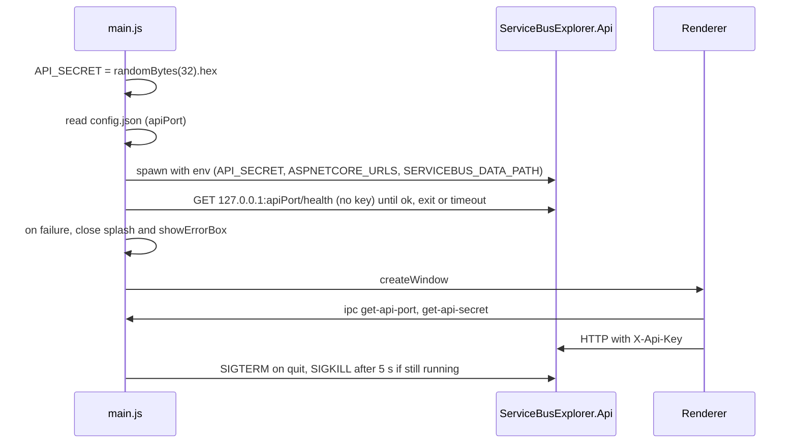

# Electron Shell

> The desktop wrapper: it launches the published .NET API with a random per-launch secret, shows the Angular UI in a sandboxed window, and owns tray, menu, updates and packaging.

## To change here, read

- [[pages/invariants/local-authenticated-api]] - the secret, loopback binding and `X-Api-Key` contract this process creates and enforces the start of.
- [[pages/invariants/secrets-masked-at-the-api-boundary]] - why the tray can show connection data safely.
- [[pages/services/web-app]] - the only consumer of `window.electronAPI`.
- [[pages/services/api]] - the child process; `API_SECRET` and `SERVICEBUS_DATA_PATH` are read there.
- [[pages/architecture/project-map]] and [[pages/conventions/tooling]] - repo layout and the release toolchain.

## Responsibility

Owns: process lifecycle of the API, window and splash, native menu, tray and its connection menu, single-instance lock, auto-update, `electron-builder` packaging and the release pipeline. Does not own any UI logic ([[pages/services/web-app]]) or any broker or storage code ([[pages/services/api]], [[pages/services/core]]).

## Startup and the API process

- Secret: `crypto.randomBytes(32).toString('hex')` at module load, so one new 64-hex-character secret per launch (`web-app/electron/main.js:10`). The API refuses to start with a secret shorter than 32 characters (`src/ServiceBusExplorer.Api/Program.cs:36`).
- Port: read from a `config.json`, trying `../../config.json`, `resourcesPath/config.json`, `../config.json` in that order (`web-app/electron/main.js:29`); default 5917 for the API and 4297 for the frontend when none is valid (`web-app/electron/main.js:47`). The repo's `config.json` holds those same two values. There is no free-port probing: the port is fixed per install, and a port already in use is not detected. The preload comment calling the port "dynamically-allocated" is wrong (`web-app/electron/preload.js:11`).
- Mode: `isDev = !app.isPackaged && NODE_ENV === 'development'` (`web-app/electron/main.js:56`).
- Dev: spawns `dotnet run --no-launch-profile` in `src/ServiceBusExplorer.Api` with `ASPNETCORE_URLS`, `ASPNETCORE_ENVIRONMENT=Development`, `SERVICEBUS_DATA_PATH`, `DOTNET_SYSTEM_GLOBALIZATION_INVARIANT=1` and `API_SECRET`, on top of `process.env` (`web-app/electron/main.js:776`). The renderer loads `http://localhost:{frontendPort}` (`web-app/electron/main.js:668`).
- Packaged: looks for `ServiceBusExplorer.Api(.exe)` under `resources/api`, `app.asar.unpacked/api`, `../resources/api`, then the repo publish folder (`web-app/electron/main.js:738`), tries `chmod 755` if not executable (`web-app/electron/main.js:831`), and spawns it with the same variables minus `ASPNETCORE_ENVIRONMENT` (`web-app/electron/main.js:844`). stdio is `['ignore','pipe','pipe']`.
- Data path: `userData/data`, created if missing, passed as `SERVICEBUS_DATA_PATH` (`web-app/electron/main.js:766`).
- Order: `whenReady` creates the splash, calls `startApi()`, creates the tray, then hands the start result to `openWindowWhenApiReady` (`web-app/electron/main.js:938`, `web-app/electron/main.js:943`). That function polls `http://127.0.0.1:{apiPort}/health` every 250 ms through `waitForHealth` (`web-app/electron/main.js:907`, `web-app/electron/shell-helpers.js:29`) until it answers ok, the child exits, or 30 s pass (120 s in dev, where `dotnet run` compiles first; `web-app/electron/main.js:910`). The probe sends no `X-Api-Key`: `/health` is public (`src/ServiceBusExplorer.Api/Program.cs:181`). Each fetch is aborted after 2 s and a fetch that never settles cannot hold the wait past its deadline. The splash stays up meanwhile and closes 1500 ms (500 ms in dev) after the window's `ready-to-show` (`web-app/electron/main.js:682`).
- Failure: `startApi()` returns a reason when it cannot spawn: executable not found, `chmod` failed, or spawn threw (`web-app/electron/main.js:806`, `web-app/electron/main.js:821`, `web-app/electron/main.js:835`, `web-app/electron/main.js:884`). The child's `error` and `exit` events record that it is gone, in dev and packaged (`web-app/electron/main.js:791`, `web-app/electron/main.js:868`, `web-app/electron/main.js:874`, `web-app/electron/main.js:890`). When the start failed, the child exited, or `/health` timed out, the main window is still created (hidden until `ready-to-show`) so the tray and menus work, and only then is the splash closed, so closing it cannot fire `window-all-closed` and quit the app on Linux or Windows; then `dialog.showErrorBox` says "The local API did not start" with the reason: not found, exited with code N, could not be launched, or did not answer within N seconds (`web-app/electron/main.js:901`, `web-app/electron/main.js:927`, `web-app/electron/main.js:931`, `web-app/electron/main.js:934`). A non-zero exit after a healthy start shows one error box unless the app is quitting (`web-app/electron/main.js:894`). There is no retry and no restart, and nothing is sent to the renderer. The dialog wiring has no automated test; only the `waitForHealth` outcomes are tested.
- Stop: on `before-quit` set `app.isQuitting` and, if the child is still running, call `stopProcess` (`web-app/electron/main.js:955`, `web-app/electron/main.js:959`): SIGTERM, then SIGKILL after 5 s if and only if `exitCode` and `signalCode` are both still null (`web-app/electron/shell-helpers.js:55`). It does not read `ChildProcess.killed`, which is true as soon as any signal was sent. The timer is unref'd. Whether Electron is still alive 5 s after `before-quit` for that timer to run is not verified (see Known gaps). On non-macOS `window-all-closed` calls `app.quit()` (`web-app/electron/main.js:963`).
- Single instance: `requestSingleInstanceLock`; a second launch shows a dialog and quits, the first instance is focused (`web-app/electron/main.js:59`, `web-app/electron/main.js:75`).

## Windows and security settings

- Main window: `nodeIntegration: false`, `contextIsolation: true`, `sandbox: true`, preload `preload.js` (`web-app/electron/main.js:628`). Splash window uses the same three flags with no preload (`web-app/electron/main.js:576`).
- Production loads `dist/web-app/browser/index.html` from `file://` (`web-app/electron/main.js:670`).
- CSP is set through `onHeadersReceived` for every non-`file://` response: `default-src 'self'; script-src 'self'; ... connect-src 'self' http://localhost:*` (`web-app/electron/main.js:648`, `web-app/electron/main.js:658`). `file://` responses are skipped (`web-app/electron/main.js:650`), so the packaged window runs without this header; only the dev server is covered.
- `window.open` and link targets are always denied in-app; the URL goes to `shell.openExternal` only when `isSafeExternalUrl` accepts it, a parseable `http:` or `https:` URL (`web-app/electron/main.js:686`, `web-app/electron/main.js:687`, `web-app/electron/shell-helpers.js:4`). That is the only `openExternal` call in main.js.
- Close hides the window (Linux: minimize) instead of quitting; quitting is via menu Exit or tray Quit (`web-app/electron/main.js:694`). DevTools menu item exists only when `isDev` (`web-app/electron/main.js:138`).

## IPC surface

| Channel | Direction | Returns / payload | Preload API | Caller in `web-app/src` |
|---|---|---|---|---|
| `get-app-version` | invoke | `app.getVersion()` (`web-app/electron/main.js:972`) | `getAppVersion` | `app.ts` `loadVersion` (`web-app/src/app/app.ts:188`) |
| `get-api-secret` | invoke | the per-launch secret (`web-app/electron/main.js:976`) | `getApiSecret` | `ApiService` (`web-app/src/app/core/services/api.service.ts:58`) |
| `get-api-port` | invoke | `apiPort` number (`web-app/electron/main.js:978`) | `getApiPort` | `ApiService` (`web-app/src/app/core/services/api.service.ts:45`) |
| `check-for-updates` | invoke | `{status:'dev-mode'}`, `{status:'ok',version}` or `{status:'error',message}` (`web-app/electron/main.js:1022`) | `checkForUpdates` | `app.ts` (`web-app/src/app/app.ts:172`) |
| `download-update` | invoke | `{status:'ok'}` or error (`web-app/electron/main.js:1033`) | `downloadUpdate` | `app.ts` (`web-app/src/app/app.ts:178`) |
| `install-update` | invoke | none; `quitAndInstall(false, true)` (`web-app/electron/main.js:1043`) | `installUpdate` | `app.ts` (`web-app/src/app/app.ts:184`) |
| `set-update-channel` | invoke | for `latest` or `beta` only: stores and applies it, returns `{status:'ok',channel}`; anything else changes nothing and returns `{status:'error',message:'Unknown update channel'}` (`web-app/electron/main.js:1048`) | `setUpdateChannel` | `app.ts` `switchChannel` |
| `get-update-channel` | invoke | stored channel, `latest` when the stored value is not a known channel (`web-app/electron/main.js:1060`) | `getUpdateChannel` | `app.ts` `loadUpdateChannel` |
| `update-status` | main to renderer | `{status, version?, percent?, message?, releaseNotes?}` (`web-app/electron/main.js:985`) | `onUpdateStatus` | `app.ts` (`web-app/src/app/app.ts:219`) |
| `navigate` | main to renderer | route string, from menu and tray | `onNavigate`, `electron.on` | `app.ts` |
| `change-connection` | main to renderer | connection id from tray (`web-app/electron/main.js:437`) | `onChangeConnection` | `app.ts` |
| `toggle-dev-mode` | main to renderer | none (`web-app/electron/main.js:151`) | `onToggleDevMode` | `app.ts` |
| `clear-all-data` | main to renderer | none (`web-app/electron/main.js:121`) | `onClearAllData` | none found |
| `menu-new-connection` | main to renderer | not sent by any menu item in main.js | `onNewConnection` | none found |
| `set-active-connection` | `ipcMain.on` | sets tray checkmark (`web-app/electron/main.js:1084`) | none | none |
| `connections-updated` | `ipcMain.on` | refreshes tray menu (`web-app/electron/main.js:1091`) | none | none |

The preload bridge also exposes `platform`, `isElectron` (`web-app/electron/preload.js:52`) and a second global `electron.on` limited to five whitelisted channels (`web-app/electron/preload.js:62`). Preload contains no `ipcRenderer.send`, so the two `ipcMain.on` handlers cannot be reached from the sandboxed renderer. Any script running in the window can call `getApiSecret`; the secret is therefore only as protected as the page content, see [[pages/invariants/local-authenticated-api]].

## Tray

The tray calls the API itself with Node `http` and the secret header (`web-app/electron/main.js:345`), for `connections` and `connectiongroups`, 5 s timeout, returning `[]` on any error (`web-app/electron/main.js:369`). It is first built at tray creation, before the API is likely to be up, and refreshed only by the two unreachable `ipcMain.on` handlers and by a connection click (`web-app/electron/main.js:445`). The tray list is therefore usually empty until a connection item is used. Menu labels use `connection.name`, falling back to the first 40 characters of `connection.connectionString` as returned by the API (`web-app/electron/main.js:430`); that value is the masked form per [[pages/invariants/secrets-masked-at-the-api-boundary]].

## Store and auto-update

- `electron-store` holds one key, `updateChannel`, default `'latest'` (`web-app/electron/main.js:13`).
- `electron-updater`: `autoDownload = false`, `autoInstallOnAppQuit = true`, `channel` from the store, run through `normalizeUpdateChannel` with `latest` as the fallback (`web-app/electron/main.js:981`, `web-app/electron/main.js:983`, `web-app/electron/shell-helpers.js:14`). `allowPrerelease` and `allowDowngrade` are not set. `set-update-channel` accepts exactly `latest` and `beta` (`web-app/electron/main.js:1048`), the two the UI offers (`web-app/src/app/app.ts:204`).
- Checks: 5 s after launch, then every 4 hours, skipped in dev (`web-app/electron/main.js:1067`, `web-app/electron/main.js:1070`). Failures are logged as "offline?" (`web-app/electron/main.js:1074`).
- Feed: GitHub provider, owner `vitorafgomes`, repo `messaging-explorer`, `releaseType: release` (`web-app/package.json:158`). Updater metadata files uploaded by the release job are only `latest.yml`, `latest-linux.yml`, `latest-mac.yml` (`.github/workflows/release.yml:92`, `.github/workflows/release.yml:133`, `.github/workflows/release.yml:175`). Whether the beta channel finds a feed file depends on electron-builder producing `beta*.yml` from a prerelease version; not verified.

## Logging

Everything goes to `console.*` of the main process; there is no log file. Findings:

- The secret is never logged by main.js: it appears only in the child env (`web-app/electron/main.js:784`, `web-app/electron/main.js:851`) and the tray header (`web-app/electron/main.js:346`). The API does not print it either; it only compares it (`src/ServiceBusExplorer.Api/Program.cs:199`).
- Child stdout and stderr are echoed verbatim as `[API]` and `[API ERROR]` (`web-app/electron/main.js:789`, `web-app/electron/main.js:858`, `web-app/electron/main.js:863`), so anything the API logs, including connection data if the API ever logs it, would reach the console. That is an API-side question, see [[pages/services/api]].
- Connection ids are logged on tray selection (`web-app/electron/main.js:1085`). No connection string is passed to any `console` call in main.js or preload.js.
- The health probe logs nothing and sends no secret. Log strings in main.js carry no emoji markers since 2026-11-12.

## Packaging (`web-app/package.json` `build`)

- App id `com.messagingexplorer.app`, product `Messaging Explorer`, output `release/` (`web-app/package.json:90`). Files: `dist/web-app/**`, `electron/**` except `electron/**/*.test.js`, `src/assets/**`; assets are `asarUnpack`ed (`web-app/package.json:94`, `web-app/package.json:102`).
- `extraResources` copies `../src/ServiceBusExplorer.Api/bin/Release/net10.0/publish` to `resources/api` (`web-app/package.json:105`). That folder comes from `dotnet publish -c Release` with no runtime identifier (`web-app/package.json:22`) and the csproj sets no `SelfContained` or `RuntimeIdentifier`, so the API is framework-dependent and the user needs the .NET 10 runtime (inferred from the missing settings, not run). One publish output is shared by the arm64 and x64 mac builds.
- Windows: `nsis` and `portable`, `asInvoker` (`web-app/package.json:114`). macOS: `dmg` and `zip` for arm64 and x64 (`web-app/package.json:129`). Linux: `AppImage` and `deb` (`web-app/package.json:149`).
- Scripts use `electron-builder --publish never` (`web-app/package.json:28`); publishing is done by the workflow, not by the builder.

## Tests

- `web-app/electron/shell-helpers.js` holds the testable decisions of main.js in plain CommonJS with no `electron` import: `isSafeExternalUrl`, `normalizeUpdateChannel`, `waitForHealth`, `stopProcess`.
- `web-app/electron/shell-helpers.test.js` covers them with `node:test` and `node:assert/strict`, no dependency: the accepted and refused URL schemes (`web-app/electron/shell-helpers.test.js:10`, `web-app/electron/shell-helpers.test.js:15`), the two channels and the rejected values (`web-app/electron/shell-helpers.test.js:25`, `web-app/electron/shell-helpers.test.js:30`), the health outcomes healthy, exited and timeout, including a fetch that never settles (`web-app/electron/shell-helpers.test.js:39`, `web-app/electron/shell-helpers.test.js:64`, `web-app/electron/shell-helpers.test.js:80`, `web-app/electron/shell-helpers.test.js:98`), and both `stopProcess` cases with a fake child whose `killed` turns true on the first signal (`web-app/electron/shell-helpers.test.js:133`, `web-app/electron/shell-helpers.test.js:145`).
- Run with `npm run test:electron` in `web-app/` (`web-app/package.json:26`); CI runs it in the `web` job after the Angular tests (`.github/workflows/ci.yml:93`).
- No test starts Electron. The wiring in main.js (the dialogs, the window opening after the wait, `before-quit`, the IPC handlers) is untested.

## Release workflow (`.github/workflows/release.yml`)

- Trigger: push of a tag matching `v*` only (`.github/workflows/release.yml:10`). One release per tag at a time (`.github/workflows/release.yml:16`). `contents: write` (`.github/workflows/release.yml:20`).
- Jobs: `build-linux` on ubuntu-latest (`.github/workflows/release.yml:56`), `build-windows` on windows-latest (`.github/workflows/release.yml:98`), `build-mac` on macos-latest (`.github/workflows/release.yml:139`); each sets up .NET 10 and Node 22, runs `npm ci` and `npm run electron:build:{linux,win,mac}`, and uploads artifacts with `if-no-files-found: error`. `release` needs all three, downloads them and calls `softprops/action-gh-release@v2` with generated notes; `prerelease` is true when the tag contains `-beta` (`.github/workflows/release.yml:181`, `.github/workflows/release.yml:209`, `.github/workflows/release.yml:212`).
- Signing: none. No certificate, `CSC_*` or notarization settings exist in the workflow or in `package.json`; the workflow header says macOS is unsigned (`.github/workflows/release.yml:5`). Windows output is unsigned as well (nothing configures it). Since 2026-11-12 the `verify-version` job fails the run when the tag is not `v` plus the `package.json` version (`.github/workflows/release.yml:43`).
- Tests: since 2026-11-12 every build job needs `verify`, which calls the CI workflow on the tagged commit (`.github/workflows/release.yml:29`, `.github/workflows/release.yml:58`), so a tag on a commit with a failing test packages nothing. CI does not build the Electron app (`.github/workflows/ci.yml:71`), and nothing starts a packaged app.

## Known gaps

- Port is fixed from `config.json`; no free-port probing despite the preload comment: `web-app/electron/preload.js:11`.
- The SIGKILL fallback may not fire on a real quit: Electron does not wait for Node timers after `before-quit`, so the process may be gone before the 5 s timer runs and the API is left with only SIGTERM. Unverified, needs a run of the packaged app: `web-app/electron/main.js:959`.
- The start-failure and crash dialogs, and the window opening only after `/health`, have no automated test; they need Electron. Only `waitForHealth` is tested: `web-app/electron/main.js:907`.
- A tray click during the health wait opens the main window before the API answers, because the tray exists first and calls `createWindow()` when there is no window: `web-app/electron/main.js:335`.
- No restart after the API crashes; the user gets one error box: `web-app/electron/main.js:894`. An API killed by a signal after a healthy start (exit code null) shows no box at all: `web-app/electron/main.js:896`.
- CSP not applied to the packaged `file://` window: `web-app/electron/main.js:650`.
- Tray refresh channels have no sender in preload, so the tray list goes stale: `web-app/electron/main.js:1084`.
- `clear-all-data` and `menu-new-connection` have no renderer consumer in `web-app/src`: `web-app/electron/preload.js:20`.
- No code signing for any OS: `.github/workflows/release.yml:5`.
- Framework-dependent API in the installer, .NET 10 runtime required on the host (inferred): `web-app/package.json:22`.

## Related

[[pages/services/web-app]], [[pages/services/api]], [[pages/architecture/project-map]]
