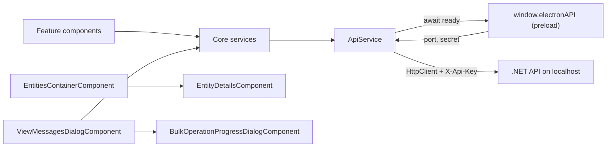

# Web App

> The Angular 21 UI under `web-app/src/`: it renders connections, entities, messages and monitoring, and sends every HTTP call to the local .NET API through `ApiService`.

## To change here, read

- [[pages/invariants/local-authenticated-api]] - the `X-Api-Key` contract `ApiService` must keep honouring.
- [[pages/invariants/secrets-masked-at-the-api-boundary]] - the UI only ever receives masked connection strings and passwords.
- [[pages/invariants/provider-boundaries]] - what may be provider-specific and where.
- [[pages/invariants/bulk-operations-are-at-least-once]] - what cancel and retry mean for the bulk dialogs.
- [[pages/services/electron-shell]] - owns `window.electronAPI`, the only source of the API port and secret.
- [[pages/services/api]] and [[pages/services/core]] - the contract this app mirrors.
- [[pages/conventions/testing]] and [[pages/conventions/tooling]] - how tests and builds are run.

## Responsibility

Owns all presentation and client-side state: connection management, the entity tree, message browsing, send, import, export, diff, bulk dialogs, monitoring charts, templates, theme, filters. Does not own persistence of connections or any broker access; that is the API ([[pages/services/api]]) and the Core library ([[pages/services/core]]). Does not own process management, tray, menu or updates; that is [[pages/services/electron-shell]].

## Stack

| Item | Value | Source |
|---|---|---|
| Angular | `^21.2.8` (core, router, forms, common) | `web-app/package.json:52` |
| Angular Material and CDK | `^21.0.5` | `web-app/package.json:55` |
| ng-bootstrap, bootstrap | `^20.0.0`, `^5.3.7`, with Font Awesome and Material Icons | `web-app/package.json:61` |
| Charts | `apexcharts`, `ng-apexcharts` | `web-app/package.json:64` |
| Export | `exceljs`, loaded with a dynamic `import()` only when XLSX export runs | `web-app/src/app/core/services/message-export.service.ts:139` |
| Electron-only deps | `electron-store`, `electron-updater` (used by the main process, not by `src/`) | `web-app/package.json:67` |
| TypeScript, vitest, jsdom | `~5.9.2`, `^4.0.8`, `^27.1.0` | `web-app/package.json:86` |
| Build | `@angular/build:application`, default configuration `production` | `web-app/angular.json:22` |
| Dev server | `@angular/build:dev-server`, port 4297 | `web-app/angular.json:78` |
| Budgets (production) | initial warn 1.5MB / error 2MB; per component style warn 20kB / error 32kB | `web-app/angular.json:47` |

All components are standalone; there are no NgModules.

## Bootstrap and routing

- `web-app/src/main.ts:5` calls `bootstrapApplication(App, appConfig)`.
- `web-app/src/app/app.config.ts:9` detects Electron by the presence of `window.electronAPI`. Under Electron it uses hash routing so `file://` works (`web-app/src/app/app.config.ts:15`); in a browser it uses path routing. `provideHttpClient()` is registered with no interceptors (`web-app/src/app/app.config.ts:16`).
- Routes are all lazy `loadComponent` (`web-app/src/app/app.routes.ts:3`): `''` redirects to `connections`, then `connections`, `entities`, `queues`, `topics`, `monitoring`.
- `web-app/src/app/app.ts:93` registers the Electron listeners (navigate, change-connection, toggle-dev-mode, update status) only when `isElectron`. It keeps the last five window errors for the bug-report dialog (`web-app/src/app/app.ts:115`).

## How it works

### ApiService (the single HTTP gate)

- A grep of `web-app/src/app` for `HttpClient` finds only `api.service.ts` (plus the provider in `app.config.ts`); every service calls `ApiService.get/post/put/delete` (`web-app/src/app/core/services/api.service.ts:76`). No `fetch`, `XMLHttpRequest` or `EventSource` is used.
- Constructor: only if `window.electronAPI` exists, it builds a `ready` promise that awaits `getApiPort()` and `getApiSecret()` in parallel (`web-app/src/app/core/services/api.service.ts:23`, `web-app/src/app/core/services/api.service.ts:35`).
- Port: a positive number from Electron replaces the base URL with `http://localhost:{port}/api` (`web-app/src/app/core/services/api.service.ts:45`). Otherwise `environment.apiUrl` is used, `http://localhost:5917/api` in both environment files (`web-app/src/environments/environment.ts:3`, `web-app/src/environments/environment.prod.ts:8`).
- Secret: stored in memory, attached as `X-Api-Key` on every verb via `getHeaders()` (`web-app/src/app/core/services/api.service.ts:65`). If the secret call throws it is logged and requests go out without the header (`web-app/src/app/core/services/api.service.ts:59`), so the API answers 401.
- Plain browser (no Electron): `ready` stays null, requests are sent immediately with no `X-Api-Key` (`web-app/src/app/core/services/api.service.ts:72`). The API requires the key on everything except `/health` and answers 401 otherwise (`src/ServiceBusExplorer.Api/Program.cs:198`, `src/ServiceBusExplorer.Api/Program.cs:204`), and refuses to start without `API_SECRET` (`src/ServiceBusExplorer.Api/Program.cs:36`). So a browser tab pointed at a running API cannot call it; see [[pages/invariants/local-authenticated-api]].
- GET requests append a `_t=Date.now()` cache buster (`web-app/src/app/core/services/api.service.ts:78`).
- **Names in a path are encoded once, by one helper.** Every endpoint that carries a value is written as an `apiPath` tagged template (`web-app/src/app/core/services/api-path.ts:7`): each interpolated value, an entity, topic, subscription or session name, a connection or group id, a sequence number or a query value, goes through `encodeURIComponent`, and the literal parts stay as written. A queue named `a/messages` is deleted with `DELETE queues/a%2Fmessages`, never the purge route of `a`; a purge of `orders#1` is `DELETE queues/orders%231/messages`, never a request for `orders`. No other code encodes, so nothing is encoded twice (`50%off` becomes `50%25off`). An `undefined` or `null` value throws instead of writing the text into the URL (`web-app/src/app/core/services/api-path.ts:11`). Endpoints with no value stay plain strings. The API decodes each segment once on its side ([[pages/services/api]]). Pinned by `web-app/src/app/core/services/api-path.spec.ts:4` and the "names in the URL" specs of the queue, topic, session and metrics services (`web-app/src/app/core/services/queue.service.spec.ts:94`, `web-app/src/app/core/services/topic.service.spec.ts:74`, `web-app/src/app/core/services/session.service.spec.ts:63`, `web-app/src/app/core/services/metrics.service.spec.ts:294`).

### Bulk operations

- `BulkOperationsService` is selection state only: one `BehaviorSubject` holding one selection per tab, three since 2026-11-12 (active, deadletter, transferdeadletter), each keyed by sequence number (`web-app/src/app/core/services/bulk-operations.service.ts:58`). It does no batching, no progress and no HTTP. "All selected" is not stored: `isAllSelected` takes the list the tab shows now and checks every row of it (`web-app/src/app/core/services/bulk-operations.service.ts:221`), so a selection made over a search never counts as the whole page.
- The operations live in `ViewMessagesDialogComponent`: resubmit (`web-app/src/app/features/messages/view-messages-dialog.component.ts:1607`), delete (`web-app/src/app/features/messages/view-messages-dialog.component.ts:2202`), move (`web-app/src/app/features/messages/view-messages-dialog.component.ts:2405`). Each sends one request carrying all selected sequence numbers (`web-app/src/app/core/services/queue.service.ts:143`, `web-app/src/app/core/services/queue.service.ts:156`, `web-app/src/app/core/services/queue.service.ts:169`). The client does not chunk; batching is the server's job.
- **"All" means the entity, not the page.** Delete sends `all: true` with an empty list, and the server drains, only when the number of selected messages equals the entity's count for that tab and no search or filter is active (`web-app/src/app/features/messages/view-messages-dialog.component.ts:2299`, `web-app/src/app/features/messages/view-messages-dialog.component.ts:2198`), and never on the transfer dead-letter tab, which has no purge; the confirmation then asks for an acknowledgement. Selecting the 20 loaded messages of a queue of 50,000 sends those 20 sequence numbers. Every change of the quick search or of a filter clears the tab's selection (`web-app/src/app/features/messages/view-messages-dialog.component.ts:1249`, `web-app/src/app/features/messages/view-messages-dialog.component.ts:1320`). The count compared is the one the dialog received when it opened, updated after each operation, not a fresh read. The selection bar says what a selection covers, as on prototype artboard 4: "3 selected of 20 loaded, 37 in the dead-letter queue" (`web-app/src/app/features/messages/view-messages-dialog.component.ts:1998`). Pinned by the "never deletes the whole entity" specs (`web-app/src/app/features/messages/view-messages-dialog.component.spec.ts:115`).
- **A possible duplicate is never retried.** A failure whose text says the message "may be duplicated" (the two texts the Azure provider writes when a send succeeded and the complete failed) is a possible duplicate (`web-app/src/app/core/services/bulk-operations.service.ts:10`). The API has no field for it yet, so the match is on text, marked as a ceiling in the code. The retry list for resubmit and for move is built from the result without those entries (`web-app/src/app/features/messages/view-messages-dialog.component.ts:1656`, `web-app/src/app/features/messages/view-messages-dialog.component.ts:2453`), Retry is offered only when one remains, and the results dialog labels each entry "Possible duplicate - do not retry" or "Failed" (`web-app/src/app/shared/components/bulk-operation-results-dialog/bulk-operation-results-dialog.component.ts:106`).
- **Continuous resubmit stops on the first failure.** Each cycle peeks the head of the dead-letter queue, where a failed or possibly duplicated message stays, so the loop stops on the first batch that reports any failure and says which sequence numbers failed and which may be duplicated (`web-app/src/app/features/messages/continuous-resubmit-dialog.component.ts:425`, `web-app/src/app/features/messages/continuous-resubmit-dialog.component.ts:439`). The dialog has no restart, so nothing that failed in a run is sent again by it. Since 2026-11-13 an error the loop does not expect also ends the run as a failure, never as "Completed - Dead letter queue is empty" (`web-app/src/app/features/messages/continuous-resubmit-dialog.component.ts:347`), locked by `web-app/src/app/features/messages/continuous-resubmit-dialog.component.spec.ts:86`.
- **A failed load is not an empty list** (2026-11-13). The entity tree fails when the queue or topic list fails (`web-app/src/app/core/services/tree-data-builder.service.ts:31`) and says "Could not load entities" (`web-app/src/app/features/entities/entities-tree.component.ts:60`); the topics page loads the subscriptions of a topic when it is opened, once, shows "Loading subscriptions..." until they arrive, and on a failure says so and closes the topic so that opening it again retries (`web-app/src/app/features/topics/topics.component.ts:226`, `web-app/src/app/features/topics/topics.component.ts:250`). The tree still asks for the subscriptions of every topic, because its dead-letter alerts need them.
- **Send and export** (2026-11-13). Each send takes the properties and the schedule from the form as it is, so a retry after a failure never carries a value the user cleared (`web-app/src/app/features/messages/send-message-dialog.component.ts:435`). A CSV cell that starts with `=`, `+`, `-`, `@`, a tab or a carriage return is prefixed with an apostrophe so a spreadsheet reads it as text (`web-app/src/app/core/services/message-export.service.ts:317`), and the CSV import removes it again (`web-app/src/app/core/services/message-import.service.ts:296`), so export then import keeps the bodies, apart from surrounding white space, which the import has always trimmed. A connected status clears the dead-letter alerts before the tree loads (`web-app/src/app/features/entities/entities-tree.component.ts:726`), so a switch whose load fails shows none of the previous connection's alerts.
- **Guards against a stacked delete.** A keyboard shortcut does nothing while another dialog is open over the messages dialog (`web-app/src/app/features/messages/view-messages-dialog.component.ts:2676`), and a delete does not start while one is in flight (`web-app/src/app/features/messages/view-messages-dialog.component.ts:2181`).
- Progress is not incremental: `updateProgress` is called once, with the final result (`web-app/src/app/features/messages/view-messages-dialog.component.ts:1642`).
- Cancel: the progress dialog emits `cancelRequested$` (`web-app/src/app/shared/components/bulk-operation-progress-dialog/bulk-operation-progress-dialog.component.ts:381`); the parent pipes the in-flight observable through `takeUntil`, which aborts the XHR (`web-app/src/app/features/messages/view-messages-dialog.component.ts:1626`, `web-app/src/app/features/messages/view-messages-dialog.component.ts:1634`). The API passes `HttpContext.RequestAborted` to the provider (`src/ServiceBusExplorer.Api/Controllers/QueuesController.cs:310`).
- After an abort: the success handler is skipped, no results dialog opens, the entity message list and counters are not reloaded, and the progress dialog stays open in a "cancelled" state with a Close button (`web-app/src/app/features/messages/view-messages-dialog.component.ts:1638`, `web-app/src/app/shared/components/bulk-operation-progress-dialog/bulk-operation-progress-dialog.component.ts:125`). The dialog itself warns that messages already processed server-side may have been affected; delivery is at-least-once, see [[pages/invariants/bulk-operations-are-at-least-once]].

### Entity selection and the purge confirmation

- `EntitySelectionService` clears the selection on every connection status after the one it starts with: a connect, a disconnect or the startup status (`web-app/src/app/core/services/entity-selection.service.ts:40`). Only those three emit, so an entity selected under one connection is never shown, with its Purge, Send and View, under another; the tree no longer clears it on its own. A new selection or a clear cancels the load still in flight (`web-app/src/app/core/services/entity-selection.service.ts:47`, `web-app/src/app/core/services/entity-selection.service.ts:82`), so a late response neither overwrites a newer selection nor brings back one from the previous connection. Pinned by `web-app/src/app/core/services/entity-selection.service.spec.ts:46`.
- The purge confirmation names what it destroys, as on prototype artboard 3: the kind and name, the topic of a subscription, the connection target (namespace or host) and the count, the live one when the panel has it and otherwise the one read when the entity was loaded, said as such; it reuses the confirm dialog with its acknowledgement checkbox (`web-app/src/app/features/entities/entity-details.component.ts:2076`). Only a subscription has a live count today; a queue shows the count from selection.

### Highlight pipe

`HighlightPipe` escapes every text segment through a detached `div.textContent` then reads `innerHTML` (`web-app/src/app/shared/pipes/highlight.pipe.ts:83`), wraps matches in `<mark>` after escaping (`web-app/src/app/shared/pipes/highlight.pipe.ts:63`) and returns a plain string, not `SafeHtml`, so Angular's own `[innerHTML]` sanitizer still runs (`web-app/src/app/shared/pipes/highlight.pipe.ts:74`). It never calls `bypassSecurityTrustHtml`. Used in three `[innerHTML]` bindings of the messages dialog (`web-app/src/app/features/messages/view-messages-dialog.component.ts:210`, `web-app/src/app/features/messages/view-messages-dialog.component.ts:333`, `web-app/src/app/features/messages/view-messages-dialog.component.ts:509`).

## core/

- `models/`: DTO interfaces mirroring the API (connection, connection-group, message, queue, topic, metrics, monitoring, session, filter, provider, tree-node) and the provider component contract (`web-app/src/app/core/models/provider-component.interface.ts:55`).
- `services/`: `api` and `api-path` (above); `connection`, `connection-group`, `queue`, `topic`, `session`, `monitoring`, `metrics`, `provider` (all thin `ApiService` wrappers); `bulk-operations` (selection); `message-search`, `advanced-message-filter` (client-side filtering, filter presets in localStorage under prefix `advanced-filter-`, `web-app/src/app/core/services/advanced-message-filter.service.ts:19`); `message-export` (CSV/JSON/XLSX), `message-import`; `message-template` (localStorage key `explorer-messages-templates`, `web-app/src/app/core/services/message-template.service.ts:6`); `theme` (key `app-theme`, `web-app/src/app/core/services/theme.service.ts:8`); `dev-settings` (key `dev-mode`); `dead-letter-notification`, `entity-selection`, `tree-data-builder`, `logger` (silent in production builds, `web-app/src/app/core/services/logger.service.ts:12`).

## features/

**Entity administration (2026-11-12),** under `features/entities/`: `entity-form-dialog` (create and edit of a queue, topic or subscription), `entity-review-dialog` (the changed fields with current and new value, before saving), `entity-status-dialog` (a status other than Active needs the entity's name typed) and `entity-admin-actions` (the status chip and the Edit and Status actions of the panel header). Angular Material, each with a spec. They appear only when the API's own answer says `supportsEntityUpdate` is true; unlike the other capabilities, a default never turns this one on, nor the rules editor, nor the transfer dead-letter queue (`web-app/src/app/core/services/provider.service.ts:82`). `ApiService` gained `patch` (`web-app/src/app/core/services/api.service.ts:99`); durations go to the wire through one formatter (`web-app/src/app/features/entities/duration.ts:103`) and the contract's limits are mirrored in `entity-validation.ts` for inline errors, the server being the authority.

**Sub-queues, scheduled messages and a disabled entity (2026-11-12),** under `features/messages/`. The messages dialog no longer carries a dead-letter boolean: one `subQueue` value is derived from the tab shown (`web-app/src/app/features/messages/view-messages-dialog.component.ts:1111`) and every list, selection and action reads it. A third tab, Transfer dead-letter, appears only when the API's own answer says `supportsTransferDeadLetter` is true (`web-app/src/app/features/messages/view-messages-dialog.component.ts:83`); it peeks, searches, deletes a selection and resubmits (`web-app/src/app/core/services/queue.service.ts:176`, `web-app/src/app/core/services/topic.service.ts:255`), with no purge and no move. The queue and subscription panels show a Transfer Dead Letter card when the count is above zero, and it opens that tab only under the same flag (`web-app/src/app/features/entities/entity-details.component.ts:110`, `web-app/src/app/features/entities/entity-details.component.ts:351`, `web-app/src/app/features/entities/entity-details.component.ts:1877`). Each message shows a state chip when it is Scheduled or Deferred (`web-app/src/app/features/messages/view-messages-dialog.component.ts:206`); a "Scheduled" filter on a queue's Active tab narrows the loaded messages, client side (`web-app/src/app/features/messages/view-messages-dialog.component.ts:1291`). Cancel scheduled is offered on a queue's Active tab only (`web-app/src/app/features/messages/view-messages-dialog.component.ts:2046`) and enabled only when every selected message is scheduled and at most 500 are selected (`web-app/src/app/features/messages/view-messages-dialog.component.ts:2051`, `web-app/src/app/features/messages/view-messages-dialog.component.ts:42`); `cancel-scheduled-dialog` confirms it and needs the queue name typed for more than one message (`web-app/src/app/features/messages/cancel-scheduled-dialog.component.ts:77`); the result opens in the bulk results dialog. A 409 from any message call is shown in the API's own words, "The entity is disabled for this operation." (`web-app/src/app/features/messages/message-call-failure.ts:8`). `supportsDeferral` defaults to false. Open points are on [[pages/roadmap/followups]].

**Sessions (2026-11-13),** under `features/entities/`: `entity-sessions` serves the queue panel and the subscription panel alike. The queue panel gained Material tabs, Properties and Sessions (`web-app/src/app/features/entities/entity-details.component.ts:142`); the subscription keeps its tab strip and mounts the same component (`web-app/src/app/features/entities/entity-details.component.ts:551`). Either appears only when the entity requires sessions and the capability is not explicitly false, and the component exists only while its tab is open, so selecting an entity reads nothing. `SessionService` calls the four routes under `api/queues/{name}/sessions` and `api/topics/{topic}/subscriptions/{subscription}/sessions` through one path helper (`web-app/src/app/core/services/session.service.ts:17`); the old `api/sessions` routes and their callers are gone.
- **The list locks nothing.** It is read once when the tab opens (a peek of up to 1000 messages on the server, at most 100 sessions back) and shows each session id with the messages seen in the scan. A truncated scan says "Listed from the first N messages." before the sentence on sessions further back or holding only a state; a complete scan says only that sessions holding only a state are not shown. A state-only session is opened by typing its id, 1 to 128 characters and not only spaces (`web-app/src/app/features/entities/entity-sessions.component.ts:205`). Above both, the screen says that opening a session locks it for a moment (`web-app/src/app/features/entities/entity-sessions.component.ts:40`).
- **Opening one session** reads its detail and then its messages, one after the other so the app never contends with itself for the session lock (`web-app/src/app/features/entities/entity-sessions.component.ts:252`): the state as text, a binary state as its byte count and base64 with no editor, the time the read held the lock until, and a read-only table of up to 100 messages (sequence number, message id, enqueued time, state, a 100-character body preview). A 400, 404 or 409 is shown in the API's words with Retry; anything else says the API did not answer. A new entity resets the component and unsubscribes what was in flight (`web-app/src/app/features/entities/entity-sessions.component.ts:216`).
- **The state editor never overwrites a state someone else changed.** `session-state-dialog` edits or clears the state (an empty text clears it), refuses more than 262144 bytes as UTF-8, enables Save only when the text differs from the state as read (an empty field and no state are the same: a zero-byte state arrives as null), then confirms with the current state beside the new and the sentence "The application that consumes this session reads this state next." The write carries `expectedState` exactly as read, null included (`web-app/src/app/features/entities/session-state-dialog.component.ts:152`). The two 409 answers are told apart by their `code`, never by the text: on `SessionStateChanged` the dialog disables the write and offers Reload, also after Back and Save, which reopens the session and puts the focus back on Edit state; it never sends again (`web-app/src/app/features/entities/session-state-dialog.component.ts:162`). On success the panel shows the state the server returned. No Format button: the app has no shared JSON formatter.

- `connections/` - connection list, add/edit dialog, client and environment groups, export of connections (`web-app/src/app/features/connections/connections.component.ts:396`).
- `entities/` - the main workspace: tree plus details (`web-app/src/app/features/entities/entities-container.component.ts:14`), transfer monitor. The metrics dashboard that drew mock data was removed on 2026-11-12.
- `messages/` - view, send, import, export, move, diff and continuous-resubmit dialogs.
- `queues/`, `topics/` - list pages with per-row purge and actions.
- `monitoring/` - snapshot and history charts (`web-app/src/app/features/monitoring/monitoring.component.ts:540`).

## providers/ and the registry

- `ProviderRegistryService` maps `ProviderType` to an entity-details component class, filled by lazy `import()` of the `azure-service-bus` and `rabbitmq` barrels (`web-app/src/app/providers/provider-registry.service.ts:57`, `web-app/src/app/providers/provider-registry.service.ts:67`).
- `ProviderShellComponent` resolves the class and calls `createComponent` (`web-app/src/app/features/entities/provider-shell.component.ts:173`, `web-app/src/app/features/entities/provider-shell.component.ts:183`).
- But the shell is not used: the `entities` route renders `<app-entity-details>` directly (`web-app/src/app/features/entities/entities-container.component.ts:20`), and a grep of `src/app` finds no `app-provider-shell` outside doc comments. The registry, shell and both provider components are therefore unreachable at runtime; the 2162-line `EntityDetailsComponent` handles both brokers, and since 2026-11-12 it hides what the connected broker's capabilities say it cannot do: sessions, scheduled messages and the dead-letter side, each only when the flag is explicitly false (`web-app/src/app/features/entities/entity-details.component.ts:1872`). See [[pages/invariants/provider-boundaries]].
- `kafka/` holds three empty folders (`.gitkeep`) and a barrel containing only a TODO comment (`web-app/src/app/providers/kafka/index.ts:4`). No Kafka component, no `ProviderType.Kafka` in the frontend enum (`web-app/src/app/core/models/provider.model.ts:5`), and none in the backend enum (`src/ServiceBusExplorer.Core/Providers/ProviderType.cs:6`): there is no backend provider.
- `ProviderService` follows the active connection: on connect it holds that provider's built-in default capabilities, then the API's answer merged over them; a failed call keeps the defaults of the connected provider without an error; on disconnect the state resets and a late answer for the previous connection is dropped (`web-app/src/app/core/services/provider.service.ts:115`). The API sends the provider type by name and the service normalises it (`web-app/src/app/core/services/provider.service.ts:88`). It lists only Azure and RabbitMQ.

### docs/ADDING_PROVIDERS.md versus the code

- Step 1 (add enum value): matches the current enum shape (`web-app/src/app/core/models/provider.model.ts:5`) but the backend enum must also change and the guide omits it.
- Step 8 (register in `registerProviders`): matches the registry (`web-app/src/app/providers/provider-registry.service.ts:55`).
- Architecture flow ("ProviderShellComponent receives change ... renders provider UI", `docs/ADDING_PROVIDERS.md:21`): does not match; the shell is never instantiated, so completing steps 1 to 9 would not make a new provider appear.
- Step 9 (`EntityInfo` union): matches (`web-app/src/app/core/models/provider-component.interface.ts:13`).

## shared/

Components: `advanced-filter-panel`, `bulk-actions-toolbar`, `bulk-operation-progress-dialog`, `bulk-operation-results-dialog`, `message-body-editor` (Prism-based, `web-app/src/app/shared/components/message-body-editor/message-body-editor.component.ts:426`). Top level: `confirm-dialog`, `bug-report-dialog`. Pipes: `highlight` only.

## Tests

- 47 `*.spec.ts` files exist under `web-app/src` (2026-11-13).
- `web-app/scripts/generate-icons.js` sets a non-zero exit code when generation fails (`web-app/scripts/generate-icons.js:43`), tested with a stubbed `sharp` by `web-app/scripts/generate-icons.test.js:26`. No npm script and no CI job runs that test: `test:electron` globs `electron/**` only (`web-app/package.json:26`); run it with `node --test scripts/generate-icons.test.js` in `web-app/`.
- `npm test` is `ng test` (`web-app/package.json:25`). `angular.json` sets the `@angular/build:unit-test` builder with no `runner` option (`web-app/angular.json:90`); the builder schema defaults `runner` to `vitest`, `runnerConfig` to `false` and `include` to `**/*.spec.ts` (`web-app/node_modules/@angular/build/src/builders/unit-test/schema.json:19`, `web-app/node_modules/@angular/build/src/builders/unit-test/schema.json:25`, `web-app/node_modules/@angular/build/src/builders/unit-test/schema.json:45`). Run on 2026-11-12, after the sub-queue and cancel-scheduled changes, `npm test -- --watch=false` executes all 45 files: 827 tests pass and 8 are skipped (three `describe.skip` blocks for the refresh variants in `web-app/src/app/core/services/metrics.service.spec.ts:314`).
- Plain `npx vitest` is not a way to run these tests: without the Angular builder there is no compiler, so components with signal inputs or `templateUrl` fail. A `vitest.config.ts` that listed 11 files for that mode was removed on 2026-11-12; the builder never read it.
- CI: the web job runs `npm ci`, the tests and `npm run build` (`.github/workflows/ci.yml:109`, `.github/workflows/ci.yml:115`, `.github/workflows/ci.yml:121`). No lint step; `web-app/package.json` has no `lint` script. See [[pages/conventions/testing]].

## Hot spots

- `web-app/src/app/features/entities/entity-details.component.ts:1833` - 2162 lines, template inline; handles both brokers, purge, send. The topic panel is read-only text since 2026-11-12: it used to be a form with no save.
- `web-app/src/app/features/messages/view-messages-dialog.component.ts:984` - 2719 lines; three near-identical bulk flows (resubmit, delete, move) and the cancel of scheduled messages.
- `web-app/src/app/shared/components/message-body-editor/message-body-editor.component.ts:426` - 1239 lines.
- `web-app/src/app/features/connections/connections.component.ts:396` - 881 lines.
- `web-app/src/app/features/connections/add-connection-dialog.component.ts:451` - 800 lines.
- `web-app/src/app/shared/components/advanced-filter-panel/advanced-filter-panel.component.ts:545` - 799 lines.
- `web-app/src/app/features/entities/entities-tree.component.ts:694` - 790 lines.
- `web-app/src/app/features/monitoring/monitoring.component.ts:540` - 785 lines.

## Known gaps

- Provider registry, shell and provider components are not wired into any route: `web-app/src/app/features/entities/entities-container.component.ts:20`.
- `docs/ADDING_PROVIDERS.md:21` describes a flow the code does not run.
- A 3537-line `web-app/src/app/features/entities/entity-details.component.ts.backup` is committed next to the live file.
- No lint or format script exists for the web app, and CI runs none.
- Eight tests are skipped: the refresh variants in `web-app/src/app/core/services/metrics.service.spec.ts:314`, with a TODO about timers under zoneless Angular.
- Bulk progress is a single final update, not per batch: `web-app/src/app/features/messages/view-messages-dialog.component.ts:1642`.
- After a cancel the message list and counters are not refreshed: `web-app/src/app/features/messages/view-messages-dialog.component.ts:1638`.
- A possible duplicate is recognised by the provider's English text, not a field: a change of that text in the Azure provider would make Retry Failed resend duplicates again, and RabbitMQ writes no such text. Ceiling until `BatchOperationFailure` carries a flag: `web-app/src/app/core/services/bulk-operations.service.ts:10`.
- The drain-all decision compares the selection with the count the messages dialog received when it opened, not a fresh read; if the entity grew past what was loaded, a selection equal to that stale count still drains everything present at execution, behind the acknowledgement: `web-app/src/app/features/messages/view-messages-dialog.component.ts:2299`.
- A disabled-entity failure of a resubmit or a move is listed as retryable: only a possible duplicate is kept out of the retry list (`web-app/src/app/features/messages/view-messages-dialog.component.ts:1656`, `web-app/src/app/features/messages/view-messages-dialog.component.ts:2453`), so Retry Failed resends by hand to an entity that is still disabled.
- The export dialog still takes a dead-letter boolean and says "(Dead Letter)" for an export from the transfer dead-letter tab: `web-app/src/app/features/messages/export-messages-dialog.component.ts:46`.
- The "Scheduled" view filters the loaded messages; it is not a listing from the broker: `web-app/src/app/features/messages/view-messages-dialog.component.ts:1291`.
- `cancelScheduledBlockedReason` and `scheduledLoadedCount` are methods bound in the template and recompute on every change detection pass (`web-app/src/app/features/messages/view-messages-dialog.component.ts:2051`, `web-app/src/app/features/messages/view-messages-dialog.component.ts:1299`); not noticeable up to 1,000 loaded messages.
- If `getApiSecret()` fails the app silently sends unauthenticated requests: `web-app/src/app/core/services/api.service.ts:59`.
- `ProviderShellComponent` silently renders nothing when no component is registered (TODO in code): `web-app/src/app/features/entities/provider-shell.component.ts:176`.
- A name that is exactly `.` or `..` cannot be sent as a path segment: `encodeURIComponent` leaves dots alone and the browser's URL parser resolves `.`, `..` and their `%2E` forms as dot segments. Azure names cannot take that form; RabbitMQ names can, and deleting a subscription named `..` under topic `t` would become `DELETE /api/topics/t/` and delete the topic (read from the URL standard and the route table, not executed). `apiPath` does not refuse such a value today: `web-app/src/app/core/services/api-path.ts:7`.
- Preload exposes `onNewConnection` and nothing consumes or sends it: `web-app/electron/preload.js:20`. `clear-all-data` does have a consumer, through the generic `electron.on` bridge (`web-app/src/app/features/connections/connections.component.ts:439`); the founding survey missed it (corrected 2026-11-12). That listener is added on every visit to the page and never removed.

## Related

[[pages/services/electron-shell]], [[pages/services/api]], [[pages/architecture/project-map]]
