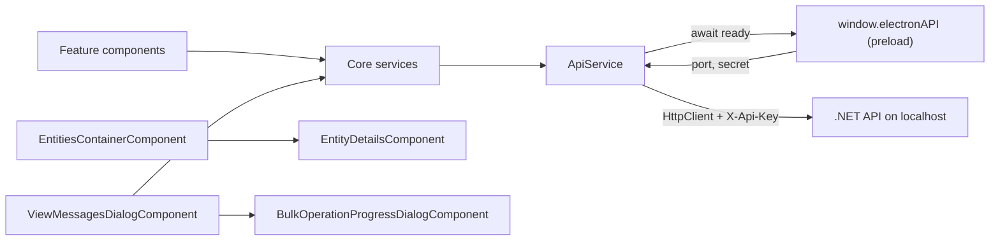

# Web App

> The Angular 21 UI under `web-app/src/`: it renders connections, entities, messages and monitoring, and sends every HTTP call to the local .NET API through `ApiService`.

## To change here, read

- [[pages/invariants/local-authenticated-api]] - the `X-Api-Key` contract `ApiService` must keep honouring.
- [[pages/invariants/secrets-masked-at-the-api-boundary]] - the UI only ever receives masked connection strings and passwords.
- [[pages/invariants/provider-boundaries]] - what may be provider-specific and where.
- [[pages/invariants/bulk-operations-are-at-least-once]] - what cancel and retry mean for the bulk dialogs.
- [[pages/services/electron-shell]] - owns `window.electronAPI`, the only source of the API port and secret.
- [[pages/services/api]] and [[pages/services/core]] - the contract this app mirrors.
- [[pages/conventions/testing]] and [[pages/conventions/tooling]] - how tests and builds are run.

## Responsibility

Owns all presentation and client-side state: connection management, the entity tree, message browsing, send, import, export, diff, bulk dialogs, monitoring charts, templates, theme, filters. Does not own persistence of connections or any broker access; that is the API ([[pages/services/api]]) and the Core library ([[pages/services/core]]). Does not own process management, tray, menu or updates; that is [[pages/services/electron-shell]].

## Stack

| Item | Value | Source |
|---|---|---|
| Angular | `^21.2.8` (core, router, forms, common) | `web-app/package.json:52` |
| Angular Material and CDK | `^21.0.5` | `web-app/package.json:55` |
| ng-bootstrap, bootstrap | `^20.0.0`, `^5.3.7`, with Font Awesome and Material Icons | `web-app/package.json:61` |
| Charts | `apexcharts`, `ng-apexcharts` | `web-app/package.json:64` |
| Export | `exceljs`, loaded with a dynamic `import()` only when XLSX export runs | `web-app/src/app/core/services/message-export.service.ts:139` |
| Electron-only deps | `electron-store`, `electron-updater` (used by the main process, not by `src/`) | `web-app/package.json:67` |
| TypeScript, vitest, jsdom | `~5.9.2`, `^4.0.8`, `^27.1.0` | `web-app/package.json:86` |
| Build | `@angular/build:application`, default configuration `production` | `web-app/angular.json:22` |
| Dev server | `@angular/build:dev-server`, port 4297 | `web-app/angular.json:78` |
| Budgets (production) | initial warn 1.5MB / error 2MB; per component style warn 20kB / error 32kB | `web-app/angular.json:47` |

All components are standalone; there are no NgModules.

## Bootstrap and routing

- `web-app/src/main.ts:5` calls `bootstrapApplication(App, appConfig)`.
- `web-app/src/app/app.config.ts:9` detects Electron by the presence of `window.electronAPI`. Under Electron it uses hash routing so `file://` works (`web-app/src/app/app.config.ts:15`); in a browser it uses path routing. `provideHttpClient()` is registered with no interceptors (`web-app/src/app/app.config.ts:16`).
- Routes are all lazy `loadComponent` (`web-app/src/app/app.routes.ts:3`): `''` redirects to `connections`, then `connections`, `entities`, `queues`, `topics`, `monitoring`.
- `web-app/src/app/app.ts:93` registers the Electron listeners (navigate, change-connection, toggle-dev-mode, update status) only when `isElectron`. It keeps the last five window errors for the bug-report dialog (`web-app/src/app/app.ts:115`).

## How it works

### ApiService (the single HTTP gate)

- A grep of `web-app/src/app` for `HttpClient` finds only `api.service.ts` (plus the provider in `app.config.ts`); every service calls `ApiService.get/post/put/delete` (`web-app/src/app/core/services/api.service.ts:76`). No `fetch`, `XMLHttpRequest` or `EventSource` is used.
- Constructor: only if `window.electronAPI` exists, it builds a `ready` promise that awaits `getApiPort()` and `getApiSecret()` in parallel (`web-app/src/app/core/services/api.service.ts:23`, `web-app/src/app/core/services/api.service.ts:35`).
- Port: a positive number from Electron replaces the base URL with `http://localhost:{port}/api` (`web-app/src/app/core/services/api.service.ts:45`). Otherwise `environment.apiUrl` is used, `http://localhost:5917/api` in both environment files (`web-app/src/environments/environment.ts:3`, `web-app/src/environments/environment.prod.ts:8`).
- Secret: stored in memory, attached as `X-Api-Key` on every verb via `getHeaders()` (`web-app/src/app/core/services/api.service.ts:65`). If the secret call throws it is logged and requests go out without the header (`web-app/src/app/core/services/api.service.ts:59`), so the API answers 401.
- Plain browser (no Electron): `ready` stays null, requests are sent immediately with no `X-Api-Key` (`web-app/src/app/core/services/api.service.ts:72`). The API requires the key on everything except `/health` and answers 401 otherwise (`src/ServiceBusExplorer.Api/Program.cs:198`, `src/ServiceBusExplorer.Api/Program.cs:204`), and refuses to start without `API_SECRET` (`src/ServiceBusExplorer.Api/Program.cs:36`). So a browser tab pointed at a running API cannot call it; see [[pages/invariants/local-authenticated-api]].
- GET requests append a `_t=Date.now()` cache buster (`web-app/src/app/core/services/api.service.ts:78`).
- **Names in a path are encoded once, by one helper.** Every endpoint that carries a value is written as an `apiPath` tagged template (`web-app/src/app/core/services/api-path.ts:7`): each interpolated value, an entity, topic, subscription or session name, a connection or group id, a sequence number or a query value, goes through `encodeURIComponent`, and the literal parts stay as written. A queue named `a/messages` is deleted with `DELETE queues/a%2Fmessages`, never the purge route of `a`; a purge of `orders#1` is `DELETE queues/orders%231/messages`, never a request for `orders`. No other code encodes, so nothing is encoded twice (`50%off` becomes `50%25off`). An `undefined` or `null` value throws instead of writing the text into the URL (`web-app/src/app/core/services/api-path.ts:11`). Endpoints with no value stay plain strings. The API decodes each segment once on its side ([[pages/services/api]]). Pinned by `web-app/src/app/core/services/api-path.spec.ts:4` and the "names in the URL" specs of the queue, topic, session and metrics services (`web-app/src/app/core/services/queue.service.spec.ts:64`, `web-app/src/app/core/services/topic.service.spec.ts:55`, `web-app/src/app/core/services/session.service.spec.ts:130`, `web-app/src/app/core/services/metrics.service.spec.ts:294`).

### Bulk operations

- `BulkOperationsService` is selection state only: two `BehaviorSubject` tab states (active, deadletter) keyed by sequence number (`web-app/src/app/core/services/bulk-operations.service.ts:45`). It does no batching, no progress and no HTTP.
- The operations live in `ViewMessagesDialogComponent`: resubmit (`web-app/src/app/features/messages/view-messages-dialog.component.ts:1285`), delete (`web-app/src/app/features/messages/view-messages-dialog.component.ts:1791`), move (`web-app/src/app/features/messages/view-messages-dialog.component.ts:1991`). Each sends one request carrying all selected sequence numbers (`web-app/src/app/core/services/queue.service.ts:131`, `web-app/src/app/core/services/queue.service.ts:144`, `web-app/src/app/core/services/queue.service.ts:157`). The client does not chunk; batching is the server's job.
- Delete on a whole tab sends `all: true` with an empty list and the server drains (`web-app/src/app/features/messages/view-messages-dialog.component.ts:1787`, `web-app/src/app/core/services/queue.service.ts:144`).
- Progress is not incremental: `updateProgress` is called once, with the final result (`web-app/src/app/features/messages/view-messages-dialog.component.ts:1322`).
- Cancel: the progress dialog emits `cancelRequested$` (`web-app/src/app/shared/components/bulk-operation-progress-dialog/bulk-operation-progress-dialog.component.ts:380`); the parent pipes the in-flight observable through `takeUntil`, which aborts the XHR (`web-app/src/app/features/messages/view-messages-dialog.component.ts:1306`, `web-app/src/app/features/messages/view-messages-dialog.component.ts:1314`). The API passes `HttpContext.RequestAborted` to the provider (`src/ServiceBusExplorer.Api/Controllers/QueuesController.cs:207`).
- After an abort: the success handler is skipped, no results dialog opens, the entity message list and counters are not reloaded, and the progress dialog stays open in a "cancelled" state with a Close button (`web-app/src/app/features/messages/view-messages-dialog.component.ts:1318`, `web-app/src/app/shared/components/bulk-operation-progress-dialog/bulk-operation-progress-dialog.component.ts:124`). The dialog itself warns that messages already processed server-side may have been affected; delivery is at-least-once, see [[pages/invariants/bulk-operations-are-at-least-once]].

### Highlight pipe

`HighlightPipe` escapes every text segment through a detached `div.textContent` then reads `innerHTML` (`web-app/src/app/shared/pipes/highlight.pipe.ts:83`), wraps matches in `<mark>` after escaping (`web-app/src/app/shared/pipes/highlight.pipe.ts:63`) and returns a plain string, not `SafeHtml`, so Angular's own `[innerHTML]` sanitizer still runs (`web-app/src/app/shared/pipes/highlight.pipe.ts:74`). It never calls `bypassSecurityTrustHtml`. Used in three `[innerHTML]` bindings of the messages dialog (`web-app/src/app/features/messages/view-messages-dialog.component.ts:175`, `web-app/src/app/features/messages/view-messages-dialog.component.ts:295`, `web-app/src/app/features/messages/view-messages-dialog.component.ts:336`).

## core/

- `models/`: DTO interfaces mirroring the API (connection, connection-group, message, queue, topic, metrics, monitoring, session, filter, provider, tree-node) and the provider component contract (`web-app/src/app/core/models/provider-component.interface.ts:55`).
- `services/`: `api` and `api-path` (above); `connection`, `connection-group`, `queue`, `topic`, `session`, `monitoring`, `metrics`, `provider` (all thin `ApiService` wrappers); `bulk-operations` (selection); `message-search`, `advanced-message-filter` (client-side filtering, filter presets in localStorage under prefix `advanced-filter-`, `web-app/src/app/core/services/advanced-message-filter.service.ts:19`); `message-export` (CSV/JSON/XLSX), `message-import`; `message-template` (localStorage key `explorer-messages-templates`, `web-app/src/app/core/services/message-template.service.ts:6`); `theme` (key `app-theme`, `web-app/src/app/core/services/theme.service.ts:8`); `dev-settings` (key `dev-mode`); `dead-letter-notification`, `entity-selection`, `tree-data-builder`, `logger` (silent in production builds, `web-app/src/app/core/services/logger.service.ts:12`).

## features/

- `connections/` - connection list, add/edit dialog, client and environment groups, export of connections (`web-app/src/app/features/connections/connections.component.ts:396`).
- `entities/` - the main workspace: tree plus details (`web-app/src/app/features/entities/entities-container.component.ts:14`), metrics dashboard (`web-app/src/app/features/entities/metrics-dashboard.component.ts`, untracked in the working tree, imported at `web-app/src/app/features/entities/entity-details.component.ts:19`), transfer monitor.
- `messages/` - view, send, import, export, move, diff and continuous-resubmit dialogs.
- `queues/`, `topics/` - list pages with per-row purge and actions.
- `monitoring/` - snapshot and history charts (`web-app/src/app/features/monitoring/monitoring.component.ts:540`).

## providers/ and the registry

- `ProviderRegistryService` maps `ProviderType` to an entity-details component class, filled by lazy `import()` of the `azure-service-bus` and `rabbitmq` barrels (`web-app/src/app/providers/provider-registry.service.ts:57`, `web-app/src/app/providers/provider-registry.service.ts:67`).
- `ProviderShellComponent` resolves the class and calls `createComponent` (`web-app/src/app/features/entities/provider-shell.component.ts:173`, `web-app/src/app/features/entities/provider-shell.component.ts:183`).
- But the shell is not used: the `entities` route renders `<app-entity-details>` directly (`web-app/src/app/features/entities/entities-container.component.ts:20`), and a grep of `src/app` finds no `app-provider-shell` outside doc comments. The registry, shell and both provider components are therefore unreachable at runtime; the 3022-line `EntityDetailsComponent` handles both brokers. See [[pages/invariants/provider-boundaries]].
- `kafka/` holds three empty folders (`.gitkeep`) and a barrel containing only a TODO comment (`web-app/src/app/providers/kafka/index.ts:4`). No Kafka component, no `ProviderType.Kafka` in the frontend enum (`web-app/src/app/core/models/provider.model.ts:5`), and none in the backend enum (`src/ServiceBusExplorer.Core/Providers/ProviderType.cs:6`): there is no backend provider.
- `ProviderService` falls back to hard-coded default capabilities when the API call fails and lists only Azure and RabbitMQ (`web-app/src/app/core/services/provider.service.ts:219`).

### docs/ADDING_PROVIDERS.md versus the code

- Step 1 (add enum value): matches the current enum shape (`web-app/src/app/core/models/provider.model.ts:5`) but the backend enum must also change and the guide omits it.
- Step 8 (register in `registerProviders`): matches the registry (`web-app/src/app/providers/provider-registry.service.ts:55`).
- Architecture flow ("ProviderShellComponent receives change ... renders provider UI", `docs/ADDING_PROVIDERS.md:21`): does not match; the shell is never instantiated, so completing steps 1 to 9 would not make a new provider appear.
- Step 9 (`EntityInfo` union): matches (`web-app/src/app/core/models/provider-component.interface.ts:13`).

## shared/

Components: `advanced-filter-panel`, `bulk-actions-toolbar`, `bulk-operation-progress-dialog`, `bulk-operation-results-dialog`, `message-body-editor` (Prism-based, `web-app/src/app/shared/components/message-body-editor/message-body-editor.component.ts:426`). Top level: `confirm-dialog`, `bug-report-dialog`. Pipes: `highlight` only.

## Tests

- 22 `*.spec.ts` files exist under `web-app/src`.
- `npm test` is `ng test` (`web-app/package.json:25`). `angular.json` sets the `@angular/build:unit-test` builder with no `runner` option (`web-app/angular.json:90`); the builder schema defaults `runner` to `vitest`, `runnerConfig` to `false` and `include` to `**/*.spec.ts` (`web-app/node_modules/@angular/build/src/builders/unit-test/schema.json:19`, `web-app/node_modules/@angular/build/src/builders/unit-test/schema.json:25`, `web-app/node_modules/@angular/build/src/builders/unit-test/schema.json:45`). Run on 2026-11-12, after the names-in-URLs fix, `npm test -- --watch=false` executes all 22 files: 540 tests pass and 8 are skipped (three `describe.skip` blocks for the refresh variants in `web-app/src/app/core/services/metrics.service.spec.ts:295`).
- Plain `npx vitest` is not a way to run these tests: without the Angular builder there is no compiler, so components with signal inputs or `templateUrl` fail. A `vitest.config.ts` that listed 11 files for that mode was removed on 2026-11-12; the builder never read it.
- CI: the web job runs `npm ci`, the tests and `npm run build` (`.github/workflows/ci.yml:109`, `.github/workflows/ci.yml:115`, `.github/workflows/ci.yml:121`). No lint step; `web-app/package.json` has no `lint` script. See [[pages/conventions/testing]].

## Hot spots

- `web-app/src/app/features/entities/entity-details.component.ts:3022` - 3760 lines, template inline; handles both brokers, purge, send, metrics.
- `web-app/src/app/features/messages/view-messages-dialog.component.ts:782` - 2320 lines; three near-identical bulk flows (resubmit, delete, move).
- `web-app/src/app/shared/components/message-body-editor/message-body-editor.component.ts:426` - 1239 lines.
- `web-app/src/app/features/connections/connections.component.ts:396` - 881 lines.
- `web-app/src/app/features/connections/add-connection-dialog.component.ts:451` - 800 lines.
- `web-app/src/app/shared/components/advanced-filter-panel/advanced-filter-panel.component.ts:545` - 799 lines.
- `web-app/src/app/features/entities/entities-tree.component.ts:653` - 791 lines.
- `web-app/src/app/features/monitoring/monitoring.component.ts:540` - 785 lines.

## Known gaps

- Provider registry, shell and provider components are not wired into any route: `web-app/src/app/features/entities/entities-container.component.ts:20`.
- `docs/ADDING_PROVIDERS.md:21` describes a flow the code does not run.
- A 3537-line `web-app/src/app/features/entities/entity-details.component.ts.backup` is committed next to the live file.
- No lint or format script exists for the web app, and CI runs none.
- Eight tests are skipped: the refresh variants in `web-app/src/app/core/services/metrics.service.spec.ts:295`, with a TODO about timers under zoneless Angular.
- Bulk progress is a single final update, not per batch: `web-app/src/app/features/messages/view-messages-dialog.component.ts:1322`.
- After a cancel the message list and counters are not refreshed: `web-app/src/app/features/messages/view-messages-dialog.component.ts:1318`.
- If `getApiSecret()` fails the app silently sends unauthenticated requests: `web-app/src/app/core/services/api.service.ts:59`.
- `ProviderShellComponent` silently renders nothing when no component is registered (TODO in code): `web-app/src/app/features/entities/provider-shell.component.ts:176`.
- A name that is exactly `.` or `..` cannot be sent as a path segment: `encodeURIComponent` leaves dots alone and the browser's URL parser resolves `.`, `..` and their `%2E` forms as dot segments. Azure names cannot take that form; RabbitMQ names can, and deleting a subscription named `..` under topic `t` would become `DELETE /api/topics/t/` and delete the topic (read from the URL standard and the route table, not executed). `apiPath` does not refuse such a value today: `web-app/src/app/core/services/api-path.ts:7`.
- Preload exposes `onNewConnection` and nothing consumes or sends it: `web-app/electron/preload.js:20`. `clear-all-data` does have a consumer, through the generic `electron.on` bridge (`web-app/src/app/features/connections/connections.component.ts:439`); the founding survey missed it (corrected 2026-11-12). That listener is added on every visit to the page and never removed.

## Related

[[pages/services/electron-shell]], [[pages/services/api]], [[pages/architecture/project-map]]
