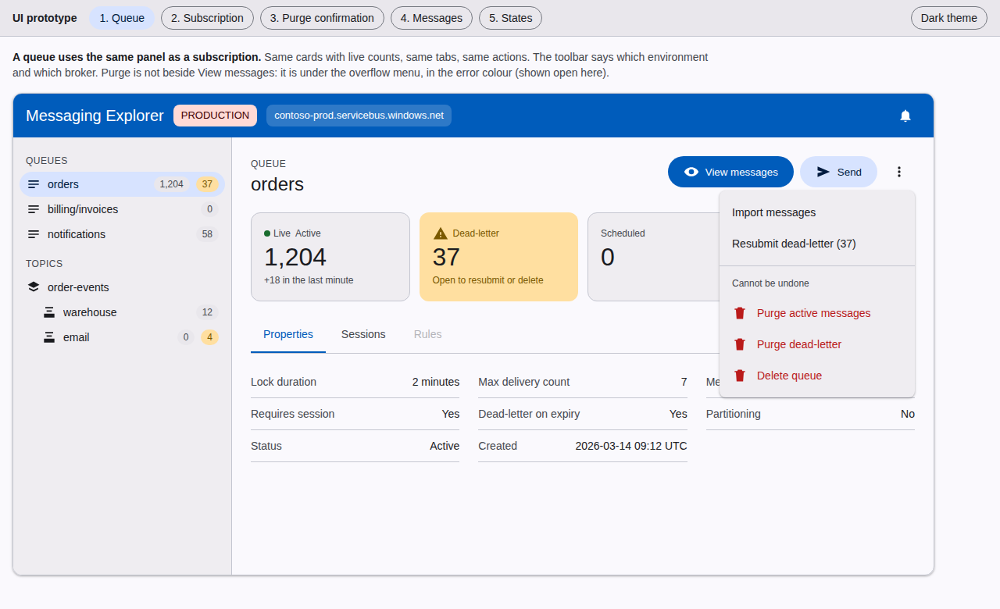
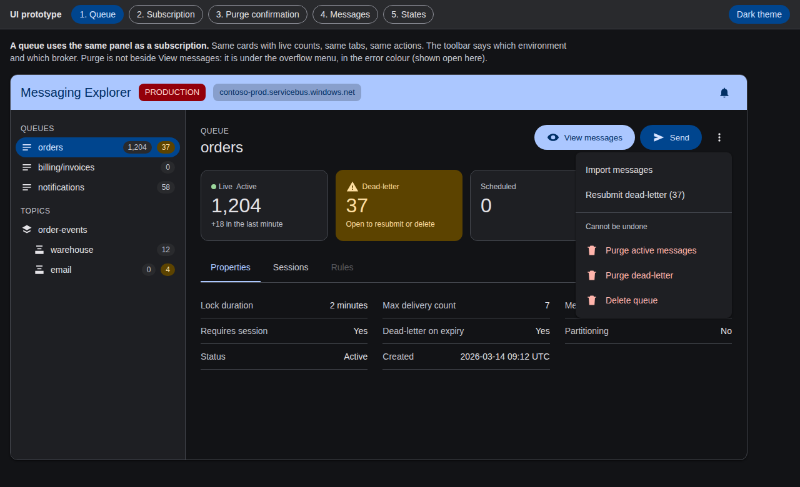
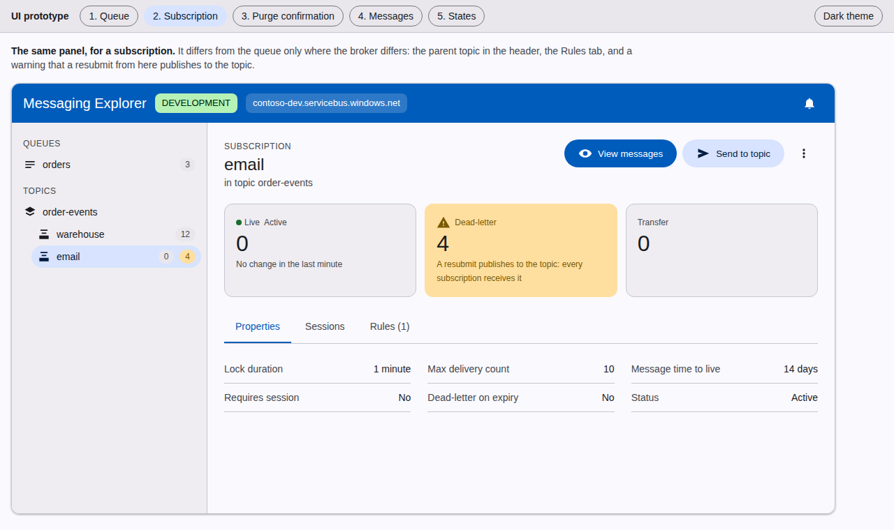
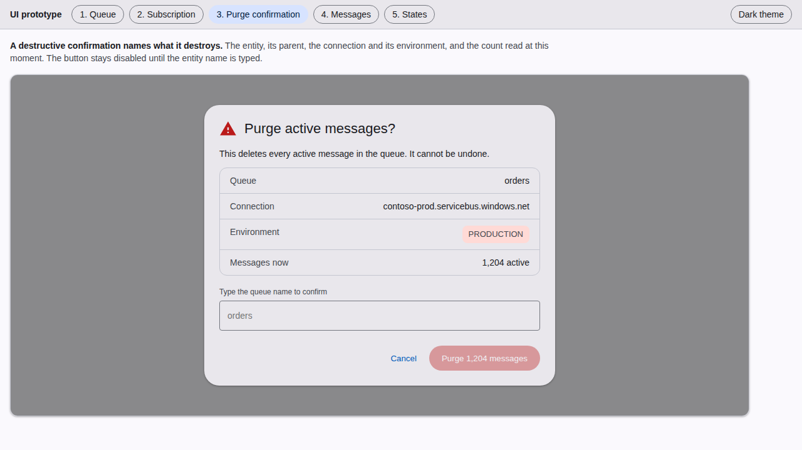
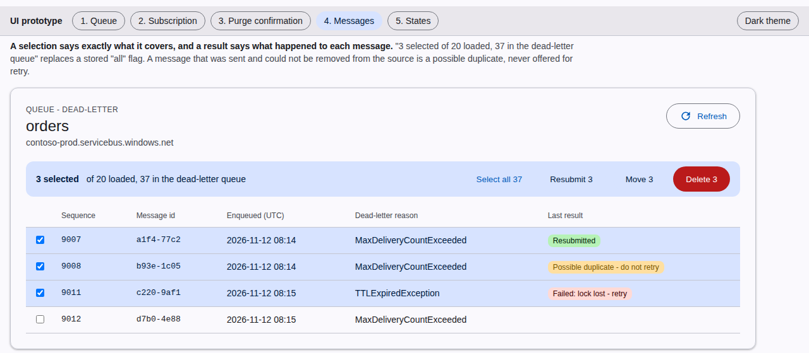
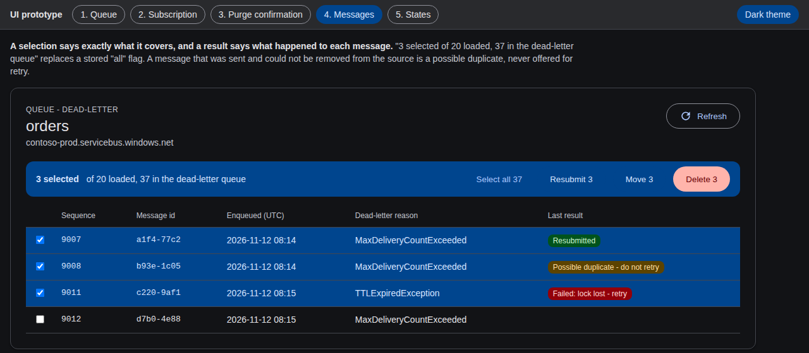
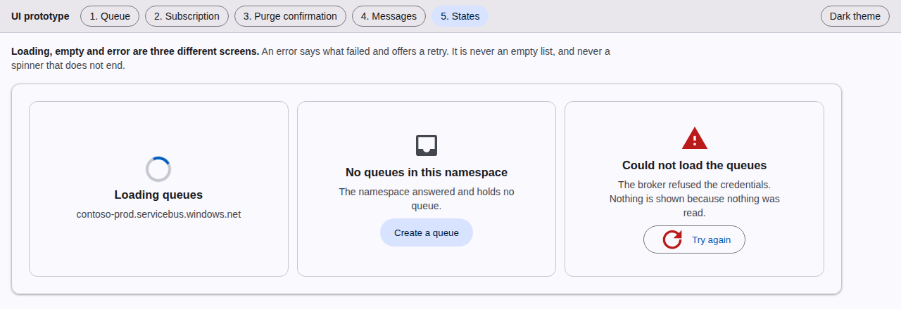

# Web app UI prototype

The target layout of the web app, as five artboards in one self-contained file: [`index.html`](./index.html). Open it in a browser; it needs no server and no network. The buttons at the top switch artboard and theme, and each has an address: `index.html#queue`, `#sub`, `#purge`, `#messages`, `#states`, with `,dark` appended for the dark theme (`index.html#messages,dark`).

It is a drawing of the proposal, not the application: the data is invented and nothing is wired. The rules it illustrates are in [`vault/pages/conventions/ui.md`](../../pages/conventions/ui.md), and the order of work in [`vault/pages/roadmap/ui-material-migration.md`](../../pages/roadmap/ui-material-migration.md).

**The prototype is the spec.** Where the application and an artboard differ, the artboard is what the screen should become; a change to a screen updates its artboard and its screenshot in the same change. To refresh the screenshots, run a headless Chromium on each address with a 1280 px wide window.

## 1. Queue

A queue uses the same panel as a subscription: the same cards with live counts, the same tabs, the same actions. The toolbar says which environment and which broker. Purge and delete are under the overflow menu, in the error colour, never beside View messages.

Dark theme:

## 2. Subscription

The same panel. It differs from the queue only where the broker differs: the parent topic in the header, the Rules tab, and the warning that a resubmit from a subscription publishes to the topic.

## 3. Purge confirmation

A destructive confirmation names what it destroys: the entity, the connection and its environment, and the count read at that moment. The button is disabled until the entity name is typed.

## 4. Messages

A selection says exactly what it covers ("3 selected of 20 loaded, 37 in the dead-letter queue"), and a result says what happened to each message. A message that was sent and could not be removed from its source is a possible duplicate and is never offered for retry.

## 5. States

Loading, empty and error are three different screens. An error says what failed and offers a retry.

